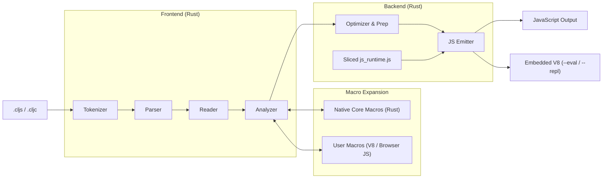

# light-cljs

light-cljs is a Clojure-to-JavaScript compiler written in Rust. It reads
`.cljs`/`.cljc` source, resolves and analyzes it in Rust, and emits self-contained
JavaScript carrying its own persistent-collection runtime. The same compiler
powers a project build tool (`light-cljs.edn` with `compile`, `watch`, `release`,
and `cljs-repl`), a script runner, and a REPL backed by an embedded V8 isolate.
No Node, JVM, or installed `cljs.core` is required to run code.

Try it in the [browser playground](https://isaksky.github.io/light-cljs/playground/)
or visit the [project site](https://isaksky.github.io/light-cljs/).

**Status:** Pre-1.0, under active development. Core language features—special
forms, macros, namespaces, persistent and sorted collections, lazy sequences,
transducers, protocols, types, records, multimethods, atoms, exceptions, and
JavaScript interop—work and are regularly tested against standard ClojureScript.
By design, light-cljs is not a drop-in replacement for shadow-cljs: it omits the
JVM, the Google Closure Library, and npm bundling in favor of a single JS
runtime, lower memory, and faster builds. Still in progress: closing remaining
small-app bundle size and runtime speed gaps against shadow-cljs, bundling
additional pure-Clojure libraries (such as `cljs.pprint`), and
prebuilt releases. See [Known boundaries](#known-boundaries).

## Quick start

### Build

Requires Rust 1.91+, [babashka](https://babashka.org/) (`bb`), Git, and a C/C++
toolchain. The first build downloads the pinned prebuilt V8 engine (x86_64 and
arm64 on macOS, Linux, and Windows). Node.js is only needed to run emitted JS
outside the embedded evaluator and for parts of the test suite.

```sh
cargo build --release
# Optional: install `light-cljs` onto PATH
cargo install --path .
```

*(WebAssembly and `--no-default-features` builds embed no JS engine; macros can
still run through a `host_evaluator::ScriptHost`, as the browser playground does.
Interactive sessions and custom compiler data readers require V8.)*

### Run scripts or a REPL (embedded V8)

```sh
light-cljs --eval --text '(/ 1 2)'
# 0.5

light-cljs --eval --source-root examples/native examples/native/demo.cljs
# Hello from compiled JavaScript
# {:squares [1 4 9 16 25], :sum 15}

light-cljs --repl
```

### Build and watch a project (`light-cljs.edn`)

`light-cljs.edn` defines builds modeled on `shadow-cljs.edn` (`:source-paths`,
`:builds`, `:dev`/`:release` overrides, dev HTTP server, hot reload, and nREPL):

```sh
cd examples/features
light-cljs watch features      # dev build + file watcher + dev server + nREPL
light-cljs cljs-repl features  # attach a REPL to the running watch (another terminal)
light-cljs compile features    # one-shot reloadable dev build
light-cljs release features    # optimized code-split release build (:advanced)
```

### Compile directly to JavaScript

```sh
# Single file -> JS expression evaluating to the last form
light-cljs --compile examples/closure.cljs | node --print 'eval(require("fs").readFileSync(0, "utf8"))'

# Namespace entry -> ES module for a bundler (--esm) or code-split chunks (--out-dir)
light-cljs --compile --optimize advanced --entry app.main \
  --source-root examples/features --out-dir /tmp/light-features
node -e 'import("/tmp/light-features/app.main.js").then(m => m.default())'
```

See [docs/cli.md](docs/cli.md) for the complete CLI reference (source maps,
`--define`, `--elide-asserts`, `--config`, caching, `--stats`, `--jobs`, nREPL,
and `--print-config`).

## Performance vs. shadow-cljs

Measured against **shadow-cljs 3.5.3** (November 24, 2026). Every ratio is
`light-cljs / shadow-cljs`, so **below `1.00` means light-cljs is faster or
smaller**. Both compilers build the same source in release mode (`:advanced`)
unless marked dev. Runs alternated on a busy machine, and the large synthetic
programs are generated by this repository. Full tables, ranges, and commands live
in [benchmarks/shadow-comparison.md](benchmarks/shadow-comparison.md) and
[benchmarks/runtime-vs-shadow.md](benchmarks/runtime-vs-shadow.md).

**Build time (command-line release builds, 3 rounds each):**

| Build | Lines | light-cljs | shadow-cljs | light/shadow |
| --- | --- | --- | --- | --- |
| Clean | 50k | 1.37 s | 18.02 s | **0.08** |
| Nothing changed | 50k | 0.25 s | 13.75 s | **0.02** |
| One file edited | 50k | 0.15 s | 13.52 s | **0.01** |
| Clean | 200k | 5.89 s | 52.73–213.19 s | **0.03–0.11** |
| Nothing changed | 200k | 1.09 s | 36.62 s | **0.03** |
| One file edited | 200k | 2.01 s | 36.47 s | **0.06** |

*(shadow-cljs pays JVM startup on each CLI invocation. Peak clean-build memory
was 0.35 GB vs. 2.36 GB at 50k lines, and 0.91 GB vs. 3.02 GB at 200k lines.)*

**Compiled output speed (10 alternated runs; "parity" = overlapping ranges):**

| Program | Measure | light/shadow |
| --- | --- | --- |
| Generated 200k / 800k lines, Node | steady state | 0.90 / 0.92 (parity) |
| Generated 200k lines, Node | first output | 1.01 (parity) |
| Generated re-frame-shaped 200k lines, Node | steady state | 1.10 |
| re-frame TodoMVC, Chromium | add 1,000 todos | 0.81 |
| re-frame TodoMVC, Chromium | toggle all, edit, clear completed | 1.01–1.02 (parity) |
| re-frame TodoMVC, Chromium | page load to interactive | 1.23 |
| re-frame TodoMVC, dev build, Chromium | add 1,000 todos / toggle all | 1.02 (parity) / 1.23 |
| Generated 200k lines, dev build, Node | steady state / first output | 1.11 / 0.87 |

In the 80-operation micro-benchmark, 76 operations are at or faster than
shadow-cljs (slowest: 1.10).

**Gzipped output size:** `0.96×`, `0.89×`, and `0.86×` of shadow-cljs on the
generated 50k-, 200k-, and 800k-line programs. Small apps are currently larger
(React included): re-frame simple is +22%, TodoMVC is +13%, flow is −3%.

**Where light-cljs still loses:** steady state on the re-frame-shaped benchmark,
TodoMVC page load to interactive, dev-build toggle-all in TodoMVC, and bundle
size on small apps.

## Architecture



| Stage | What it does | Entry points |
| --- | --- | --- |
| **Tokenizer & Parser** | Zero-copy byte-span tokenization into a flat syntax arena ([lexer](docs/lexer.md), [parser](docs/parser.md)). | `src/lib.rs`, `src/parser.rs` |
| **Reader** | Reader conditionals, syntax quote, `#()`, namespaced maps, tagged literals; custom data readers run in a separate V8 isolate. | `src/compiler_reader.rs`, `src/compiler_data.rs` |
| **Analyzer** | Resolves bindings into a `Program` arena, expands binding/destructuring macros in Rust, and tracks core op types, purity, and runtime units. | `src/analyzer.rs`, `src/core_operations.tsv` |
| **Macros** | Hot core macros (`cond`, `when`, `and`, `->`, `case`, `for`, `doseq`, …) expand natively in Rust; `defmacro`s compile through the same pipeline and run in V8 (or the browser host in WASM). | `src/native_core_macros.rs`, `src/macro_host.rs` |
| **Optimizer & Emitter** | Dead-code elimination, type inference, specialization/inlining, code splitting, and JS emission with only the reachable slice of `js_runtime.js`. | `src/application.rs`, `src/emitter.rs`, `src/js_runtime.js` |
| **Evaluation** | Incremental compilation and execution in a persistent embedded V8 isolate for `--eval` and `--repl`. | `src/eval_session.rs`, `src/v8_session.rs` |

## Known boundaries

- **Numbers** are JavaScript Numbers everywhere, including during macro expansion. `N`/`M` literals and integral ratios (`4/2`) become Numbers (large integers round); non-integral ratios (`1/3`) are rejected.
- **Bundled libraries:** only `cljs.core` (supported subset), `clojure.string`, `clojure.set`, `clojure.walk`, `clojure.template`, `clojure.edn`, `cljs.reader`, `cljs.test` (also required as `clojure.test`), and `light.lazy` are bundled. There is no Google Closure Library (`goog.*`), `cljs.pprint`, `core.async`, or `test.check`. A custom `cljs.test/assert-expr` method runs while `is` expands, so it must be a top-level `defmethod` analyzed before the `is` calls that use it, in a required namespace or earlier in the same one (see [docs/compiler.md](docs/compiler.md#compiler-owned-standard-libraries-and-stream-reading)). Other namespaces are supplied as source via `--source-root` / `:source-paths`.
- **No npm resolution:** light-cljs never reads `node_modules` or `package.json` and does no CommonJS conversion. String libspecs like `["react" :as r]` read `globalThis.lightCljsPackages["react"]`, or become static ES `import`s with `--esm` / `--out-dir` for an external bundler (Vite, esbuild, Rollup).
- **Macros** must be in `.cljs`/`.cljc` files (`.clj` companions are never loaded) and run in JavaScript.
- **Release optimizer (`--optimize advanced`)** is still being built ([docs/advanced-optimization.md](docs/advanced-optimization.md)). Typical sizes today: `(js/console.log (+ 1 2))` is ~150 B, a small record/protocol program ~6 KB, printing pulls in the printer (~21 KB), and generic sequence operations ~30–50 KB.
- **Collection performance:** vectors, hash maps, hash sets, and transients use persistent 32-way / HAMT tries matching upstream asymptotic complexity (except `rseq` on vectors copies); some lazy-seq and seq-probing paths are still slower than upstream (~1.8× on `map`/`filter`/`partition` pipelines in Node). See [benchmarks/compiler.md](benchmarks/compiler.md).
- **Embedded V8 environment:** `--eval`, `--repl`, and macro isolates provide ECMAScript intrinsics only—no DOM, Node APIs, filesystem, network, or timers unless supplied by the host (`NamePolicy` restricts resolution, not sandboxing). In `--eval`/`--repl`, promise microtasks drain after each top-level form rather than at end of file; compiled output uses the host event loop (`^:async`/`await` supported).

Deliberate behavioral differences from upstream ClojureScript are documented in [docs/compiler.md](docs/compiler.md).

## Browser playground

[playground/](playground/) compiles light-cljs to `wasm32-unknown-unknown` and
runs both macros and compiled output in the browser's JS engine inside a worker
([live demo](https://isaksky.github.io/light-cljs/playground/),
[playground/README.md](playground/README.md)). Build and serve the site locally
with `bb site/build.bb build` and `bb site/build.bb serve`.

## Examples

| Path | Shows |
| --- | --- |
| [examples/closure.cljs](examples/closure.cljs) | Single-file compilation |
| [examples/namespaces](examples/namespaces) | Multi-namespace entry compilation (`--entry demo.main`) |
| [examples/macros](examples/macros) | `.cljs` macro namespace required alongside runtime code |
| [examples/collections](examples/collections) | Multi-namespace collection processing |
| [examples/features](examples/features) | `light-cljs.edn` project with code splitting (`light.lazy/loadable`) |
| [examples/dev](examples/dev) | Dev workflow: `defonce`, macros, records, and reload hooks |
| [examples/native](examples/native) | Standalone scripts for `--eval` |
| [examples/embedding.rs](examples/embedding.rs), [examples/evaluator.rs](examples/evaluator.rs) | Rust embedding API |

## Testing

The test suite requires Node.js and the pinned upstream checkout in
`research/clojurescript` ([tests/reference/README.md](tests/reference/README.md)).

```sh
cargo nextest run                          # recommended (~1.5 min on 24 vCPUs)
cargo test                                 # plain cargo test (~4 min)
cargo clippy --all-targets -- -D warnings
node tests/support/js_runtime.test.js
```

See [docs/testing.md](docs/testing.md) for test binaries, ratchets, phase
oracles, reference ClojureScript comparisons, and benchmarks.

## Documentation

- **Using light-cljs**
  - [docs/cli.md](docs/cli.md) — full CLI reference, flags, caching, `--stats`, and `--jobs`
  - [docs/build-configuration.md](docs/build-configuration.md) — `light-cljs.edn` schema and `compile`/`watch`/`release`/`cljs-repl`
  - [docs/dev-workflow.md](docs/dev-workflow.md) — reloadable builds, watch server, overlays, and nREPL
  - [docs/code-splitting.md](docs/code-splitting.md) — `light.lazy/loadable` and chunked ES module builds
  - [docs/evaluation.md](docs/evaluation.md) — `EvalSession` Rust embedding API, `--eval`, and `--repl`
- **Compiler internals**
  - [docs/compiler.md](docs/compiler.md) — pipeline, supported forms, runtime semantics, macros, interop, and differences
  - [docs/advanced-optimization.md](docs/advanced-optimization.md) — `--optimize advanced` passes and design
  - [docs/compiler-cache.md](docs/compiler-cache.md) — persistent cache keys, contract, and invalidation
  - [docs/compiler-concurrency.md](docs/compiler-concurrency.md) — `--jobs` scheduler and isolate memory budgets
  - [docs/evaluator.md](docs/evaluator.md) — V8 evaluator, compile-time phase contract, and form bridge
  - [docs/browser-macros.md](docs/browser-macros.md) — browser macro host for the WebAssembly build
  - [docs/lexer.md](docs/lexer.md) & [docs/parser.md](docs/parser.md) — syntax layers
- **Contributing & performance**
  - [docs/testing.md](docs/testing.md) — test suites, ratchets, CI, and benchmarks
  - [docs/dos-and-donts.md](docs/dos-and-donts.md) — compiler performance guidelines

## Acknowledgements

light-cljs stands on the work of the Clojure community:

- [Rich Hickey](https://github.com/richhickey) for Clojure and ClojureScript,
  whose language design, core library, and test suite this compiler follows and
  is checked against.
- [David Nolen](https://github.com/swannodette) for leading ClojureScript; its
  analyzer and compiler shaped how this project resolves and emits code.
- [Thomas Heller](https://github.com/thheller) for shadow-cljs, which served as
  the reference for the npm dependency and build model.
- [Michiel Borkent](https://github.com/borkdude) for SCI and babashka; SCI's
  test suite provides the evaluator conformance fixtures, and babashka runs the
  scripts in this repository.

## License

light-cljs is released under the [MIT License](LICENSE). Files adapted from
ClojureScript and SCI stay under the Eclipse Public License 1.0, keep their
upstream copyright notices, and are listed in
[THIRD_PARTY_NOTICES.md](THIRD_PARTY_NOTICES.md); the EPL text is in
[epl-v10.html](epl-v10.html). Compiled programs that use `clojure.string` or
`clojure.set` embed JavaScript compiled from those EPL-1.0 files. The embedded
`rusty_v8` bindings are MIT-licensed. V8 carries its BSD license and upstream
dependency notices listed in the third-party notices.
