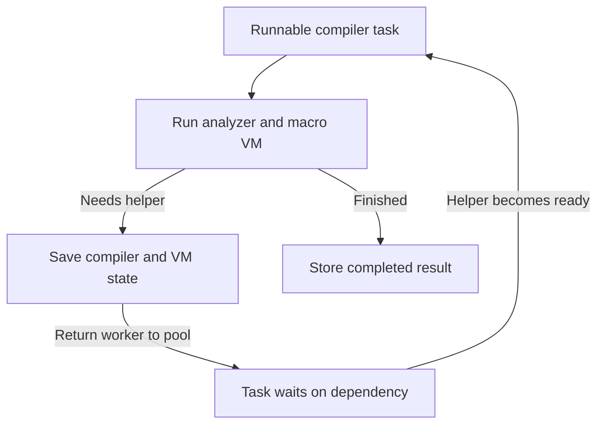

# Compiler Performance Review

A ChatGPT conversation (gpt-6-pro, 2026-10-29), saved from the share link https://chatgpt.com/share/6ae3e3bc-6f34-83e8-89c6-a208bc37a211 so it stays with the repository.

The question was pasted from a terminal and arrived partly garbled (the model notes this too), so it is kept verbatim below.

## Question

```text
For my clojure->js compiler project I'm using a new project especially created for it called big-boy-pants-js which is inspired by quickjs, except ported to rust, and then has special features to enable threading. But in the overall compilation speed we are still not competative. Here is a description of how it works today. See if you can identify some things that are 1) clearly idiotic, or 2) promising research directions:

Here it is, condensed. I didn't edit, build or commit anything; line references are to the current master.

1. How the Pants build splits work at N threads (checked in the code)

- Two kinds of work.
  - Each namespace gets a top-level walk: its forms are read in order, macros written at top level are expanded (for example one that expands to defrecord), and the names it defines are recorded.
  - Each def/defn body is then compiled separately, later.
- Who does what.
  - One coordinator thread does every namespace's top-level walk, one after another.
  - N-1 worker threads compile the bodies.
  - One more thread only hands batches of bodies to the workers (src/scheduler.rs:16-19,
    src/compilation_session.rs:3561-3565, :3797-3808).
  - In the Pants build every worker can run macros (src/compiler.rs:2811-2815).
- Handing off bodies. After walking namespace A, the coordinator gives A's bodies to the  (src/analyzer.rs:8074-8118). It collects A's finished bodies in source order only after walking 6 more
  namespaces (DRAIN_LAG = 6, src/analyzer.rs:4278). If they aren't finished by then, it stops and waits.
  I'll call that moment the collection point.                                                              
- What's shared. There is one engine heap. Compiled macro code and helpers (ordinary functions that macros
  call while compiling) are set up once and used by every thread. The 200k project sets up 57 helpers at
  every thread count.
- When a helper isn't ready. Say a body on worker 2 uses macro M, and M calls helper h from namespace B,
  which another thread is still compiling. M's JavaScript stops at that point, and once h exists the rest
  of M can continue on any worker (src/bbp_evaluator.rs:1694-1796).
- Never built. Running top-level walks in parallel is pellet 475, which is parked as mayb
2. Where threads wait or take turns
                                                                                                            design:                                                                                                  One coordinator. All top-level walks run one after another. In the 200k project, the macros that definefunctions, records and protocols are top-level macros, and all 57 helpers are set up on the coordinator.
- The coordinator idles at collection points. It waits for bodies in source order and does no other work   meanwhile (help: None, src/compilation_session.rs:2676). It never compiles a body it already handed to the workers (:955-960).
- Atom effects stay in source order. When macro code touches an atom that other work created, it waits   until all earlier work in source order has finished, so every N behaves like 1 thread                   (docs/compiler-concurrency.md:3129-3225). How often this happened on 200k wasn't recorded.

By implementation:
- A waiting worker isn't really freed. Its Rust compiling work stays on the thread. It can help only with
  bodies that use no macros, or with resumed macro steps. Otherwise it sleeps in 20 ms timeouts
  (src/bbp_evaluator.rs:1828-1890, src/compilation_session.rs:3512-3521). The summary at the top of
  docs/shared-heap-compilation.md says waiting "frees its worker", so the doc overstates what the code    does.
- One lock for every form conversion. Converting each macro call's form and &env into engine values, and converting the expansion back, holds one build-wide lock the whole time (Mutex<Bridge>,                src/bbp_evaluator.rs:759, :2381, :2804-2814). Macro calls on different threads take turns there.
- Other shared locks:                                                           
├─────────┼─────────────┼──────────┤
│       2 │      22.2 s │    6.0 s │
├─────────┼─────────────┼──────────┤
│       4 │      17.7 s │    5.1 s │
├─────────┼─────────────┼──────────┤
│       8 │      19.3 s │    5.2 s │
└─────────┴─────────────┴──────────┘

- Cores busy. At 4 threads the build used 24.0 s of CPU in 17.9 s, about 1.3 cores. At 1 thread it used 32.6 s of CPU.
- The 8-thread stack sample counted 13,296 sleeps on a condition variable, 1,137 waits for a lock and 365 samples in the interpreter. It doesn't say what each sleeping thread was waiting for.

4. Known versus unknown

- Known:
  - Top-level walks run one at a time.
  - The coordinator idles at collection points.
  - Form conversion and garbage collection make threads take turns.
  - The V8 build also scales weakly, so part of the limit is how the compiler divides the work, not the engine.
- Inferred, not measured:
  - The coordinator probably sets the wall time. A simple model fits 1 and 2 threads with about 11 s of coordinator-only work, but it predicts about 11 s at 4 threads, against 17.7 s measured. About 6 s is unexplained.
  - The stack sample can't tell idle workers with nothing queued apart from workers waiting on a dependency or a collection.
  - Total CPU dropped from 32.6 s at 1 thread to 24.0 s at 4, which nothing explains yet.
- Unknown:
  - the longest chain of work that must run in order;
  - how much time is top-level walks versus bodies;
  - how long the coordinator waits at collection points;
  - how much time form conversion and its lock take;
  - garbage-collection pauses at each thread count;
  - how often atom effects had to wait for source order.

Pellet 573 is queued to measure exactly this: a timeline per thread at 1, 2, 4 and 8 threads, with each wait labelled by what it waits for, the longest chain, and one follow-up pellet per cause that costs 10% or more of lost thread time. I'd suggest adding to it whether workers sat idle because the coordinator had nothing to hand them, and how long the form-conversion lock is held. Tell me if you want that filed or amended.
```

## Progress notes while it worked

> I’ll separate concrete problems in this design from ideas that need measurement, and check relevant compiler and runtime research. I’ll pay particular attention to whether the threading model is putting genuinely independent work on the critical path.

> Two problems stand out already: the six-namespace collection rule can force waits that the dependency graph doesn’t require, and a movable JavaScript continuation does not free a worker if its Rust compiler stack stays blocked. There’s also an important measurement distinction: unused cores tell you where to investigate, but the next fix should be chosen by how much it can shorten the build.

> The macro-to-engine boundary looks like a particularly promising research direction. Since you control both sides, you may be able to pass immutable form handles and environment snapshots instead of repeatedly rebuilding whole trees. That could improve single-thread speed as well as scaling. I would be more cautious with atom ordering: some of those waits preserve observable macro behavior, though waiting for an earlier body’s entire compilation may be excessive.

> I would change pellet 573’s ranking rule: “10% of lost thread time” can count the same upstream blockage once for every waiting worker. It should also estimate recoverable build time and identify the task causing each wait. The most useful early experiments look small: vary the drain window, give blocked tasks’ helper producers priority, and measure body throughput with prerequisites already prepared.

## Answer

Yes. **There are three clear architectural problems here, and several promising directions beyond them.** My strongest suspicion is that you have built more concurrency into the JavaScript runtime than the surrounding compiler can effectively use.

The clearest problems are:

1. **The coordinator stops at an arbitrary collection boundary while useful work may remain.**
2. **A suspended macro still occupies a worker through its enclosing Rust compiler stack.**
3. **Every macro invocation crosses a globally serialized conversion boundary.**

The biggest research opportunity is more specific to your project: **because you control both the compiler and the runtime, you can potentially eliminate most form conversion altogether.** That could improve absolute compilation speed even when dependencies limit parallelism.

I’m treating your description as accurate; this is an architectural review of the supplied audit, not an independent inspection of those source lines. The pasted timing table also lost its headers and first row, so I won’t infer what the unexplained timing column represents.

### 1. Things I would classify as clear architectural problems

#### A. The fixed six-namespace collection rule

`DRAIN_LAG = 6` is the first thing I would investigate with a small experiment.

There are legitimate reasons to wait:

- A macro needs a helper that has not been compiled.
- A later operation must observe an earlier operation’s effects.
- The compiler has reached a deliberate memory limit.
- A phase needs information produced by an earlier phase.

**“We have walked six more namespaces” does not itself establish any of those conditions.**

It is a scheduling heuristic that can create a dependency the program does not have. It also treats six tiny namespaces and six enormous namespaces as equivalent.

The important separation is between:

| Event | Ordering requirement |
|---|---|
| A body finishes compiling | Can ordinarily happen in any order |
| A result becomes available to a dependent task | Must respect the actual dependency and visibility rules |
| Observable compile-time effects become visible | Must preserve the compiler’s semantic contract |
| Generated JavaScript and diagnostics are assembled | Can often be buffered and presented in deterministic order |

Your current collection process appears to combine some of these.

A better arrangement is to accept completed bodies immediately, store them by stable source ID, and enforce ordering at the particular point that needs it. If the window bounds memory, replace it with a budget based on outstanding work or retained bytes. If it enforces compiler-state visibility, represent that dependency explicitly.

**First experiment:** vary the lookahead substantially, including a large value on a bounded workload, while preserving the existing semantic publication rules. Measure wall time, ready-work supply, and peak memory.

A material improvement would identify an artificial barrier without requiring a scheduler rewrite.

There is also a possible liveness trap: the coordinator could wait for a body whose helper will only be discovered by a later top-level walk. Your dependency ordering may already prevent this. If so, that invariant matters much more than the number six.

##### The coordinator’s inactivity compounds this

At a collection point, you have deliberately taken one execution resource out of circulation.

At two configured threads, that potentially leaves just one worker doing useful work. At the end of the build, when no more top-level walks remain, keeping the coordinator unable to help is especially hard to justify.

Allowing it to help can be a useful incremental fix, provided it executes work that can safely make progress. Letting it enter another blocking macro compilation could simply move the problem.

Also investigate **when bodies become eligible for submission**. If an entire large namespace must finish its top-level walk before any body is handed off, that creates another avoidable startup delay. Enqueue each definition as soon as its required scope snapshot and metadata are stable, where semantics permit.

#### B. Suspending JavaScript without suspending the compiler task

This is the most serious mismatch in the design.

You have paid for movable JavaScript continuations, but the Rust call stack that invoked the macro remains attached to a worker. That worker then has restricted options for useful work.

Consequently, the runtime can say, “this JavaScript execution is suspended,” while the scheduler still has fewer workers available.

**The unit that needs to suspend is the whole compiler operation.**

Conceptually, a compilation step should return something like:

- `Complete(result)`
- `Runnable(saved_state)`
- `Blocked(dependency, saved_state)`

The saved state must include whatever is needed to resume the analyzer as well as the VM.



This does not necessarily require making every compiler function asynchronous. You could introduce explicit suspension boundaries around operations that can actually wait. Stackful fibers are another possibility, but they bring ownership, stack, GC-root, and migration complications.

The key requirement is that **a waiting task consumes retained state, rather than monopolizing an execution slot**.

Your current helping restriction also creates a specific potential starvation scenario:

1. Every worker is waiting for a helper.
2. The helper-producing tasks are queued.
3. Those tasks themselves contain macros.
4. The helping loop refuses to start them.

The source dependency graph could be perfectly acyclic, yet the implementation has no worker available to execute a ready prerequisite. I am not saying this happens today; I would create one focused fixture to determine whether the scheduler guarantees progress in this situation.

Simply choosing a work-stealing library does not settle this. Rayon’s own documentation warns that tasks blocking on other tasks can cause poor performance or deadlock; the dependency-waiting behavior still needs to be designed explicitly. ([docs.rs](https://docs.rs/rayon/latest/rayon/fn.join.html))

#### C. One global bridge mutex around complete conversions

This is a definite serialization point. Its wall-time importance remains unmeasured.

Every macro invocation apparently performs some combination of:

1. Traversing the input form.
2. Creating engine values.
3. Constructing `&env`.
4. Executing the macro.
5. Traversing and converting the expansion back.

If steps 1–3 and 5 require the same build-wide mutex, your parallel macro engine has a serial service that every invocation must pass through.

There are two separate costs:

- **Waiting for another conversion.**
- **Doing the conversion itself.**

Both matter. If most macro work currently runs on the coordinator, the mutex might show little contention simply because the compiler already serialized the callers. Conversion can still dominate the coordinator’s active time.

The first implementation question is: **what does `Bridge` actually need to protect?**

Conversion scratch maps, interning, heap allocation, GC roots, and publication of shared values have different ownership requirements. Some could be local to the task; others may need brief synchronized operations.

Giving every worker its own `Bridge` only helps if the underlying state can safely be separated. Otherwise you move contention to an allocator or root-table lock, or introduce a correctness bug.

I would start by separating local conversion bookkeeping from shared publication. But the more interesting opportunity is eliminating much of this work.

### 2. The strongest research direction: native immutable compiler values

**This is where a custom compiler/runtime pairing could earn its keep.**

Suppose the Rust compiler already has an immutable representation of this:

```clojure
(defn example [x]
  ...a large body...)
```

A macro may mostly rearrange a few nodes around that body. If the bridge recursively converts the entire body into engine objects and then recursively converts it back, you pay for processing a large unchanged subtree twice.

Now repeat that through nested expansions.

The alternative is to make compiler values directly usable by macro code:

- A VM value can hold a native `FormRef` or `CompilerValue`.
- Lists, vectors, maps, symbols, keywords, and metadata have native persistent representations.
- The collection operations emitted by your compiler operate on those representations.
- A macro returns an expansion that shares unchanged subtrees with its input.
- The analyzer consumes that expansion directly.

**JavaScript can remain the language that executes macro code.** This changes the representation of the data that code manipulates; it does not require bringing back a separate Clojure interpreter.

QuickJS itself has mechanisms for attaching native payloads to objects and integrating their references with GC. That establishes an embedding mechanism, although it says nothing about the performance or thread safety of your proposed implementation. Your controlled runtime could provide more direct operations than generic wrappers. ([bellard.org](https://bellard.org/quickjs/quickjs.html))

Two implementation traps deserve attention:

**An opaque wrapper that materializes the whole tree on first use preserves much of the cost.** The important part is that collection operations work on the native representation.

**An expensive host callback for every tiny operation can substitute call overhead for copying.** Since you control generated code and VM behavior, common operations could use efficient native runtime functions or dedicated instructions.

#### Treat `&env` as part of this design

An immutable environment snapshot can be shared across an expansion and extended structurally as scope changes.

If you currently rebuild a large environment map for every invocation, that is another candidate for substantial unnecessary work. A lazy representation may help, provided it still behaves like the expected map, including enumeration and compiler metadata.

The exact schema depends on your compatibility contract. Clojure explicitly exposes the invoked form through `&form` and local-binding compiler information through `&env`, so this boundary is observable to macros. ([clojure.org](https://clojure.org/reference/macros))

#### Measure repeated traversal, not just time per conversion

I would add these counters:

- Total form nodes visited during conversions.
- Distinct form nodes involved.
- Total `&env` entries converted.
- Allocated bytes per macro invocation.
- Fraction of an expansion structurally shared with its input.
- Conversion counts grouped by macro and source location.

There is a possible algorithmic problem here. If successive nested expansions copy subtrees of sizes $n, n-1, n-2,\ldots$, the conversion work can become quadratic. That is a hypothesis to test, not something your audit establishes.

**First prototype:** support direct native form access for one frequently used macro, then compare allocations, conversion volume, and complete-build time. That is a much more informative investment than immediately rewriting the entire value system.

### 3. Parallel top-level walks deserve serious attention

The report contains a particularly revealing detail:

> The macros that define functions, records and protocols are top-level macros.

If that is where most macro execution occurs, **the benchmark may barely exercise concurrent macro execution at all**, because all of that work remains on the coordinator.

“All workers can run macros” is a capability. You need to measure how much macro work actually reaches them.

Add a split of macro invocation counts and VM CPU time between:

- Top-level walks.
- Worker body compilation.
- Helper preparation.

If the first category dominates, parallel top-level work deserves a higher priority than “maybe someday.”

#### Start with independent namespaces

I would begin with this model:

- Forms within a namespace retain their required order.
- Independent namespaces can advance concurrently.
- Actual macro/helper dependencies connect the namespaces.
- Namespace and compiler environments have explicit snapshots or visibility rules.
- Observable shared effects retain their required order.

This is a narrower problem than running arbitrary top-level forms concurrently.

A useful first fixture would contain two independent namespace branches, each using the real macro machinery. If they still serialize, the trace can identify which shared implementation structure couples them.

There is a semantic qualification: declared namespace dependencies may not describe everything a macro can inspect or mutate. A macro can interact with compiler state outside its immediate inputs. Unknown effectful behavior needs conservative treatment.

#### Make helper availability an explicit scheduling priority

A helper that unlocks ten macro expansions is often more valuable than an unrelated function body.

When a task blocks on helper `h`, the scheduler should know:

- Which task produces `h`.
- Whether that producer is discovered, queued, running, or blocked.
- What prevents it from making progress.

A relatively simple policy is **priority donation**: the blocked task raises the priority of its prerequisite’s producer. This is worth trying before building an elaborate critical-path scheduler.

Also distinguish:

- Knowing that a definition exists.
- Having executable helper code.
- Executing an initializer.
- Publishing a binding or other observable effect.

Those events need not all have the same prerequisites. Preparing executable code earlier can be safe even when executing its initializer early would change behavior.

A query-style interface is a useful research model here: “give me executable helper H under environment version V” either returns a result or identifies the computation that will produce it. Rust’s query model is a concrete reference for immutable inputs/results, explicit dependencies, and memoization. Its purity requirements also explain why arbitrary effectful macros cannot simply be treated as cached queries. ([rustc-dev-guide.rust-lang.org](https://rustc-dev-guide.rust-lang.org/queries/query-evaluation-model-in-detail.html))

### 4. Atom ordering: legitimate constraint, potentially excessive barrier

I would be careful about classifying source-order atom behavior as foolish.

Consider this illustrative macro:

```clojure
(def counter (atom 0))

(defmacro ticket []
  (swap! counter inc))

(def a (ticket))
(def b (ticket))
```

Under sequential expansion, `a` receives one value and `b` receives the next. Concurrent atomic increments can be completely race-free while assigning those values to the opposite definitions.

Clojure’s atom implementation provides atomic updates and retries through compare-and-set. That does not establish source order among callers. ([clojure.org](https://clojure.org/reference/atoms))

Buffering the generated JavaScript and emitting it in source order will not repair constants that were already computed using a different effect order. Likewise, committing writes in order is insufficient if earlier reads or `swap!` return values affected the expansion.

However, **“wait for every earlier body to finish compiling” can be much stronger than necessary.**

#### A promising refinement: publish when effects are finished

Suppose an earlier body has completed all macro expansion and observable compile-time activity, but still has substantial pure lowering, optimization, or emission remaining.

A later macro may only need to wait for the earlier body’s effects to finish.

That suggests an explicit `effects_complete` state. Ordered effect processing could advance while pure compilation continues.

The proof obligation is precise: after publishing that state, the body must never perform another relevant effect. If later analysis can invoke additional macros, the boundary must account for that.

This could be a relatively contained optimization compared with speculative macro execution.

#### Find out which atoms cause the waits

The distinction between these cases matters:

- A user macro maintains a registry whose contents affect later expansions.
- A compiler-owned atom implements an internal memoization cache.
- An atom is private to a task.
- A shared atom’s value is stable for the relevant compilation interval.

Your description already suggests that task-created atoms receive special treatment. The next opportunity is identifying which shared state truly requires ordering.

Compiler-owned bookkeeping may admit a more concurrent representation. Arbitrary user-visible state needs its existing semantics preserved.

Speculation with tracked reads, buffered writes, validation, and retry is a genuine research direction, but I would put it behind the simpler work. Watchers, I/O, exceptions, mutable captures, and other observations make it a substantial project.

One related requirement: a migrating macro continuation must retain its logical dynamic bindings. Clojure documents binding conveyance across asynchronous work; your runtime needs an equivalent rule appropriate to its compatibility contract. ([clojure.org](https://clojure.org/reference/vars))

### 5. Reduce total work as aggressively as you improve scheduling

Poor scaling and poor absolute speed are separate problems.

A compiler can scale beautifully and still lose because it performs too much work. Conversely, removing unnecessary conversion can improve wall time without changing the average number of busy cores very much.

Besides form conversion, I would investigate:

- Whether discovery and body compilation expand any of the same macros twice.
- Whether expanded forms are repeatedly cloned or traversed.
- Whether helpers are repeatedly translated through Clojure → JavaScript → VM bytecode.
- Whether generated record/protocol code is constructed, analyzed, and then substantially discarded.
- Whether large environment maps or symbol tables are copied at definition boundaries.
- Whether bootstrap work repeats across builds despite unchanged inputs.

These are questions, not allegations about the implementation.

One useful compiler reference is esbuild’s architectural emphasis on avoiding representation conversions and combining compatible traversals. Its macro semantics are very different from yours, but reducing repeated movement through intermediate representations transfers directly. ([github.com](https://github.com/evanw/esbuild/blob/main/docs/architecture.md))

#### The 57 helpers are not inherently a problem

Setting them up once and sharing them is reasonable. Their count does not tell you whether setup costs 10 milliseconds or several seconds.

Measure preparation time, initialization time, and dependencies.

If unchanged bootstrap code costs substantial time on every invocation, cached bytecode or a prepared immutable startup image could help. V8’s startup snapshots provide a concrete example of avoiding repeated initialization by restoring prepared state. For Pants, mutable state would need fresh initialization or an explicitly valid restoration rule. ([v8.dev](https://v8.dev/blog/custom-startup-snapshots))

For repeated development builds, dependency-aware reuse can also be valuable. But report that separately from clean-build performance; otherwise caching can obscure the cost you are trying to improve.

### 6. Shared heap and GC: investigate the cost before choosing a replacement

A shared heap is a reasonable design choice. So is sharing immutable code and helpers.

The promising memory architecture is some combination of:

- Shared immutable code, forms, and environment snapshots.
- Local temporary allocation.
- Explicit publication of values that escape.
- Clearly defined roots and lifetimes for suspended tasks.

A single logical shared heap can still have local allocation buffers.

Be careful with “per-worker” storage when tasks migrate. A continuation must retain access to its values and roots after moving. Task ownership and worker ownership are different things.

For GC, distinguish:

1. Allocation cost.
2. Actual collection CPU time.
3. Global pause time.
4. Time waiting for threads to reach GC-safe points.
5. Objects created primarily by form conversion.

If conversion generates most temporary garbage, reducing conversion may improve GC behavior without a collector redesign.

For relevant research, the Multicore OCaml work is particularly useful. Its authors compared concurrent and stop-the-world parallel minor collectors and found the parallel stop-the-world design faster in almost all evaluated circumstances. That result is specific to their runtime, but it demonstrates why the collector’s label alone is a poor guide to performance. ([kcsrk.info](https://kcsrk.info/papers/retro-parallel_icfp_20.pdf))

### 7. What your existing measurements actually establish

#### Four configured threads are averaging about 1.34 occupied cores

From your reported figures:

$$
24.0\text{ CPU seconds}/17.9\text{ elapsed seconds}\approx1.34
$$

Assuming the CPU measurement includes all relevant threads, that is strong evidence of limited aggregate execution.

It does **not** establish that the coordinator is busy throughout. The coordinator could itself be waiting at drains, behind the bridge mutex, or on a dependency.

#### The “11 seconds of coordinator work” fit is weak evidence

There are two problems with treating that estimate as a measured serial component.

First, your configuration is one coordinator plus $N-1$ workers, with another dispatcher thread. Those are not interchangeable executors. The one-thread path deserves particular scrutiny.

Second, measured CPU time changes substantially:

$$
32.6 \rightarrow 24.0\text{ seconds}
$$

That is approximately **26% less CPU time** at four threads.

This is not inherently impossible. It could reflect different execution paths, caching, allocation and GC behavior, retries, measurement scope, or hardware placement. But a fixed-work scaling model needs those differences explained.

The constant helper count does not establish constant work. Compare macro invocations, conversions, analyzed bodies, allocations, helper compilation, and GC activity across thread counts.

#### The stack samples do not establish the dominant cause

A sampler repeatedly observing seven sleeping workers can produce many more sleeping samples than samples of the one thread controlling build completion.

“13,296 samples in condition-variable waits” also does not necessarily mean 13,296 separate wait operations.

You need both execution profiles and waiting profiles, connected to logical tasks.

#### A 20 ms timeout does not automatically impose a 20 ms delay

Rust condition-variable waits can wake on notification before the timeout. The timeout might be a fallback check. ([doc.rust-lang.org](https://doc.rust-lang.org/std/sync/struct.Condvar.html))

Measure:

- When the dependency becomes available.
- When notification occurs.
- When the task becomes runnable.
- When execution resumes.
- Whether the wait returned because its timeout expired.

If work is ready but routinely waits for the timeout, that is a concrete defect. If notifications are prompt, shortening the timeout may only add wake-ups.

### 8. How I would amend pellet 573

The proposed timeline is useful. **Its most important improvement is causal attribution, not merely more labels.**

Because continuations can migrate, an OS-thread timeline alone is insufficient. Events need logical task IDs, namespace/form IDs, and dependency identities.

I would require these distinctions:

| Measurement | Question it answers |
|---|---|
| Coordinator active time by phase | Is top-level expansion or helper setup the serial producer? |
| Coordinator drain time | How much progress stops at collection points? |
| Ready-task count | Is there useful work available? |
| Ready but disallowed work | Are parked workers refusing macro-bearing tasks? |
| Helper wait with producer task ID | What must execute to unblock the task? |
| Producer state | Is it undiscovered, queued, running, or itself blocked? |
| Bridge wait versus hold time | Is contention expensive, conversion expensive, or both? |
| Nodes and bytes converted | Is the compiler repeatedly processing the same data? |
| GC execution versus rendezvous | Is collection slow, or are threads slow to reach a safe point? |
| Atom wait with predecessor/effect gate | Which ordering requirement actually blocks progress? |
| Dependency-ready to task-resumed latency | Is the scheduler adding avoidable delay? |
| Completed versus committed results | Is finished work held behind ordered publication? |

Use local event buffers so the tracing system does not introduce another global lock.

#### Change the “10% of lost thread time” rule

That is useful as a utilization statistic, but it is a poor primary ranking criterion.

If seven workers wait ten seconds for one coordinator, you have seventy thread-seconds of waiting caused by one ten-second upstream interval. Fixing seven downstream wait sites separately achieves nothing.

Rank candidates by:

- Their contribution to build completion time.
- The upstream cause of the delay.
- Plausible recoverable wall time.
- The cost of a small experiment that can test causality.

The work/span model is useful here. “Work” is total computation; “span” is the longest required chain. OpenCilk’s analysis explicitly distinguishes these from scheduling burden and other contention costs. ([opencilk.org](https://www.opencilk.org/doc/reference/cilkscale/))

For Pants, label edges on that chain as either:

- **Required by the program’s semantics:** needing a helper result or observing an earlier effect.
- **Introduced by this implementation:** fixed drain boundaries, global conversion serialization, or worker restrictions.

Otherwise the reported “longest chain” risks presenting today’s avoidable scheduling choices as unavoidable properties of compilation.

### 9. The experiments I would run first

I would keep the next round small enough that it produces a decision quickly.

| Order | Experiment | What it would resolve |
|---|---|---|
| 1 | Repeat comparable 1/2/4/8-thread builds with operation counts and output checks | Whether thread counts are doing equivalent work, and how much timing variation exists |
| 2 | Trace one representative four-thread build with task and dependency IDs | Whether the first intervention belongs in scheduling, conversion, effects, or GC |
| 3 | Vary the drain window while preserving required publication order | Whether the collection policy creates substantial artificial delay |
| 4 | Prioritize awaited helper producers and permit safe coordinator assistance | Whether ready prerequisites are being starved |
| 5 | Measure body throughput with prerequisites already prepared, reporting preparation separately | Whether the worker/runtime layer scales when work is available |
| 6 | Prototype native form access for one heavily used macro | Whether eliminating conversion offers a large absolute-speed improvement |

I would also use three small diagnostic workloads: macro-free bodies, independent pure macros, and macros with helper dependencies. They separate basic compiler throughput, bridge/runtime contention, and suspension behavior. They supplement the real 200k workload.

**My strongest immediate recommendation is to test the drain policy and producer scheduling. My strongest architectural recommendation is to make suspension encompass the Rust compiler task. My strongest research bet is native immutable forms shared between the compiler and VM.** Those attack three different costs: avoidable waiting, unavailable execution capacity, and unnecessary work.

## Sources cited

- [join in rayon](https://docs.rs/rayon/latest/rayon/fn.join.html)
- [QuickJS Javascript Engine](https://bellard.org/quickjs/quickjs.html)
- [Clojure](https://clojure.org/reference/macros)
- [The Query Evaluation Model in detail](https://rustc-dev-guide.rust-lang.org/queries/query-evaluation-model-in-detail.html)
- [esbuild/docs/architecture.md at main · evanw/esbuild](https://github.com/evanw/esbuild/blob/main/docs/architecture.md)
- [Custom startup snapshots](https://v8.dev/blog/custom-startup-snapshots)
- [Retrofitting Parallelism onto OCaml](https://kcsrk.info/papers/retro-parallel_icfp_20.pdf)
- [Condvar in std::sync](https://doc.rust-lang.org/std/sync/struct.Condvar.html)
- [Cilkscale reference](https://www.opencilk.org/doc/reference/cilkscale/)
