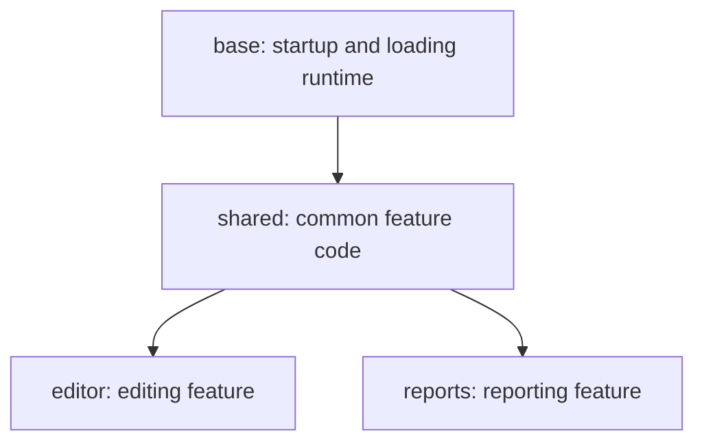

# Chunk splitting and loading in Closure Library

Closure Library supplies the runtime that makes a program split into JavaScript
chunks usable: it tracks dependencies, requests missing chunks, evaluates their
code in order, initializes them, and releases waiting callers. The build system
chooses the chunk graph, and Closure Compiler assigns and optimizes code within
that graph. Understanding the complete mechanism requires keeping these two
responsibilities separate.

The primary source is the local Closure Library checkout at
`38c238f011ba49820b6b0c4f831261f464cac152`. The build-time explanation uses the
adjacent Closure Compiler checkout at
`21768cdbfa949bcce3f80d4285feb66475c4758c`. The descriptions below apply to these
snapshots, including their implementation limits.

## What a module means in this code

Closure uses the word *module* for several different things:

| Name | Meaning | Relationship to splitting |
| --- | --- | --- |
| `goog.module('example.editor')` | A source file's namespace, private scope, and exports | A source organization mechanism; it does not create a separately downloadable chunk |
| `goog.require('example.editor')` | A source dependency | Helps tools order and analyze code; compiled calls are stripped |
| Compiler `JSChunk` | A named collection of compiler inputs with dependencies on other chunks | The build-time unit of output and cross-chunk optimization |
| `goog.module.ModuleInfo` | A runtime record for an ID such as `editor` | Tracks prerequisite chunk IDs, resource URLs, callbacks, and loaded state |
| `goog.module.ModuleManager` | The runtime scheduler | Decides which missing chunks to request and when a requested chunk is ready |
| `goog.module.ModuleLoader` | A replaceable transport and evaluation implementation | Retrieves and executes the JavaScript associated with chunk IDs |

Here, **chunk** means the compiler output/runtime loading unit. Source namespaces
and chunk IDs need not match, and a chunk can contain many source modules.
The stock loader also accepts multiple URLs for one chunk ID, so the runtime
mapping is not restricted to one ID per file.

Sources: [source module declaration][source-module], [require semantics][require],
[compiler chunk representation][jschunk], [runtime module information][moduleinfo],
and [URL collection][collect-uris].

## Source dependencies and chunk dependencies are different graphs

At the source level, `goog.provide`, `goog.module`, and `goog.require` describe
which file supplies a namespace and which other namespaces it needs.
`goog.requireType` represents a type-only reference and does not load runtime
code. `goog.loadModule` evaluates a supplied source-module definition and stores
its exports; it does not fetch a production chunk by ID.

During uncompiled development, `goog.addDependency(path, provides, requires,
loadFlags)` registers files with the debug loader in `base.js`. The
`closure-make-deps` utility generates this information. A `goog.require` can then
resolve a namespace to a file, recursively visit its dependencies, and queue
files with dependencies first. The debug loader records visited paths to avoid
loading the same file repeatedly. The separate `closure-deps` graph utility also
offers a dependency-first ordering operation.

This machinery supplies source files for development and dependency analysis.
Production chunk loading has a separate manifest and scheduler. A source
`goog.require` is not an asynchronous feature boundary: the compiler strips it,
and the build must already have arranged for the required code to be available.
Consequently, making startup code statically depend on an entire optional
feature can cause the feature's code to be placed in an earlier chunk.

Sources: [dependency registration and require][require],
[type-only require][require-type], [source-module evaluation][load-module],
[debug loader traversal][debug-loader], and [dependency utility ordering][dep-order].

## How code gets split at build time

This section describes Closure Compiler, which lives in the adjacent checkout.
It explains where the files consumed by Closure Library come from.

### The build supplies named chunks and their dependencies

The explicit compiler CLI accepts chunk specifications of the form
`name:number-of-input-files:dependency,dependency`. For example, this graph
lets an editor and a report viewer share code without making either feature
depend on the other:



Arrows point from a prerequisite to a dependent. The corresponding specification
could be:

```text
--chunk base:3
--chunk shared:2:base
--chunk editor:2:shared
--chunk reports:1:shared
```

This example assumes eight ordered inputs: three initially assigned to `base`,
two to `shared`, two to `editor`, and one to `reports`. The numbers count input
files, not bytes. Chunks must be specified in dependency order; input files must
be listed in the corresponding order. `createJsChunks` creates the `JSChunk`
objects, adds their dependency edges, validates counts, and assigns the initial
inputs. Empty chunks are permitted. An `auto` file count on the first,
dependency-free chunk consumes the remaining inputs.

This is an explicit graph, not a chunk-size threshold or a runtime grouping
algorithm. The CLI also documents a separate `--chunk auto` mode for CommonJS
chunk creation; that is compiler functionality, not something ModuleManager
infers from the running application.

Sources: [chunk flags][chunk-flags] and [chunk construction][create-chunks].

### Dependency management places shared source files in a common prerequisite

When compiler dependency management runs, `JSChunkGraph.manageDependencies`
computes the strong source dependencies reachable from the entry points assigned
to each chunk. A required source must live in that chunk or in one of its
prerequisites.

The assignment loop works as follows:

1. Record the entry points associated with each chunk, then clear the initial
   input lists so they can be rebuilt.
2. Compute each chunk's transitive source dependencies, using the configured
   sorting and pruning behavior.
3. Assign an input to the first chunk that needs it.
4. If another chunk also needs that input, replace its assignment with the
   deepest common dependency of the two chunks, allowing either chunk itself
   to be that common dependency.
5. Rebuild each chunk's input list in the resulting dependency order.

In the example, a source required by both `editor` and `reports` can be assigned
to `shared`. If the graph only had `base`, `editor`, and `reports`, with both
features depending directly on `base`, their common source would instead need
to live in `base`. This assignment operation chooses an existing common chunk;
it does not create a new shared chunk for each overlap it discovers.

The graph helper searches common prerequisites by depth and uses chunk order to
break ties. Pruning and weak/type-only inputs receive separate handling, so this
is not equivalent to concatenating every source reachable through every kind
of reference.

Sources: [dependency management][manage-deps], [shared input assignment][assign-input],
and [deepest common dependency][common-dep].

### Optimization can move individual declarations between chunks

Initial input assignment is only one stage. Closure's advanced optimization
configuration enables both `CrossChunkCodeMotion` and `CrossChunkMethodMotion`.
These passes can change which output file contains a particular declaration,
even when its original source file was assigned elsewhere.

`CrossChunkCodeMotion`:

1. Collects top-level statements, global declarations, and references.
2. Groups declarations for the same global symbol within a chunk.
3. Treats statements that are not eligible declarations as immovable, and records
   the references they make.
4. Builds a graph between global symbols. Mutually dependent symbols are grouped
   into strongly connected components so their declarations can move together.
5. Processes referring groups before the groups they reference, allowing the
   final location of a caller to constrain the location of its dependencies.
6. Moves eligible declaration groups to an existing chunk that covers their
   remaining uses, preserving the ordering of statements moved together.

The destination helper is specifically `getSmallestCoveringSubtree`. It intersects
the reference chunks' prerequisite sets, requires a destination beneath the
original chunk in the dependency graph, and favors the candidate with the fewest
transitive dependents. This is more precise than describing every code-motion
decision as simply a deepest-common-ancestor calculation.

For example, a helper declared in `base` but used only by `editor` may move into
`editor`. A helper needed by both features can stay in or move to their shared
prerequisite, subject to the motion rules. The source-file assignment stage and
the declaration-motion stage can therefore work in opposite directions: shared
inputs move toward common prerequisites, while eligible declarations move later
toward their actual users.

Eligibility matters. The reference collector permits functions, literals, and
various recursively safe initializer forms. General function-call initializers
are not eligible; generated method-stub calls are an explicit exception. A
declaration with an observable initialization effect cannot simply be delayed
because its value is used only by a lazy feature.

Sources: [advanced configuration][advanced], [code-motion algorithm][code-motion],
[destination selection][covering-subtree], [motion eligibility][motion-eligibility],
and [moving statements][move-statements].

`CrossChunkMethodMotion` can move eligible prototype/class method implementations
deeper in the graph. In its stub-producing mode, it leaves an indirection at the
earlier location and installs the implementation in the later chunk. In
schematic form:

```javascript
// Earlier chunk:
Widget.prototype.edit = JSCompiler_stubMethod(0);

// Later chunk:
Widget.prototype.edit = JSCompiler_unstubMethod(0, function() {
  // The actual method implementation.
});
```

The stub dispatches through a shared table using the original `this` and
arguments. It does not download the missing implementation. The required chunk
still has to execute before the method is called. Motion is restricted by
references, captured variables, redeclarations, and method shape; getters,
setters, and methods referring to `super` have relevant exclusions.

Source: [method motion and stub implementation][method-motion].

### Output generation and runtime integration are separate steps

The compiler emits the resulting chunks and supports an output filename prefix,
per-chunk wrappers, and source maps. Its default chunk output type uses a shared
global namespace; it also has an ES module output mode. The classic
`ModuleManager`/`ModuleLoader` protocol described below loads executable script
code and uses explicit readiness markers.

A build integrating that protocol must provide the chunk dependency manifest,
resource URLs, and initialization markers. Passing `--chunk` alone should not
be understood as configuring Closure Library's runtime. Literal wrappers added
after compilation also need stable access to any runtime entry points they call;
advanced renaming must be accounted for by the integration.

Sources: [output and wrapper flags][output-flags], [output formats][output-type],
and [runtime marker contract][active-manager].

## The manifest supplied to ModuleManager

`setAllModuleInfo` accepts an object mapping runtime IDs to prerequisite IDs.
For the dynamic part of the example graph:

```javascript
manager.setAllModuleInfo({
  shared: [],
  editor: ['shared'],
  reports: ['shared']
});
```

Here the startup bundle is already executing and is omitted from the manifest.
An explicit named startup chunk can also appear in a manifest, but the
integration must arrange for its runtime entry to be marked loaded.

`setAllModuleInfoString` accepts a compact representation of the same information:

```text
shared/editor:0/reports:0
```

Entries are separated by `/`. After `:`, comma-separated **base-36 indexes**
refer to earlier entries, rather than spelling out dependency IDs. Thus `0`
references `shared`; with enough entries, `a` references position ten. The parser
requires each referenced entry to have appeared already. This encoding carries
the graph only, not URLs or source-to-chunk assignments.

The manager creates a `ModuleInfo` per ID. If a record already exists, it updates
the dependency array in place, preserving its loaded state and registered
callbacks. This matters when the manifest is refreshed.

URLs arrive separately through `setModuleTrustedUris`:

```javascript
manager.setModuleTrustedUris({
  shared: [sharedUrl],
  editor: [editorUrl],
  reports: [reportsUrl]
});
```

The values above stand for `goog.html.TrustedResourceUrl` instances supplied by
the application/build integration. Each value is an ordered array, so a logical
chunk can comprise more than one script. The stock loader concatenates these
arrays in chunk dependency order when constructing a request group.

Sources: [manifest setup and decoding][manifest], [manifest updates][update-info],
[URL setup][uri-setup], and [URL collection][collect-uris].

## How a request turns into an ordered load

An application requests a feature with `manager.load('editor')`. The concrete
implementation returns a `goog.async.Deferred`; its success value is the shared
application context, not an ES module namespace object. `loadMultiple` returns a
map from requested IDs to their individual deferreds.

The request path first removes duplicate IDs. For each remaining ID it:

- Rejects an unknown ID in normal manifest-based operation.
- Immediately resolves the deferred with the application context if the chunk
  is already loaded.
- Otherwise attaches success/error callbacks to its `ModuleInfo`.
- Starts or queues a request only if the chunk is not already loading or queued.

Multiple callers can therefore wait for the same chunk without scheduling a
second copy of that load. `execOnLoad` exposes a callback-oriented API, including
an option to register without initiating a load. For an already loaded chunk,
its callback runs asynchronously by default, unless the caller requests
synchronous execution. This differs from the immediately fired deferred in the
already-loaded `load` path.

Sources: [request deduplication][load-requests], [load and callback APIs][load-api],
and [queued/loading lookup][is-loading].

### The dependency traversal

`getNotYetLoadedTransitiveDepIds_` computes the missing prerequisites and the
requested chunk. Its implementation is unusual enough to describe explicitly:

1. Build a set of IDs already requested through the manager.
2. Start a work list with the requested ID, and an output list containing that
   ID if it has not already been requested.
3. Walk the work list breadth first. For each node, visit its dependency array in
   reverse order. Append dependencies that are neither loaded nor already
   requested to both the work list and the output list.
4. Reverse the output list.
5. Remove duplicates, keeping the first occurrence in that reversed order.

Deduplication deliberately happens after reversal. A shared prerequisite may
be discovered through paths of different lengths, and retaining it too early
can produce the wrong order. One regression test uses:

```text
a depends on b and c
b depends on d
c depends on e and f

result: d, e, f, b, c, a
```

The tests also cover diamonds and dependencies between two of the root's own
prerequisites. For the running example, requesting `editor` initially yields
`shared, editor`. After those chunks are loaded, requesting `reports` yields
only `reports`.

This traversal expects a valid acyclic chunk graph. It has no visited set that
stops cycles during expansion; its duplicate removal is at the end. Manifest
validation and valid execution order are responsibilities of the integration.
The separate cycle-aware visitor used for synthetic-module bookkeeping does
not make this load traversal cycle-safe.

Sources: [missing dependency traversal][transitive-deps],
[ordering regression tests][ordering-tests], and [synthetic dependency visitor][visit-deps].

### Scheduling and batching

Both batch mode and concurrent loading are disabled by default.

With batch mode disabled, `processModulesForLoad_` takes the first missing
dependency, queues each remaining ID separately at the front of the pending
queue, and loads that first dependency. Completion lets the manager advance
through the queue. With batch mode enabled, it passes the entire ordered set of
missing dependencies to one loader invocation.

**A batch is one loader invocation, not necessarily one HTTP request.** The stock
loader flattens the chunk URL lists and can issue a request for each URL. A custom
loader/server combination can implement a combined response instead.

Concurrent mode allows additional request groups to start while earlier ones
are outstanding, after the initial-module barrier has completed. IDs already
requested are subtracted from later dependency expansions. This requires the
loader to preserve the necessary execution order across groups even when
network responses arrive out of order. The abstract manager explicitly says
that the stock `goog.module.ModuleLoader` does not support this concurrent mode.
Parallel downloading *within* one batch is a different capability and is
supported by the stock loader.

Sources: [default modes][manager-defaults], [queueing][queue-loads],
[batch expansion][batch-expansion], [request tracking][send-load],
[concurrent-loader requirement][concurrency-contract], and [parallel URL fetching][bulk-load].

## Downloading and evaluating chunk code

The manager delegates transport to the object installed with `setLoader`.
`AbstractModuleLoader.loadModules` receives ordered IDs, the `ModuleInfo` map,
and options for errors, timeouts, forced reloads, and extra dependency edges.
The stock implementation selects among three main paths:

| Path | Download behavior | Evaluation order |
| --- | --- | --- |
| Default XHR path | `BulkLoader` requests the group's URLs in parallel and retains response text by original URL index | After the group completes, evaluate text in URL order, either joined together or separately with `sourceURL` annotations |
| `setUseScriptTags(true)` | Insert scripts with `async = false`; their downloads can overlap | Execution follows script insertion order |
| Debug mode without source URL injection | Use `goog.net.jsloader.safeLoadMany` | Scripts load serially |

Debug mode does not always mean serial script tags: on supported browsers it
can enable source URL injection and follow the XHR/evaluation path. Explicit
non-async script mode takes precedence when selected.

The XHR path only evaluates a successful group's code after all of its response
texts are present. Prefetching can leave those texts stored until a later load
request. Evaluation uses `goog.globalEval`, so this is classic script execution,
not the native ES module import/linking process.

Transport events are not a reliable substitute for chunk readiness. In
particular, `evaluateCode_` dispatches `RequestSuccessEvent` before evaluation,
and the manager does not use the loader's optional `onSuccess` callback to mark
each chunk loaded. That happens through the explicit protocol in the next
section.

Sources: [loader interface][loader-interface], [transport selection][download],
[script construction][script-element], [parallel URL fetching][bulk-load],
[response ordering][bulk-responses], and [evaluation][evaluate].

## The chunk initialization protocol

A normal dynamic chunk has a beginning marker and an ending marker. In
schematic generated code, using a reference to the active manager:

```javascript
manager.beforeLoadModuleCode('editor');

// Definitions belonging to the editor chunk execute here.

manager.registerInitializationCallback(function(context) {
  // Publish the feature's entry point or do other load-time setup.
  context['features']['editor'] = editorEntryPoint;
});

manager.setLoaded();
```

The example illustrates the protocol; a real build must emit references valid
under its output format and renaming rules. The library also exposes
`goog.loader.activeModuleManager.beforeLoadModuleCode` and `setLoaded` as
forwarding functions for generated code. An active manager must already have
been installed or instantiated; these two forwarding functions do nothing when
there is no active manager.

`beforeLoadModuleCode(id)` selects the `ModuleInfo` that owns initialization
registrations during evaluation. `setLoaded()` calls that record's `onLoad`,
which performs this sequence:

1. Construct its module object, using `BaseModule` unless a custom constructor
   was registered during evaluation.
2. Call the object's `initialize(context)` method.
3. Store the module object; `isLoaded()` now returns true.
4. Run early callbacks registered with `registerInitializationCallback`.
5. If the early callback phase reported no errors, run the regular callback
   queue, including callers waiting on `load` and any late initialization
   callbacks.
6. Clear error callbacks if callback execution succeeded.

Callbacks within a queue run in registration order. Late initialization
callbacks share the regular queue, so “late” means after the early phase;
it does not mean a separate phase that necessarily precedes waiting callers.
The context can be populated by initialization before ordinary callers receive
it. For example, a caller can use:

```javascript
manager.load('editor').addCallback(function(context) {
  context['features']['editor']();
});
```

After `onLoad`, the manager removes the ID from its loading/user-initiated sets,
advances the pending queue when no current IDs remain, updates activity events,
and clears its current-evaluation record.

The beginning and ending markers must bracket synchronous evaluation of each
logical chunk. Fetching bytes, evaluating definitions, completing initialization,
and notifying callers are distinct steps. Omitting the ending marker can leave
callers waiting even after the network request succeeds.

Sources: [active manager forwarding][active-manager],
[begin marker and initialization registration][begin-load],
[completion bookkeeping][set-loaded], [initialization ordering][on-load],
and [loaded-state predicate][loaded-state].

### Startup initialization

The manager starts with a private base `ModuleInfo` whose ID is the empty
string. This represents the code containing the manager and collects startup
initialization callbacks. The first call to `setAllModuleInfo`, a valid
`setAllModuleInfoString`, or `setModuleContext` finishes this private base load.
It is distinct from any application manifest entry literally named `base`.

The string manifest API can also receive IDs already being loaded as part of
startup. It records the last such ID and resolves `initialModulesLoaded_` when
that ID completes. Concurrent requests wait on this barrier.

Sources: [base and initial-module state][manager-defaults],
[manifest startup handling][manifest], and [base completion][base-completion].

## Prefetching and preloading

The two similarly named APIs do different work:

- `prefetchModule(id)` obtains the missing chunk and dependency resources without
  executing them. In XHR mode, the loader retains response text. In script-tag
  mode, it inserts `link rel="preload" as="script"` elements; a later load inserts
  actual scripts and can reuse the browser's fetched resources.
- `preloadModule(id, timeout)` schedules a real load after the specified delay,
  which defaults to zero. It downloads, evaluates, initializes, and resolves a
  deferred. The timeout argument is a scheduling delay, not a network deadline.

The stock loader skips prefetch work in debug mode. Once its `prefetchModule`
method has been called, it rejects multi-ID loads unless non-async script-tag
mode is enabled: its XHR prefetch cache is keyed by individual module requests,
whereas batched requests use a group key.

Sources: [manager prefetch and preload][prefetch-manager],
[loader prefetch implementation][prefetch-loader], and [prefetch/batch restriction][loader-load].

## Errors and retries

The manager distinguishes transport errors, timeouts, and initialization errors.
For an ordinary transport failure it removes the failed group's IDs from its
requested-ID history so a retry can request them again.

| Condition | Manager behavior |
| --- | --- |
| First ordinary load failure | Retry after 5 seconds |
| Second consecutive failure | Retry after 20 seconds |
| Third consecutive failure | Fail the request or split a request for multiple target chunks into separate queued attempts |
| HTTP 401 | Report unauthorized loading and discard additional queued requests |
| HTTP 410 | Treat the requested code as no longer available; fail or split the batch |
| Corrupt-response status 8001 | Use the normal retry path with `forceReload: true` |
| Loader timeout callback | Fail or split the batch, then continue the queue |

The delay is `consecutiveFailures² * 5000` milliseconds. Splitting a failed batch
here means retrying its originally requested target chunks individually; each
target still needs its prerequisites. It does not repartition the JavaScript
output files.

Failure dispatch also removes queued requests that depend on failed targets,
emits manager error callbacks for the canceled IDs, and calls `ModuleInfo`
errbacks for the failed target IDs. The implementation does not call each
canceled dependent's `ModuleInfo.onError` in that loop, so those two notification
mechanisms should not be treated as identical.

The stock loader does not implement every capability in the abstract contract.
It accepts `forceReload` and `onTimeout`, but does not use them to bypass caches
or enforce a deadline, and contains a timeout-handling TODO. The legacy serial
debug-script path also does not connect `safeLoadMany`'s result to the manager's
error callbacks. A custom loader is needed if the integration relies on those
contract features.

Initialization is not transactional. `ModuleInfo` stores the module object before
running its callback queues. Callback exceptions are caught and rethrown
asynchronously; an error in the early phase prevents the regular queue from
running, and the manager reports `INIT_ERROR`. An exception from the module
constructor or its `initialize` method occurs outside that callback-catching
loop. There is no rollback of top-level JavaScript effects or general unload
mechanism that would undo evaluated definitions.

Sources: [retry delay][backoff], [error policy][load-errors],
[failure dispatch][failure-dispatch], [stock loader options][loader-load],
[debug transport branch][download], and [initialization/callback errors][on-load].

## Synthetic chunks and server-assisted loading

### Synthetic chunks can omit their normal markers

The manager includes support for shared chunks whose build has omitted the
begin/end markers to reduce output overhead. These are described in the source
as synthetic modules created by factoring out common code.

If initialization is registered while no chunk is marked as currently
evaluating, the manager creates a temporary `ModuleInfo` under a special
synthetic ID. When the next ordinary chunk's beginning marker arrives, the
manager completes that temporary module and removes it.

It then walks the new chunk's prerequisites and marks still-unloaded records
loaded, removing them from the active loading list. This relies on the
integration having already executed those prerequisite scripts in order. Here
`ModuleInfo.setLoaded` merely installs a `BaseModule`; it does not perform the
full `onLoad` callback sequence. Custom module constructors cannot be attached
to the temporary synthetic record.

This is a protocol optimization for compatible generated output, not a second
algorithm for deciding which declarations belong in a shared chunk.

Sources: [synthetic-module rationale][synthetic-rationale],
[marker handling and temporary records][begin-load],
[lightweight loaded marker][loaded-state], and [synthetic regression tests][synthetic-tests].

### Subtractive loading moves dependency expansion to the serving system

`SUBTRACTIVE_MODULE_LOADING` is a compile-time define, false by default. Its
documented model omits the complete client-side graph. The client tracks
requested/loaded modules, and a compatible loader and serving system determine
the remaining dependencies for subsequent requests. In this mode, querying an
unknown ID creates a `ModuleInfo` with an empty dependency list instead of
requiring a pre-existing manifest entry.

Enabling the define does not turn the stock URL loader into such a server
protocol. The server's dependency expansion and response construction are
outside this implementation. Similarly, runtime “extra edges” are handed to a
loader that declares `supportsExtraEdges`; the manager throws when such edges
exist and the selected loader does not advertise support.

Sources: [subtractive loading define][subtractive], [extra-edge registration][extra-edges],
and [loader capability check][send-load].

## A complete editor load

For the earlier graph, a normal first editor load proceeds as follows:

1. The page executes `base`, which contains the loading runtime and application
   bootstrap. The bootstrap installs a loader, context, dynamic chunk manifest,
   and trusted URL map.
2. A user action calls `load('editor')` and attaches a callback.
3. The manager finds that `shared` and `editor` are missing. In serial mode it
   requests `shared` first; in batch mode it submits both ordered IDs together.
4. The loader retrieves the corresponding scripts and evaluates `shared` before
   `editor`.
5. Each ordinary chunk's beginning marker selects its initialization record.
   Its ending marker initializes it and releases its waiting callbacks.
6. The editor's early initialization publishes its feature entry point into
   the context. The waiting application callback receives that context and
   invokes the entry point.
7. A later `load('reports')` requests only `reports`, because `shared` is already
   loaded. Another `load('editor')` resolves without a network request.

The resulting behavior depends on three agreements across the build and runtime:
the compiler output satisfies the declared chunk graph; the loader executes
prerequisites before their dependents; and generated completion markers signal
when a chunk's initialization has reached the point at which callers may use it.

## Source and regression test map

| Concern | Main source | Existing tests |
| --- | --- | --- |
| Namespace/source loading | [base.js][require] | [base module tests][base-tests] |
| Manifest, graph traversal, queueing, retries | [ModuleManager][manifest] | [ModuleManager tests][manager-tests] |
| Synthetic marker handling | [beginning markers][begin-load] | [synthetic cases][synthetic-tests] |
| Transport, prefetch, script ordering | [ModuleLoader][loader-load] | [ModuleLoader tests][loader-tests] |
| Initialization and loaded state | [ModuleInfo][on-load] | [ModuleInfo tests][info-tests] |
| Whole-input chunk placement | [JSChunkGraph][manage-deps] | [JSChunkGraph tests][graph-tests] |
| Declaration and method motion | [CrossChunkCodeMotion][code-motion], [CrossChunkMethodMotion][method-motion] | [code-motion tests][motion-tests], [method-motion tests][method-tests] |

[source-module]: /Users/admin/src/light-cljs/research/closure-library/closure/goog/base.js:440
[require]: /Users/admin/src/light-cljs/research/closure-library/closure/goog/base.js:785
[require-type]: /Users/admin/src/light-cljs/research/closure-library/closure/goog/base.js:885
[load-module]: /Users/admin/src/light-cljs/research/closure-library/closure/goog/base.js:1075
[debug-loader]: /Users/admin/src/light-cljs/research/closure-library/closure/goog/base.js:2407
[dep-order]: /Users/admin/src/light-cljs/research/closure-library/closure-deps/lib/depgraph.js:438
[jschunk]: /Users/admin/src/light-cljs/research/closure-compiler/src/com/google/javascript/jscomp/JSChunk.java:40
[chunk-flags]: /Users/admin/src/light-cljs/research/closure-compiler/src/com/google/javascript/jscomp/CommandLineRunner.java:247
[create-chunks]: /Users/admin/src/light-cljs/research/closure-compiler/src/com/google/javascript/jscomp/AbstractCommandLineRunner.java:812
[manage-deps]: /Users/admin/src/light-cljs/research/closure-compiler/src/com/google/javascript/jscomp/JSChunkGraph.java:515
[assign-input]: /Users/admin/src/light-cljs/research/closure-compiler/src/com/google/javascript/jscomp/JSChunkGraph.java:608
[common-dep]: /Users/admin/src/light-cljs/research/closure-compiler/src/com/google/javascript/jscomp/JSChunkGraph.java:414
[advanced]: /Users/admin/src/light-cljs/research/closure-compiler/src/com/google/javascript/jscomp/CompilationLevel.java:211
[code-motion]: /Users/admin/src/light-cljs/research/closure-compiler/src/com/google/javascript/jscomp/CrossChunkCodeMotion.java:40
[covering-subtree]: /Users/admin/src/light-cljs/research/closure-compiler/src/com/google/javascript/jscomp/JSChunkGraph.java:361
[motion-eligibility]: /Users/admin/src/light-cljs/research/closure-compiler/src/com/google/javascript/jscomp/CrossChunkReferenceCollector.java:321
[move-statements]: /Users/admin/src/light-cljs/research/closure-compiler/src/com/google/javascript/jscomp/CrossChunkCodeMotion.java:600
[method-motion]: /Users/admin/src/light-cljs/research/closure-compiler/src/com/google/javascript/jscomp/CrossChunkMethodMotion.java:48
[output-flags]: /Users/admin/src/light-cljs/research/closure-compiler/src/com/google/javascript/jscomp/CommandLineRunner.java:368
[output-type]: /Users/admin/src/light-cljs/research/closure-compiler/src/com/google/javascript/jscomp/CommandLineRunner.java:895
[moduleinfo]: /Users/admin/src/light-cljs/research/closure-library/closure/goog/module/moduleinfo.js:25
[collect-uris]: /Users/admin/src/light-cljs/research/closure-library/closure/goog/module/moduleloader.js:784
[manifest]: /Users/admin/src/light-cljs/research/closure-library/closure/goog/module/modulemanager.js:278
[update-info]: /Users/admin/src/light-cljs/research/closure-library/closure/goog/module/modulemanager.js:514
[uri-setup]: /Users/admin/src/light-cljs/research/closure-library/closure/goog/module/modulemanager.js:403
[load-requests]: /Users/admin/src/light-cljs/research/closure-library/closure/goog/module/modulemanager.js:540
[load-api]: /Users/admin/src/light-cljs/research/closure-library/closure/goog/module/modulemanager.js:923
[is-loading]: /Users/admin/src/light-cljs/research/closure-library/closure/goog/module/modulemanager.js:909
[transitive-deps]: /Users/admin/src/light-cljs/research/closure-library/closure/goog/module/modulemanager.js:790
[ordering-tests]: /Users/admin/src/light-cljs/research/closure-library/closure/goog/module/modulemanager_test.js:2114
[visit-deps]: /Users/admin/src/light-cljs/research/closure-library/closure/goog/module/modulemanager.js:1315
[manager-defaults]: /Users/admin/src/light-cljs/research/closure-library/closure/goog/module/modulemanager.js:129
[queue-loads]: /Users/admin/src/light-cljs/research/closure-library/closure/goog/module/modulemanager.js:621
[batch-expansion]: /Users/admin/src/light-cljs/research/closure-library/closure/goog/module/modulemanager.js:742
[send-load]: /Users/admin/src/light-cljs/research/closure-library/closure/goog/module/modulemanager.js:668
[concurrency-contract]: /Users/admin/src/light-cljs/research/closure-library/closure/goog/loader/abstractmodulemanager.js:101
[bulk-load]: /Users/admin/src/light-cljs/research/closure-library/closure/goog/net/bulkloader.js:85
[bulk-responses]: /Users/admin/src/light-cljs/research/closure-library/closure/goog/net/bulkloader.js:131
[loader-interface]: /Users/admin/src/light-cljs/research/closure-library/closure/goog/module/abstractmoduleloader.js:31
[download]: /Users/admin/src/light-cljs/research/closure-library/closure/goog/module/moduleloader.js:463
[script-element]: /Users/admin/src/light-cljs/research/closure-library/closure/goog/module/moduleloader.js:157
[evaluate]: /Users/admin/src/light-cljs/research/closure-library/closure/goog/module/moduleloader.js:354
[active-manager]: /Users/admin/src/light-cljs/research/closure-library/closure/goog/loader/activemodulemanager.js:78
[begin-load]: /Users/admin/src/light-cljs/research/closure-library/closure/goog/module/modulemanager.js:999
[set-loaded]: /Users/admin/src/light-cljs/research/closure-library/closure/goog/module/modulemanager.js:842
[on-load]: /Users/admin/src/light-cljs/research/closure-library/closure/goog/module/moduleinfo.js:276
[loaded-state]: /Users/admin/src/light-cljs/research/closure-library/closure/goog/module/moduleinfo.js:237
[base-completion]: /Users/admin/src/light-cljs/research/closure-library/closure/goog/module/modulemanager.js:826
[prefetch-manager]: /Users/admin/src/light-cljs/research/closure-library/closure/goog/module/modulemanager.js:464
[prefetch-loader]: /Users/admin/src/light-cljs/research/closure-library/closure/goog/module/moduleloader.js:421
[loader-load]: /Users/admin/src/light-cljs/research/closure-library/closure/goog/module/moduleloader.js:265
[backoff]: /Users/admin/src/light-cljs/research/closure-library/closure/goog/module/modulemanager.js:647
[load-errors]: /Users/admin/src/light-cljs/research/closure-library/closure/goog/module/modulemanager.js:1087
[failure-dispatch]: /Users/admin/src/light-cljs/research/closure-library/closure/goog/module/modulemanager.js:1174
[synthetic-rationale]: /Users/admin/src/light-cljs/research/closure-library/closure/goog/module/modulemanager.js:35
[synthetic-tests]: /Users/admin/src/light-cljs/research/closure-library/closure/goog/module/modulemanager_test.js:886
[subtractive]: /Users/admin/src/light-cljs/research/closure-library/closure/goog/module/modulemanager.js:341
[extra-edges]: /Users/admin/src/light-cljs/research/closure-library/closure/goog/module/modulemanager.js:371
[base-tests]: /Users/admin/src/light-cljs/research/closure-library/closure/goog/base_module_test.js
[manager-tests]: /Users/admin/src/light-cljs/research/closure-library/closure/goog/module/modulemanager_test.js
[loader-tests]: /Users/admin/src/light-cljs/research/closure-library/closure/goog/module/moduleloader_test.js
[info-tests]: /Users/admin/src/light-cljs/research/closure-library/closure/goog/module/moduleinfo_test.js
[graph-tests]: /Users/admin/src/light-cljs/research/closure-compiler/test/com/google/javascript/jscomp/JSChunkGraphTest.java
[motion-tests]: /Users/admin/src/light-cljs/research/closure-compiler/test/com/google/javascript/jscomp/CrossChunkCodeMotionTest.java
[method-tests]: /Users/admin/src/light-cljs/research/closure-compiler/test/com/google/javascript/jscomp/CrossChunkMethodMotionTest.java
