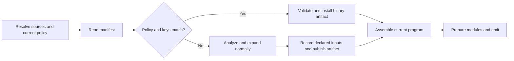

# Persistent compiler cache design

Status: proposed architecture, October 17, 2026. Persistent application caching
is not implemented. This design builds on `b51af6a` and the existing
[development workflow](dev-workflow.md). API and configuration names below describe
proposed behavior; they are not available compiler options yet.

Cache completed namespace compilation in a versioned binary format. Reuse it
when conservative source, dependency, compiler, and configuration keys match.
Provide explicit APIs for external dependencies and opt-outs for work that must
execute again. Ordinary macro expansion is assumed reusable under this contract;
the compiler does not need to prove arbitrary macros pure.

A cache hit skips the namespace's analysis and macro calls. It restores immutable
compiler artifacts, not a JavaScript heap or the effects of those skipped calls.
This is an explicit incremental-compilation contract. An uncached fresh build
remains available when all compilation work must execute.

## Goals and scope

- Reduce repeated macro expansion, analysis, and emission, including after a
  compiler restart and after localized source edits.
- Support ordinary and advanced output with reusable semantic IR.
- Give macro authors a small, explicit dependency and cache-policy interface.
- Keep disk and memory retention bounded, with understandable miss reasons.
- Preserve source resolution, declaration visibility, diagnostics, application
  initialization order, and generated-name hygiene across mixed hits and misses.

The measured Penpot main build takes 21.97 seconds and 0.948 GB peak RSS with the
native V8 backend. Parsing is a small part of the workload; macro execution and
form transport remain substantial. The cache must skip that work on a hit, not
re-execute macros merely to establish whether their results can be reused.
These are cold-build measurements, not predictions of warm performance. See the
[benchmark report](../benchmarks/penpot-investigation.md) and
[cold-build driver](../benchmarks/penpot.bb).

Initial scope is namespace artifacts for native entry compilation. Development
session reuse follows separately. Excluded are general effect tracking, automatic
purity inference, arbitrary mutation replay, serialized engine heaps, persistent
REPL application state, remote caches, and per-expression incremental queries.

## Lessons from Shadow

The inspected Shadow revision is
`b8d76ecdffc8bb441f4200f3121885f23dd1da2a`.

Shadow caches analyzer metadata and emitted JavaScript per namespace using
Transit JSON. It validates source and transitive dependency keys, compiler
identity, selected options, macro/helper source timestamps, lazy-module
assignments, and explicitly registered resources. Hits load required macro
namespaces but skip the consumer's macro calls and their effects.

It handles exceptions through policy rather than a general execution tracker:

- Default cache blockers include `clara.rules` and `clara.macros`, whose
  compilation side effects require their direct consumers to compile again.
- Its own test runner uses `:dev/always` because a macro discovers tests by
  inspecting the whole compiler namespace inventory.
- `shadow.resource/slurp-resource` records resource dependencies explicitly.
- Changes to broad tooling/external configuration invalidate conservatively.

Shadow's disk bypass and watch invalidation are distinct. `:cache-blockers` and
`:cache-level :off` prevent disk reuse but do not invalidate existing in-memory
output on every watch build. `:dev/always` does. Shadow also recompiles namespaces
with warnings; light-cljs will instead retain and restore successful diagnostics.

Adopt these principles with an explicit light-cljs contract. Keep binary semantic
IR, use content fingerprints for declared resources, and define blocker
propagation through our dependency graph. Shadow's direct-only blockers and
alias-based JVM helper discovery are not rules to copy unchanged.

Primary source references:

- [Cache validation and restoration](https://github.com/thheller/shadow-cljs/blob/b8d76ecdffc8bb441f4200f3121885f23dd1da2a/src/main/shadow/build/compiler.clj#L975).
- [Default side-effect blockers](https://github.com/thheller/shadow-cljs/blob/b8d76ecdffc8bb441f4200f3121885f23dd1da2a/src/main/shadow/build/api.clj#L111).
- [Disk gate and retained output](https://github.com/thheller/shadow-cljs/blob/b8d76ecdffc8bb441f4200f3121885f23dd1da2a/src/main/shadow/build/compiler.clj#L1115).
- [Explicit resource API](https://github.com/thheller/shadow-cljs/blob/b8d76ecdffc8bb441f4200f3121885f23dd1da2a/src/main/shadow/resource.clj#L11).
- [Test discovery opt-out](https://github.com/thheller/shadow-cljs/blob/b8d76ecdffc8bb441f4200f3121885f23dd1da2a/src/main/shadow/test/node.cljs#L15).

## Cache contract

A namespace is cacheable by default when its supported source inputs have stable
identities and no applicable opt-out is set. The compiler assumes its expansion
results depend on the recorded inputs. This is a contract with macro authors,
not a claim that the compiler detects every source of nondeterminism.

On a validated hit:

1. Restore declarations, expanded/analyzed bodies, diagnostics, and deferred-unit
   descriptions in the required source order.
2. Register macro/helper code for later demand in the current evaluator.
3. Skip the compilation represented by the artifact, including its macro calls.
4. Run application preparation, lazy-target validation, optimization, and emission
   as required by the current build options.

Loading code or registering a helper does not restore previously mutated roots,
failed initializer values, or effects of skipped macro calls. Each fresh
compilation starts with fresh evaluator state. Retained watch sessions keep
their existing state and reload rules. The cache does not execute application top-level forms
at compile time; emitted applications retain their normal initialization order.

### Macro-author responsibilities

Macros that depend on files, configuration, or provider data should obtain those
inputs through the dependency APIs below. Macros that need clock/random values,
undeclared host observations, or compilation effects on every build should opt
out at the namespace or macro-provider level. The compiler does not intercept
arbitrary `Date`, `Math.random`, atom mutations, or JavaScript property access.

An undeclared input may produce stale output. A skipped stateful macro may leave
a different compile-time state for a later miss. These limitations are part of
the cache-enabled contract and must be documented with the controls, not hidden
behind a claim of identical fresh-build effects.

For example:

```clojure
;; macros.cljs
(ns macros)
(def counter (atom 0))
(defmacro next-value [] (swap! counter inc))

;; dep.cljs
(ns dep (:require [macros :refer [next-value]]))
(def value (next-value))

;; main.cljs
(ns main (:require [dep :as d] [macros :refer [next-value]]))
(js/console.log d/value (next-value))
```

An uncached fresh build prints `1 2`, as covered by the existing
[macro tests](../tests/compiler/macros.rs). With no opt-out, a cached `dep` and
recompiled `main` can print `1 1`: the earlier increment did not run. Putting
`macros` in the build's cache-blocker set forces its compilation consumers,
including `dep` and `main`, to miss in a fresh build. If they must also recompile
on every watch build, use the always-compile policy for that provider.

Likewise, an unannotated timestamp macro can retain its earlier expansion on a
hit. Either supply an explicit build-time value as a keyed configuration input
or opt out. We do not add an effect system to rediscover those requirements.

## Explicit dependency APIs

Provide a small compiler service interface available from macros, ordinary
helpers executing at compile time, and custom data readers. The following are
API capabilities; final function names belong to implementation.

| Capability | Recorded dependency |
| --- | --- |
| Read a resource | Resolved provider identity, logical path, and hash of the exact bytes returned |
| Read build configuration | Requested key/path and value fingerprint, including a distinct missing value |
| Declare a dependency | A namespace/source identity, resource, or host-provider token with a stable fingerprint |
| Depend on a broad compiler view | A coarse namespace inventory, declaration view, or build-configuration fingerprint |

Record dependencies in the compiler-owned manifest of the compilation unit that
uses the result. A helper's or data reader's dependencies must propagate to every
artifact that incorporates its result, including when helper analysis was reused
in memory. Nested deferred compilation must attribute dependencies to the right
units without losing them when its temporary analysis state is released.

Resource reading and dependency recording are one operation. Hash the bytes
actually returned, not a separate later read. Record optional-resource absence
and resolution search identities so adding or shadowing a resource invalidates
the result. A provider without a stable identity makes the consuming work
non-cacheable. Provider validation must not invoke arbitrary macro code.

For the first implementation, hashing the complete declared build configuration
is acceptable even if a macro reads one key. Over-invalidation is preferable to
an incomplete key. Arbitrary environment-variable or filesystem access outside
these services is not automatically observed; it requires a declared provider
input or an opt-out.

These services track explicit dependencies at known compiler boundaries. They
do not log every runtime read, discover a general call graph, or replay writes.

## Opt-outs and their propagation

Expose separate controls for persistent storage and recompilation. The following
names are semantic labels; exact CLI, embedding, and namespace-metadata spellings
must be consistent when implemented.

| Control | Persistent cache | Running watch session |
| --- | --- | --- |
| Build: persistent cache off | No reads or writes for the build | Existing incremental state remains; this alone does not force recompilation |
| Namespace: cache off | No reads or writes for that namespace | Ordinary invalidation still applies |
| Build: cache-blocker namespace set | No reads or writes for blockers and their transitive compilation consumers | Ordinary invalidation still applies |
| Namespace/provider: always compile | No reads or writes for it and affected compilation consumers | Invalidate that set on each triggered build |
| Fresh uncached build | No persistent reuse; fresh compiler/evaluator context | Separate operation, not an implicit reset of a live session |

Initially, compilation-consumer propagation uses the conservative transitive
runtime, macro, and helper dependency graph. This deliberately over-invalidates
compared with Shadow's direct-only blocker rule. Unrelated namespaces that share
state through undeclared JavaScript are not discovered: declare that dependency
or disable caching for the broader build.

Resolve policy from current build configuration and source metadata before
accepting a candidate. Changing a blocker or always-compile setting must take
effect even when an old artifact exists. Keep the same policy evaluator for
initial builds and watch invalidation. Clearing disk artifacts alone must not
be presented as clearing a live compiler's state.

An always-compile flag acts when a build is triggered; it does not create a
watch event for an unregistered external input. Registered resource dependencies
must participate in watching as well as restart validation. Preserve the
existing watch session's state semantics when recompiling; always compile does
not promise a fresh macro heap on each edit.

## Conservative keys and invalidation

Each namespace manifest includes:

- Source content and kind (`.cljs` or `.cljc`), resolved identity, and relevant
  source locations for diagnostics and macro-visible provenance.
- Compiler implementation, embedded runtime/bootstrap, bundled first-party
  library, and binary-schema identities.
- Analysis/macro options: warning mode, assertions, `opaque_packages`, reader
  features, custom/default reader implementations, and declared host config.
- All transitive source dependencies, including macro providers and ordinary
  helper sources. Begin with namespace dependencies, not used-function guesses.
- Incoming compiler-visible declarations, macro generations, reader contexts,
  and extension visibility, represented by conservative view fingerprints.
- Dependency resolution results and search order, including missing lookups,
  fallback library selection, and newly shadowing source files.
- Explicit resource/config/provider dependencies and broad-view declarations.

A hit requires these inputs to match and current policy to permit reuse. Runtime
mutation history is not part of a general automatic key. An ordinary helper
implementation change invalidates consumers even when its signature is unchanged.
Dependency fingerprints also cover their declared external inputs and relevant
semantic metadata; matching dependency source hashes alone is insufficient.
Reflective dependencies outside the ordinary source graph must use an explicit
broad-view dependency or an always-compile policy.

Use content fingerprints for source and resource values. Timestamps can avoid
unnecessary filesystem work but are not the final semantic key. Detect inputs
that change while compiling before publishing an artifact; do not validate one
version and store a result from another. Use the same dependency manifest for
restart validation and reverse invalidation in watch mode, including helper
and external-resource edges.

Keep front-end keys separate from emission keys. Output mode, maps, defines,
optimization, exports, and module layout invalidate every stage they actually
affect. Conservatively including an option in both keys is acceptable initially.
Backend-specific code sections include engine/ABI identity; reuse portable IR
across backends only after compatibility tests cover the relevant options.

Finer interface fingerprints, unchanged-result propagation, and definition-level
queries are later optimizations. They are not prerequisites for the first cache.

## Binary artifacts

Use one immutable artifact per completed namespace, with references to any shared
deferred-unit records. The first implementation must capture the information
needed to install a namespace without analyzing its source or executing its
skipped macro calls. [Analysis and expansion](../src/analyzer.rs) currently
interleave; running that traversal again would defeat the purpose of the cache.

| Section | Contents |
| --- | --- |
| Header and manifest | Version, namespace identity, keys, dependency/policy declarations, section bounds and integrity checks |
| Declaration metadata | Vars, arities, types/protocols, aliases, refers, macro generations, and visibility information |
| Semantic IR | Expanded and analyzed bodies before application optimization |
| Deferred-unit descriptions | Bodies or equivalent prepared representation, definition-site snapshots/frontiers, and registration descriptions |
| Diagnostics and provenance | Warnings, source identities/spans, reader metadata, and macro-origin information |
| Compiler-owned accounting | Logical work counts, relevant depth bounds, and generated-name information |
| Optional derived output | Emitted JavaScript/maps or helper code when measurement justifies storing them |

Semantic IR remains necessary for whole-program optimization, runtime slicing,
and lazy-module placement. Per-namespace JavaScript alone is not sufficient.
Final target validation and module preparation run on the assembled program.

Completed [deferred units](../src/compilation_session.rs) can release their IR
while retaining prepared code. Capture the reusable representation at that
lifecycle boundary. Do not keep duplicate whole-program snapshots merely to
write the cache later. Persist either sufficient unit IR/descriptors or its
prepared equivalent; avoid storing both by default.

### Representation and relocation

Use an explicit versioned binary schema with compact tables and interned UTF-16
strings. Define tags and byte order. Preserve metadata, collection order,
provenance, special numeric values, and required identity relationships. Never
serialize Rust memory layouts, pointers, reference counts, or engine handles.

Local references use artifact-local indices. External references use stable
namespace/definition identities with relevant generation/visibility information.
Resolve them into current arena IDs using indexes rather than repeated global
scans. Source indices and deferred-unit IDs also need relocation; rebuild
JavaScript registrations that refer to `__lightCompileUnit` IDs.
[Program fragment remapping](../src/program_fragment.rs) offers useful machinery,
but its shared-prefix assumption is not a portable disk format.

Keep the manifest readable without decoding all IR. Start with bounded ordinary
decoding. Choose the encoding library using representative Penpot artifact sizes
and load costs; compression, mapping, and zero-copy access are optional later work.
A whole-program snapshot may be useful as a format experiment, but localized-edit
reuse is the reason to retain namespace granularity as the target architecture.

### Generated names

Cached and freshly compiled code must remain hygienic when combined. Existing
reader/binding allocators use process-wide counters, while the JavaScript runtime
has its own gensym counter and reserved-name set. Treat these compiler-owned
allocators explicitly; do not infer arbitrary user state from their handling.

Store enough name information to prevent fresh allocations colliding with names
retained by cache hits. Validate the reservation/remapping scheme across all hits
and misses in a build, including cached namespaces installed later in source
order. Fresh numerical suffixes need not match an uncached run. Preserve cached
symbols that escape as literal data; do not normalize them away in validation.
Macros that require the allocation sequence itself to repeat must opt out for
the relevant compilation dependency set.

## Loading, diagnostics, and storage



Validate bounds, references, integrity, and compatibility before exposing an
artifact's declarations or executing its code. Decode into temporary owned
state, then install at the correct source frontier. Corrupt, incomplete, or
incompatible artifacts become misses. Cache lookup itself must not execute
macros; a failed probe must not cause a macro effect to run twice.

Restore successful warnings with their original locations and ordering, subject
to the keyed warning policy. Do not persist failed or cancelled compilation as a
successful artifact. Later compilation errors remain ordinary compilation errors,
not reasons to rerun earlier effectful work through a cache fallback.

Preserve logical compiler limits using recorded work counts and depth bounds,
charged once for each reused unit. If the remaining budget cannot admit a unit,
or the accounting is unavailable, bypass before installation and let ordinary
compilation enforce its limits. Time and live-memory limits apply to actual work;
loading also needs cancellation polling and explicit size/structural bounds.
A cache hit must never reset a terminal failure or replenish an enclosing budget.
This is compiler-owned accounting, not an execution-effect log.

Write immutable content-addressed artifacts through temporary files and atomic
publication. Update indexes only after their artifacts are complete. Concurrent
readers must not see partial writes. Write failures leave otherwise valid compiler
output usable. Cache files are disposable derived data and are not committed.

Bound disk retention and loaded artifacts. Release decoded IR after its consumers
finish. Report namespace hits/misses, policy bypasses, dependency mismatches,
executed macro counts, and validation/decode/write costs. The cache-disabled fresh
build is a supported debugging and comparison path.

## Development sessions and engine boundaries

Start with persistent reuse for native entry compilation. Existing running
sessions already retain compiler state; cache integration must preserve their
reload rules and use the same declared dependency and policy information.
Invalidate always-compile sets before consulting retained output. Ordinary
disk bypass, including the cache-blocker set, leaves otherwise valid
in-memory output usable.

The current [watch startup](../src/dev_watch.rs) compiles a clean build, writes
output, then loads the entry again into `DevSession`. Measure this separately and
evaluate a common startup compilation path. It is useful work, but not a
prerequisite for the binary cache.

Native clean compilation uses V8 and the interactive session currently uses
QuickJS. Registering cached definitions in a new evaluator does not transfer
mutated roots or live function handles. Initial session loading may skip cached
expansions under the cache contract, but must install compatible declarations,
source contexts, lazy helpers, and session registrations for future edits.
Validate first edits and opt-out behavior explicitly; do not simply attach the
clean-build catalog to another engine. Engine heap migration and application-state
persistence remain out of scope.

## Implementation sequence

1. **Define policy and dependency services.** Implement the explicit input APIs,
   conservative dependency graph, opt-out propagation, and shared invalidation
   rules. Add contract tests for skipped macro calls and the controls that force
   them to execute. Instrument cold build phases and macro counts.
2. **Build relocatable namespace artifacts.** Capture declarations, IR, deferred
   units, diagnostics, names, and accounting at existing lifecycle boundaries.
   Verify in-memory installation and mixed hits/misses without source reanalysis.
3. **Add the binary store and native compile integration.** Implement manifests,
   validation, bounded decoding, atomic writes, explicit cache controls, and miss
   diagnostics. Keep caching opt-in during rollout; produce measured unchanged
   restart and localized-edit wins before enabling it by default.
4. **Integrate development startup and invalidation.** Reuse dependency manifests,
   preserve retained session semantics, apply always-compile policy before the
   memory fast path, and test subsequent edits. Address duplicate startup work
   independently of engine-state transfer.
5. **Optimize measured costs.** Consider optional emitted-code sections, more
   precise invalidation, or compression only when end-to-end benchmarks justify
   the complexity. No stage depends on a general effect-tracking system.

Choose final API/configuration spellings and cache location before exposing the
first implementation. Do not add a project-specific exception list for Penpot
without identifying and recording the dependency or policy it actually needs.

## Validation and performance gates

For macros that follow the cache contract, compare cached and uncached output,
execution, diagnostics, and source maps. Use byte equality where deterministic;
otherwise normalize only unobservable private identifiers. Effectful and
nondeterministic fixtures test the documented skip/opt-out behavior rather than
asserting that every cache hit reproduces a fresh compilation's effects.

| Scenario | Required result |
| --- | --- |
| Warm fresh-process build | Namespace hits skip expansion and analysis; application behavior and diagnostics match for contract-compliant inputs |
| Mixed hit/miss counter example | Without opt-outs, skipped increments are not replayed; with provider blockers, the fresh build produces `1 2` |
| Timestamp macro | Undeclared observation can retain its cached expansion; keyed time input or an opt-out produces the specified refresh behavior |
| Resource/config change, including absent-to-present | Registered consumers invalidate in fresh builds and watch sessions |
| Input read through a helper or custom reader | Dependency is retained by every consuming artifact |
| Macro/helper implementation edit | Transitive compilation consumers invalidate even when interfaces match |
| New source, changed alias, reader metadata, or broad namespace view | Resolution and view-dependent artifacts invalidate |
| Cache off versus always compile | Disk bypass preserves ordinary memory reuse; always compile invalidates before the watch fast path |
| Blocker policy changes with an existing artifact | Current policy takes effect before accepting a hit |
| Generated names and source-order generations | Mixed artifacts remain hygienic and preserve declaration visibility |
| Lowered logical limits, cancellation, corruption, or concurrent writes | Limits remain enforced; invalid or partial artifacts do not become hits |
| Dev, ordinary output, advanced output, and lazy modules | Correct mode-specific output, maps, target validation, and module placement |
| Session startup followed by edits | Valid registrations, helper demand, macro generations, and opt-out behavior |
| Repeated builds and teardown | No unbounded growth from artifacts, bridge roots, or duplicate program tables |

Run the full compiler/evaluator suites for default V8 and QuickJS-only builds,
the Node execution workflows, and relevant playground checks as implementation
touches those paths. Large-project validation includes bundling and browser smoke
tests; successful compilation alone does not establish application correctness.

Benchmark Penpot with caching disabled, during cache population, in a warm fresh
process, and during watch edits. Include leaf, macro/helper, external-resource,
configuration, and source-resolution changes. Record wall/CPU time, peak RSS,
disk size, executed expansions, hit/bypass counts, and load/write costs. Alternate
baseline and candidate runs on a quiet machine. Preserve reasonable cold-build
and memory costs while measuring the actual warm-build savings.
