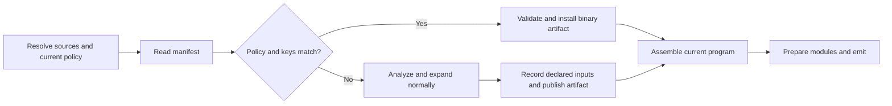

# Persistent compiler cache design

Status: proposed architecture, October 17, 2026. Persistent application caching
is not implemented. This design builds on `b51af6a` and the existing
[development workflow](dev-workflow.md). API and configuration names below describe
proposed behavior; they are not available compiler options yet, except
`--stats`, which reports cold-build phases and macro calls (light-cljs-310).

Cache completed namespace compilation in a versioned binary format. Reuse it
when conservative source, dependency, compiler, and configuration keys match.
Provide explicit APIs for external dependencies and opt-outs for work that must
execute again. Ordinary macro expansion is assumed reusable under this contract;
the compiler does not need to prove arbitrary macros pure.

A cache hit skips the namespace's analysis and macro calls. It restores immutable
compiler artifacts, not a JavaScript heap or the effects of those skipped calls.
This is an explicit incremental-compilation contract. An uncached fresh build
remains available when all compilation work must execute.

## Settled decisions

The user settled these on October 17, 2026. They fix the spellings this
document leaves to implementation; pellets do not reopen them. A measurement or
test that contradicts one is recorded under a new "Open questions" section.

- **CLI.** These flags go with `--compile`, `--watch` and `--reloadable`, parsed
  by hand in `src/main.rs` in the style of `CompileFlags::accept`:
  - `--cache-dir DIR` opts in and stores artifacts in DIR. During rollout the
    cache is off unless this flag is given.
  - `--cache-blocker NS` is repeatable. NS and every compilation consumer of NS
    never read or write the cache.
  - `--stats` prints a report to stderr: phase times, executed macro calls, and
    hits, misses and bypasses with reasons.
  - Once the cache is on by default, its default location is
    `.light-cljs/cache` under the current directory, and `--no-cache` turns it
    off. A fresh uncached build means no `--cache-dir` (later, `--no-cache`).
- **Namespace metadata.**
  - `^:light-cljs/no-cache` covers that namespace only: no reads or writes;
    ordinary invalidation still applies.
  - `^:dev/always` takes Shadow's meaning: always compile. The namespace and its
    compilation consumers get no cache reads or writes. In watch, every
    triggered step recompiles them as well as reloading them (today it only
    reloads them); the watch pellet updates
    [docs/dev-workflow.md](dev-workflow.md) ("The reload set", "Settled
    questions") to match.
- **The compile-time API is the bundled namespace `light.build`**, available to
  macros, to ordinary helpers running at compile time and to custom data
  readers:
  - `(b/resource "path")` returns the text and is an error if the resource is
    absent.
  - `(b/resource? "path")` returns the text or nil; absence is part of the key.
  - `(b/config :key)` returns the value given by `--config`, or nil when unset.
  - `(b/depend! {:resource "x"})` declares a dependency without reading. It also
    accepts `{:namespace sym}` and `{:provider token :fingerprint string}`.
  - `(b/depend-on! :namespaces)` depends on a broad view: `:namespaces`,
    `:declarations` or `:config`.
  - Paths resolve like namespaces, across every `--source-root`, and a path
    found in two roots is an error. A path starting with `./` or `../` resolves
    against the file of the namespace being compiled, the expansion site, as
    `shadow.resource/inline` does.
  - Configuration comes from the repeatable `--config KEY=EDN`, for example
    `--config app/flavor=:dev --config app/n=3`. The first implementation hashes
    the whole configuration map into every namespace key.
- **No new crate dependencies.** The codec is hand-written: explicit tags,
  little-endian byte order and an interned UTF-16 string table. Hashing is an
  in-tree SHA-256 checked against the NIST test vectors, following the
  hand-written JSON, bencode and HTTP already in this crate.
- **Rollout gates**, measured on Penpot `app.main --optimize none` on a quiet
  machine, alternating with cache-off runs at the same commit
  ([benchmarks/penpot.bb](../benchmarks/penpot.bb)); numbers go in
  [benchmarks/compiler-cache.md](../benchmarks/compiler-cache.md):
  - Every change: without `--cache-dir`, the cold build stays within +3% wall
    time and +5% peak RSS of its parent commit (21.97 s and 0.948 GB when this
    was decided).
  - Turning the cache on by default requires all of: a populating run at most
    +10% wall and +10% RSS over cache-off; a warm run with no edit at most 50%
    of the cache-off wall time; a warm run after editing one leaf namespace at
    most 60%; disk size reported, with no gate. If every gate is met the final
    benchmark change turns the cache on by default; otherwise it records the
    numbers and the cache stays opt-in.
- [docs/dev-workflow.md](dev-workflow.md) settled "No cache of compiled
  namespaces". Phase 4 below supersedes that for watch startup and session
  loading only. A watch step still recompiles the changed namespace against the
  retained program; the cache does not replace retained in-memory state.

## Goals and scope

- Reduce repeated macro expansion, analysis, and emission, including after a
  compiler restart and after localized source edits.
- Support ordinary and advanced output with reusable semantic IR.
- Give macro authors a small, explicit dependency and cache-policy interface.
- Keep disk and memory retention bounded, with understandable miss reasons.
- Preserve source resolution, declaration visibility, diagnostics, application
  initialization order, and generated-name hygiene across mixed hits and misses.

The measured Penpot main build takes 21.97 seconds and 0.948 GB peak RSS with the
native V8 backend. Parsing is a small part of the workload; macro execution and
form transport remain substantial. The cache must skip that work on a hit, not
re-execute macros merely to establish whether their results can be reused.
These are cold-build measurements, not predictions of warm performance. See the
[benchmark report](../benchmarks/penpot-investigation.md) and
[cold-build driver](../benchmarks/penpot.bb).

Initial scope is namespace artifacts for native entry compilation. Development
session reuse follows separately. Excluded are general effect tracking, automatic
purity inference, arbitrary mutation replay, serialized engine heaps, persistent
REPL application state, remote caches, and per-expression incremental queries.

## Lessons from Shadow

The inspected Shadow revision is
`b8d76ecdffc8bb441f4200f3121885f23dd1da2a`.

Shadow caches analyzer metadata and emitted JavaScript per namespace using
Transit JSON. It validates source and transitive dependency keys, compiler
identity, selected options, macro/helper source timestamps, lazy-module
assignments, and explicitly registered resources. Hits load required macro
namespaces but skip the consumer's macro calls and their effects.

It handles exceptions through policy rather than a general execution tracker:

- Default cache blockers include `clara.rules` and `clara.macros`, whose
  compilation side effects require their direct consumers to compile again.
- Its own test runner uses `:dev/always` because a macro discovers tests by
  inspecting the whole compiler namespace inventory.
- `shadow.resource/slurp-resource` records resource dependencies explicitly.
- Changes to broad tooling/external configuration invalidate conservatively.

Shadow's disk bypass and watch invalidation are distinct. `:cache-blockers` and
`:cache-level :off` prevent disk reuse but do not invalidate existing in-memory
output on every watch build. `:dev/always` does. Shadow also recompiles namespaces
with warnings; light-cljs will instead retain and restore successful diagnostics.

Adopt these principles with an explicit light-cljs contract. Keep binary semantic
IR, use content fingerprints for declared resources, and define blocker
propagation through our dependency graph. Shadow's direct-only blockers and
alias-based JVM helper discovery are not rules to copy unchanged.

Primary source references:

- [Cache validation and restoration](https://github.com/thheller/shadow-cljs/blob/b8d76ecdffc8bb441f4200f3121885f23dd1da2a/src/main/shadow/build/compiler.clj#L975).
- [Default side-effect blockers](https://github.com/thheller/shadow-cljs/blob/b8d76ecdffc8bb441f4200f3121885f23dd1da2a/src/main/shadow/build/api.clj#L111).
- [Disk gate and retained output](https://github.com/thheller/shadow-cljs/blob/b8d76ecdffc8bb441f4200f3121885f23dd1da2a/src/main/shadow/build/compiler.clj#L1115).
- [Explicit resource API](https://github.com/thheller/shadow-cljs/blob/b8d76ecdffc8bb441f4200f3121885f23dd1da2a/src/main/shadow/resource.clj#L11).
- [Test discovery opt-out](https://github.com/thheller/shadow-cljs/blob/b8d76ecdffc8bb441f4200f3121885f23dd1da2a/src/main/shadow/test/node.cljs#L15).

## Cache contract

A namespace is cacheable by default when its supported source inputs have stable
identities and no applicable opt-out is set. The compiler assumes its expansion
results depend on the recorded inputs. This is a contract with macro authors,
not a claim that the compiler detects every source of nondeterminism.

On a validated hit:

1. Restore declarations, expanded/analyzed bodies, diagnostics, and deferred-unit
   descriptions in the required source order.
2. Register macro/helper code for later demand in the current evaluator.
3. Skip the compilation represented by the artifact, including its macro calls.
4. Run application preparation, lazy-target validation, optimization, and emission
   as required by the current build options.

Loading code or registering a helper does not restore previously mutated roots,
failed initializer values, or effects of skipped macro calls. Each fresh
compilation starts with fresh evaluator state. Retained watch sessions keep
their existing state and reload rules. The cache does not execute application top-level forms
at compile time; emitted applications retain their normal initialization order.

### Macro-author responsibilities

Macros that depend on files, configuration, or provider data should obtain those
inputs through the dependency APIs below. Macros that need clock/random values,
undeclared host observations, or compilation effects on every build should opt
out at the namespace or macro-provider level. The compiler does not intercept
arbitrary `Date`, `Math.random`, atom mutations, or JavaScript property access.

An undeclared input may produce stale output. A skipped stateful macro may leave
a different compile-time state for a later miss. These limitations are part of
the cache-enabled contract and must be documented with the controls, not hidden
behind a claim of identical fresh-build effects.

For example:

```clojure
;; macros.cljs
(ns macros)
(def counter (atom 0))
(defmacro next-value [] (swap! counter inc))

;; dep.cljs
(ns dep (:require [macros :refer [next-value]]))
(def value (next-value))

;; main.cljs
(ns main (:require [dep :as d] [macros :refer [next-value]]))
(js/console.log d/value (next-value))
```

An uncached fresh build prints `1 2`, as covered by the existing
[macro tests](../tests/compiler/macros.rs). With no opt-out, a cached `dep` and
recompiled `main` can print `1 1`: the earlier increment did not run. Putting
`macros` in the build's cache-blocker set forces its compilation consumers,
including `dep` and `main`, to miss in a fresh build. If they must also recompile
on every watch build, use the always-compile policy for that provider.

Likewise, an unannotated timestamp macro can retain its earlier expansion on a
hit. Either supply an explicit build-time value as a keyed configuration input
or opt out. We do not add an effect system to rediscover those requirements.

## Explicit dependency APIs

Provide a small compiler service interface available from macros, ordinary
helpers executing at compile time, and custom data readers. The following are
API capabilities; final function names belong to implementation.

| Capability | Recorded dependency |
| --- | --- |
| Read a resource | Resolved provider identity, logical path, and hash of the exact bytes returned |
| Read build configuration | Requested key/path and value fingerprint, including a distinct missing value |
| Declare a dependency | A namespace/source identity, resource, or host-provider token with a stable fingerprint |
| Depend on a broad compiler view | A coarse namespace inventory, declaration view, or build-configuration fingerprint |

Record dependencies in the compiler-owned manifest of the compilation unit that
uses the result. A helper's or data reader's dependencies must propagate to every
artifact that incorporates its result, including when helper analysis was reused
in memory. Nested deferred compilation must attribute dependencies to the right
units without losing them when its temporary analysis state is released.

Resource reading and dependency recording are one operation. Hash the bytes
actually returned, not a separate later read. Record optional-resource absence
and resolution search identities so adding or shadowing a resource invalidates
the result. A provider without a stable identity makes the consuming work
non-cacheable. Provider validation must not invoke arbitrary macro code.

For the first implementation, hashing the complete declared build configuration
is acceptable even if a macro reads one key. Over-invalidation is preferable to
an incomplete key. Arbitrary environment-variable or filesystem access outside
these services is not automatically observed; it requires a declared provider
input or an opt-out.

These services track explicit dependencies at known compiler boundaries. They
do not log every runtime read, discover a general call graph, or replay writes.

*As built (light-cljs-312):* the resource and declaration rows are
`light.build/resource`, `resource?` and `depend!`, documented in
[compiler.md](compiler.md), "Compile-time services: light.build";
configuration and the broad views are light-cljs-313's (below). Both compile-time
engines run one JavaScript object, `lightCljsBuild` (`src/build_services.js`),
over a string service that `src/build_services.rs` answers, so V8 and QuickJS
behave identically: the session heap gets it when the compilation session
attaches, and the data-reader heap when it is created. These choices settle
what the section leaves open:

- The caller is described by the JavaScript side. `compiler_roots.js` keeps a
  stack of the deferred units whose initializers are running, and the Rust
  catalog knows the units being analyzed. A read is recorded on the namespace
  being analyzed and, as helper reads, on the namespace of every such unit (or
  of the form a data reader reads). The manifest gives helper reads to that
  namespace and to its whole reverse closure through compilation edges, which
  covers reuse in memory without tracking values.
- Each record goes into the compilation's `ObservationLog` the moment the
  service answers, so `release_application_ir` and nested deferred
  compilation cannot lose it. Inputs are interned: `DependencyManifest::inputs`
  holds each distinct input once and each `NamespaceRecord::external_inputs`
  lists `InputId`s, ascending.
- A relative path resolves against the expansion site: the innermost unit
  being analyzed, or the namespace being analyzed. When an initializer is the
  innermost code running there is no site, and `./` is an error.
- The site's directory is that of the file the provider returned for the
  site namespace, as a logical path: `ResourceProvider::directory` places
  the file under the roots (`FileSourceProvider` strips the first root that
  holds it, as named, then canonically), and the result is searched in every
  root like any path. A file the provider cannot place (REPL input, an entry
  file outside every root, an embedding provider without `directory`)
  resolves by the namespace's name instead: `my-app.ui.core` resolves
  `./x.txt` to `my_app/ui/x.txt`. Each source's site is its namespace and
  file by source index, so a deferred unit analyzed later resolves against
  the namespace that defined it.
- Service arguments must be well-formed text: a NUL or a lone surrogate is
  refused in `src/build_services.js` before any request, because V8's bridge
  would replace a lone surrogate and QuickJS's refuse it.
- A read when the provider supplies no resources at all is an error, and is
  recorded as a non-cacheable absent resource, since a macro can catch it.
- Interactive compilation (`EvalSession`, `DevSession` and so a watch's
  session and the dev REPL) serves `light.build` for the compiler's whole
  life with its source provider's resources. Every form is source 0 there,
  and its current namespace is the site, set before each form is read,
  analyzed or macroexpanded. A session records no manifest, so nothing is
  attributed. `BuildGuard` restores the context it replaced when it drops.
- `ResourceDependency::stable` is false when the `ResourceProvider` is not
  `stable` or answered without an identity; `cache_policy::non_cacheable_inputs`
  turns those into the policy's `NonCacheableInput` list. Ambiguity and
  provider errors are compile errors, and they are recorded too, since a
  macro can catch them: an ambiguous lookup as an absent stable resource with
  its candidates, which change when a copy goes, and any other provider
  failure as non-cacheable.
- An artifact's manifest carries the namespace's inputs
  (`ManifestFields::inputs`, artifact schema version 2), so a lookup can
  check them without decoding a section.
- `{:namespace sym}` records the name and, when that namespace loaded earlier,
  an observed edge to it; otherwise the name is among the absent ones, so its
  later appearance invalidates.

*As built (light-cljs-313):* the configuration and broad-view rows are
`light.build/config` and `light.build/depend-on!`, over the same string
service. These choices settle what the section leaves open:

- `--config KEY=EDN` is repeatable with `--compile --entry`, `--reloadable`
  and `--watch`; embedders pass a `BuildConfiguration` to
  `MacroHost::set_build_configuration` and `EvalOptions::configuration`.
  KEY is a keyword name without its colon, and EDN is read with the
  compiler's syntax reader (`parser::parse`) and limited to keywords,
  numbers, strings, booleans, nil and lists, vectors, maps and sets of them;
  numbers are decimal integers and floats, the ones the EDN reader reads as
  JavaScript numbers (`1N`, `1M`, `36rN`, `0x10` and ratios are refused). A
  symbol, a tagged literal, an auto-resolved keyword, a map key or set
  element repeated by value (`{"a" 1 "\u0061" 2}`, `#{1 1.0}`), more than
  one form or a key given twice is an error. Each value is kept as canonical
  text (numbers as the JavaScript number they read as, strings re-escaped,
  collections single-spaced, discards dropped), which `config` reads back
  with the EDN reader, so V8 and QuickJS see the same data.
- The fingerprint is the SHA-256 of the whole map's canonical text, keys
  ascending: `{}` for the empty map, which differs from every non-empty
  one. `cache_key::KeyEnvironment::new` takes it from the host as the key's
  config component, and the keys hash both new input variants. It is one interned `ExternalInput::Configuration` in
  `DependencyManifest::inputs`, which every namespace's `external_inputs`
  lists, whether or not it reads a key (the log carries it as
  `ObservationLog::configuration`). Equal values spelled differently, such as
  maps with their entries in another order, get different fingerprints:
  over-invalidation, which the design allows. Keying each namespace on the
  keys it reads is a later optimization.
- A view is `ExternalInput::View(BroadView)`, recorded and attributed like a
  resource read: on the namespace being analyzed, and as a helper read on the
  namespaces of the deferred units running and so on their reverse closures.
  The views carry no fingerprint of their own; the keys (light-cljs-319,
  completed by light-cljs-354) compute them: for `:namespaces` the
  inventory of the build's names and source identities, for `:declarations` the declarations of every earlier
  namespace, which a namespace that runs a source macro
  already depends on through `EdgeKinds::COARSE`, and for `:config` the
  configuration fingerprint every namespace already has. Finer views are a
  later optimization.
- The manifest encodes the configuration as tag 3 with its 32-byte SHA-256
  and a view as tag 4 with one byte, artifact schema version 5.

## Opt-outs and their propagation

Expose separate controls for persistent storage and recompilation. The following
names are semantic labels; exact CLI, embedding, and namespace-metadata spellings
must be consistent when implemented.

| Control | Persistent cache | Running watch session |
| --- | --- | --- |
| Build: persistent cache off | No reads or writes for the build | Existing incremental state remains; this alone does not force recompilation |
| Namespace: cache off | No reads or writes for that namespace | Ordinary invalidation still applies |
| Build: cache-blocker namespace set | No reads or writes for blockers and their transitive compilation consumers | Ordinary invalidation still applies |
| Namespace/provider: always compile | No reads or writes for it and affected compilation consumers | Invalidate that set on each triggered build |
| Fresh uncached build | No persistent reuse; fresh compiler/evaluator context | Separate operation, not an implicit reset of a live session |

Initially, compilation-consumer propagation uses the conservative transitive
runtime, macro, and helper dependency graph. This deliberately over-invalidates
compared with Shadow's direct-only blocker rule. Unrelated namespaces that share
state through undeclared JavaScript are not discovered: declare that dependency
or disable caching for the broader build.

Resolve policy from current build configuration and source metadata before
accepting a candidate. Changing a blocker or always-compile setting must take
effect even when an old artifact exists. Keep the same policy evaluator for
initial builds and watch invalidation. Clearing disk artifacts alone must not
be presented as clearing a live compiler's state.

An always-compile flag acts when a build is triggered; it does not create a
watch event for an unregistered external input. Registered resource dependencies
must participate in watching as well as restart validation. Preserve the
existing watch session's state semantics when recompiling; always compile does
not promise a fresh macro heap on each edit.

*As built (light-cljs-314):* the evaluator is
`light_cljs::cache_policy::evaluate`. It takes the build's `CacheSettings`
(whether the persistent cache is on, and the `--cache-blocker` names), the
`NamespaceMetadata` of each namespace's `ns` form, the `light.build` inputs
that cannot be keyed, and the build's `DependencyManifest`. No artifact is an
input. `source_metadata` reads the flags from the `ns` symbols the macro host
keeps for the current sources: `:light-cljs/no-cache` and `:dev/always` in
the form's metadata or attribute map, set by any value but `nil` and `false`.
No flag reaches it yet; the `--compile` integration (light-cljs-322) adds
`--cache-dir` and `--cache-blocker` and reports its `describe` lines.

The returned `CachePolicy` keeps every reason that applies to a namespace and
reports the first in this order: cache off, `^:light-cljs/no-cache`,
`^:dev/always`, blocked, non-cacheable input. These implementation choices
settle what the table above leaves open:

- **Propagation follows every compilation edge.** Always-compile, blockers
  and non-cacheable inputs reach the manifest's `reverse_closure`: runtime,
  macro-provider, helper, observed and coarse edges, never `LAZY` ones.
  Because a coarse namespace depends on every earlier one, a blocker early in
  load order bypasses every later namespace that ran a source macro.
- **A non-cacheable input propagates like a blocker.** A consumer's key
  covers its dependencies' declared inputs, and an input without a stable
  identity has no fingerprint to cover.
- **Each propagated reason keeps a shortest path** from the namespace that
  set it, through one breadth-first walk of the reverse rows per reason, with
  one predecessor per namespace.
- **The always-compile set is computed even with the cache off**, because
  watch recompiles it on every triggered step whether or not a disk cache
  exists.
- **A blocker the build does not load blocks nothing.** Warning about it
  belongs to the flag's integration.

## Conservative keys and invalidation

Each namespace manifest includes:

- Source content and kind (`.cljs` or `.cljc`), resolved identity, and relevant
  source locations for diagnostics and macro-visible provenance.
- Compiler implementation, embedded runtime/bootstrap, bundled first-party
  library, and binary-schema identities.
- Analysis/macro options: warning mode, assertions, `opaque_packages`, reader
  features, custom/default reader implementations, and declared host config.
- All transitive source dependencies, including macro providers and ordinary
  helper sources. Begin with namespace dependencies, not used-function guesses.
- Incoming compiler-visible declarations, macro generations, reader contexts,
  and extension visibility, represented by conservative view fingerprints.
- Dependency resolution results and search order, including missing lookups,
  fallback library selection, and newly shadowing source files.
- Explicit resource/config/provider dependencies and broad-view declarations.

A hit requires these inputs to match and current policy to permit reuse. Runtime
mutation history is not part of a general automatic key. An ordinary helper
implementation change invalidates consumers even when its signature is unchanged.
Dependency fingerprints also cover their declared external inputs and relevant
semantic metadata; matching dependency source hashes alone is insufficient.
Reflective dependencies outside the ordinary source graph must use an explicit
broad-view dependency or an always-compile policy.

Use content fingerprints for source and resource values. Timestamps can avoid
unnecessary filesystem work but are not the final semantic key. Detect inputs
that change while compiling before publishing an artifact; do not validate one
version and store a result from another. Use the same dependency manifest for
restart validation and reverse invalidation in watch mode, including helper
and external-resource edges.

Keep front-end keys separate from emission keys. Output mode, maps, defines,
optimization, exports, and module layout invalidate every stage they actually
affect. Conservatively including an option in both keys is acceptable initially.
Backend-specific code sections include engine/ABI identity; reuse portable IR
across backends only after compatibility tests cover the relevant options.

Finer interface fingerprints, unchanged-result propagation, and definition-level
queries are later optimizations. They are not prerequisites for the first cache.

*As built (light-cljs-311):* the dependency and resolution items are
`light_cljs::dependency_manifest::DependencyManifest`, which
`compiler::analyze_namespace_entry_with_dependencies` returns beside the
program. No other entry point records one, so builds without it do no extra
work. A namespace is a dense `NamespaceId`, its source index. Its edges are
stored twice as compressed rows, forward and reverse, and every compilation
edge points to an earlier namespace. `closure` and `reverse_closure` walk
those rows, and no per-namespace copy of the graph is kept. Edges carry
`EdgeKinds` bits:

- `RUNTIME`: a direct require, after `clojure.X` rewrites, including the
  implicit `light.lazy` require.
- `MACRO_PROVIDER`: a direct require of a namespace that declares macros.
- `HELPER`: a direct dependency of a macro provider, whose code the provider's
  macros may run while the consumer expands them.
- `OBSERVED`, `COARSE`: the observations below.
- `LAZY`: a `light.lazy/loadable` target. It is checked when the program
  closes, may come later in load order, and is not a compilation edge.

Each namespace records its `SourceIdentity`: the resolved file, `.cljs` or
`.cljc`, provider or bundled, and the provider `Lookup` it came from. A lookup
lists every candidate tried, in order: each root at `.cljs`, then each root at
`.cljc` when no `.cljs` was present, each marked present or absent. A file that
would shadow the result or make it ambiguous is therefore an absent candidate
of the current record. A bundled library keeps the provider lookup it fell
back from.

Each require records what it became: a namespace, the virtual core, or a
`goog.*` host namespace. It also records its form (as written, a
`ClojureRewrite`, or the `ImplicitLazy` require) and the extra lookups that
decided it: the `goog.*` source check, and the `clojure.X` check before
`cljs.X`. A custom `SourceProvider` reports candidates through
`load_traced`. The default reports none, only the provider's answer.
`external_inputs` is empty until light-cljs-312 and light-cljs-313 add the
`light.build` inputs.

The audit of what analysis can observe outside the require closure found the
following:

- **Qualified names of loaded, unrequired namespaces.** The analyzer resolves
  `ns/name` and dotted `ns.name` against any namespace already loaded, which
  is how a macro expansion names its own namespace's dependencies. Each
  resolution is an `OBSERVED` edge from the namespace being analyzed. The
  macro host's fully qualified macros of a loaded namespace are
  `OBSERVED | MACRO_PROVIDER`. `ns-publics`, `ns-interns`, `ns-imports` and
  `ns-refers` of a named namespace are `OBSERVED` too.
- **Lookups that found nothing.** Some lookups miss: a dotted symbol's prefix
  that is not loaded (`Math.PI`), a warning-mode unknown qualifier, or a
  reflected namespace not loaded yet. These go in the namespace's `absent`
  names, because loading such a namespace earlier changes the result.
- **The declaration view of a source macro: the coarse fallback.** A source
  macro (or a quoted `macroexpand` of one) runs with the whole compilation's
  declaration view, and no edge can attribute that view:
  - Every declaration bundle registered so far, whichever namespace
    registered it: protocols, types, extensions and multimethods. This
    includes an earlier namespace's first one. A namespace that declares
    nothing today can change the expansion by adding an extension.
  - Every loaded macro, with its metadata and generation, in `&env`'s
    `:light-cljs/macros`.
  - The namespace inventory of `all-ns`, `find-ns` and `the-ns`, however
    they are reached (by symbol, `#'` or `resolve`).

  A namespace that ran a source macro is therefore `coarse`. It gets
  `COARSE` edges to every earlier namespace, and only that namespace does.
  Namespaces that only expand core macros and resolve names keep their exact
  edges. This is the one case that needed the fallback.
- **Analysis-time tables.** Analysis reaches protocol and record tables only
  through resolved globals, so the edges above already cover them. Compiler
  data readers run in their own heap, with no namespace declarations.
- **Macro generations and reader contexts.** Inside analysis, these are not
  cross-namespace observations:
  - `CompiledMacro.generation` counts redefinitions of one macro key inside
    its defining namespace.
  - `CompilationUse.generation` counts a unit's Var generations within one
    compilation.
  - A macro's reader environment holds the expanding namespace's own context
    and the per-compilation `READER_GENERATION`.

  Through `&env` a source macro can read other namespaces' macro metadata and
  generations; that is part of the coarse view above. Otherwise they are
  private identities of the defining namespace, which artifacts normalize
  (see "Generated names").

On Penpot `app.main` the manifest holds 922 namespaces and 356,265 edges. There
are 1,163 lookups with 7,485 candidates, and 676 of the namespaces are coarse.
An edge may carry several kinds:

| Kind | Edges |
| --- | ---: |
| `RUNTIME` | 9,660 |
| `MACRO_PROVIDER` | 2,162 |
| `HELPER` | 8,774 |
| `OBSERVED` | 338, none outside the require closure |
| `COARSE` | 354,851 |
| `LAZY` | 7 |

Walking every namespace's reverse closure takes 63 ms. Analysis took 27.0 and
26.0 s without the manifest and 26.1 and 26.0 s with it, alternating at load
about 10: building it costs nothing measurable.

*As built (light-cljs-319):* the keys are `light_cljs::cache_key`, on the
in-tree `light_cljs::sha256`, which the tests check against NIST's CAVP
SHA-256 short message (65), long message (64) and Monte Carlo (100
checkpoints) vectors, kept verbatim in `tests/fixtures/sha256`. Every key is
a `sha256::Fingerprint`: each field is a kind byte, a u64 length and its
bytes, lists carry their count, and each fingerprint starts with a domain
name, so no two different field sequences hash the same bytes.

`NamespaceKeys::compute` takes a `KeyEnvironment`, the dependency manifest
and the sources, and keys every namespace in source order. A `FrontEndKey`
is the digest of eight component digests, which it keeps, and
`FrontEndKey::mismatch` names the first component that differs from a
stored key. That is the `--stats` miss reason: "compiler changed",
"analysis options changed", "config changed", "source changed",
"resolution changed", "dependency app.util changed", "external input
changed" or "earlier namespaces changed". The components:

- **Compiler.** `build.rs` hashes every file under `src/` (the embedded
  runtime, bootstrap units, core macros and bundled first-party libraries
  are there), `build.rs`, `Cargo.toml`, `Cargo.lock` and the vendored
  `rquickjs-sys`, `v8` (with its patch) and `v8-headers`, by path and
  content, with the enabled features, profile, optimization level, target,
  `RUSTFLAGS` and `rustc -vV`. Any edit, even to a comment, is another
  compiler. The key adds the artifact `SCHEMA_VERSION`, the core operation
  table and the macro engine: V8 with its version for clean compilations,
  QuickJS for interactive ones, so a key never matches across engines.
  Hashing about 16 MB adds 0.4 s to a debug build-script run (1.1 s to
  1.5 s), which reruns on any edit under `src/`.
- **Options.** Every `AnalysisOptions` field (the warning mode among them),
  assertions (`--elide-asserts`), `opaque_packages`, the reader features
  (`:cljs`), each compiler data reader's emitted source by tag and the
  default reader's, an interactive host's name policy, the logical macro
  limits (`--macro-expansions`, `--macro-nodes`, the expansion depth) and the
  evaluator stack and memory limits, which a macro can observe by catching
  their error. The deadline and poll budget terminate work, which is never
  stored, at machine-dependent points, and are left out. A registered
  data reader is always source, so it has a stable identity; there is no
  reader without one today.
- **Config.** The fingerprint of the host's `--config` map
  (`MacroHost::build_configuration`), which `KeyEnvironment::new` takes.
  It is also the `:config` broad view.
- **Source.** The name, whether it is the entry, the resolved file, `.cljs`
  or `.cljc`, provider or bundled, and the SHA-256 of the text.
- **Resolution.** The lookup of the name, with the namespace that asked,
  every candidate, present or absent, and the file found; each require as written, its target, its form
  and the lookups that decided it.
- **Dependencies.** Every compilation edge but the coarse fallback's, with
  its kinds and the target's own key: a Merkle hash, so an edit to a helper
  that keeps its signature changes every consumer's key. A `LAZY` edge is
  not a compilation dependency and is left out.
- **Inputs.** Each `light.build` input: a resource's path, candidates,
  identity, SHA-256 and length or absence, and stability; a declared
  namespace; a provider's token and fingerprint. `ResolvedResource` holds
  the SHA-256 since this pellet, replacing light-cljs-312's temporary
  FNV-1a. Since light-cljs-313, the configuration's fingerprint and each
  broad view's tag.
- **View.** Whether the namespace is coarse and, if so, a chain digest of
  every earlier namespace's name and key in source order (one hash per
  namespace, so the coarse edges cost nothing extra), and for each name it
  looked for and did not find, whether an earlier namespace has it now.
  *As built (light-cljs-354):* a namespace with the `:declarations` broad
  view gets the same chain whether or not it is coarse, since a helper's
  view is attributed to namespaces that ran no source macro. One with the
  `:namespaces` view gets the build's inventory, every namespace's name and
  source identity (file, `.cljs` or `.cljc`, provider or bundled) in source
  order, later ones included, since a watch step recompiles against a
  retained program that holds them. A namespace that appears anywhere in the
  build, goes or moves changes its key, and an edit to a namespace's text
  does not. The keys still come in source order: the inventory takes no
  key, only the manifest's records, so it needs the compilation's complete
  manifest.

`cache_key::emission_key` is separate: the front-end key, the compiler, and
every `ApplicationOptions` field (`--optimize`, defines, exports,
`--pseudo-names`, the inlining and folding switches), the output layout
(script, `--esm`, `--out-dir` chunks, `--reloadable`), the source map
output and, once the caller has it, a fingerprint of the module plan: which
chunk holds the namespace and what it imports, which depends on the whole
program's lazy roots rather than on the namespace's inputs. The front-end
key takes none of them. Nothing is reused by the emission key until
artifacts hold emitted sections, and the measurement path passes no module
plan.

`cache_key::revalidate` re-reads a namespace's inputs after it compiles: it
repeats every lookup of its resolution through the source provider and
compares the candidates and file found, asking as the loader asked (the same
requesting namespace), compares the source text's SHA-256
with the text compiled, and re-reads each resource. It reports the first
input that changed, and the store (light-cljs-321) refuses to publish then.
Keys use content hashes only; nothing reads a timestamp.

Each `LIGHT_CLJS_CAPTURE_ARTIFACTS` mode now also records the manifest,
keys every namespace and re-validates it. `--stats` reports
`cache.keys.namespaces`, `cache.keys.source-bytes`, `cache.keys.changed`,
`cache.keys-ms` and `cache.revalidate-ms`, and `encode` encodes each
artifact with its real keys. Penpot's numbers are in
[benchmarks/compiler-cache.md](../benchmarks/compiler-cache.md).

### Open questions

- **The coarse fallback is broad.** Every namespace that runs a source macro
  depends on every earlier namespace. That is correct but costs cache hits:
  editing an early namespace invalidates every later macro user. A finer key
  could replace the coarse edges with a fingerprint of the declaration view
  (bundles, macro metadata and the namespace inventory), as the
  `:declarations` and `:namespaces` broad views of `light.build` will
  fingerprint them. It could also record the bundles a macro actually
  demanded. That is light-cljs-347, deferred until light-cljs-328 measures
  hit rates.

## Binary artifacts

Use one immutable artifact per completed namespace, with references to any shared
deferred-unit records. The first implementation must capture the information
needed to install a namespace without analyzing its source or executing its
skipped macro calls. [Analysis and expansion](../src/analyzer.rs) currently
interleave; running that traversal again would defeat the purpose of the cache.

| Section | Contents |
| --- | --- |
| Header and manifest | Version, namespace identity, keys, dependency/policy declarations, section bounds and integrity checks |
| Declaration metadata | Vars, arities, types/protocols, aliases, refers, macro generations, and visibility information |
| Semantic IR | Expanded and analyzed bodies before application optimization |
| Deferred-unit descriptions | Bodies or equivalent prepared representation, definition-site snapshots/frontiers, and registration descriptions |
| Diagnostics and provenance | Warnings, source identities/spans, reader metadata, and macro-origin information |
| Compiler-owned accounting | Logical work counts, relevant depth bounds, and generated-name information |
| Optional derived output | Emitted JavaScript/maps or helper code when measurement justifies storing them |

Semantic IR remains necessary for whole-program optimization, runtime slicing,
and lazy-module placement. Per-namespace JavaScript alone is not sufficient.
Final target validation and module preparation run on the assembled program.

Completed [deferred units](../src/compilation_session.rs) can release their IR
while retaining prepared code. Capture the reusable representation at that
lifecycle boundary. Do not keep duplicate whole-program snapshots merely to
write the cache later. Persist either sufficient unit IR/descriptors or its
prepared equivalent; avoid storing both by default.

*As built (light-cljs-315):* `src/namespace_artifact.rs` defines the
in-memory artifact, and `src/artifact_capture.rs` fills it at the drain
boundary. Its sections:

- **Header:** the namespace, the file the loader read, its length, `.cljc`
  reading and whether it was the entry, whose body returns the program's
  value (so the IR differs), and the body's root.
- **Declarations:** the globals the analysis created, with their flags,
  metadata, visibility and session binding kind; protocols, record
  constructors, type fields and methods, and macro functions; each `defmacro`
  with its generation, its metadata (including `:light-cljs/generation`), its
  definition site and its compile-time JavaScript; the `ns` form's aliases,
  requires, refers, excludes and host refers; the reader context; the macro
  host's imports, renames, `:import`s, namespace symbol and docstring; and the
  lazy targets.
- **Semantic IR:** the expressions from `first_expr` on, which include the
  drained units' bodies, with their bindings, recur targets, strings, names
  and host paths, before application optimization.
- **Patches:** earlier globals whose flags or metadata the namespace changed,
  found by comparing the globals table with a frozen clone taken before the
  analysis (`Arena::changed_entries` compares only the leaves a write
  copied). Defining a Var that an earlier namespace's lazy target or
  existence probe reserved is the common case.
- **Deferred units:** each unit's prepared compile-time JavaScript, the
  declarations it saw (its view: this namespace's globals up to its
  definition, and the globals its own analysis added), its definition-site
  extension frontier relative to the namespace, and its compilation use as of
  the capture; and the session's root and bundle registrations, as data. The
  catalog now keeps a bundle registration as a `BundleRecord` and renders its
  JavaScript when it evaluates it. Unit IR and `DefinitionSnapshot` programs
  are not kept: the prepared code and the view are the prepared equivalent.
- **Diagnostics and provenance:** the warnings analysis reported about the
  namespace's own source, in their (sorted) order, with spans; the `ns`
  form's warnings stay the loader's. Every source macro call the analysis
  expanded, nested ones included, in expansion order: the macro by name and
  generation, the call's span and the macro's definition site. The IR keeps
  no per-expression expansion chain once forms are released, so this list is
  the macro-origin record; compiler-owned `cljs.core` macros are part of the
  compiler and are not listed.
- **References:** earlier namespaces and globals by name, with the global's
  declaration state and visibility. A program has one global per namespace and
  name, which capture checks against the name index.
- **Names and accounting:** the generated-name marks (light-cljs-317, see
  "Generated names") and the logical accounting (light-cljs-318, see "Loading, diagnostics, and
  storage").

Local references are dense indices into the artifact's own tables. A
`(var x)` of an earlier Var shares that global's metadata expression; the
artifact records it as `VarMetadata::Global`, the metadata the global had
when the namespace began. A protocol or record defined on a global that an
earlier namespace reserved is a declaration of this namespace on an external
global, with a patch for its flags. Source indices are `SourceRef`s, deferred
unit IDs `UnitRef`s, and the `globalThis.__lightCompilerTest(N)` calls in
compile-time JavaScript are recorded by byte range (`RelocatableCode`); the
code is lexed to find them, so the same text in a string or comment is not a
reference. Declaration and `:test` unit names
are kept without their numbers, and a `defmethod`'s extension identity as its
offset in its own source. The types name no program ID, `Rc`, `Arc` or engine
handle, which a test checks against the module's text.

Capture refuses, with a reason, what it cannot represent yet rather than
producing a partial artifact: a unit that was never analyzed, is still being
analyzed, or failed; IR that
refers to an earlier namespace's expressions, bindings, recur targets or
lazy sites; a change to an earlier protocol, type, macro function or reader
context; and warnings about another source. A failed analysis produces no
artifact, and a refused capture still takes its namespace's macro and
expansion records, so they never reach the next namespace's artifact. On
Penpot no namespace is refused. A unit's analysis count and whether it ran are those at the
capture: a later namespace's macro may still run it, and installation reads
the current compilation's counts.

### Representation and relocation

Use an explicit versioned binary schema with compact tables and interned UTF-16
strings. Define tags and byte order. Preserve metadata, collection order,
provenance, special numeric values, and required identity relationships. Never
serialize Rust memory layouts, pointers, reference counts, or engine handles.

Local references use artifact-local indices. External references use stable
namespace/definition identities with relevant generation/visibility information.
Resolve them into current arena IDs using indexes rather than repeated global
scans. Source indices and deferred-unit IDs also need relocation; rebuild
JavaScript registrations that refer to `__lightCompileUnit` IDs.
[Program fragment remapping](../src/program_fragment.rs) offers useful machinery,
but its shared-prefix assumption is not a portable disk format.

Keep the manifest readable without decoding all IR. Start with bounded ordinary
decoding. Choose the encoding library using representative Penpot artifact sizes
and load costs; compression, mapping, and zero-copy access are optional later work.
A whole-program snapshot may be useful as a format experiment, but localized-edit
reuse is the reason to retain namespace granularity as the target architecture.

*As built (light-cljs-316):* installation is the inverse of capture and
shares no code with `program_fragment::append`, whose shared prefix does not
exist here. An artifact's own tables land after the program's, so each local
reference is an offset; an earlier namespace's global resolves through the
analysis's (namespace, name) index and an earlier namespace, host path or
lazy namespace through indexes `artifact_install::InstallIndex` extends as
the program grows, so no table is scanned. Source indices become the
current program's; the patches to earlier globals are applied; a
`VarMetadata::Global` takes the metadata the global has when installation
begins, which is the state the namespace began with. Installed in the same
source order as captured, the program's tables have the same entries at the
same IDs as an uncached analysis, except that an IR reference to an earlier
namespace's string or symbol, which capture copies into the artifact, is
appended as a copy, which shifts the IDs of later strings without changing
what they hold. The deferred units are registered again in the
`CompilationSession` catalog at the next unit IDs, in the `Prepared` state,
with their `__lightCompilerTest(N)` references rewritten and their
registrations replayed in order: a root names its unit's new ID, a
`declaration#N` or `:test#N` name takes it, and a bundle's JavaScript is
rendered from its relocated `BundleRecord`. Their counts are this
compilation's: not analyzed and not executed until a later miss demands
them. A unit's registration view is the program's globals up to its
frontier (a shared frozen clone) plus the globals its analysis added, with
the program's namespaces and the namespace's reader context as the unit's
own registration named it (`RegistrationView::reader_context`, which can lack
a macro the namespace declares later). The relocations a unit's code records
must be in text order without overlap, or the artifact is refused. The macro
host gets the `ns` declarations, each Var's compile-time binding and
visibility, and the macros, whose functions are evaluated, with their
registration, on their first expansion rather than on installation; a
compilation whose first macro is an installed one starts its macro session
then. Installed namespaces also add their definitions' arities, which later
namespaces' arity diagnostics read.

*As built (light-cljs-320), the byte format:* `src/artifact_codec.rs` is a
hand-written encoder and decoder for `NamespaceArtifact`, which settles the
"encoding library" question above: there is none, as the settled decisions
require, and SHA-256 is the in-tree `src/sha256.rs` (checked against the
FIPS 180-4 vectors; light-cljs-319 builds the keys on it). The module's
comment gives the layout. In short:

- **Header.** The magic `LCLJSART`, `SCHEMA_VERSION` (5 since light-cljs-313
  added the configuration and broad-view inputs, 4 since light-cljs-319
  added the key components and SHA-256 resource hashes, 3 since light-cljs-318
  added the analysis policy and the accounting, 2 since light-cljs-312 added
  the external inputs, 1 before) as a little-endian
  u32, a byte-order mark, the manifest's length and the SHA-256 of the header
  and manifest.
- **Manifest.** Readable with `artifact_codec::read_manifest`, which checks
  its hash and the section table and decodes nothing else. It starts with
  the section table: kind, offset, length and SHA-256 of each section. Then
  the namespace, path, source length, `.cljc` and entry flags, the
  front-end key with the digest of each of its components (see "Conservative
  keys and invalidation"), the emission key, a digest of the compiler's
  core-operation table, the namespace's requires and referenced namespaces,
  its dependency edges with their `EdgeKinds` bits, the dependencies its
  front-end key covers with their kinds and keys, its `light.build` external
  inputs (each resource with its logical path, every candidate tried, its
  answer's identity, SHA-256 and length or its absence, and its stability; each declared
  namespace and provider token with its fingerprint) and its policy flags
  (`ManifestFields::of` takes them from a `DependencyManifest`). Manifest
  text is inline UTF-8.
- **Sections, in order.** The interned UTF-16 string table (each distinct
  text once, by first use), declarations (with references and patches),
  semantic IR, deferred units, diagnostics, and generated names with the
  accounting slot. All text outside the manifest is a string-table index.
  Counts and indices are LEB128 varints, signed integers zigzag varints,
  and doubles their IEEE-754 bits, so `-0.0`, the infinities and every NaN
  payload come back bit for bit. Every enum is an explicit tag; a `CoreFnId`
  is its row in `src/core_operations.tsv`, which is why the manifest records
  the table's digest. References stay the artifact's dense indices, so
  shared identities stay shared.

`artifact_codec::decode` takes `DecodeLimits` and a cancellation callback.
The limits are the total bytes, the entries per table, the code units per
string, the reader-data depth (1,024 by default), the bytes the decoded
artifact may allocate (4 GiB) and the longest expression chain (4,096;
Penpot's longest is 88). The callback is polled on entry, between 1 MiB
pieces of hashing, and every 1,024 table entries or 1 MiB of input,
whichever comes first. Decoding checks before it allocates: a count larger
than the bytes left in its section is refused, and every table, list, text
copy and box is charged to the allocation budget first, so many references
to one long string cannot expand past it. It verifies each section's hash
before decoding it and runs `NamespaceArtifact::validate` on the result,
which since this pellet also refuses expressions that form a cycle
(`NamespaceArtifact::ir_depth`, an iterative walk that leaves shared
subexpressions alone); installation refuses them too. Every failure is a typed
`DecodeError` with a `Display` reason, which the store (light-cljs-321)
reports as a miss. The encoder refuses reader data deeper than the default
depth limit, so it never writes an artifact the decoder would refuse.

The decoder reads only its own `SCHEMA_VERSION`; there is no migration,
since artifacts are disposable. Any change to the bytes written bumps it.
That includes a field added to an artifact type, which does not compile
until it is encoded, because the encoder destructures every struct
exhaustively. Version 2 (light-cljs-312) adds the `ExternalInput`
variants to the manifest's dependency fields, and version 3
(light-cljs-318) writes the header's analysis policy, one byte in the
declarations section, and the filled `Accounting` in the names section.
Version 5 (light-cljs-313) adds the configuration and broad-view
`ExternalInput` variants.
The cache-contract suites (`cache_contract::round_trip`) and
`tests/compiler/namespace_artifacts.rs` encode and decode every artifact
they capture, check that it prints and re-encodes the same, and install
the decoded ones. With every eligible namespace a hit, the in-memory
artifacts are installed as well, and both emit the same.
`tests/compiler/artifact_codec.rs` truncates at every section boundary,
flips bits in every section and in the header, writes other versions and
applies 4,000 rounds of seeded random damage. Damage that is resealed (hashes
recomputed with `artifact_codec::seal`) must decode to a valid artifact or
fail with an error, never a panic. The unit tests cover every expression
and datum kind, a string index outside the table, invalid UTF-16 in Rust
text, every limit and cancellation. Penpot's sizes and times are in
[benchmarks/compiler-cache.md](../benchmarks/compiler-cache.md): the
artifacts are 8.3 times the source, mostly because the prepared
compile-time JavaScript of the deferred units is stored as UTF-16.

### Open questions (light-cljs-320)

- **The size of compile-time JavaScript.** 31.3 MB of Penpot's prepared unit
  code, all ASCII, becomes 62.5 MB of the 75.3 MB string table, which is 67%
  of the 93.8 MB of artifacts. The settled decision is a UTF-16 table, so
  this pellet keeps it. A one-byte form for strings whose code units are all
  below 256 would halve that text without compression. Storing unit IR
  instead of prepared code, which the design allows, would also change it.
  Light-cljs-328's disk-size report, or light-cljs-329, should decide.

### Generated names

Cached and freshly compiled code must remain hygienic when combined. Existing
reader/binding allocators use process-wide counters, while the JavaScript runtime
has its own gensym counter and reserved-name set. Treat these compiler-owned
allocators explicitly; do not infer arbitrary user state from their handling.

Store enough name information to prevent fresh allocations colliding with names
retained by cache hits. Validate the reservation/remapping scheme across all hits
and misses in a build, including cached namespaces installed later in source
order. Fresh numerical suffixes need not match an uncached run. Preserve cached
symbols that escape as literal data; do not normalize them away in validation.
Macros that require the allocation sequence itself to repeat must opt out for
the relevant compilation dependency set.

*As built (light-cljs-317):* `src/generated_names.rs` owns the four
process-wide allocators (syntax-quote `x__N__auto__`, `#()` identities
`pK__N#`, `binding__N__auto__` and `compiler_destructure__N__auto__`) and
documents every allocator's treatment. An artifact records the names its
namespace's analysis generated, deferred units included
(`NamespaceArtifact::names`). The process-wide allocators only count up, so
for them the smaller and sufficient form is the window: where the four
counters stood before the namespace was prepared and after its analysis.
For the compile-time runtime's `gensym` it records the counter at the
namespace's end and, since `gensym` appends its counter to any prefix
(`(gensym "x1")` at 1 and `(gensym "x")` at 11 both spell `x11`), the
spellings it returned, as UTF-16 code units: the runtime logs what `gensym`
returns while capture runs, and the form bridge's `takeGensyms` hands the
counter and the log over at each namespace's end. Those hooks exist only in
the runtime the compile-time evaluators run, which `build.rs` writes as the
embedded runtime with three lines inserted at anchors
(`runtime_manifest::COMPILER_RUNTIME`), so output is byte for byte what it
was. Every generated name an artifact retains, including one an earlier
namespace's code made, was numbered below its marks, since installation
moves the allocators of the capturing compilation past what it installed.
Installation reserves the names: the process-wide counters move to at least
the window's end, the session runtime's `gensym` counter to at least its
mark (`raiseGensyms`), and the spellings are imported as symbols, which adds
them to the `generatedNames` set `gensym` skips; both at once or when the
runtime starts. Fresh numbers stay above every retained one, so names a
macro derives from a gensym, such as munged JavaScript names, stay apart as
in an uncached build. Marks that run backward or exceed 2^48 make the
artifact invalid; installation refuses it and the early reservation leaves
it out. An installed namespace is therefore apart from every namespace
after it.
`EntryRecorders::reserve` takes `generated_names::Reservation::of` every
artifact the compilation may install and reserves it before the first
namespace is read, which keeps namespaces compiled fresh before a later hit
apart from it too; the store (light-cljs-321 onward) passes the
reservation of the artifacts its lookup can return. Installation also
refuses, before anything changes, an artifact whose window overlaps numbers
the compilation already holds (its own allocations, or another installed
window, as an artifact captured in another compilation can) or that spells
a gensym an installed namespace spells; its namespace is then analyzed.
Without the early reservation nothing keeps a hit's gensym spellings from
misses before it. Nothing is renumbered: a gensym that escapes as data
prints in a hit what it printed when captured, and fresh suffixes differ
from an uncached run's. The other allocators are explicitly not reserved.
`READER_GENERATION` identifies the compilation whose declarations a macro
environment's reader sees; artifacts record reader contexts without it.
`NEXT_SOURCE` identifies source text within a process; artifacts name
sources by index. `declaration#N` and `:test#N` are unit IDs, which
installation renumbers. Known gaps: a custom data reader runs in its own
evaluator, whose `gensym` counter is neither reserved nor shared with the
session's (light-cljs-350); an artifact's spellings are the ones its own
analysis generated, so a gensym spelling it took over from an earlier
namespace's code is reserved by number only, which a prefix ending in a
digit can still spell again; and a process that read the compiled bootstrap
(whose sequence macros use syntax-quote) before its first reservation, as a
long-lived watch process can, holds bootstrap names below the reserved
windows. Tests stand for a
new process by rewinding the counters (`generated_names::rewind`) to where
the capture began or where one namespace's analysis ended, so that misses
allocate the numbers hits retain. `tests/compiler/cache_contract.rs` checks
every mix of hits and misses that way, a hit after a fresh namespace that
allocates more than when the hit was captured, artifacts captured in
separate compilations, a hit installed into a running runtime, gensym
prefixes ending in digits and gensyms escaping as data, against the
uncached build's binding table, output and execution.

## Loading, diagnostics, and storage



Validate bounds, references, integrity, and compatibility before exposing an
artifact's declarations or executing its code. Decode into temporary owned
state, then install at the correct source frontier. Corrupt, incomplete, or
incompatible artifacts become misses. Cache lookup itself must not execute
macros; a failed probe must not cause a macro effect to run twice.

Restore successful warnings with their original locations and ordering, subject
to the keyed warning policy. Do not persist failed or cancelled compilation as a
successful artifact. Later compilation errors remain ordinary compilation errors,
not reasons to rerun earlier effectful work through a cache fallback.

Preserve logical compiler limits using recorded work counts and depth bounds,
charged once for each reused unit. If the remaining budget cannot admit a unit,
or the accounting is unavailable, bypass before installation and let ordinary
compilation enforce its limits. Time and live-memory limits apply to actual work;
loading also needs cancellation polling and explicit size/structural bounds.
A cache hit must never reset a terminal failure or replenish an enclosing budget.
This is compiler-owned accounting, not an execution-effect log.

*As built (light-cljs-318):*

- **Warnings.** An installed namespace adds the warnings its artifact
  captured, with their spans, at its source index, and the compilation's
  warnings are then sorted by source and offset, stably, as the end of every
  analysis sorts them; the `ns` form's warnings stay the loader's. Mixed
  builds report the uncached build's warnings in its order, which
  `check_mixed` now asserts for every fixture it runs. A warning kind is the
  compiler's static string; installation finds it by its text in a
  process-wide set bounded to 256 short kinds, and refuses an artifact
  naming any other.
- **Policy.** The header records the analysis policy (`--warnings` and the
  two checked-array modes, which also change the IR), and installation
  refuses an artifact of another policy before anything changes. The keys
  pellet (light-cljs-319) puts the same policy in the key.
- **Accounting.** `Accounting` records the namespace's expansions and
  generated nodes, counted from before its source was prepared, deferred
  units included; a node peak; and the expansion, generated-nesting and
  deferred-unit depths its limit checks compared, each plus one. The peak is
  there because each conversion of a macro call, its environment or its
  expansion is bounded by the remaining node budget, not only the total: it
  is the most, from the namespace's start, that the budget had to leave room
  for, the nodes generated before an expansion plus the largest datum it
  converted. The JavaScript side of a conversion charges the budget per
  sequence cell and lazy realization step, so a wide or lazy expansion
  (`(cons 'do (repeat n 1))`) costs about twice the nodes it exports; the
  compile-time runtime's `encode` therefore records what each encoding
  charged when it ends, and after each expansion the capturing compilation
  reads the most any encoding that ended since the last read charged
  (`takeEncodePeak`, a hook build.rs adds to the compile-time runtime only,
  so output is unchanged) through a function handle it evaluates once per
  session. Active encodings are a stack, since realizing a lazy result can
  expand another macro in the middle of one, and a nested read leaves the
  outer encodings to record their own cost. Measuring costs that call
  and a datum count per expansion, done only while capturing, with the
  environment's large shared entries counted once by identity. A bootstrap
  macro whose unused environment was elided under half the remaining
  budget counts twice the environment's nodes, the budget elision needed:
  with less, the environment is converted instead, which can cost more. Compiler data readers convert their input and result under
  the whole node limit, not what is left of it, so the largest of those
  conversions is recorded apart, as the conversion peak, and must fit the
  limit itself. A measurement that cannot be read leaves the namespace
  without accounting. Installation admits an artifact only if the
  expansions and peak fit what the compilation has left, the conversion
  peak fits the node limit and the depths fit its limits; otherwise, or
  without accounting, it is refused, and analysis enforces the limits as
  uncached. An admitted artifact charges its counts
  once, and the counters only grow. Charged expansions count against
  `--macro-expansions` but are not executed macro calls, so `--stats` reports
  executed calls without them, while its node peak includes the charge.
- **Cancellation and failure.** `EntryRecorders::control` is the
  compilation's cancellation control. The compilation checks it before each
  namespace; installation checks it and the compile-time session's control
  before it starts, every 4096 expressions and around the declarations,
  with `ExecutionControl::check`, which spends no poll budget and reads no
  deadline: installation runs no JavaScript, and the per-operation deadline
  and budget bound engine work. (`ExecutionControl::cancel_after_checks`
  lets a test cancel between two of these checks.) A cancelled or terminal
  control fails the
  compilation rather than letting a hit stand in for work that could not
  run, and capture refuses a namespace whose analysis ended with the
  control or the session halted. A namespace whose analysis failed produces
  no artifact; namespaces completed before a later failure keep theirs,
  since nothing a later namespace does changes them. A later error is the
  ordinary error: a refusal happens before anything changes, and nothing
  reruns installed work.
- **Bounds.** `validate` also holds an artifact to its 32-bit tables, data
  nesting at most `NamespaceArtifact::DATUM_DEPTH` (1024) deep, checked
  without recursion, and warnings inside its own source.

Write immutable content-addressed artifacts through temporary files and atomic
publication. Update indexes only after their artifacts are complete. Concurrent
readers must not see partial writes. Write failures leave otherwise valid compiler
output usable. Cache files are disposable derived data and are not committed.

Bound disk retention and loaded artifacts. Release decoded IR after its consumers
finish. Report namespace hits/misses, policy bypasses, dependency mismatches,
executed macro counts, and validation/decode/write costs. The cache-disabled fresh
build is a supported debugging and comparison path.

*As built (light-cljs-321), the store:* `src/artifact_store.rs`, which
`--compile` uses from light-cljs-322.

- **Layout.** A cache directory holds `v1/`, the store format version, so a
  compiler with another layout ignores it rather than misreading it. In it
  are `objects/<sha256>`, each encoded artifact named by the SHA-256 of its
  bytes; `index/<sha256>`, each namespace's index named by the SHA-256 of
  its name (namespace names may not be valid or distinct file names, as on
  a case-insensitive file system); and `lock`. An index lists the
  namespace's candidates newest first, each with the front-end key it was
  published under, its artifact's hash and size, its publication time and
  its generated names. It is a small binary file with its own magic,
  version and trailing SHA-256.
- **Lookup.** A compilation reads the indexes it may use once, before its
  first namespace, into a `Snapshot`, reserves the generated names of every
  candidate in it (light-cljs-317) without reading an artifact, and looks
  up only in it. An artifact another process publishes meanwhile is not a
  candidate until the next compilation, so a hit never retains a name an
  earlier miss of this compilation could have taken.
- **Publication.** `Store::publish` re-validates the namespace's inputs
  (`cache_key::revalidate`) and refuses an artifact whose inputs changed
  while it compiled. Otherwise it encodes the artifact, writes the bytes to
  `.tmp-<pid>-<n>-<time>` in `objects/`, renames that over the artifact's
  name and drops the bytes, so no artifact stays in memory after it is
  written. The rename holds the advisory `lock` (`File::lock`), and so does
  the index update that follows it: reread the namespace's index, replace
  any entry with the same key or artifact, put the new one first and write
  the index the same way. Under the lock, then, an artifact no index names
  is an orphan. Two processes
  publishing at once therefore keep each other's entries; for one key the
  last complete write wins. Readers take no lock: a rename shows a reader
  the old file or the new one whole, and every read checks the index's hash
  and the artifact's size and content hash, so anything else is a miss.
  Nothing is synced to disk: after a crash a file can at worst fail its
  hash, a miss that the next publish replaces, and on macOS a sync is a
  full flush per file, two per namespace.
- **Failure.** The first failed write (a read-only directory, a full disk)
  prints one `warning:` line and turns writing off for the store's
  lifetime. A failed write leaves at most a temporary file, so what the
  store held stays readable, and the compilation does not depend on it.
- **Retention.** Publishing never evicts. `Store::trim`, after a successful
  build, with the artifacts the build used or published as in use, keeps
  three artifacts per namespace (those in use first), then evicts the
  oldest by publication time, those not in use first, until the store's
  artifacts total at most 1 GiB. Penpot's 922 artifacts encode to 94 MB, so
  the cap is about ten builds. It removes every unindexed artifact (one a
  newer artifact of the same key replaced, or a killed writer's), and
  temporary files once they are ten minutes old; a younger one may be a
  running writer's. Recency is publication, not use, since rewriting an
  index on every hit would cost a write per namespace of a warm build.
- **Disposable.** Cache files are derived data: never commit them. Deleting
  the cache directory is always safe, and clears nothing a running
  compiler holds in memory.
- **Tests.** `tests/artifact_store.rs` runs its own binary as child
  processes: concurrent writers of the same and of different namespaces, a
  reader racing a writer, a killed writer with its temporary files, a
  read-only directory, an edit between compiling and publishing, retention
  to the cap, a snapshot against a later publish, and damaged, truncated,
  over-budget and missing files.

## Development sessions and engine boundaries

Start with persistent reuse for native entry compilation. Existing running
sessions already retain compiler state; cache integration must preserve their
reload rules and use the same declared dependency and policy information.
Invalidate always-compile sets before consulting retained output. Ordinary
disk bypass, including the cache-blocker set, leaves otherwise valid
in-memory output usable.

The current [watch startup](../src/dev_watch.rs) compiles a clean build, writes
output, then loads the entry again into `DevSession`. Measure this separately and
evaluate a common startup compilation path. It is useful work, but not a
prerequisite for the binary cache.

*As built (light-cljs-326):* measured, and the startup path is kept
([benchmarks/compiler-cache.md](../benchmarks/compiler-cache.md), "Watch
startup"; `bb benchmarks/watch_startup.bb`). Penpot does not start under
`--watch`, which takes no `--macro-*` flags (light-cljs-349), so the large
fixture is a generated 301-namespace program at the watch's 1,024-expansion
limit. There the session load is 89% of a 4.55 s startup and grows
quadratically, while the V8 build analyzes, emits and writes in under 0.5 s.
Writing the dev build from the session's units would save at most 11% and
changes the output (the session runs each form in a scope of its own and
enters the namespace with `createNs`), so it is rejected. Seeding the
session from the startup build is where the time is: a whole-program build
in QuickJS writes a byte-identical dev build in about 0.7 s and would keep
the macro heap in the session's engine. It is not adopted because the
session's state for later edits (directive contexts, the macro host's
interactive imports, renames and namespace metadata, runtime registrations,
the loaded set and the file of each namespace) comes only from its own load
today; installing it for namespaces compiled elsewhere is light-cljs-327's
work, which validates first edits after the install, and a seeded session
should reuse that installation. The quadratic session load itself, per-form
copies of the whole retained program, is light-cljs-348.

Native clean compilation uses V8 and the interactive session currently uses
QuickJS. Registering cached definitions in a new evaluator does not transfer
mutated roots or live function handles. Initial session loading may skip cached
expansions under the cache contract, but must install compatible declarations,
source contexts, lazy helpers, and session registrations for future edits.
Validate first edits and opt-out behavior explicitly; do not simply attach the
clean-build catalog to another engine. Engine heap migration and application-state
persistence remain out of scope.

## Implementation sequence

1. **Define policy and dependency services.** Implement the explicit input APIs,
   conservative dependency graph, opt-out propagation, and shared invalidation
   rules. Add contract tests for skipped macro calls and the controls that force
   them to execute. Instrument cold build phases and macro counts.

   *As built (light-cljs-310):* `--stats` (with `--compile --entry`,
   `--reloadable` and `--watch`'s startup build) prints the report of
   `light_cljs::compile_stats::CompileStats` to stderr, and
   `compiler::analyze_namespace_entry_with_stats` returns the same struct to
   Rust callers. The report is a `light-cljs-stats 1` line, one `key value`
   line per counter, then `[macro-calls-by-namespace]` and up to 20
   `NAMESPACE COUNT` rows, most calls first. The phases are
   `time.resolve-parse-ms`, `time.analysis-ms` (top-level passes, including
   deferred units a macro demands while they run), `time.deferred-units-ms`
   (each namespace's drain before its analysis returns, the capture boundary),
   `time.prepare-application-ms`, `time.emission-ms` and `time.write-ms`, with
   `time.wall-ms` and, for `--watch`, `time.session-load-ms`. A macro call is
   one expansion the `--macro-expansions` limit counts (native, bootstrap and
   source macros alike), attributed to the namespace whose analysis ran it;
   `defmacro` and `defn` forms are themselves calls. `macro-nodes.peak` is the
   generated-node count `--macro-nodes` limits, and `deferred-units.*` count
   the session's units registered, analyzed, prepared and executed. The cache
   pellets add their `cache.*` counters as further `key value` lines before
   the table. Without `--stats` no clock is read: the counts come from the
   counters `MacroHost` already keeps. Penpot's baseline is in
   [benchmarks/compiler-cache.md](../benchmarks/compiler-cache.md).

   *As built (light-cljs-311):* the conservative dependency graph is the
   `DependencyManifest` described under "Conservative keys and invalidation".
   Opt-out propagation (light-cljs-314) and watch invalidation (light-cljs-325)
   read its `reverse_closure`. Until then, watch keeps its own partial answer:
   the direct requirers of a macro-declaring namespace.
2. **Build relocatable namespace artifacts.** Capture declarations, IR, deferred
   units, diagnostics, names, and accounting at existing lifecycle boundaries.
   Verify in-memory installation and mixed hits/misses without source reanalysis.

   *As built (light-cljs-315), the capture half:*
   `light_cljs::compiler::analyze_namespace_entry_with_artifacts` hands each
   namespace to its caller as a `NamespaceCapture` right after
   `NamespaceAnalysis::analyze` returns, in source order: a
   `light_cljs::namespace_artifact::NamespaceArtifact`, or the reason there
   is none. Nothing else captures, and without that call analysis keeps
   nothing for it. `NamespaceArtifact::describe` prints the sections and
   `validate` checks that every reference stays inside them. The sections
   and how they relocate are under "Binary artifacts" below. Until the
   store exists, `LIGHT_CLJS_CAPTURE_ARTIFACTS=1` makes `--compile --entry`
   capture each namespace and drop its artifact, as a writing store would,
   and `=keep` keeps every artifact until the process exits. With `--stats`
   the report adds `cache.capture.namespaces`, `cache.capture.skipped`,
   `cache.capture.bytes` (an estimate) and `cache.capture-ms`, which is not
   counted in `time.analysis-ms`. Penpot's numbers are in
   [benchmarks/compiler-cache.md](../benchmarks/compiler-cache.md).

   *As built (light-cljs-316), the install half:*
   `light_cljs::compiler::analyze_namespace_entry_recorded` (and
   `..._with_provider`) takes an `EntryRecorders` whose `install` lookup is
   asked for each namespace, in source order, whether to install an artifact
   in its place. The caller decides eligibility; there is no store or key
   yet, so `tests/compiler/cache_contract.rs` captures every namespace in one
   compilation, asks the policy evaluator (light-cljs-314) which may use the
   cache, and installs a chosen subset in a fresh `MacroHost`. The entry
   loop skips `prepare_source` and `NamespaceAnalysis::analyze` for an
   installed namespace and calls `NamespaceAnalysis::install`
   (`src/artifact_install.rs`) at the same source frontier; `finish`,
   application preparation and emission then run unchanged. The relocation
   is described under "Representation and relocation". An artifact that
   does not describe the source the loader resolved (namespace, path,
   length, entry), names an earlier global or namespace the program lacks,
   declares a global the program already has, or disagrees with the
   program's declared state is refused before anything changes, and its
   namespace is analyzed instead. With `--stats`, a compilation that
   installs reports `cache.install.namespaces`, `cache.install.refused` and
   `cache.install-ms`; an installed namespace counts no macro calls in
   `[macro-calls-by-namespace]`. Installing does not restore the
   namespace's warnings (light-cljs-318); since light-cljs-317 it reserves
   the generated names the artifact retains (see "Generated names"). The
   macros, deferred, compile-time unit and chunk suites run `cache_contract::check_mixed` on their fixtures: every mix it
   tries (all eligible namespaces, and alternate halves in source order)
   emits byte for byte the uncached program at `none`, `prepare` and
   `advanced`, chunk files included. The counter fixture of
   `tests/compiler/macros.rs` is the documented exception: a hit on `dep`
   prints `1 1`.
3. **Add the binary store and native compile integration.** Implement manifests,
   validation, bounded decoding, atomic writes, explicit cache controls, and miss
   diagnostics. Keep caching opt-in during rollout; produce measured unchanged
   restart and localized-edit wins before enabling it by default.

   *As built (light-cljs-320), the byte format:* manifests, bounded decoding
   and integrity hashes are `src/artifact_codec.rs`, described under
   "Representation and relocation". `LIGHT_CLJS_CAPTURE_ARTIFACTS=encode`
   also encodes and decodes each captured artifact, and `--stats` reports
   `cache.codec.*` (artifacts, failures, bytes, the largest, source bytes
   and bytes by section), `cache.encode-ms` and `cache.decode-ms`.

   *As built (light-cljs-321), the store:* `src/artifact_store.rs`, described
   under "Loading, diagnostics, and storage".

   *As built (light-cljs-319), the keys:* `src/cache_key.rs` computes each
   namespace's front-end key, its emission key and the miss reason, and
   re-validates inputs after compiling, as described under "Conservative
   keys and invalidation". The capture modes report `cache.keys.*`,
   `cache.keys-ms` and `cache.revalidate-ms`.
4. **Integrate development startup and invalidation.** Reuse dependency manifests,
   preserve retained session semantics, apply always-compile policy before the
   memory fast path, and test subsequent edits. Address duplicate startup work
   independently of engine-state transfer.
5. **Optimize measured costs.** Consider optional emitted-code sections, more
   precise invalidation, or compression only when end-to-end benchmarks justify
   the complexity. No stage depends on a general effect-tracking system.

Choose final API/configuration spellings and cache location before exposing the
first implementation. Do not add a project-specific exception list for Penpot
without identifying and recording the dependency or policy it actually needs.

## Validation and performance gates

For macros that follow the cache contract, compare cached and uncached output,
execution, diagnostics, and source maps. Use byte equality where deterministic;
otherwise normalize only unobservable private identifiers. Effectful and
nondeterministic fixtures test the documented skip/opt-out behavior rather than
asserting that every cache hit reproduces a fresh compilation's effects.

| Scenario | Required result |
| --- | --- |
| Warm fresh-process build | Namespace hits skip expansion and analysis; application behavior and diagnostics match for contract-compliant inputs |
| Mixed hit/miss counter example | Without opt-outs, skipped increments are not replayed; with provider blockers, the fresh build produces `1 2` |
| Timestamp macro | Undeclared observation can retain its cached expansion; keyed time input or an opt-out produces the specified refresh behavior |
| Resource/config change, including absent-to-present | Registered consumers invalidate in fresh builds and watch sessions |
| Input read through a helper or custom reader | Dependency is retained by every consuming artifact |
| Macro/helper implementation edit | Transitive compilation consumers invalidate even when interfaces match |
| New source, changed alias, reader metadata, or broad namespace view | Resolution and view-dependent artifacts invalidate |
| Cache off versus always compile | Disk bypass preserves ordinary memory reuse; always compile invalidates before the watch fast path |
| Blocker policy changes with an existing artifact | Current policy takes effect before accepting a hit |
| Generated names and source-order generations | Mixed artifacts remain hygienic and preserve declaration visibility |
| Lowered logical limits, cancellation, corruption, or concurrent writes | Limits remain enforced; invalid or partial artifacts do not become hits |
| Dev, ordinary output, advanced output, and lazy modules | Correct mode-specific output, maps, target validation, and module placement |
| Session startup followed by edits | Valid registrations, helper demand, macro generations, and opt-out behavior |
| Repeated builds and teardown | No unbounded growth from artifacts, bridge roots, or duplicate program tables |

Run the full compiler/evaluator suites for default V8 and QuickJS-only builds,
the Node execution workflows, and relevant playground checks as implementation
touches those paths. Large-project validation includes bundling and browser smoke
tests; successful compilation alone does not establish application correctness.

Benchmark Penpot with caching disabled, during cache population, in a warm fresh
process, and during watch edits. Include leaf, macro/helper, external-resource,
configuration, and source-resolution changes. Record wall/CPU time, peak RSS,
disk size, executed expansions, hit/bypass counts, and load/write costs. Alternate
baseline and candidate runs on a quiet machine. Preserve reasonable cold-build
and memory costs while measuring the actual warm-build savings.
