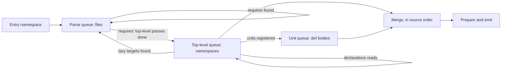

# Multi-threaded compilation: research and design

Status: proposed design, October 17, 2026. Nothing here is implemented. The
document merges the feasibility research (measurements, schedule models and
the scheduler, discovery and failure semantics) with the review of that
research, which tightened the measurement claims and separated the policies.
Measurements use the release build of `b51af6a` (the code under `87f5d0e`)
on the 24-core Mac, compiling the Penpot port's `app.main` entry with
`--optimize none`, which takes 23.2 s wall, 27.5 s user CPU and 0.96 GB peak
RSS. Method, scripts and raw data are listed at the end. Names of new types,
flags and configuration fields are design sketches, not available APIs.

## Summary

The proposed design is feasible. A work queue is seeded with the entry and
drained by a pool of workers that take batches and steal work. Each phase
hands its results to the next phase's queue, and work runs serially only
where macros and dependencies require it. Mapped onto light-cljs's phases,
it gives each phase a queue and a unit of work:

| Phase queue | Unit of work | Share of the build | Parallel? | What forces order |
| --- | --- | ---: | --- | --- |
| Lex and parse | one source file | ~1% (95 ms load, ~0.1 s re-parse in analysis) | fully | none; source order and cycle errors are computed from the discovered graph |
| Namespace top-level pass | one namespace | 26% | across namespaces | serial within a namespace (macros and definitions become visible in order); starts after the top-level passes of the namespaces it requires |
| Deferred units (`def` bodies) | one unit, batched per namespace | 70% | across workers, subject to declared blockers | compile-time effects made inside a body are visible only in the isolate that made them; consumers of a declared blocker keep today's order on the main isolate |
| Merge into the program | one result | ~3% (0.67 s) | no | canonical order, so output does not depend on timing |
| Prepare and emit | whole program, later per namespace | 3% | emit later | whole-program preparation |

Findings that decide how much the design buys:

- **The time is in the two analysis queues, and most of it is JavaScript.**
  96% of the build is analysis, and about 60% of the total runs inside V8:
  user macro code, plus the bridge that carries forms and environments to and
  from it. So **each worker needs its own V8 isolate**. A design that keeps
  one macro owner and feeds it requests from parallel Rust analysis is bounded
  by Amdahl's law at `1 / (0.60 + 0.40/P)`: about 1.5x at 8 slots and 1.67x
  with unlimited slots, before any overhead, however good its scheduler is.
  That bound rules out the single-owner architecture, even though its
  semantics would be easier to preserve.
- **The deferred-unit queue is almost free to create.** Each top-level `def`
  initializer is already a *deferred unit*: the compiler analyzes it from a
  frozen definition-time snapshot after the namespace's top-level pass, then
  appends the result. There are 13,361 of them, averaging 1.2 ms.
- **The dependency graph allows a large speedup.** The require graph has 922
  namespaces, is 63 levels deep and has a critical path of 2.8 s, against
  22.6 s of serial analysis. Simulated schedules on measured per-namespace
  and per-unit costs give the ideal times below. They are idealized list
  schedules, not predictions: they assume every task costs what it cost
  serially, and they omit transfer, publication, isolate start-up, JIT
  warm-up and memory admission. The measured slowdown from running compiles
  side by side (1.2x at 4, 1.4x at 8, 1.75x at 12 processes) is not included.

  | Which queues run in parallel | 4 workers | 8 workers | 12 workers |
  | --- | ---: | ---: | ---: |
  | None (today) | 22.6 s | 22.6 s | 22.6 s |
  | A. Units only; top-level passes on one thread | 6.1 s | 6.1 s | 6.1 s |
  | B. Top-level passes too, merged strictly in source order | 5.5 s | 4.2 s | 4.2 s |
  | C. Top-level passes too, each starting when its requires are done | 5.5 s | 2.7 s | 2.1 s |

  End-to-end targets, including contention and the serial load/emit tail,
  are about **9 s (2.5x) for A** and **5 s (4.5x) for C**. These are
  **hypotheses, not forecasts**, until the stage A prototype measures
  correctness and real scaling; they are not acceptance criteria. For
  comparison, Shadow-cljs dev took 32 s in the latest Penpot benchmark, for
  a build that also covers modules `app.main` does not reach.
- **The main semantic change is that compile-time state is no longer one
  heap.** A macro effect made in one isolate is invisible in every other.
  Stage A keeps top-level expansion serial on the main isolate, but it does
  *not* keep today's visibility: an effect made inside a `def` body on a
  worker is not seen by a later top-level macro on the main isolate. Macro
  providers with cross-namespace compile-time effects behave as they do under
  the proposed compiler cache: correct when declared, and the declaration
  gives their consumers affinity to the main isolate. The opt-out is the same
  blocker set, for the reason given under "Semantics and determinism".
  Upstream ClojureScript and shadow-cljs both run macros concurrently on a
  shared JVM and treat macro side effects as unsupported.
- **Cacheable and isolation-safe are separate properties.** One declaration
  (`--cache-blocker NS`) serves both opt-outs because the class of provider
  that breaks is the same, but neither feature proves the other correct.
  Each has its own contract tests, and each must stay correct with the other
  switched off.
- **The Rust refactor is moderate but not mechanical.** Parse results are
  already `Send`. `Program`'s element types hold no `Rc`; only its container
  types do. Swapping `Rc` for `Arc` in the arena, shared, layered, name-index
  and compiler-data modules measured no difference in a small sample (three
  alternating runs each; medians 23.07 s and 23.13 s, identical output).
  That is about 0.3%, not proof of zero overhead. `Arc` alone is not enough:
  `RefCell`, `Cell`, lazy state, callback captures and the engine handle
  remain. The larger work is splitting the engine handle out of `MacroHost`,
  a thread-safe unit catalog, deterministic name allocation and in-order
  merging.
- **The scheduler is written in this repository.** A compiler-specific pool
  on the standard library, with batched claims and work stealing, is a
  requirement. No scheduling or threading crate is added. The specifics
  under "The scheduler" are the recommended shape, not a contract.

Suggested build order:

1. The pool and queues, which can start with the parse queue, since that
   phase needs no thread-safety work. It is a scaffold rather than a speedup.
2. The deferred-unit queue (A). This is the first large gain, and it keeps
   today's top-level expansion order.
3. The top-level-pass queue (C), built on the relocatable namespace fragments
   that the [compiler cache](compiler-cache.md) needs anyway.
4. Per-namespace emission.

## Where the time goes

A 1 ms stack sample of the main thread (21,501 samples) attributes the time
as follows. Loading started before the sampler attached, so the load figure
comes from the timing probes instead. The sample is of the main thread only;
it is not a CPU profile of V8's background threads.

| Phase | Share | Notes |
| --- | ---: | --- |
| Deferred unit analysis (`drain_deferred`) | 69.8% | 63% of it is V8 time; includes the drain bookkeeping below |
| Namespace top-level passes (`NamespaceAnalysis::analyze`, excluding drain) | 26.3% | 62% of it is V8 time; includes helper work demanded synchronously during the pass |
| Emission | 2.9% | 0.67 s |
| Application preparation | 0.4% | 0.10 s |
| Loading and parsing 922 sources | 0.4% | 95 ms (probe); the re-parse of `#_` sources inside analysis adds ~0.1 s |

V8 accounts for 12.7 s of self time in the sample. The Rust frames that
enter it split as follows. These are self samples in milliseconds, and the
categories are exclusive.

| Entry | ms |
| --- | ---: |
| Macro calls (`MacroHost` → `MacroEvaluator::call`) | 6,680 |
| Form import (`import_macro_form`) | 1,451 |
| Environment import (`import_environment`) | 1,025 |
| Result export (`export_form`) | 972 |
| `compiler_frontier` | 746 |
| `macro_arguments` | 654 |
| Release, registration, unit evaluation | ~190 |
| Unattributed (truncated stacks) | 975 |

The timed V8-entry probes total 13.62 s. That is a different measurement
from the 12.7 s of sampled self time: the probe is taken at `invoke` depth 0
and so includes Rust callbacks reached from JavaScript. The two are not
interchangeable exclusive phase totals. Rust analysis called back from inside
a macro takes 3.7%; these are helpers that a macro demands, compiled on
demand. The substantial bridge cost (import, export, environment, frontier)
matters: parallel Rust analysis with one engine owner would retain most of
the current bottleneck.

The JIT matters a great deal: turning off V8's optimizing tiers (`--no-opt
--no-maglev`) raises the build from 23 s to 40 s, and also turning off
Sparkplug raises it to 60 s. That shows the importance of optimization, not
how much warm-up each worker will repeat; see "Risks".

Temporary per-namespace probes (reverted, see the end) produced these totals.
Output stayed byte-identical. An independent re-run of the saved model
reproduced the totals from the saved samples; that reproduction does not
rerun the compiler.

| Quantity | Value |
| --- | ---: |
| Top-level passes | 6.00 s (3.59 s in V8) |
| Deferred-unit drains | 16.53 s (10.03 s in V8) |
| Units analyzed in drains | 13,361; 15.86 s total (a subset of the 16.53 s) |
| Drain bookkeeping (append, index, release) | 0.67 s (the rest of the 16.53 s) |
| JS service calls | 1,288,464 (calls have different costs; the count is not a scheduling granularity) |

Do not add the drain total to its two components. Measured analysis comes to
22.56 s allowing for rounding, and the model's one-worker schedule takes
21.90 s because the unit models omit the bookkeeping, so printed speedup
ratios from the model do not compare identical total work.

Units are small and uneven.

- The mean is 1.2 ms. 2,535 units take over 1 ms, 227 over 10 ms and 4 over
  100 ms. Batches must remain stealable.
- The largest is 2.03 s: instaparse's `precompile-cljs-grammar` macro runs the
  GLL parser on the ABNF grammar at compile time (`instaparse.abnf`). It is a
  candidate for investigation, not an assertion that it is isolation-safe.
- Namespace cost barely correlates with source size (r = 0.11).
- 34 namespaces take over 100 ms. The costliest after `instaparse.abnf`
  (2.05 s) are `app.plugins.shape` (0.50 s), `app.main.ui.icons` (0.27 s, 272
  units) and `app.main.ui.dashboard.team` (0.27 s).

The engine side of a worker looks cheap to replicate, with the caveat that
these are whole-session observations, not the measured incremental cost of a
worker.

- A compile that boots V8, the runtime and the core macros takes about 45 ms
  in total.
- The whole build loads 993 JS units (1.7 MB of source) into the isolate. Its
  heap peaks near 39 MB used / 67 MB committed and ends at 27 MB after GC.

Parsing alone scales cleanly but is too small to matter. A harness that
parsed all 972 port files (11.8 MB, 1.07 M nodes) with the release parser
took 39.7 ms on one thread, 20.7 ms on two, 12.0 ms on four and 8.0 ms on
eight. Claiming four files at a time instead of one made no consistent
difference. The harness pre-enumerates files, holds sources in memory and
skips discovery, so it says nothing about the pipeline's batching policy or
about whole-build scaling.

The earlier whole-build numbers in
[benchmarks/results/compiler-2026-10-16/penpot-phase112](../benchmarks/results/compiler-2026-10-16/penpot-phase112/README.md)
(render 3.73 s, main none 21.97 s, main advanced 28.24 s) are the production
baseline. Advanced mode costs about 6 s more than none there, so the
preparation passes are worth a later look, but the two commands also differ
in assertions and output, so that subtraction is not an optimizer timer. Do
not average those runs with the probe run.

## How the compiler is structured today

The pipeline in [compiler.md](compiler.md) runs on one thread with one
`MacroHost`, one `CompilationSession` and one engine. It is more interleaved
than parse → expand → analyze → emit.

1. **Load** (`Loader::visit`, `src/compiler.rs:1175`). A depth-first walk
   asks the source provider for each namespace, parses the whole file inline
   with discarded forms retained, selects `.cljc` branches and reads the
   namespace directives, including raw directives beyond the `ns` form. It
   recurses into requires. The post-order defines each namespace's *source
   index*, which is also its initialization order. `Loading` marks membership
   in this DFS's active path; it is a cycle detector only for a serial walk.
   Namespaces reachable only through `light.lazy/loadable` are discovered
   *during analysis* and appended (`visit_lazy`, `:1343`, from
   `analyze_entry`, `:1541`). A lazy target may require its requester without
   being a static cycle.
2. **Analyze each namespace in source order**
   (`NamespaceAnalysis::analyze`, `src/analyzer.rs:3503`). Before each one,
   `prepare_source` installs macro imports and reads semantic namespace
   metadata, so it is not header scanning.
   - The analyzer takes ownership of the one combined `Program` (`:3535`).
     All `ExprId`, `GlobalId`, `LocalId` and similar values are dense indices
     into its arenas.
   - The top-level pass (`:3610`) expands top-level macros, declares globals
     and registers Vars and macros with the host. Reading, expansion,
     declaration and analysis interleave; `&env`, syntax quote, generated
     declarations and name resolution all depend on the current semantic
     position. There is no "expand everything, then analyze" phase to exploit.
   - For each top-level `def` with an initializer, it reads the initializer
     to a `Form`, takes a `definition_snapshot` and registers a unit with the
     session (`:6443`). The snapshot (`:6170`) is a frozen prefix of the
     program, the name index, the resolution and a macro-host frame. It does
     **not** freeze the JavaScript heap: roots can be late-bound, shared
     mutable values can change, and extension state has its own frontier. A
     snapshot is a transfer boundary, not a purity proof.
   - After the last form, `drain_deferred` (`:6202`) analyzes each unit
     through `CompilationSession::analyze` (`src/compilation_session.rs:386`).
     It then appends what the unit added with `program_fragment::append`,
     remapping its IDs. Parsed trees are released after each namespace;
     source text stays for diagnostics.
   - A macro may demand a helper's compile-time value. The evaluator's
     `__lightCompileUnit` callback enters the session, analyzes the unit,
     emits it and returns to the still-running macro. So analysis calls
     emission and evaluation before the application is analyzed, and an
     `Analyzing` unit met again on the single active stack is a cycle.
3. **Finish, prepare and emit.** These are whole-program passes on the
   assembled `Program`. Advanced mode alternates folding, inlining and
   retention, then computes inference, rapid type analysis and call shapes.

That gives two graphs: the static require graph and the dynamically
discovered graph of compile-time unit demands. Neither is the order in which
application initializers run; that is the source index.

Facts that bound a parallel design:

- **Definition-time snapshots already exist.** A unit never resolves names in
  a later environment, and its result is a fragment over a shared prefix.
  This is the isolation a parallel task needs on the Rust side.
- **One growing ID space.** A namespace's top-level pass allocates IDs after
  everything appended before it, including the previous namespace's units.
  The `Program` assumes a sequential build.
- **A namespace's analysis reads only its dependencies' top-level results.**
  - Declarations, metadata and macro registrations are all produced by the
    top-level pass (`GlobalBinding` and its `metadata` expressions are set
    before the initializer is deferred).
  - Cross-namespace arity warnings use arities from earlier namespaces'
    finished bodies (`collect_expression_warnings`, `src/analyzer.rs:3987`).
    That is a diagnostic post-pass, which can run at merge time.
  - In Penpot, deferred bodies add only 14 globals in total. All 14 are
    undeclared reservations (`exists?`-style probes and lazy targets); none
    is a definition.
- **Visibility follows load order, not requires.** A namespace may qualify
  globals of any namespace loaded before it. A probe over the final Penpot
  program found no runtime reference outside the referencing namespace's
  transitive requires. The only hits were the six lazy-target reservations.
  Compile-time observations were not probed: `&env`, `resolve`, `all-ns`, and
  the protocol-extension frontier, which is a global sequence number.
- **The engine is single-threaded state.**
  - Compile-time roots, compiled macro functions, the namespace reader-context
    registry, the protocol-extension journal and the JS `gensym` counter
    (`src/js_runtime.js:424`) live in one heap.
  - Every clean compilation starts fresh. Within a compilation, every macro
    sees the effects of every earlier macro, in source order, including
    effects made inside `def` bodies. The
    [macro regression tests](../tests/compiler/macros.rs) pin this down:
    definition-time visibility and macro generations; generated `defmacro`
    and top-level `do` declarations interleaving with later forms; shared
    mutable compile-time roots, with standalone application effects not
    replayed by helper demand; exactly-once nested expansion, cached failures
    and `defonce`; separate analysis-cycle and initializer-cycle diagnostics;
    and expansion limits that reject a macro *before* running it.
  - The `counter`/`next-value` test
    (`macro_namespace_effects_are_shared_once_per_compilation_with_fresh_reused_hosts`)
    is the canonical example:

    ```clojure
    ;; macros.cljs
    (ns macros)
    (def counter (atom 0))
    (defmacro next-value [] (swap! counter inc))

    ;; dep.cljs
    (ns dep (:require [macros :refer [next-value]]))
    (def value (next-value))

    ;; main.cljs
    (ns main (:require [dep :as d] [macros :refer [next-value]]))
    (js/console.log d/value (next-value))
    ```

    Namespace `dep` increments the counter inside `(def value (next-value))`,
    a deferred unit. Namespace `main` then calls `(next-value)` in a
    top-level form and prints `1 2`. Keeping every top-level call serial is
    not enough to preserve this: moving `dep`'s deferred expansion to a
    worker heap while `main` runs on the main heap prints `1 1`.
- **Process-wide name counters.** Syntax-quote `x#` (`src/compiler_reader.rs:1000`),
  `#()` parameters (`:1284`), binding gensyms (`src/compiler_binding_macros.rs:75`)
  and destructuring gensyms (`src/compiler_destructuring.rs:227`) are global
  atomics. Locals emit as `l{LocalId}`, but these names reach output through
  global, field and symbol-literal names and source-map `names`. Interleaved
  threads would make output depend on timing.

### Thread safety today

A read-only audit of the types on the analysis path found:

| Type | Send/Sync today | Blocking fields |
| --- | --- | --- |
| `SyntaxTree`, `Node`, `NamespaceSource`, `NamespaceResolution` | Send + Sync | none |
| `Program` (and `PreparedApplication`) | no | only the containers: `Arena` (`Rc` chunks, `Cell` hint), `Shared` (`Rc`), `Layered` (`Rc` maps) |
| `NameIndex` | no | `Rc` nodes |
| `Name`, `Source`, `Datum`, `Form`, `Origin` | no | `Rc`; `Source` also has a `OnceCell` line index; `Datum` identity is `Rc::as_ptr` (works the same with `Arc`) |
| `DefinitionSnapshot` | no | its `Program`, `NameIndex`, `Arena` and `Form` |
| `CompilationSession` | no | `RefCell<Catalog>` and `Rc<RefCell<Unit>>` units; each unit holds a boxed `MacroHost` frame |
| `MacroHost` | no | `Layered` maps, `Rc<RefCell>` environment caches, `Rc<Cell>` budget counters, `Rc<CompilationSession>`, and the engine via `Bootstrap` (`Rc<dyn CompilerEvaluator>`) |
| `SourceProvider` | no bound on the trait | caller-supplied closures may be thread-affine; `LoadRequest` carries a `Name` |
| `V8Evaluator`, QuickJS `Evaluator` | no, and must not move | isolate/runtime handles, `Rc<State>`, a stack limit bound to the creating thread |

About 190 `Rc` uses, 74 `RefCell` and 23 `Cell` across 21 files.
`analyzer.rs`, `compiler.rs` and `emitter.rs` contain none.

The engines are ready for concurrent use.

- The V8 platform is initialized once per process (`OnceLock` in `platform()`,
  `src/v8_evaluator.rs:190`). The vendored V8 headers permit one thread per
  isolate at a time; a second context in the same isolate gives no
  concurrency.
- Each evaluator owns one isolate. The interrupt scheduler is one process-wide
  thread built to serve many isolates.
- A unit test already runs four isolates on four threads, and
  `tests/compiler/dev_build.rs` runs whole independent compilations in
  parallel threads.
- On Linux x86-64 hosts with memory protection keys, threads created before
  the first V8 initialization cannot enter isolates. So `platform()` must run
  before the pool spawns.
- The bootstrap macro JS cache is `thread_local!` (`src/compiler_bootstrap.rs:158`).
  Each worker would recompile it once, and its gensym suffixes would differ
  per thread. It should become a process-wide `OnceLock`, so every thread
  shares the exact artifacts the canonical compiler produced.
- Evaluators are created and destroyed on their owning thread. Engine
  handles, closures, roots and an active `MacroHost` never travel through a
  queue; a worker constructs a local host bound to its own evaluator from
  transferable data.

QuickJS remains for interactive sessions and WebAssembly, which stay serial.
Parsing and IR work must not come to require V8.

The built-in file provider can be parallelized directly. A caller-supplied
provider keeps today's invocation context and order unless the embedding
opts into a `Send + Sync` contract. Jobs carry namespace strings and build
the `LoadRequest` on their own thread.

## How upstream ClojureScript and shadow-cljs do it

Both parallelize per namespace.

- **Upstream** `:parallel-build` is off by default (`cljs/closure.clj:1074-1100`).
  - A pool of `2 + 0.6 × cores` threads takes namespaces from a dependency-ordered
    deque. A thread busy-waits, polling every 10 ms, until all of a
    namespace's requires are compiled.
  - All threads `swap!` into one shared compiler env, with no per-task copy.
  - Macro *loading* (`require`) is under a global `load-mutex`. Expansion is
    not locked.
  - Results are re-sorted into dependency order. Warnings print as they
    happen, and gensym is a global JVM counter, so output is not deterministic.
- **Shadow-cljs** is parallel by default (`shadow/build/compiler.clj:1215-1398`),
  with `availableProcessors` threads.
  - One task per namespace, ready when every require is ready. Waiting tasks
    poll every 5 ms with a progress timeout.
  - A namespace signals ready **after analysis, before emit**, and right after
    a cache restore, so dependents start earlier.
  - Macro loading takes a global `require-lock`.
  - Warnings are collected per namespace and printed in source order.
    Namespace roots are precomputed, because the munger raced on a partially
    populated namespace set ("the ns may not exist when munge decides to
    munge").
- **Macro side effects** are unsupported in both; neither serializes
  expansion. Upstream fixed several races caused by them:
  - CLJS-1570: `set! *unchecked-if*` leaked between files.
  - CLJS-2171: spec-registry reads.

  Shadow handles side-effecting macros by excluding them from its cache
  (`:cache-blockers`, default `clara.rules`/`clara.macros`).

The transferable lessons are explicit readiness and reusable per-source
results. The polling loops are not worth copying; readiness here is
completion-driven. The 2023 parallel-rustc report is the other relevant
precedent: task graph and data ownership mattered more than thread count,
and utilization was uneven.

light-cljs can't share one macro runtime across threads the way the JVM does.
Its isolates are separate heaps, so compile-time state diverges *more* than on
the JVM, not less. In return, nothing races: each isolate is single-threaded,
and the divergence is deterministic once tasks are assigned deterministically.

## The design, phase by phase



**Queue seeded with the entry.** This works as described.

- Parsing a file reveals its requires, which go on the same queue. This
  discovery is parallel. A one-file frontier stays serial until its
  dependencies are known; stealing cannot create parallelism that the graph
  does not have.
- Today's depth-first source order, which is also initialization order, and
  the dependency-cycle error path are then computed from the discovered graph
  rather than from the order files happened to finish.
- Namespaces reachable only through `light.lazy/loadable` are found during
  analysis, so the top-level queue feeds them back into the parse queue.

**Workers that take several items at once, plus work stealing.** Both fit.
The cache to protect is mostly per-worker state rather than the CPU cache:
the macro and helper code installed in that worker's isolate, its JIT
feedback, namespace registrations, and the analyzer's reader-view cache.

- *Parse queue:* batch whole files. Any order works. Scanning and parsing
  stay fused in one file job; a token queue or splitting a file at byte
  offsets would be finer than the work justifies.
- *Unit queue:* a worker takes one namespace's units as a batch, in source
  order. Idle workers steal from the far end of another worker's batch.
- *Top-level queue:* one namespace per task. Locality comes from preferring
  the worker that already holds the namespace's dependencies' macros.
- *Queue type:* tasks average about 1 ms (13,361 units plus 922 passes, over
  a few seconds of wall time). Standard-library primitives are enough, with
  no new crates; see "The scheduler".
- *Priority:* this matters more than the queue type. Taking the longest
  remaining dependency chain first beats source order by 1.4x at 8 workers.
  The chain length counted in namespaces is within 3% of perfect knowledge,
  so no timing profile is needed.

**Hand-off between queues.** Items move on one at a time as soon as they are
ready, so the phases overlap.

- A namespace leaves the parse queue for the top-level queue once the
  namespaces it requires have finished *their top-level passes*. It does not
  wait for their units. This follows shadow-cljs's "ready after analysis".
- A namespace's units enter the unit queue as its top-level pass registers
  them.
- Every result goes to the merge, which consumes them in source order.
- A worker may continue straight into a ready next stage for the item it just
  finished. The queue boundary is a scheduling opportunity, not a forced
  thread migration.

**What must be serial**, precisely:

- *Within a namespace*, the top-level pass. Definitions become visible in
  source order, a `defmacro` may be used by later forms, and top-level forms
  have effects on the host and session. Declaration admission follows actual
  source and macro-generated declarations; nothing predeclares names found
  in parsed files.
- *Across namespaces*, only along require edges, as above.
- *Consumers of a declared blocker*, on the main isolate in source order.
- *Merging* into the final program, in canonical order. It is cheap: 0.67 s
  of bookkeeping today, and it can run as results arrive.
- *Whole-program preparation.* Emission could later run per namespace.

"Independent" here means independent *compiler execution*. Lowering a
function that prints or mutates an atom is independent Rust work; the
compiler creates instructions and does not run them. Only when a macro
demands that function's value or invokes it at compile time does its effect
belong to an isolate's ordered state.

Macro execution itself does not need to be serial if macros don't share
compile-time state across workers; that is the contract under "Semantics and
determinism". The 9 s and 5 s targets come from the two analysis queues, so
that is where the hard engineering goes:

- an isolate per worker;
- `Arc` instead of `Rc` in shared data;
- deterministic generated names;
- the in-order merge.

## The scheduler

A compiler-specific scheduler on the standard library is a requirement of
this design: `std::thread::scope` for a build's fixed worker set, one
`Mutex`, two `Condvar`s and `VecDeque`s, with batched claims and work
stealing. No scheduling, channel or thread-pool crate is added. A scheduling
runtime of this shape is on the order of 800 lines, which is small next to
the compiler changes it drives. Stage transitions live in the compiler, not
in the queues, so the same work graph runs inline for `--jobs 1` and
WebAssembly and through the pool natively. Deterministic order comes from the
compiler's canonical numbering, never from which worker won a lock. Worker
assignment and stealing are never part of the language contract.

**Ownership.** The coordinator runs on the calling thread and owns the
canonical `Program`, the dependency state, the merge and the main isolate.
Each worker owns one isolate and its scratch buffers. Only owned,
transferable job and result handles enter the scheduler state. Queues carry
handles, not copies of syntax trees.

**One mutex, for the first version.** Behind it: a ready `VecDeque<Job>` per
phase, per-worker deques grouped by phase, a completion deque, running-job
accounting and the shutdown flag. The lock covers short bookkeeping only.
Compiler code, provider callbacks, macro evaluation, large destructors and
merging all run after it is released. Measure contention before splitting
the lock.

**Claiming and stealing.** At each job boundary, under the mutex:

1. Check cancellation, then urgent work (anything the coordinator or a
   waiting demand needs). Otherwise pop from the local deque of the current
   phase.
2. If empty, claim a bounded batch from that phase's shared queue. Start one
   job and leave the rest in the local deque, where peers can still see it.
3. If the shared queue is empty, steal from a peer: rotate the victim index
   and take about half of its unstarted jobs, capped by the batch limits. The
   owner pops from the back; thieves take from the front.
4. If the phase has nothing, move to another ready phase with the same
   policy. Reconsider phase preference after a bounded number of jobs, with
   aging, so a busy phase cannot starve the others.
5. Sleep only when no runnable job exists anywhere.

Batch limits count jobs and estimated cost. A batch is never a private
closure: every unstarted member stays stealable. A running job stays on its
worker until it finishes. Start with small fixed batch counts; use measured
costs later to keep several large items off one worker.

**Outcomes.** A worker reports `Done` or a failure through the completion
deque. The coordinator consumes it, updates readiness, and releases newly
ready jobs. Work whose readiness is already known may be placed on the
finishing worker's own deque, under the same accounting. Discovery results
and anything that touches ordered state go through the coordinator.

**Parking and wakeups.** One condition variable for workers waiting for
runnable work, one for the coordinator waiting for outcomes, so an outcome
never wakes only a worker. Every wait inspects its predicate under the mutex
and loops around `Condvar::wait`; producers update the predicate under the
same mutex before notifying. Claiming or stealing must preserve the
"runnable work exists" predicate, including jobs in local deques. One new
job wakes one worker; a batch wakes all. There is no polling sleep.

**Completion.** Track queued, running and completed-but-unconsumed jobs
separately, plus suspended demands and pending publications. The coordinator
registers an outcome's successors before testing for completion, and only it
declares the build done: no admitted running work, no runnable work and no
outstanding discovery or demand that can create more. An empty queue while a
parse job is still discovering requires does not end the build. A dependency
with no producer is a cycle, a missing source or a scheduler bug, and is
diagnosed as such.

**Failure and shutdown.** A compiler error is an outcome whose precedence and
cancellation scope the coordinator decides. A worker panic, under unwinding,
is caught at the job boundary, retires the running slot, is reported and
stops the build; its scratch state is discarded. Every exit path, including
coordinator failure, sets shutdown and wakes both wait sets before the scope
joins; scoped joining alone cannot wake a parked worker. Abort-mode panics
still abort the process.

**Bounded admission.** Bound queued artifacts by estimated bytes as well as
count; parsed trees are many times their source size and macro output is
larger still. Reserve completion-deque room for every admitted job so a
worker can always publish without blocking, and prefer work that unblocks
the next merge over speculative breadth. Byte estimates guide admission;
they are not a hard memory bound.

**Worker count.** `--jobs N` (proposed spelling) means CPU work slots, and the
coordinator's own isolate counts as one, so there are up to `N-1` background
workers. It does not promise a thread count: V8's platform threads, I/O and
other builds are outside it. `--jobs 1` runs the ready jobs and ordered
operations inline without spawning. An empty eligible workload starts no
pool and no worker isolate. A persistent watch-build pool is a later step
and uses owned scheduler state with explicit shutdown.

## Source discovery and readiness

- One record per resolved namespace per build, with states unrequested,
  queued or running, parsed, top-level done, committed and failed. Reverse
  edges and unresolved-prerequisite counts drive readiness. Parsed
  dependencies and top-level-done dependencies are different conditions, and
  stage A's merge order follows today's total order, not any topological
  order.
- Two branches reaching the same dependency at once form a diamond, not a
  cycle. Coalesce the requests and diagnose cycles from graph paths, never
  from a `Loading` flag.
- Reconstruct the DFS post-order deterministically from ordered require
  edges, independent of completion order. That order defines source indices,
  the entry's value, diagnostic order and initialization order.
- Preserve the resolution rules: `.cljs` before `.cljc`, canonical duplicate
  handling and ambiguity errors, virtual core namespaces, first-party
  fallback, `clojure.*` rewriting, explicit sources over `goog.*` host
  namespaces, and `:as-alias` not loading a file. Keep whole-file parsing
  before discovery; an early-header scanner would miss raw directives later
  in the file.
- Lazy targets enter only at the existing semantic discovery point and append
  their closures by the current rules.
- Keep the initial source-error barrier. Today the whole static graph is
  loaded and validated before any application macro runs. Overlapping
  analysis with discovery would let macro effects run before an error that
  currently prevents them, and needs its own compatibility decision.
- Tag work with a build generation and the source bytes it saw, so a stale
  completion cannot publish into a newer watch build.

## Building it in stages

A coordinator thread owns the canonical `Program` and the merge, and N
worker threads each own one V8 isolate. Immutable compiler data is shared
through `Arc`. The parse queue can go first as scaffolding for the pool. It
needs no thread-safety work beyond what parse output already has, and it
gives no measurable speedup on its own.

### Stage A: parallel deferred units

This stage keeps today's top-level *expansion order*: every top-level form is
still expanded on the main isolate, in source order. It does not keep
today's *visibility* of compile-time effects made inside `def` bodies; see
"Semantics and determinism" for what changes and how blockers restore it.

- **Coordinator.** It runs the loader and every top-level pass in source
  order, in the *main isolate*, as today. Where `drain_deferred` analyzes
  units inline today, the coordinator instead enqueues the namespace's units
  as one batch and moves on to the next namespace. Units of a blocker's
  consumers are not enqueued; they drain inline on the main isolate at
  today's point, before the next namespace.
- **Workers.** A worker takes a unit and analyzes it from its existing
  snapshot and macro frame, in its own isolate. It registers macro and helper
  code from the shared catalog on first use, then stores the fragment and
  warnings in the catalog. Nested demands made during the unit keep running
  inline on the worker, as today.
- **Compile-time demand.** When a macro demands a helper unit (on any thread),
  the caller claims the unit if it is still queued, waits if another worker
  is analyzing it, and reuses the analysis if it is finished. One producer
  per unit, many waiters, shared success or failure. Analysis is shared
  across threads; evaluation of roots is per isolate. Nested demands keep
  running inline on the demanding thread, as today, so a macro that
  synchronously needs a helper never waits on a coordinator that is waiting
  on it.
- **Cross-worker cycles.** Each wait walks the wait-for graph. A cycle back
  to the waiter is the existing "compile dependency cycle" error, reported
  with the canonical path (lowest source index first). Thread-local recursion
  stacks alone cannot see these cycles.
- **Merge.** Unit fragments are appended *after* the coordinator's top-level
  passes, in unit order. Every snapshot is a prefix of the monotonically
  growing program, so the existing shared-prefix `append` stays valid. The
  merge remaps expression, local, global, string, literal, recur and lazy
  IDs, source indices, generation references, diagnostics and reader
  metadata; `append` does the first group today and must grow to the rest.
  - This changes ID order relative to today: the next namespace's
    declarations now precede the previous namespace's bodies. That is one
    deterministic output change, and afterwards output is identical for any
    worker count.
  - Reservations made inside bodies must be merged with an existing
    same-named global rather than duplicated.
  - Later flags and metadata set on an earlier global by a later namespace
    are kept when a definition-time fragment is appended.

Expected result: the 6.0 s of serial top-level passes is the floor. That gives
6.1 s ideal at 4 workers, with no gain beyond 4, and about 8–9 s end to end,
2.5–2.8x. It needs every piece of infrastructure that stage C needs.

A narrower first cut dispatches only units whose analysis is conservatively
known not to enter the macro host, and keeps the rest on the coordinator.
Eligibility must come from the frozen resolver: imported macros, core
macros, semantic readers and nested demands all count, and "no `defmacro` in
this file" is not enough. Unknown work discovered before execution takes the
serial path; a macro-host entry after a task begins is a bug in the
eligibility check, not a recoverable condition. This is a milestone on the
way to stage A, useful for shaking out the merge, the pool and the transfer
boundary without a second isolate. It is not a design of its own, and its
eligible share of Penpot is expected to be small.

### Stage C: parallel namespaces

This stage removes the serial top-level chain.

- **Readiness.** A namespace's top-level pass becomes a worker task. It is
  ready when all of its requires have finished *their top-level passes*,
  following shadow's "ready after analysis".
- **Visibility.** It analyzes against exactly its transitive requires (plus
  `cljs.core` and first-party libraries). Visibility by dependency closure
  replaces visibility by load order. The probe above shows Penpot already
  conforms for runtime references. Compile-time views must follow the same
  rule: reader contexts, `all-ns`/`ns-publics`, and the extension frontier,
  which becomes closure-relative. This is a language-policy decision, taken
  here deliberately; the runtime-reference probe is evidence that Penpot
  tolerates it, not the justification for it.
- **Relocatable fragments.** A namespace's fragment refers to three kinds of
  entries:
  - the committed prefix, by stable ID;
  - dependencies' not-yet-committed fragments, by fragment and local ID;
  - its own entries, by local ID.

  The analyzer reads `Program` tables through a view that combines the prefix
  with dependency overlays. The merge commits fragments in source order and
  relocates the second and third kinds. Interned tables (strings, named
  literals) must be canonicalized at commit, so results don't depend on which
  prefix a task happened to see.

  This is the in-memory form of the cache's "relocatable namespace artifacts"
  (Phase 2 of [compiler-cache.md](compiler-cache.md), pellets 315–318). Its
  external-reference and generated-name rules are the same. Build it once
  for both.

A cheaper variant, **stage B**, commits fragments in order *without* overlays.
A namespace starts only when every namespace up to its latest dependency in
source order has committed. It still uses the plain prefix `append`. It reaches
only 4.2 s ideal, because depth-first source order usually places a
namespace's last require right before it. Keep it as a fallback if overlays
prove hard.

Expected result for C: 2.7 s ideal at 8 workers and 2.1 s at 12. The 2 s
instaparse unit becomes the floor; without it, 0.8 s at 24. End to end that
is about 5 s, 4.5x. Splitting namespaces without unit fan-out is almost as
good at 8 workers (2.8 s), but units keep balancing the load at 12 and above.
Stage A's measured speedup cannot be extrapolated to this changed schedule;
plan C from stage A's trace, not from the model.

### Stage D: the serial tail

After stage C, the 0.87 s that stays serial (load 95 ms, prepare 98 ms, emit
672 ms) is about a sixth of the build. Candidates, each needing a frozen
plan before dispatch:

| Existing boundary | Candidate jobs | What must be fixed first |
| --- | --- | --- |
| `emit_dev_build` | each namespace's JavaScript and source map in its own emitter | manifest order, stable source indices, the first-unit registration choice |
| Advanced chunk emission | each planned chunk into a private buffer | runtime slice, constants, reflection, imports; today one `Emitter` discovers requirements while writing |
| `prepare_application` | `ProgramFacts::new` and `closed_functions` side by side | both precede `Inference::new`; two coarse jobs, little to gain |
| Folding and inlining rounds | local summaries or rewrites over one program version | deterministic growth-budget allocation and overlap resolution; `fold` and `inline` mutate the whole `Program` today |

Per-namespace dev emission is the direct one. Output concatenation preserves
initializer order whatever order bodies were generated in, and source-map
offsets are fixed at assembly. Profile advanced mode before touching the
folding and inlining rounds.

## Semantics and determinism

The invariant: **output, warnings and errors are byte-identical for every
worker count.** `--jobs 1` runs the same algorithm with one worker. Today's
output changes once, when stage A lands.

- **Compile-time state across isolates.** Each isolate has its own roots,
  atoms and extension state. Pure macros, and helpers whose values don't
  depend on other units' effects, behave as today. A macro whose effect is
  observed from another namespace does not: the `counter`/`next-value` test
  prints `1 1` under stage A without further measures, because dep's
  increment happened on a worker and main's top-level call ran on the main
  isolate. Stage C widens the exposure to top-level effects as well.
  - **Why the cache blocker set is the right opt-out.** A cache hit skips a
    consumer namespace's macro expansion, so its effects never happen and a
    later fresh consumer sees state without them. A worker isolate produces
    the same observation: the effect happened, but not where the later
    consumer looks. The class of provider that breaks is identical, which is
    why one declaration (`--cache-blocker NS`, the spelling decided in the
    cache pellets) serves both.
  - **The two policies stay separate.** The cache contract permits skipped
    effects on hits; it says nothing about reordering fresh-build effects or
    replicating roots across heaps. Cacheable does not *prove*
    concurrency-safe, and no annotation for one feature grants the other.
    Each feature has its own contract tests, and each must stay correct with
    the other off: `--jobs 1` with the cache on, and `--jobs N` with no cache.
  - The parallel scheduler gives a blocker's compilation consumers *affinity*:
    their units and passes run on the coordinator's main isolate, in source
    order, and their drains complete before the next namespace's top-level
    pass. That restores today's `1 2` exactly. A namespace's own
    `^:light-cljs/no-cache` is a different thing and does not imply affinity.
  - Effects are never discovered after the fact and replayed serially. A
    provider is either declared or it is treated as pure.
- **Definition-time rules stay.** A unit resolves against its frozen
  snapshot: declaration identities, aliases, macro generations and the
  frozen resolution tables. Forward macro references still fail; an earlier
  function keeps the earlier macro definition; generated `defmacro` and
  top-level `do` declarations still interleave with later source forms,
  because the top-level pass is serial within a namespace.
- **Worker heaps and history.** A persistent worker isolate carries the
  macro and helper code it installed for earlier tasks and their JIT state.
  Results, diagnostics and logical work counts must not depend on which
  worker ran a task, which tasks it ran before, or the task order. The
  validation compares persistent workers against a fresh isolate per task
  under different task histories; matching one fixed assignment is not
  enough. A worker whose isolate failed is discarded, not returned to the
  pool.
- **Generated names.** Replace the four process-wide Rust counters and the
  per-heap JS `gensym` counter with allocation that is deterministic per
  unit: a unit-local counter plus a canonical unit discriminator, remapped or
  reserved at merge. Macro-visible `gensym` results that escape into literal
  data keep their existing contract; rewriting symbol strings after the fact
  is not hygiene. The cache needs the same thing ("Generated names" in
  compiler-cache.md). Make the bootstrap JS cache process-wide, so every
  thread gets the same text.
- **Warnings.** Buffer them per task and emit them at merge in canonical
  order. Cross-namespace arity warnings move to the merge post-pass.
- **Errors.** Report the failure with the earliest canonical position, which
  is the serial traversal's precedence, not whichever worker failed first.
  Stop scheduling work that comes after it in canonical order, let earlier
  work finish so the correct error is chosen, and cancel the rest. Messages
  must be deterministic from the task's own data: a cycle message carries
  the canonical path, a limit message the canonical unit. Nothing is re-run
  serially to recover a message, since a re-run would repeat macro effects on
  the main heap and could observe different state. Failures are shared with
  every waiter on the unit and are not retried. Internal panics,
  cancellation and physical resource failures are terminal; a partial result
  is never reinterpreted as success, and a failed build publishes no output.
- **Limits.** `--macro-expansions` and `--macro-nodes` are shared `Rc<Cell>`
  counters today. They become per-unit counts, checked as running sums in
  canonical order at merge. A shared atomic soft cap stops runaway work
  early. A limit still rejects an expansion before running its producer, as
  the depth-limit test requires; new workers never replenish a build's
  budget, renew its deadline or clear a cancellation.
  - **Memory is one budget.** `--macro-memory-limit` covers the main isolate
    and every worker isolate in aggregate, including backing stores; it does
    not become a per-worker multiplier. Add cooperative aggregate accounting
    and admission before enabling workers, and keep the per-isolate guards
    as secondary limits. Account for queued IR and source data separately
    in total RSS. A cooperative engine cap is not a process RSS limit.
  - Wall-clock timeouts and physical memory failures are
    scheduling-sensitive already; byte-identical resource-failure diagnostics
    are not promised across worker counts.
  - Engine stack limits are bound to the creating thread, so pool threads
    need the stack-boundary behavior re-checked, not just a stack size.
- **Publication is transactional.** Nothing is published as final while a
  later declaration could still change its meaning, and a failed build
  publishes no output.

## Engineering inventory

| Area | Change |
| --- | --- |
| `arena`, `shared`, `layered`, `name_index` | `Rc` → `Arc`; the `Arena` lookup hint `Cell` becomes per-thread or a relaxed atomic. Measured cost of the `Rc` swap (with `compiler_data`): none observed in a three-run sample. |
| `compiler_data` | `Rc` → `Arc` for `Name`, `Source`, `Datum`, `Form`, `Origin`; `OnceCell` → `OnceLock` |
| `macro_host` | Split into sendable environment data (layered maps, limits, options) and a per-thread engine binding (bootstrap evaluator, data-reader evaluator, session). The `Rc<RefCell>` environment caches become per worker. |
| `compilation_session` | Catalog behind a `Mutex`, unit state with an owner and a `Condvar`, analyzed IR as `Arc<Program>`, prepared JS as `Arc<str>`; per-isolate registration state moves to the worker; wait-for graph for cross-worker cycles; shared failure per unit |
| Engines | One `V8Evaluator` per worker; platform init before spawning; process-wide bootstrap JS cache; `__lightCompileUnit` callbacks bound to the worker's catalog handle |
| Loader | Task per file; namespace records with readiness counts; deterministic DFS reconstruction; diamond coalescing; parallel built-in provider, serial custom providers |
| Names, warnings, limits | Deterministic per-unit allocation; per-task buffers; merge-time accounting; aggregate memory budget |
| Driver | `std::thread::scope` pool, one mutex, two condvars, phase and per-worker deques, batch claims and stealing, critical-path priority, in-order merge, completion accounting, panic and shutdown handling; `--jobs N`, default 1 until the gates below pass |
| Stage C | Program view over prefix and overlays, fragment relocation and interned-table canonicalization at commit, closure-based visibility (shared with cache Phase 2) |

QuickJS, interactive sessions, `--eval`/`--repl` and the WebAssembly
playground stay single-threaded. `DevSession` reloads are a later consumer.

## Risks and unknowns

A prototype of stage A must measure the following before stage C is planned
in detail.

- **JIT warm-up.** Each isolate warms up separately, and the optimizing tiers
  are worth 17 s of this build. Most of that is steady-state speed, not
  warm-up, but the warm-up share per isolate is unmeasured. The 45 ms boot
  figure is a whole-session number; the incremental cost of a worker isolate
  is measured by the prototype, first with a fresh isolate per task as the
  correctness reference, then with persistent isolates.
- **Repeated compile-time initialization.** A helper root demanded in k
  isolates initializes k times. The 2 s grammar unit is a single expansion,
  but a large helper value used by many workers costs k times.
- **Contention.** The 1.2x / 1.4x / 1.75x slowdowns were measured with
  separate processes, each with its own V8 platform and GC threads. A shared
  platform may do better or worse; these are not correction factors. Past 12
  workers, efficiency cores and GC threads compete.
- **Memory.** Expect 40–70 MB per isolate plus per-task analyzer state:
  about +0.3–0.6 GB at 8 workers, against today's 0.96 GB peak and Shadow
  dev's 2.55 GB. Retaining the whole parsed closure behind the source-error
  barrier is a baseline that bounded queues do not remove.
- **Ecosystem macros.** No Penpot macro has been checked for compile-time
  effects beyond the build's own output. A stage A build compared
  byte-for-byte against `--jobs 1` and run in the browser is the check. If
  Penpot needs blockers, the affinity path is on the critical path from day
  one.
- **Ready width.** The DAG model assumes each task costs what it cost
  serially and that units are independent. The real question is how much
  work is ready at once at each boundary, which only the multi-stage
  prototype's trace can answer. A useful lower bound for any schedule is the
  serial work outside the parallel runs plus, per run, `max(W_run/P,
  longest_task)`, plus the ordered merge.

## Gates and first steps

1. The worker pool and queues, with the parse queue as the first one running
   in parallel. Validate the pool's lifecycle on synthetic jobs first: no
   job duplicated or lost under claim/steal races, no missed wakeup at the
   sleep boundary, no starvation across phases, clean shutdown on panic.
   Gate: identical output and source order, and no regression in cold-build
   time.
2. Phase timing (the cache plan already reserves `--stats`) and the
   deterministic generated-name scheme. The cache needs both too. Record
   exclusive work per stage, waits, artifact sizes and demand edges with one
   worker, as the trace baseline. Exclusive times, so nested work is not
   counted twice.
3. `Arc` and the `MacroHost` engine split. Gate: serial build within +2%
   wall and +3% RSS of today, suite green for both backends.
4. Stage A, the unit queue, behind `--jobs N`. Gates: output identical across
   `--jobs 1/4/8` with randomized scheduling delays; the blocker-affinity
   test reproduces `1 2`, and a test pins the documented undeclared behavior
   so that any change to it is noticed; Penpot main ≤ 50% of `--jobs 1` wall
   at 8 jobs, run in the browser; RSS ≤ 1.5x. Report two numbers: the
   speedup against the unchanged serial compiler at the parent commit, and
   the scaling against `--jobs 1` of the new code. A slower new baseline
   must not pass as good scaling.
5. Stage C, the top-level queue, on top of cache Phase 2's relocatable
   fragments. Then per-namespace emission.

If a gate fails, the trace decides the next investment: reduce bridge work,
improve artifact transfer, relax one restriction, or prioritize the
persistent cache. Do not respond by building a general effect system or a
continuation-based analyzer; neither is needed by this design.

Validation that the prototype must cover:

| Area | Evidence |
| --- | --- |
| Graph handling | diamond loads once; static cycle path; missing source; extension precedence and ambiguity; host and first-party fallbacks; raw directives; lazy targets, including one that requires its requester |
| Semantic parity | the existing macro tests: source order and generations, generated declarations, nested demand, `defonce`, cached failure, readers, extension frontier; the shared counter across siblings, declared and undeclared |
| Policy separation | a blocker gives affinity with the cache off; a cache hit with `--jobs 1` behaves per the cache contract; neither annotation is inherited from the other |
| Determinism | repeated 1/2/4/8-worker builds with randomized delays; stable JS, maps, diagnostics, entry result and initializer order |
| Worker history | persistent worker isolates match a fresh isolate per task after different preceding tasks; no escaped roots or handles; a failed isolate is retired |
| Scheduler | claim/steal races; stealable batch members; phase aging; wakeup at the sleep boundary |
| Liveness | duplicate unit demands, cross-worker cycles, panic and cancellation during discovery and nested demand; small queue capacities with saturated workers |
| Completion | empty queues mid-discovery do not end the build; successors register before completion checks; one-thread inline execution progresses |
| Limits | shared expansion and node limits, no replay, no replenished budgets; aggregate memory budget; bounded backlog; stack behavior on pool threads |
| Backends | native V8; QuickJS-only; wasm without threads; thread-affine custom providers |
| Performance | cold Penpot builds and small fixtures; wall, user, system, peak RSS; per-stage queue depth and wait, lock contention, steal counts, worker utilization, critical path and main-isolate time; isolate start-up and helper initialization |

Benchmark with the existing Babashka workflow: sequential, non-overlapping
baseline and candidate runs, several alternating repetitions, a pinned
compiler and source fingerprint, medians and spread. Include a macro-free
parse-heavy program, a macro-heavy one, a wide DAG, a chain, one huge
file or macro, and a small program where pool start-up dominates. Measure
none and advanced separately, and cold builds separately from retained
sessions. A Penpot output comparison is not a browser run; the browser run
is part of the stage A gate.

## Method and reproduction

The experiment code is not in the repository. The probe patch, the `Arc`
experiment patch, the bb models, the sample data, the parse harness and the
run script are in the gitignored `research/concurrency-opus/` of the main
checkout. The first pellet retains them in version control with a portable
driver.

- **Sampling.** `sample PID 30 1` during a cold build. `phases.bb` attributes
  self samples to the outermost phase marker and the innermost
  light-cljs-or-V8 frame. `jscallers2.bb` attributes V8 samples to the
  compiler operation that entered JS.
- **Probes** (`instrumentation.patch`, `conc_probe.rs`).
  - `LIGHT_NS_PROBE=1` prints per namespace: top-level and drain time, the V8
    share of each, the unit count, each unit's duration and its requires.
  - It also prints load, prepare and emit times; out-of-closure global
    references; and globals added by unit bodies.
  - V8 time is measured at `v8_evaluator::invoke`, at depth 0, so it includes
    Rust callbacks made from JS.
- **Models** (`dag.bb`). They take the measured costs and the require edges,
  and compute critical paths and list schedules (critical-path-first) for
  the designs above. The models assume each task costs what it cost serially
  and do not record an effect or demand graph. Contention was measured
  separately by running 1, 4, 8 and 12 concurrent `app.render` compiles.

  ```sh
  bb research/concurrency-opus/dag.bb research/concurrency-opus/main-probe.tsv
  ```
- **`Arc` A/B.** Three alternating runs of each binary on Penpot main. Same
  output; medians 23.07 s (`Rc`) and 23.13 s (`Arc`).
- **Parse harness** (`parse_probe.rs`). Links the release `liblight_cljs`
  rlib and mimalloc, preloads every `.cljs`/`.cljc` under the five port
  roots used by `benchmarks/penpot.bb`, and times parsing on 1, 2, 4 and 8
  threads claiming one or four files at a time; one warm-up, seven samples,
  rotated order. Timing covers thread creation, parsing and joining, not
  loading or destruction.
- **Run script.** `run.sh` embeds a temporary binary path and is not a
  portable reproduction command; the retained driver takes explicit binary
  and source-root arguments.

Recorded SHA-256 identities of the artifacts at the time of writing:

| Artifact | SHA-256 |
| --- | --- |
| `main-probe.tsv` | `be8dd1084a1dda6f1b50c1920876e9680c993ee401c97b1e0ef229646f933d7f` |
| `dag.bb` | `0468372d10e42761fc37eedd7ee7ea910e9572663380ef167cfe8f827dbfcf52` |
| `instrumentation.patch` | `6b9bbf3debed7b810510acf8f64dcda95ae74bca47a6bf9d8d569f47915b90b8` |
| `arc-experiment.patch` | `1494961534a815b2db1547704166773a2703812e590448a7eb4c41c0c2c00399` |
