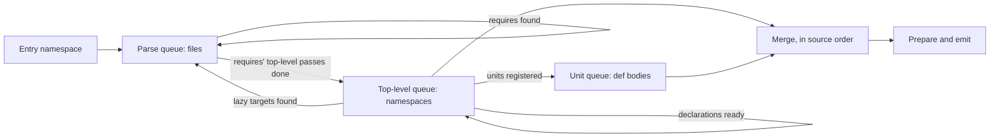

# Multi-threaded compilation: research and design

Status, October 19, 2026: stage A is built behind `--jobs N` and stays
experimental with a default of 1, because the stage A gate was missed on
Penpot (0.79x of `--jobs 1` at eight jobs, 1.8x peak RSS, and source maps
that depended on the schedule until light-cljs-379; light-cljs-343 under
"Gates and first steps").
Stages C and D are not built. The "As built" notes record what was
implemented; the rest of the document is the design as proposed.

Original status: proposed design, October 17, 2026. Nothing here is implemented. The
document merges the feasibility research (measurements, schedule models and
the scheduler, discovery and failure semantics) with the review of that
research, which tightened the measurement claims and separated the policies.
Measurements use the release build of `b51af6a` (the code under `87f5d0e`)
on the 24-core Mac, compiling the Penpot port's `app.main` entry with
`--optimize none`, which takes 23.2 s wall, 27.5 s user CPU and 0.96 GB peak
RSS. Method, scripts and raw data are listed at the end. Names of new types,
flags and configuration fields are design sketches, not available APIs.

## Summary

The proposed design is feasible. A work queue is seeded with the entry and
drained by a pool of workers that take batches and steal work. Each phase
hands its results to the next phase's queue, and work runs serially only
where macros and dependencies require it. Mapped onto light-cljs's phases,
it gives each phase a queue and a unit of work:

| Phase queue | Unit of work | Share of the build | Parallel? | What forces order |
| --- | --- | ---: | --- | --- |
| Lex and parse | one source file | ~1% (95 ms load, ~0.1 s re-parse in analysis) | fully | none; source order and cycle errors are computed from the discovered graph |
| Namespace top-level pass | one namespace | 26% | across namespaces | serial within a namespace (macros and definitions become visible in order); starts after the top-level passes of the namespaces it requires |
| Deferred units (`def` bodies) | one unit, batched per namespace | 70% | across workers, subject to declared blockers | compile-time effects made inside a body are visible only in the isolate that made them; consumers of a declared blocker keep today's order on the main isolate |
| Merge into the program | one result | ~3% (0.67 s) | no | canonical order, so output does not depend on timing |
| Prepare and emit | whole program, later per namespace | 3% | emit later | whole-program preparation |

Findings that decide how much the design buys:

- **The time is in the two analysis queues, and most of it is JavaScript.**
  96% of the build is analysis, and about 60% of the total runs inside V8:
  user macro code, plus the bridge that carries forms and environments to and
  from it. So **each worker needs its own V8 isolate**. A design that keeps
  one macro owner and feeds it requests from parallel Rust analysis is bounded
  by Amdahl's law at `1 / (0.60 + 0.40/P)`: about 1.5x at 8 slots and 1.67x
  with unlimited slots, before any overhead, however good its scheduler is.
  That bound rules out the single-owner architecture, even though its
  semantics would be easier to preserve.
- **The deferred-unit queue is almost free to create.** Each top-level `def`
  initializer is already a *deferred unit*: the compiler analyzes it from a
  frozen definition-time snapshot after the namespace's top-level pass, then
  appends the result. There are 13,361 of them, averaging 1.2 ms.
- **The dependency graph allows a large speedup.** The require graph has 922
  namespaces, is 63 levels deep and has a critical path of 2.8 s, against
  22.6 s of serial analysis. Simulated schedules on measured per-namespace
  and per-unit costs give the ideal times below. They are idealized list
  schedules, not predictions: they assume every task costs what it cost
  serially, and they omit transfer, publication, isolate start-up, JIT
  warm-up and memory admission. The measured slowdown from running compiles
  side by side (1.2x at 4, 1.4x at 8, 1.75x at 12 processes) is not included.

  | Which queues run in parallel | 4 workers | 8 workers | 12 workers |
  | --- | ---: | ---: | ---: |
  | None (today) | 22.6 s | 22.6 s | 22.6 s |
  | A. Units only; top-level passes on one thread | 6.1 s | 6.1 s | 6.1 s |
  | B. Top-level passes too, merged strictly in source order | 5.5 s | 4.2 s | 4.2 s |
  | C. Top-level passes too, each starting when its requires are done | 5.5 s | 2.7 s | 2.1 s |

  End-to-end targets, including contention and the serial load/emit tail,
  are about **9 s (2.5x) for A** and **5 s (4.5x) for C**. These are
  **hypotheses, not forecasts**, until the stage A prototype measures
  correctness and real scaling; they are not acceptance criteria. For
  comparison, Shadow-cljs dev took 32 s in the latest Penpot benchmark, for
  a build that also covers modules `app.main` does not reach.
- **The main semantic change is that compile-time state is no longer one
  heap.** A macro effect made in one isolate is invisible in every other.
  Stage A keeps top-level expansion serial on the main isolate, but it does
  *not* keep today's visibility: an effect made inside a `def` body on a
  worker is not seen by a later top-level macro on the main isolate. Macro
  providers with cross-namespace compile-time effects behave as they do under
  the proposed compiler cache: correct when declared, and the declaration
  gives their consumers affinity to the main isolate. The opt-out is the same
  blocker set, for the reason given under "Semantics and determinism".
  Upstream ClojureScript and shadow-cljs both run macros concurrently on a
  shared JVM and treat macro side effects as unsupported.
- **Cacheable and isolation-safe are separate properties.** One declaration
  (`--cache-blocker NS`) serves both opt-outs because the class of provider
  that breaks is the same, but neither feature proves the other correct.
  Each has its own contract tests, and each must stay correct with the other
  switched off.
- **The Rust refactor is moderate but not mechanical.** Parse results are
  already `Send`. `Program`'s element types hold no `Rc`; only its container
  types do. Swapping `Rc` for `Arc` in the arena, shared, layered, name-index
  and compiler-data modules measured no difference in a small sample (three
  alternating runs each; medians 23.07 s and 23.13 s, identical output).
  That is about 0.3%, not proof of zero overhead. `Arc` alone is not enough:
  `RefCell`, `Cell`, lazy state, callback captures and the engine handle
  remain. The larger work is splitting the engine handle out of `MacroHost`,
  a thread-safe unit catalog, deterministic name allocation and in-order
  merging.
- **The scheduler is written in this repository.** A compiler-specific pool
  on the standard library, with batched claims and work stealing, is a
  requirement. No scheduling or threading crate is added. The specifics
  under "The scheduler" are the recommended shape, not a contract.

Suggested build order:

1. The pool and queues, which can start with the parse queue, since that
   phase needs no thread-safety work. It is a scaffold rather than a speedup.
2. The deferred-unit queue (A). This is the first large gain, and it keeps
   today's top-level expansion order.
3. The top-level-pass queue (C), built on the relocatable namespace fragments
   that the [compiler cache](compiler-cache.md) needs anyway.
4. Per-namespace emission.

## Where the time goes

A 1 ms stack sample of the main thread (21,501 samples) attributes the time
as follows. Loading started before the sampler attached, so the load figure
comes from the timing probes instead. The sample is of the main thread only;
it is not a CPU profile of V8's background threads.

| Phase | Share | Notes |
| --- | ---: | --- |
| Deferred unit analysis (`drain_deferred`) | 69.8% | 63% of it is V8 time; includes the drain bookkeeping below |
| Namespace top-level passes (`NamespaceAnalysis::analyze`, excluding drain) | 26.3% | 62% of it is V8 time; includes helper work demanded synchronously during the pass |
| Emission | 2.9% | 0.67 s |
| Application preparation | 0.4% | 0.10 s |
| Loading and parsing 922 sources | 0.4% | 95 ms (probe); the re-parse of `#_` sources inside analysis adds ~0.1 s |

V8 accounts for 12.7 s of self time in the sample. The Rust frames that
enter it split as follows. These are self samples in milliseconds, and the
categories are exclusive.

| Entry | ms |
| --- | ---: |
| Macro calls (`MacroHost` → `MacroEvaluator::call`) | 6,680 |
| Form import (`import_macro_form`) | 1,451 |
| Environment import (`import_environment`) | 1,025 |
| Result export (`export_form`) | 972 |
| `compiler_frontier` | 746 |
| `macro_arguments` | 654 |
| Release, registration, unit evaluation | ~190 |
| Unattributed (truncated stacks) | 975 |

The timed V8-entry probes total 13.62 s. That is a different measurement
from the 12.7 s of sampled self time: the probe is taken at `invoke` depth 0
and so includes Rust callbacks reached from JavaScript. The two are not
interchangeable exclusive phase totals. Rust analysis called back from inside
a macro takes 3.7%; these are helpers that a macro demands, compiled on
demand. The substantial bridge cost (import, export, environment, frontier)
matters: parallel Rust analysis with one engine owner would retain most of
the current bottleneck.

The JIT matters a great deal: turning off V8's optimizing tiers (`--no-opt
--no-maglev`) raises the build from 23 s to 40 s, and also turning off
Sparkplug raises it to 60 s. That shows the importance of optimization, not
how much warm-up each worker will repeat; see "Risks".

Temporary per-namespace probes (reverted, see the end) produced these totals.
Output stayed byte-identical. An independent re-run of the saved model
reproduced the totals from the saved samples; that reproduction does not
rerun the compiler.

| Quantity | Value |
| --- | ---: |
| Top-level passes | 6.00 s (3.59 s in V8) |
| Deferred-unit drains | 16.53 s (10.03 s in V8) |
| Units analyzed in drains | 13,361; 15.86 s total (a subset of the 16.53 s) |
| Drain bookkeeping (append, index, release) | 0.67 s (the rest of the 16.53 s) |
| JS service calls | 1,288,464 (calls have different costs; the count is not a scheduling granularity) |

Do not add the drain total to its two components. Measured analysis comes to
22.56 s allowing for rounding, and the model's one-worker schedule takes
21.90 s because the unit models omit the bookkeeping, so printed speedup
ratios from the model do not compare identical total work.

Units are small and uneven.

- The mean is 1.2 ms. 2,535 units take over 1 ms, 227 over 10 ms and 4 over
  100 ms. Batches must remain stealable.
- The largest is 2.03 s: instaparse's `precompile-cljs-grammar` macro runs the
  GLL parser on the ABNF grammar at compile time (`instaparse.abnf`). It is a
  candidate for investigation, not an assertion that it is isolation-safe.
- Namespace cost barely correlates with source size (r = 0.11).
- 34 namespaces take over 100 ms. The costliest after `instaparse.abnf`
  (2.05 s) are `app.plugins.shape` (0.50 s), `app.main.ui.icons` (0.27 s, 272
  units) and `app.main.ui.dashboard.team` (0.27 s).

The engine side of a worker looks cheap to replicate, with the caveat that
these are whole-session observations, not the measured incremental cost of a
worker.

- A compile that boots V8, the runtime and the core macros takes about 45 ms
  in total.
- The whole build loads 993 JS units (1.7 MB of source) into the isolate. Its
  heap peaks near 39 MB used / 67 MB committed and ends at 27 MB after GC.

Parsing alone scales cleanly but is too small to matter. A harness that
parsed all 972 port files (11.8 MB, 1.07 M nodes) with the release parser
took 39.7 ms on one thread, 20.7 ms on two, 12.0 ms on four and 8.0 ms on
eight. Claiming four files at a time instead of one made no consistent
difference. The harness pre-enumerates files, holds sources in memory and
skips discovery, so it says nothing about the pipeline's batching policy or
about whole-build scaling.

The earlier whole-build numbers in
[benchmarks/results/compiler-2026-10-16/penpot-phase112](../benchmarks/results/compiler-2026-10-16/penpot-phase112/README.md)
(render 3.73 s, main none 21.97 s, main advanced 28.24 s) are the production
baseline. Advanced mode costs about 6 s more than none there, so the
preparation passes are worth a later look, but the two commands also differ
in assertions and output, so that subtraction is not an optimizer timer. Do
not average those runs with the probe run.

## How the compiler is structured today

The pipeline in [compiler.md](compiler.md) runs on one thread with one
`MacroHost`, one `CompilationSession` and one engine. It is more interleaved
than parse → expand → analyze → emit.

1. **Load** (`Loader::visit`, `src/compiler.rs:1175`). A depth-first walk
   asks the source provider for each namespace, parses the whole file inline
   with discarded forms retained, selects `.cljc` branches and reads the
   namespace directives, including raw directives beyond the `ns` form. It
   recurses into requires. The post-order defines each namespace's *source
   index*, which is also its initialization order. `Loading` marks membership
   in this DFS's active path; it is a cycle detector only for a serial walk.
   Namespaces reachable only through `light.lazy/loadable` are discovered
   *during analysis* and appended (`visit_lazy`, `:1343`, from
   `analyze_entry`, `:1541`). A lazy target may require its requester without
   being a static cycle.
2. **Analyze each namespace in source order**
   (`NamespaceAnalysis::analyze`, `src/analyzer.rs:3503`). Before each one,
   `prepare_source` installs macro imports and reads semantic namespace
   metadata, so it is not header scanning.
   - The analyzer takes ownership of the one combined `Program` (`:3535`).
     All `ExprId`, `GlobalId`, `LocalId` and similar values are dense indices
     into its arenas.
   - The top-level pass (`:3610`) expands top-level macros, declares globals
     and registers Vars and macros with the host. Reading, expansion,
     declaration and analysis interleave; `&env`, syntax quote, generated
     declarations and name resolution all depend on the current semantic
     position. There is no "expand everything, then analyze" phase to exploit.
   - For each top-level `def` with an initializer, it reads the initializer
     to a `Form`, takes a `definition_snapshot` and registers a unit with the
     session (`:6443`). The snapshot (`:6170`) is a frozen prefix of the
     program, the name index, the resolution and a macro-host frame. It does
     **not** freeze the JavaScript heap: roots can be late-bound, shared
     mutable values can change, and extension state has its own frontier. A
     snapshot is a transfer boundary, not a purity proof.
   - After the last form, `drain_deferred` (`:6202`) analyzes each unit
     through `CompilationSession::analyze` (`src/compilation_session.rs:386`).
     It then appends what the unit added with `program_fragment::append`,
     remapping its IDs. Parsed trees are released after each namespace;
     source text stays for diagnostics.
   - A macro may demand a helper's compile-time value. The evaluator's
     `__lightCompileUnit` callback enters the session, analyzes the unit,
     emits it and returns to the still-running macro. So analysis calls
     emission and evaluation before the application is analyzed, and an
     `Analyzing` unit met again on the single active stack is a cycle.
3. **Finish, prepare and emit.** These are whole-program passes on the
   assembled `Program`. Advanced mode alternates folding, inlining and
   retention, then computes inference, rapid type analysis and call shapes.

That gives two graphs: the static require graph and the dynamically
discovered graph of compile-time unit demands. Neither is the order in which
application initializers run; that is the source index.

Facts that bound a parallel design:

- **Definition-time snapshots already exist.** A unit never resolves names in
  a later environment, and its result is a fragment over a shared prefix.
  This is the isolation a parallel task needs on the Rust side.
- **One growing ID space.** A namespace's top-level pass allocates IDs after
  everything appended before it, including the previous namespace's units.
  The `Program` assumes a sequential build.
- **A namespace's analysis reads only its dependencies' top-level results.**
  - Declarations, metadata and macro registrations are all produced by the
    top-level pass (`GlobalBinding` and its `metadata` expressions are set
    before the initializer is deferred).
  - Cross-namespace arity warnings use arities from earlier namespaces'
    finished bodies (`collect_expression_warnings`, `src/analyzer.rs:3987`).
    That is a diagnostic post-pass, which can run at merge time.
  - In Penpot, deferred bodies add only 14 globals in total. All 14 are
    undeclared reservations (`exists?`-style probes and lazy targets); none
    is a definition.
- **Visibility follows load order, not requires.** A namespace may qualify
  globals of any namespace loaded before it. A probe over the final Penpot
  program found no runtime reference outside the referencing namespace's
  transitive requires. The only hits were the six lazy-target reservations.
  Compile-time observations were not probed: `&env`, `resolve`, `all-ns`, and
  the protocol-extension frontier, which is a global sequence number.
- **The engine is single-threaded state.**
  - Compile-time roots, compiled macro functions, the namespace reader-context
    registry, the protocol-extension journal and the JS `gensym` counter
    (`src/js_runtime.js:424`) live in one heap.
  - Every clean compilation starts fresh. Within a compilation, every macro
    sees the effects of every earlier macro, in source order, including
    effects made inside `def` bodies. The
    [macro regression tests](../tests/compiler/macros.rs) pin this down:
    definition-time visibility and macro generations; generated `defmacro`
    and top-level `do` declarations interleaving with later forms; shared
    mutable compile-time roots, with standalone application effects not
    replayed by helper demand; exactly-once nested expansion, cached failures
    and `defonce`; separate analysis-cycle and initializer-cycle diagnostics;
    and expansion limits that reject a macro *before* running it.
  - The `counter`/`next-value` test
    (`macro_namespace_effects_are_shared_once_per_compilation_with_fresh_reused_hosts`)
    is the canonical example:

    ```clojure
    ;; macros.cljs
    (ns macros)
    (def counter (atom 0))
    (defmacro next-value [] (swap! counter inc))

    ;; dep.cljs
    (ns dep (:require [macros :refer [next-value]]))
    (def value (next-value))

    ;; main.cljs
    (ns main (:require [dep :as d] [macros :refer [next-value]]))
    (js/console.log d/value (next-value))
    ```

    Namespace `dep` increments the counter inside `(def value (next-value))`,
    a deferred unit. Namespace `main` then calls `(next-value)` in a
    top-level form and prints `1 2`. Keeping every top-level call serial is
    not enough to preserve this: moving `dep`'s deferred expansion to a
    worker heap while `main` runs on the main heap prints `1 1`.
- **Process-wide name counters.** Syntax-quote `x#` (`src/compiler_reader.rs:1000`),
  `#()` parameters (`:1284`), binding gensyms (`src/compiler_binding_macros.rs:75`)
  and destructuring gensyms (`src/compiler_destructuring.rs:227`) are global
  atomics. Locals emit as `l{LocalId}`, but these names reach output through
  global, field and symbol-literal names and source-map `names`. Interleaved
  threads would make output depend on timing.

### Thread safety today

A read-only audit of the types on the analysis path found:

| Type | Send/Sync today | Blocking fields |
| --- | --- | --- |
| `SyntaxTree`, `Node`, `NamespaceSource`, `NamespaceResolution` | Send + Sync | none |
| `Program` (and `PreparedApplication`) | no | only the containers: `Arena` (`Rc` chunks, `Cell` hint), `Shared` (`Rc`), `Layered` (`Rc` maps) |
| `NameIndex` | no | `Rc` nodes |
| `Name`, `Source`, `Datum`, `Form`, `Origin` | no | `Rc`; `Source` also has a `OnceCell` line index; `Datum` identity is `Rc::as_ptr` (works the same with `Arc`) |
| `DefinitionSnapshot` | no | its `Program`, `NameIndex`, `Arena` and `Form` |
| `CompilationSession` | no | `RefCell<Catalog>` and `Rc<RefCell<Unit>>` units; each unit holds a boxed `MacroHost` frame |
| `MacroHost` | no | `Layered` maps, `Rc<RefCell>` environment caches, `Rc<Cell>` budget counters, `Rc<CompilationSession>`, and the engine via `Bootstrap` (`Rc<dyn CompilerEvaluator>`) |
| `SourceProvider` | no bound on the trait | caller-supplied closures may be thread-affine; `LoadRequest` carries a `Name` |
| `V8Evaluator`, QuickJS `Evaluator` | no, and must not move | isolate/runtime handles, `Rc<State>`, a stack limit bound to the creating thread |

About 190 `Rc` uses, 74 `RefCell` and 23 `Cell` across 21 files.
`analyzer.rs`, `compiler.rs` and `emitter.rs` contain none.

As built (light-cljs-333): `Arena`, `Shared`, `Layered`, `NameIndex` and
`Name`, `Source`, `Datum`, `Form`, `Origin` hold `Arc` instead of `Rc`;
`Source`'s line index is a `OnceLock`, and the `Arena` lookup hint is a
relaxed `AtomicUsize`: it measured +0.5% wall against the parent, a
per-thread hint +1.2%. `Datum` identity is `Arc::as_ptr`. So `Program`,
`PreparedApplication`, `NameIndex`,
`DefinitionSnapshot` (every field), `SyntaxTree` and the compiler data types
are now `Send + Sync`, and a `const` assertion at the end of
`src/compiler_data.rs` fails every build, not only test builds, if one of
them stops being so. Output is byte-identical; the Penpot numbers are in
[benchmarks/compiler-concurrency.md](../benchmarks/compiler-concurrency.md).

What still blocks `Send` on the analysis path, for the host-split and
session pellets (light-cljs-334, 335). Function-local `RefCell`s (in
`program_fragment.rs`, for example) and test-only counters are left out.

| Where | Thread-affine state | Kind | Blocks |
| --- | --- | --- | --- |
| `macro_host.rs` `MacroHost` | `compiler_data_readers: Rc<RefCell<CompilerDataReaders>>`, which also holds an `Rc<Evaluator>` for data readers | `RefCell`, engine handle | the host |
| `macro_host.rs` `MacroHost` | `macro_environment`, `namespace_environment`, `local_environment`, `reader_environment`: `Rc<RefCell<Option<…>>>` caches shared by frames | lazy state | the host |
| `macro_host.rs` `MacroHost` | `expansions`, `generated_nodes`: `Rc<Cell<usize>>` budgets shared by frames | `Cell` | the host; the aggregate budget of "Semantics and determinism" replaces them |
| `macro_host.rs` `MacroHost` | `reader_declared: Rc<RefCell<HashMap>>`, per-session registration positions | `RefCell` | the host |
| `macro_host.rs` `MacroHost` | `session: Option<Rc<CompilationSession>>`, `session_ref: rc::Weak` | session handle | the host |
| `macro_host.rs` `MacroHost` | `bootstrap: Option<Bootstrap>`, whose `evaluator` is `Rc<dyn CompilerEvaluator>` | engine handle | the host, `Catalog` |
| `compilation_session.rs` | `catalog: RefCell<Catalog>`; `units: Vec<Rc<RefCell<Unit>>>`; `Unit::host: Option<Box<MacroHost>>`; `AnalysisState` holds `Rc<Program>`, `rc::Weak<Program>` and `Rc<DeferredUnit>` (each `Send + Sync` inside) | `RefCell`, `Rc` | `CompilationSession`, `FrontierGuard` |
| `compilation_session.rs` `attach`, `compiler_evaluator.rs` `UnitService` | the `__lightCompileUnit` callback: `Rc<dyn Fn>` capturing an `rc::Weak<CompilationSession>` | callback capture | the bootstrap evaluator's services |
| `compiler_bootstrap.rs` `UNITS` | `thread_local!` `RefCell<Option<Vec<BootstrapUnit>>>`, the bootstrap macro JS cache | per-thread lazy state | nothing (it is per thread), but each thread compiles it again with its own gensyms; it becomes a process-wide `OnceLock` |
| `compiler_reader.rs` `NamespaceView` | `core_bindings: Rc<HashMap<Name, ResolvedBinding>>` from a `thread_local!` `CORE` | per-thread lazy state, `Rc` | `NamespaceView` and the analyzer's `ReaderView` (stage C); as an `Arc` in a `OnceLock` it would be shared |
| `evaluator.rs`, `v8_evaluator.rs`, `v8_bridge.rs` | isolate and runtime handles, `Rc<State>`, `RefCell`/`Cell` engine state | engine | must not move; one per thread |

As built (light-cljs-334): the `macro_host.rs` rows, the `__lightCompileUnit`
callback row and the `compiler_reader.rs` row above are resolved; the
`compilation_session.rs` rows are the session pellet's (light-cljs-335).

- **Two parts.** A `MacroHost` is its sendable data and an `EngineBinding`
  (`src/macro_host.rs`). The data is the limits, the evaluator options and the
  opaque-packages setting, which stay fields of the host so that callers can
  borrow them apart, and `MacroTables`: the layered imports, renames, namespace
  symbols and docs, runtime Vars, macro declarations and their names, source
  bindings, the name policy, the reader generation, the build configuration
  (now an `Arc`) and the data readers' emitted sources. `MacroHost::environment`
  takes all of it as a `MacroEnvironment`, as an analysis frame sees it. The
  binding holds the bootstrap engine, the data-reader engine and the reader
  functions evaluated in it, the session handle, the four environment caches,
  the budget counters and work marks, the reader declarations, the dependency
  log, the `light.build` context and the script host.
- **Checked in every build.** A `const` assertion fails the build if
  `MacroEnvironment` stops being `Send + Sync`, and another if
  `EngineBinding` becomes either; a marker field keeps it neither whatever its
  other fields become.
- **The serial path** builds every analysis frame from the two parts: the
  environment and a frame of the coordinator's binding, which shares its
  engines, caches, counters and session as before. Output is byte-identical.
- **A worker's host** is `MacroHost::bind(environment, evaluator)`, with an
  engine made on the worker's thread. The engine gets the host's preludes and
  the process-wide bootstrap units through `compiler_bootstrap::bind`, so no
  thread compiles them again. Without an engine, the host analyzes what runs
  no macro in one, which is light-cljs-338's case. The bound binding starts
  with no session, empty caches and zero counters; one aggregate budget is
  light-cljs-341's.
- **Source macros stay with their engine.** A declaration's function is a
  value ID of the engine that evaluated it, which any other engine refuses
  ("Value ID belongs to another JavaScript session"). An installed macro's
  cached function is behind an `Arc<Mutex>` now, so the tables are sendable,
  but it is still one engine's. Installing macro code in each isolate is
  light-cljs-339's.
- **The services' seam.** `install_catalog_services`
  (`src/compilation_session.rs`) installs `__lightCompileUnit` and
  `light.build`'s `__lightBuildService` in an engine from a weak
  `CatalogView`. `CompilationSession` is the coordinator's view; a worker
  installs them with a view of its own. The catalog behind it is
  thread-safe since light-cljs-335 (below).
- **V8 starts first.** `--compile` initializes the V8 platform at the start
  of `analyze_entry`, before the load pool's threads start
  (`v8_evaluator::initialize_platform`). An evaluator made elsewhere still
  initializes it on first use.
- **One table of core bindings.** `NamespaceView`'s core bindings are one
  `OnceLock<Arc>` for the process instead of an `Rc` per thread, and
  `NamespaceView` is in the `compiler_data.rs` assertion.
- **Tests.** `compilation_session::worker_tests` keeps the inputs of each
  unit a compilation registers, sends them to another thread, binds a fresh
  engine there (V8, or QuickJS in a QuickJS-only build) and analyzes a
  macro-free unit, with an engine and without, and a unit that expands `when`
  and `->`, to the main thread's prepared JavaScript. Others run the data
  readers an environment was taken with on another thread, and give a bound
  engine a catalog view of its own, through which `__lightCompileUnit` and
  `light.build` requests reach it.

As built (light-cljs-335): the `compilation_session.rs` rows are resolved.

- **One shared catalog.** `SharedCatalog` (`src/compilation_session.rs`) is
  the units, the Var bindings, the active and `defmulti` targets and the
  ordered registrations behind one `Mutex`, with one `Condvar`, and a `const`
  assertion keeps it `Send + Sync`. A unit is `Unstarted`, `Analyzing(owner)`,
  `Analyzed(Arc<Program>, warnings)`, `Prepared(sync::Weak<Program>,
  warnings, Arc<DeferredUnit>)` (the prepared compile-time JavaScript is the
  `DeferredUnit`'s source) or `Failed(message, diagnostic)`. Its inputs are
  its form, its snapshot and the `MacroEnvironment` of the host it was
  registered with (`MacroHost::into_parts`); the registering thread keeps the
  host's `EngineBinding`, by unit ID.
- **One producer, many waiters.** A demand claims an `Unstarted` unit, waits
  on the condvar with a predicate loop while another thread's analysis owns
  it, and otherwise reuses the result or the failure, which every waiter
  shares and nothing retries. The lock covers that bookkeeping only: the
  analysis, the preparation of a unit's JavaScript and the drop of a
  program run outside it, and the condvar is notified only when a thread
  waits. A unit counts its waiters: when the application takes the analyzed
  program (`release_application_ir`) while one waits, the unit keeps a strong
  reference until the last waiter has its own, and `__lightCompileUnit`
  falls back to the prepared JavaScript if the program went first. The claim
  is guarded from the moment it is taken, so an analysis that unwinds still
  fails its unit as interrupted and wakes its waiters.
- **Cycles.** Each view joins the catalog with a thread slot that holds its
  stack of units being analyzed and the unit it waits for. A unit met again
  on the demanding thread's own stack is the serial diagnostic, unchanged. A
  wait that would close a cycle across threads walks owner, waited unit,
  owner, and reports "compile dependency cycle" with the cycle's units in
  demand order from the lowest (source index, unit ID), and that unit again.
  The thread that would close it gets the error; its failure reaches the
  others as their waits end. The root-initializer cycle stays separate, in
  JavaScript.
- **Per isolate.** The coordinator's bootstrap engine and how many of the
  catalog's registrations it holds are fields of its view,
  `CompilationSession`, and no longer of the catalog. `WorkerView` is a
  worker's view: its host (`MacroHost::bind`), whose binding each analysis
  frame is taken from, its own slot, and its own count. It installs
  `__lightCompileUnit`, `light.build`, the root registry and the runtime in
  its engine, and before each analysis or `__lightCompileUnit` it installs
  the registrations made since it last looked. Analysis is shared; a unit's
  registration and roots are evaluated in each engine that asks for it.
- **Left for later.** Only the coordinator registers units. A worker frame
  has no `CompilationSession`, so analysis that needs one there, such as a
  definition's `:test` unit, is for light-cljs-338's eligibility; source
  macros in worker engines are light-cljs-339's.
- **Tests.** `compilation_session::worker_tests` registers units in a fresh
  catalog and analyzes them on worker threads without an engine: two threads
  demanding one unit share one analysis and the same `Arc<Program>`; three
  demanding a failing unit all get its one failure, and a later demand does
  not retry it; a two-thread wait cycle reports `cljs.user/a -> cljs.user/c
  -> cljs.user/a` whichever thread asks; a waiter that wakes only after the
  coordinator's application took the program still gets it; a producer that
  panics wakes its two waiters with "analysis interrupted", which a later
  demand gets too. A worker engine evaluates a unit the coordinator prepared
  through its own `__lightCompileUnit`, without a second analysis. Roots
  initialized once per isolate with a stateful initializer are
  light-cljs-367's test.

The engines are ready for concurrent use.

- The V8 platform is initialized once per process (`OnceLock` in `platform()`,
  `src/v8_evaluator.rs:190`). The vendored V8 headers permit one thread per
  isolate at a time; a second context in the same isolate gives no
  concurrency.
- Each evaluator owns one isolate. The interrupt scheduler is one process-wide
  thread built to serve many isolates.
- A unit test already runs four isolates on four threads, and
  `tests/compiler/dev_build.rs` runs whole independent compilations in
  parallel threads.
- On Linux x86-64 hosts with memory protection keys, threads created before
  the first V8 initialization cannot enter isolates. So `platform()` must run
  before the pool spawns.
- The bootstrap macro JS cache is `thread_local!` (`src/compiler_bootstrap.rs:158`).
  Each worker would recompile it once, and its gensym suffixes would differ
  per thread. It should become a process-wide `OnceLock`, so every thread
  shares the exact artifacts the canonical compiler produced.
- Evaluators are created and destroyed on their owning thread. Engine
  handles, closures, roots and an active `MacroHost` never travel through a
  queue; a worker constructs a local host bound to its own evaluator from
  transferable data.

QuickJS remains for interactive sessions, and WebAssembly (whose embedder runs
the macros since light-cljs-357) has no engine of its own; both stay serial.
Parsing and IR work must not come to require V8.

The built-in file provider can be parallelized directly. A caller-supplied
provider keeps today's invocation context and order unless the embedding
opts into a `Send + Sync` contract. Jobs carry namespace strings and build
the `LoadRequest` on their own thread.

## How upstream ClojureScript and shadow-cljs do it

Both parallelize per namespace.

- **Upstream** `:parallel-build` is off by default (`cljs/closure.clj:1074-1100`).
  - A pool of `2 + 0.6 × cores` threads takes namespaces from a dependency-ordered
    deque. A thread busy-waits, polling every 10 ms, until all of a
    namespace's requires are compiled.
  - All threads `swap!` into one shared compiler env, with no per-task copy.
  - Macro *loading* (`require`) is under a global `load-mutex`. Expansion is
    not locked.
  - Results are re-sorted into dependency order. Warnings print as they
    happen, and gensym is a global JVM counter, so output is not deterministic.
- **Shadow-cljs** is parallel by default (`shadow/build/compiler.clj:1215-1398`),
  with `availableProcessors` threads.
  - One task per namespace, ready when every require is ready. Waiting tasks
    poll every 5 ms with a progress timeout.
  - A namespace signals ready **after analysis, before emit**, and right after
    a cache restore, so dependents start earlier.
  - Macro loading takes a global `require-lock`.
  - Warnings are collected per namespace and printed in source order.
    Namespace roots are precomputed, because the munger raced on a partially
    populated namespace set ("the ns may not exist when munge decides to
    munge").
- **Macro side effects** are unsupported in both; neither serializes
  expansion. Upstream fixed several races caused by them:
  - CLJS-1570: `set! *unchecked-if*` leaked between files.
  - CLJS-2171: spec-registry reads.

  Shadow handles side-effecting macros by excluding them from its cache
  (`:cache-blockers`, default `clara.rules`/`clara.macros`).

The transferable lessons are explicit readiness and reusable per-source
results. The polling loops are not worth copying; readiness here is
completion-driven. The 2023 parallel-rustc report is the other relevant
precedent: task graph and data ownership mattered more than thread count,
and utilization was uneven.

light-cljs can't share one macro runtime across threads the way the JVM does.
Its isolates are separate heaps, so compile-time state diverges *more* than on
the JVM, not less. In return, nothing races: each isolate is single-threaded,
and the divergence is deterministic once tasks are assigned deterministically.

## The design, phase by phase



**Queue seeded with the entry.** This works as described.

- Parsing a file reveals its requires, which go on the same queue. This
  discovery is parallel. A one-file frontier stays serial until its
  dependencies are known; stealing cannot create parallelism that the graph
  does not have.
- Today's depth-first source order, which is also initialization order, and
  the dependency-cycle error path are then computed from the discovered graph
  rather than from the order files happened to finish.
- Namespaces reachable only through `light.lazy/loadable` are found during
  analysis, so the top-level queue feeds them back into the parse queue.

**Workers that take several items at once, plus work stealing.** Both fit.
The cache to protect is mostly per-worker state rather than the CPU cache:
the macro and helper code installed in that worker's isolate, its JIT
feedback, namespace registrations, and the analyzer's reader-view cache.

- *Parse queue:* batch whole files. Any order works. Scanning and parsing
  stay fused in one file job; a token queue or splitting a file at byte
  offsets would be finer than the work justifies.
- *Unit queue:* a worker takes one namespace's units as a batch, in source
  order. Idle workers steal from the far end of another worker's batch.
- *Top-level queue:* one namespace per task. Locality comes from preferring
  the worker that already holds the namespace's dependencies' macros.
- *Queue type:* tasks average about 1 ms (13,361 units plus 922 passes, over
  a few seconds of wall time). Standard-library primitives are enough, with
  no new crates; see "The scheduler".
- *Priority:* this matters more than the queue type. Taking the longest
  remaining dependency chain first beats source order by 1.4x at 8 workers.
  The chain length counted in namespaces is within 3% of perfect knowledge,
  so no timing profile is needed.

**Hand-off between queues.** Items move on one at a time as soon as they are
ready, so the phases overlap.

- A namespace leaves the parse queue for the top-level queue once the
  namespaces it requires have finished *their top-level passes*. It does not
  wait for their units. This follows shadow-cljs's "ready after analysis".
- A namespace's units enter the unit queue as its top-level pass registers
  them.
- Every result goes to the merge, which consumes them in source order.
- A worker may continue straight into a ready next stage for the item it just
  finished. The queue boundary is a scheduling opportunity, not a forced
  thread migration.

**What must be serial**, precisely:

- *Within a namespace*, the top-level pass. Definitions become visible in
  source order, a `defmacro` may be used by later forms, and top-level forms
  have effects on the host and session. Declaration admission follows actual
  source and macro-generated declarations; nothing predeclares names found
  in parsed files.
- *Across namespaces*, only along require edges, as above.
- *Consumers of a declared blocker*, on the main isolate in source order.
- *Merging* into the final program, in canonical order. It is cheap: 0.67 s
  of bookkeeping today, and it can run as results arrive.
- *Whole-program preparation.* Emission could later run per namespace.

"Independent" here means independent *compiler execution*. Lowering a
function that prints or mutates an atom is independent Rust work; the
compiler creates instructions and does not run them. Only when a macro
demands that function's value or invokes it at compile time does its effect
belong to an isolate's ordered state.

Macro execution itself does not need to be serial if macros don't share
compile-time state across workers; that is the contract under "Semantics and
determinism". The 9 s and 5 s targets come from the two analysis queues, so
that is where the hard engineering goes:

- an isolate per worker;
- `Arc` instead of `Rc` in shared data;
- deterministic generated names;
- the in-order merge.

## The scheduler

A compiler-specific scheduler on the standard library is a requirement of
this design: `std::thread::scope` for a build's fixed worker set, one
`Mutex`, two `Condvar`s and `VecDeque`s, with batched claims and work
stealing. No scheduling, channel or thread-pool crate is added. A scheduling
runtime of this shape is on the order of 800 lines, which is small next to
the compiler changes it drives. Stage transitions live in the compiler, not
in the queues, so the same work graph runs inline for `--jobs 1` and
WebAssembly and through the pool natively. Deterministic order comes from the
compiler's canonical numbering, never from which worker won a lock. Worker
assignment and stealing are never part of the language contract.

**Ownership.** The coordinator runs on the calling thread and owns the
canonical `Program`, the dependency state, the merge and the main isolate.
Each worker owns one isolate and its scratch buffers. Only owned,
transferable job and result handles enter the scheduler state. Queues carry
handles, not copies of syntax trees.

**One mutex, for the first version.** Behind it: a ready `VecDeque<Job>` per
phase, per-worker deques grouped by phase, a completion deque, running-job
accounting and the shutdown flag. The lock covers short bookkeeping only.
Compiler code, provider callbacks, macro evaluation, large destructors and
merging all run after it is released. Measure contention before splitting
the lock.

**Claiming and stealing.** At each job boundary, under the mutex:

1. Check cancellation, then urgent work (anything the coordinator or a
   waiting demand needs). Otherwise pop from the local deque of the current
   phase.
2. If empty, claim a bounded batch from that phase's shared queue. Start one
   job and leave the rest in the local deque, where peers can still see it.
3. If the shared queue is empty, steal from a peer: rotate the victim index
   and take about half of its unstarted jobs, capped by the batch limits. The
   owner pops from the back; thieves take from the front.
4. If the phase has nothing, move to another ready phase with the same
   policy. Reconsider phase preference after a bounded number of jobs, with
   aging, so a busy phase cannot starve the others.
5. Sleep only when no runnable job exists anywhere.

Batch limits count jobs and estimated cost. A batch is never a private
closure: every unstarted member stays stealable. A running job stays on its
worker until it finishes. Start with small fixed batch counts; use measured
costs later to keep several large items off one worker.

**Outcomes.** A worker reports `Done` or a failure through the completion
deque. The coordinator consumes it, updates readiness, and releases newly
ready jobs. Work whose readiness is already known may be placed on the
finishing worker's own deque, under the same accounting. Discovery results
and anything that touches ordered state go through the coordinator.

**Parking and wakeups.** One condition variable for workers waiting for
runnable work, one for the coordinator waiting for outcomes, so an outcome
never wakes only a worker. Every wait inspects its predicate under the mutex
and loops around `Condvar::wait`; producers update the predicate under the
same mutex before notifying. Claiming or stealing must preserve the
"runnable work exists" predicate, including jobs in local deques. One new
job wakes one worker; a batch wakes all. There is no polling sleep.

**Completion.** Track queued, running and completed-but-unconsumed jobs
separately, plus suspended demands and pending publications. The coordinator
registers an outcome's successors before testing for completion, and only it
declares the build done: no admitted running work, no runnable work and no
outstanding discovery or demand that can create more. An empty queue while a
parse job is still discovering requires does not end the build. A dependency
with no producer is a cycle, a missing source or a scheduler bug, and is
diagnosed as such.

**Failure and shutdown.** A compiler error is an outcome whose precedence and
cancellation scope the coordinator decides. A worker panic, under unwinding,
is caught at the job boundary, retires the running slot, is reported and
stops the build; its scratch state is discarded. Every exit path, including
coordinator failure, sets shutdown and wakes both wait sets before the scope
joins; scoped joining alone cannot wake a parked worker. Abort-mode panics
still abort the process.

**Bounded admission.** Bound queued artifacts by estimated bytes as well as
count; parsed trees are many times their source size and macro output is
larger still. Reserve completion-deque room for every admitted job so a
worker can always publish without blocking, and prefer work that unblocks
the next merge over speculative breadth. Byte estimates guide admission;
they are not a hard memory bound.

**Worker count.** `--jobs N` means CPU work slots, and the
coordinator's own isolate counts as one, so there are up to `N-1` background
workers. It does not promise a thread count: V8's platform threads, I/O and
other builds are outside it. `--jobs 1` runs the ready jobs and ordered
operations inline without spawning. An empty eligible workload starts no
pool and no worker isolate. A persistent watch-build pool is a later step
and uses owned scheduler state with explicit shutdown.

*As built (light-cljs-336):* the pool is `src/scheduler.rs`, about 1,100
lines with no `unsafe` (`#![forbid(unsafe_code)]`), and its tests on
synthetic jobs are `src/scheduler/tests.rs`. It is generic and knows nothing
about the compiler:

- *Interface.* A `Job` reports its phase, an estimated cost, estimated bytes
  and a priority. `scheduler::run(config, make, execute, coordinate)`
  takes a function that creates a slot's state on the thread that owns it,
  on that slot's first job (so a worker that never runs a job never starts
  an isolate), one that runs a job against that state, and the
  coordinator's closure, which drives the build on the calling thread
  through a `Coordinator`. The coordinator submits jobs singly or as a
  batch (`submit`, `submit_batch`), submits urgent work (`submit_urgent`)
  and consumes outcomes with `next_outcome()`. A running job sees a `Worker`
  handle: its slot, whether the build is cancelled, and `push_local` for
  a successor whose readiness it already knows. Anything ordered goes back
  in its outcome.
- *Slots.* Slot 0 is the coordinator's. With `Slots::ONE`, nothing is
  spawned: `next_outcome()` claims and runs each job inline, through the same
  queues, claim order and accounting, and creates the slot state on the
  calling thread. With N slots, N-1 named, scoped worker threads are
  spawned at `run` (`Config::stack_size` sets their stacks). The
  coordinator does not run pool jobs; its slot is for its ordered work
  and its own isolate. A caller with no eligible work does not call `run`.
- *Claims.* Claims follow the order above. Urgent jobs come first, in any
  phase, and are admitted whatever the bounds, since what waits for them
  may be holding the room. Then come the local deque of the current phase,
  a batch from the phase's shared queue, and a steal of about half a
  victim's deque from its far end. A batch is at most `batch_jobs` jobs
  and `batch_cost` total estimated cost, but its first job is always
  taken. Shared queues and the backlog are ordered by priority, highest
  first, with ties in submission order. A worker stays in its phase for
  `phase_quantum` consecutive jobs while that phase has runnable work.
  Then, or when the phase runs dry, it moves to the runnable phase whose
  last start is oldest (the aging).
- *Admission.* The backlog is kept per phase. It admits the
  highest-priority front, ties in submission order, but a phase whose
  backlog has waited `phase_quantum` admissions goes next. Without that
  rule, a high-priority stream could keep another phase out of the
  runnable set when admission is tight.
- *What the bounds cover.* The bounds apply to admitted work, which is
  queued, running, or completed and not yet consumed. A job's byte
  estimate is what it holds until its outcome is consumed. The backlog
  holds job handles the caller has already built, and it does not refuse
  them. A caller that produces work faster than it runs can read
  `backlogged()` and hold back; `PoolCounts::peak_backlog` records the
  most that waited.
- *Defaults.* `batch_jobs` is 4, `batch_cost` is unbounded until costs
  are measured, admission allows 4096 jobs and 1 GiB of estimates, and
  the quantum is 32.
- *Wakeups.* A submission that makes one job runnable notifies one worker,
  and a batch notifies all. A claim that leaves unstarted jobs in the
  claimer's deque notifies up to that many parked workers, so they can
  steal. Workers notify the coordinator when they publish an outcome or a
  panic.
- *Completion.* `next_outcome()` returns `Outcome`, in completion order. With
  nothing admitted or in the backlog it returns `Quiescent`, or `Stalled`
  when demands or publications are held: the coordinator registers those
  with `hold` and `release`, and "stalled" is the "dependency with no
  producer" case for it to diagnose. An outcome's admission is freed when
  the coordinator consumes it. Admitted jobs that are neither runnable,
  running nor completed are a scheduler bug, and `next_outcome()` panics on them
  rather than waiting forever.
- *Cancellation.* `cancel()` drops every unstarted job with the mutex
  released and refuses later submissions. Running jobs finish, and long
  ones can poll `Worker::cancelled`. It is also set when the build stops,
  after a panic or when the coordinator's closure ends, so the scope can
  join a running job that polls it.
- *Panics.* A panic in a job or a slot constructor is caught at the job
  boundary. The slot's state is dropped and its unstarted jobs go back to
  the shared queues. Shutdown is set, and `next_outcome()` returns the
  `WorkerPanic` from then on. `run` returns `PoolError::Panic` whatever
  the coordinator returned. A guard sets shutdown and wakes both condition
  variables however the coordinator's closure ends, so a panicking
  coordinator still joins every worker before its panic resumes.
- *Counters.* `PoolCounts` records the jobs started by each path, claims,
  steals, phase switches, parks, the peak numbers admitted and
  backlogged and the jobs cancelled, for `--stats` once a phase runs on the pool.
- *CLI.* `--jobs N` is parsed in `CompileFlags::accept` and is threaded to
  the compile entry as `EntryRecorders::slots` (and to
  `analyze_namespace_entry_cached`). It is accepted with every
  `--compile` and defaults to 1. The parse queue is the first phase to use
  more than one slot (light-cljs-337, under "Source discovery and
  readiness").

The tests cover the scheduler, liveness and completion rows of the
validation table that do not need the compiler:

- the claim order, batch limits and steals, checked on the state directly;
- no job lost or duplicated in a 3,000-job graph with injected delays, at
  2, 3, 4, 8 and 16 slots, four rounds each, with local pushes and
  coordinator successors;
- members of one claimed batch stolen by idle workers;
- 2,000 submissions racing the last worker as it parks, half of them made
  only once every worker is parked;
- a starved phase served against endless local streams, also with one or
  two jobs admitted at a time, where only admission aging lets it in;
- a panicking job, and a panicking slot constructor, which stop the build
  and drop every slot's state;
- shutdown with every worker parked, and with a panicking coordinator;
- a running job that polls for cancellation, joined after a peer's panic,
  after the coordinator returns, and after it panics;
- admission bounds of one job and one byte with saturated workers;
- the one-slot path, which runs the same graph on the calling thread;
- a chain whose queues are empty while its only job runs;
- held demands without a producer;
- cancellation.

Each liveness test runs under a deadline, so a deadlock fails instead of
hanging the suite. Disabling the single-job wakeup, the quantum or
admission aging makes them fail. Duplicate unit demands, cross-worker
cycles and cancellation during discovery need the compiler's jobs and
remain for the stage A pellets.

## Source discovery and readiness

- One record per resolved namespace per build, with states unrequested,
  queued or running, parsed, top-level done, committed and failed. Reverse
  edges and unresolved-prerequisite counts drive readiness. Parsed
  dependencies and top-level-done dependencies are different conditions, and
  stage A's merge order follows today's total order, not any topological
  order.
- Two branches reaching the same dependency at once form a diamond, not a
  cycle. Coalesce the requests and diagnose cycles from graph paths, never
  from a `Loading` flag.
- Reconstruct the DFS post-order deterministically from ordered require
  edges, independent of completion order. That order defines source indices,
  the entry's value, diagnostic order and initialization order.
- Preserve the resolution rules: `.cljs` before `.cljc`, canonical duplicate
  handling and ambiguity errors, virtual core namespaces, first-party
  fallback, `clojure.*` rewriting, explicit sources over `goog.*` host
  namespaces, and `:as-alias` not loading a file. Keep whole-file parsing
  before discovery; an early-header scanner would miss raw directives later
  in the file.
- Lazy targets enter only at the existing semantic discovery point and append
  their closures by the current rules.
- Keep the initial source-error barrier. Today the whole static graph is
  loaded and validated before any application macro runs. Overlapping
  analysis with discovery would let macro effects run before an error that
  currently prevents them, and needs its own compatibility decision.
- Tag work with a build generation and the source bytes it saw, so a stale
  completion cannot publish into a newer watch build.

*As built (light-cljs-337):* the parse queue is the first phase on the
pool, in `src/compiler.rs` (`Loader::load`, `discover`, `parse_source`):

- *The job.* `parse_source` is one file's whole job: the provider lookup
  (with the bundled first-party fallback), the whole-file parse with
  discarded forms retained, `.cljc` selection, the `ns` form and the raw
  directives after it, the `goog.*` host checks and the `clojure.*` rewrite
  lookups, and the implicit `light.lazy` require. Its result carries the
  ordered requires, which are the edges, and the job's own lookups numbered
  from 0. The same function runs wherever the job runs.
- *Discovery.* `discover` seeds the queue with the root and, as each
  outcome arrives, requests every require that is not the core, not loaded
  and not requested yet, as one batch. `ParseRecords` holds one record per
  namespace by dense id: absent (unrequested), `Queued` (queued or
  running), `Done` (parsed or failed). A namespace that two requires reach
  is requested once, whichever outcome names it first, so a diamond is
  never mistaken for a cycle. A failed job reports no requires. The phase
  ends when the pool is quiescent.
- *Replay.* The depth-first walk (`visit`) then runs exactly as before,
  but takes each namespace's result from the records instead of reading
  it. Its post-order is the source order; the cycle check still uses the
  walk's stack, so a cycle's path and the first error reported (a missing
  source, a parse error, an ambiguity, a cycle) are the ones the serial
  walk meets first, located at the same require. Each job's lookups are
  appended to the manifest record when the walk reaches its namespace,
  with the walk's requester, and its lookup numbers are offset by the
  lookups recorded before it, so the record is identical too. Work the
  queue did beyond a first error (files the walk never reaches) is
  discarded with the records.
- *Lazy targets.* `visit_lazy` asks the provider for the target on the
  calling thread, as before, then loads it with `load`: a new phase whose
  discovery skips every loaded namespace, so the target's unvisited
  closure is appended by the walk's rules and a require of the requester
  is no cycle. The static graph is still loaded and validated whole before
  analysis starts.
- *Providers.* `SourceProvider::concurrent` (default `None`) is the
  `Send + Sync` opt-in; `FileSourceProvider` returns itself. Any other
  provider is called by the walk on the calling thread, in today's order,
  with no pool started. A concurrent provider is asked once per namespace,
  with the requester that reached it first in the discovery, which need not
  be the depth-first one, so its answers must not depend on the requester;
  the manifest records the depth-first requester.
- *Slots.* At `--jobs 1` (the default) the pool runs every parse job inline
  on the calling thread, so every build with source roots goes through the
  same discovery and replay. With N slots, N-1 workers parse and the
  coordinator only consumes outcomes. QuickJS-only and WebAssembly builds keep one slot
  whatever `--jobs` says (`parse_slots`), as the first delivery's scope
  requires: their parse jobs all run inline. Each lazy target's phase is its own
  `scheduler::run`.
- *Generation.* Each phase takes a fresh generation from a process-wide
  counter, its jobs and outcomes carry it, and an outcome of another
  generation is dropped unpublished. With the pool scoped to one phase
  this cannot happen yet; it is the guard for a persistent watch-build
  pool.
- *Trace.* With `--stats`, each job times itself and the walk records the
  times as the namespaces' `load`, in source order; `trace.load-ms` is the
  coordinator's wall time in load phases (discovery and replay), which at
  `--jobs 1` is the sum of the jobs and at N slots the phase's wall time.
- *Errors.* A panic in a parse job is reported as a compile error naming
  the worker, after the pool joins.

The tests are `tests/compiler/source_loading.rs`. Each scenario compiles at
one and four slots, four rounds each, and compares JavaScript, source order,
warnings, the dependency manifest or the error (message, file, span, line
and column) with the serial walk of a provider that does not opt in: a
diamond; a static cycle and a missing source, each reported first when the
walk meets it first; a parse error deep in the graph against a later one; a
mismatched `ns` name; `.cljs` over `.cljc` and an ambiguity across roots;
`goog.*` host, explicit `goog.*` source, bundled `clojure.string` and the
`clojure.*` rewrite; raw `require` forms after the `ns` form; and a lazy
target that requires its requester, with a missing dependency in its
closure; and a missing source later in the graph than a namespace whose
macro would throw, which reports the missing source. A non-`Send` closure
provider at four slots is asked on the
calling thread, in walk order; an opted-in provider is asked once per
namespace, on worker threads at four slots. The whole suite was also run
once with the loader forced to four slots (not committed).

On Penpot main the serial build measured +2.7% median wall in a noisy set
(+1.7% on paired differences) and -0.4% peak RSS; the load phase itself is
103 ms before and 105 ms after, of a 26 s build, and at `--jobs 8` the
load phase takes 35 ms; see
[benchmarks/compiler-concurrency.md](../benchmarks/compiler-concurrency.md).

## Building it in stages

A coordinator thread owns the canonical `Program` and the merge, and N
worker threads each own one V8 isolate. Immutable compiler data is shared
through `Arc`. The parse queue can go first as scaffolding for the pool. It
needs no thread-safety work beyond what parse output already has, and it
gives no measurable speedup on its own.

### Stage A: parallel deferred units

This stage keeps today's top-level *expansion order*: every top-level form is
still expanded on the main isolate, in source order. It does not keep
today's *visibility* of compile-time effects made inside `def` bodies; see
"Semantics and determinism" for what changes and how blockers restore it.

- **Coordinator.** It runs the loader and every top-level pass in source
  order, in the *main isolate*, as today. Where `drain_deferred` analyzes
  units inline today, the coordinator instead enqueues the namespace's units
  as one batch and moves on to the next namespace. Units of a blocker's
  consumers are not enqueued; they drain inline on the main isolate at
  today's point, before the next namespace.
- **Workers.** A worker takes a unit and analyzes it from its existing
  snapshot and macro frame, in its own isolate. It registers macro and helper
  code from the shared catalog on first use, then stores the fragment and
  warnings in the catalog. Nested demands made during the unit keep running
  inline on the worker, as today.
- **Compile-time demand.** When a macro demands a helper unit (on any thread),
  the caller claims the unit if it is still queued, waits if another worker
  is analyzing it, and reuses the analysis if it is finished. One producer
  per unit, many waiters, shared success or failure. Analysis is shared
  across threads; evaluation of roots is per isolate. Nested demands keep
  running inline on the demanding thread, as today, so a macro that
  synchronously needs a helper never waits on a coordinator that is waiting
  on it.
- **Cross-worker cycles.** Each wait walks the wait-for graph. A cycle back
  to the waiter is the existing "compile dependency cycle" error, reported
  with the canonical path (lowest source index first). Thread-local recursion
  stacks alone cannot see these cycles.
- **Merge.** Unit fragments are appended *after* the coordinator's top-level
  passes, in unit order. Every snapshot is a prefix of the monotonically
  growing program, so the existing shared-prefix `append` stays valid. The
  merge remaps expression, local, global, string, literal, recur and lazy
  IDs, source indices, generation references, diagnostics and reader
  metadata; `append` does the first group today and must grow to the rest.
  - This changes ID order relative to today: the next namespace's
    declarations now precede the previous namespace's bodies. That is one
    deterministic output change, and afterwards output is identical for any
    worker count.
  - Reservations made inside bodies must be merged with an existing
    same-named global rather than duplicated.
  - Later flags and metadata set on an earlier global by a later namespace
    are kept when a definition-time fragment is appended.

Expected result: the 6.0 s of serial top-level passes is the floor. That gives
6.1 s ideal at 4 workers, with no gain beyond 4, and about 8–9 s end to end,
2.5–2.8x. It needs every piece of infrastructure that stage C needs.

A narrower first cut dispatches only units whose analysis is conservatively
known not to enter the macro host, and keeps the rest on the coordinator.
Eligibility must come from the frozen resolver: imported macros, core
macros, semantic readers and nested demands all count, and "no `defmacro` in
this file" is not enough. Unknown work discovered before execution takes the
serial path; a macro-host entry after a task begins is a bug in the
eligibility check, not a recoverable condition. This is a milestone on the
way to stage A, useful for shaking out the merge, the pool and the transfer
boundary without a second isolate. It is not a design of its own, and its
eligible share of Penpot is expected to be small.

*As built (light-cljs-338), the narrower first cut:*

- *Eligibility.* With `--jobs N` above one, `Analyzer::definition` judges
  each unit as it registers it, from the resolver its snapshot freezes
  (`macro_free_form`): every list whose operator could name a macro other
  than the native `let`, `loop`, `fn` and `letfn` (source, imported and
  bootstrap macros alike, through `has_javascript_macro` and `macro_name`),
  every intrinsic the analyzer lowers itself, a nested `def`, `ns`, `var` or
  lazy reference, a `js*` template with a named placeholder, a symbol
  naming a macro in a value position, and a qualified or dotted symbol whose namespace is neither the unit's own, an
  alias, a require, `js` nor the core makes it ineligible; so does `:test`
  metadata, whose unit is analyzed through the session. Whether the file
  defines macros does not enter: a call to a function the file later turns
  into a macro is eligible, as its snapshot sees it. At `--jobs 1` nothing
  is judged, so the serial build does no new work (since light-cljs-391
  it is judged at every value, to start the coordinator's engine at the
  same point, but only `--jobs N` above one dispatches by it).
- *The guard.* A macro-free unit is analyzed under
  `macro_host::MacroFreeUnit` on whichever thread takes it. Entering a core
  or source macro's JavaScript, declaring a macro, calling a data reader,
  registering a nested definition's Var or recording a dependency
  observation panics there with the unit named (`forbid_engine_entry`); a
  worker's panic is raised again on the coordinator when the drain ends. The
  whole suite was run once with every build forced to four unit slots (not
  committed): no unit tripped it.
- *Dispatch.* A namespace's drain with at least one macro-free unit runs in
  `compilation_session::with_unit_pool`: `scheduler::run` with the build's
  slots, whose workers each own a `WorkerView` of the shared catalog bound
  to an engine-free `MacroHost`, and whose jobs are the macro-free units'
  IDs. The coordinator drains every unit in unit order exactly as before:
  for a pooled unit the catalog's claim makes it reuse a finished analysis,
  wait for a running one, or analyze one no worker has started yet itself.
  A worker's analysis is the catalog's `Analyzed` state, with its warnings,
  which the drain appends in unit order. Ineligible units drain inline at
  today's point, so the counter fixture still prints `1 2` at `--jobs 8`.
  The pool is started per drain; 339 keeps one for the build.
- *Accounting.* A macro-free unit's analysis counts with counters and work
  marks of its own, polls no execution control, and records in order each
  form's poll (its span) and each native expansion attempt, before its
  limit checks (`UnitEvent`: its nodes, operator and span). The
  coordinator charges them to the compilation when it first takes the
  analysis, in its order (`UnitCharges::charge`): it polls the control the
  unit's analysis there would have polled, and checks the expansion and
  generated-node limits per expansion as `expand_compiler_seed` does, so a
  limit crossed inside a pooled unit fails with the error, message and
  position of the serial build, and `--stats` and the cache's work marks
  do not depend on `--jobs`. No analysis is run again for it. A worker
  does not notice a cancellation or deadline itself; the charge does. The
  poll budget is not exact even with one slot, since V8's interrupts poll
  on a timer, so a build whose budget runs out may report it at another
  form; it runs out at every `--jobs` value.
- *Trace.* The exclusive-stage trace is per thread, so units analyzed on
  workers are not in it (until light-cljs-369, below); `--stats` adds `deferred-units.macro-free` and
  `time.macro-free-units-ms`, the summed analysis time of those units on
  whichever thread.
- *Append.* `program_fragment::append` checks in every build that each
  shared table is a prefix of both programs and that the last shared global
  names the same binding (`SharedPrefix::check`); a unit test appends a
  fragment after its target grew past the snapshot, as the merge after the
  next namespace's top-level pass will: the body's global merges with the
  same-named one the target reserved meanwhile, the target's later change
  to a shared global stays, and the program runs.

*The merge after the top-level passes (light-cljs-338, second part).*
The one deterministic ID-order change of this stage is made, at every
`--jobs` value and in QuickJS-only builds alike:

- *Order.* `NamespaceAnalysis::analyze` still analyzes, claims or waits for
  each unit in unit order at its drain, where errors, warnings and
  compile-time effects happen as before, but keeps each unit's fragment
  instead of appending it (`DrainedUnit`). The loader merges a namespace's
  fragments (`NamespaceAnalysis::merge_front`) once the next namespace has
  been analyzed or installed, and every remaining one before `finish` or
  when a namespace fails. The program of `a`, then `main` is now `a`'s
  top-level pass, `main`'s, `a`'s bodies, `main`'s bodies; nothing else
  appends between the next namespace's top-level pass and its own drain,
  so merging after its drain gives the same IDs as merging before it.
  The globals a unit's analysis added (a nested `def`'s Var, a
  reservation) are given to the program at the drain, without their
  metadata, as appending there did (`publish_globals`), so the next
  namespace resolves them and they keep their IDs; the merge finds them by
  name.
  `macro_free_units::a_namespaces_bodies_follow_the_next_namespaces_top_level_pass`
  checks the order and that `--jobs 1`, `2` and `8` emit the same program.
- *Append.* A unit's fragment may reach only its own namespace's reader
  context: merged after later namespaces, its snapshot's view of the
  others may predate their refreshes (`program_fragment::append`'s
  `own_namespace`). Its reservations merge with a same-named global by
  name, as before.
- *Lazy targets.* The loader reads a namespace's lazy targets when its
  analysis returns, from its top-level pass and from its units' fragments
  before they merge (`NamespaceAnalysis::lazy_namespaces`), in the order
  the program had them, so lazily reached sources load in the same order.
  `finish` reports the first missing target in ID order, which can now be
  a later namespace's top-level one.
- *Warnings.* Units' warnings are reported at the drain as before. The
  expression warnings, which read the bodies, and the cross-namespace
  `DiagnosticArities` move to the merge (`expression_warnings` over the
  namespace's two ranges); since warnings are sorted by source and offset
  after each namespace, their order is unchanged.
- *Errors.* The analysis that fails is still the first in unit order at
  its drain; the namespaces before it merge first, so their warnings are
  still reported. With asynchronous units (light-cljs-339 on) a later
  namespace's error waits for the earlier units (light-cljs-341).
- *Artifacts.* A namespace's artifact is two parts: what its analysis
  appended, captured and keyed when it returns, and its bodies, captured
  when they merge and installed at the same point (docs/compiler-cache.md,
  "As built (light-cljs-338), two-part artifacts"), so cached builds keep
  matching uncached ones (`tests/compiler/cache_modes.rs`,
  `cache_contract.rs`).

*As built (light-cljs-339), per-worker isolates:*

- *One pool for the build.* With `--jobs N` above one, `analyze_entry`
  starts a `compilation_session::UnitPool` once the compilation's session
  exists and finishes it after the last namespace: `scheduler::run` with N
  slots, so N-1 workers, each of which makes one `V8Evaluator` on its own
  thread at its first job (after `initialize_platform`), binds it with
  `MacroHost::bind` to the compilation host's settings and joins the
  catalog with a `WorkerView`; the engines are destroyed on their threads
  when the pool finishes. The scheduler is driven from a thread of its own
  (`light-cljs-units`), which only submits the batches the drains hand it
  and consumes outcomes, so the coordinator's analysis does not have to run
  inside the scheduler's closure; a job is a unit ID. A worker whose engine
  failed for good (`ExecutionControl::check`) is retired and the next job
  on that slot makes a new one. `LIGHT_CLJS_FRESH_UNIT_ISOLATES=1` makes
  one isolate per job instead, the correctness reference.
- *Which units.* Every unit is the pool's (`CompilationSession::pools`)
  except a definition's with `:test` metadata, analyzed with its
  definition through the session (a worker that demands one analyzes its
  test unit through its own catalog view), and those of a cache blocker
  and its consumers, which stay on the main isolate (light-cljs-340, which
  replaced the temporary `LIGHT_CLJS_INLINE_UNITS` hook; "Semantics and
  determinism"). While
  artifacts are captured or a dependency manifest is recorded
  (`--cache-dir`), the workers had no engine and took only macro-free
  units, as light-cljs-338's did; light-cljs-374 lifted that (below).
  QuickJS-only builds and WebAssembly have one slot, so no pool.
- *The drain.* A namespace's drain gives the pool its units still
  unstarted, as one batch in unit order, and then takes every unit in
  order as before; for a pooled one it waits in the catalog even while it
  is queued (`SharedCatalog::claim` with `queued`): the coordinator never
  analyzes a pooled unit in the main isolate, whose compile-time state
  would then depend on which thread got there first. A compile-time demand
  from the coordinator (a top-level macro calling a helper) still claims,
  waits for or reuses its unit as before, and a demand from a worker runs
  inline on that worker.
- *Per isolate.* A source macro's declaration keeps the JavaScript that
  declared it (`compiler_bootstrap::MacroCode`), and a worker's engine
  evaluates it once into its binding's own table (`EngineBinding::foreign`,
  `foreign_macros`), as it does an installed artifact's macro. The table
  is keyed by an identity the declaration's clones share, never by an
  address, which a later declaration can reuse once a released
  generation is freed (light-cljs-385); the
  bootstrap macros are its own already. A worker installs the catalog's
  registrations before each analysis and evaluates the roots it demands
  through its own `__lightCompileUnit`, so a helper demanded from k
  isolates initializes k times (`--stats`: `pool.worker-initializations`).
  The bootstrap macros' extension frontier comes from the catalog
  (`EngineBinding::extension_frontier`), and the macro inventory `&env`
  shows is cached per inventory (`MacroTables::macro_version`), since one
  worker's binding serves units of many snapshots. A worker's `light.build` request
  is answered by the coordinator, which alone has the build's resources
  and log, while it waits for units (`SharedCatalog::forward_build`).
- *Accounting.* A unit a worker analyzes records its form polls, native
  expansions and JavaScript macro expansions (`UnitEvent::Script`) with
  counters of its own, as a macro-free unit's do, and a unit it demands
  is recorded with it, in its place; the coordinator charges them in unit
  order when it takes the analysis, so `--stats`' macro calls and nodes do
  not depend on N. A unit that expanded a JavaScript macro starts the
  coordinator's engine where a serial build's first expansion would have,
  so the polls charged after it are spent. A limit crossed in a worker's
  JavaScript expansion fails with the serial limit's message but not
  always its position; one aggregate budget and the earliest canonical
  error are light-cljs-341's.
- *Memory.* The isolates, the main one included, share
  `--macro-memory-limit` evenly: as many as the limit gives a share of at
  least 32 MiB, up to N, each capped at its share, so their caps never sum
  to more than the limit (`isolate_shares`, now `isolate_count`); with fewer than two shares the
  workers have no engine and take only macro-free units. The default
  64 MiB gives the main isolate and one worker 32 MiB each; Penpot's 4 GB
  gives eight isolates 500 MB. The limits pellet makes it one budget
  (light-cljs-341, below: the isolate count stays, the even caps go).
- *Semantics.* The counter fixture prints `1 1` with several slots, the
  documented undeclared behavior (`macro_free_units::the_counter_fixture_prints_one_one_at_several_slots_without_a_blocker`,
  `tests/cli.rs` `worker_isolates_match_a_fresh_isolate_per_unit`, which
  also checks that persistent and fresh isolates emit the same program and
  that the inline hook restores `1 2`).
- *The coordinator going on.* Not built here: it needed a second ID-order
  change, since the globals a unit adds were published at the drain,
  before the next namespace allocated any. light-cljs-391 built it with
  the user's 2026-10-19 decision (below). The jobs keep phase 0 and
  priority 0, one batch per namespace, so workers take earlier
  namespaces' units first (ties go in submission order), claim four at a
  time and steal.
- *Trace.* The exclusive-stage trace stays per thread; `--stats` adds
  `deferred-units.pooled`, `pool.worker-isolates`,
  `time.worker-isolate-startup-ms`, `time.worker-units-ms` and
  `pool.worker-initializations` when the pool ran. JIT share per worker is
  not measured. *As built (light-cljs-369):* worker units are in it. While
  the coordinator records, each pool slot's thread records its unit
  analyses (`compile_trace::record_worker`), and a unit's rows, with those
  of the units it demanded and its `execute` and `read` rows, travel with
  its `UnitCharges`. The coordinator records them where it charges the
  unit, so `unit` rows come in the order a serial build gives: what the
  job itself demanded becomes the coordinator's innermost frame (the drain
  for a pooled unit), depths count from the coordinator's stack, and the
  `thread` column is the slot (1 to N-1). Their times are the workers'
  work: they enter no stage total, as the parse jobs' do not, though a
  top-level pass that demanded one counts it as its wait, as in a serial
  build. The time any thread is blocked in the catalog, for another
  thread's analysis or a forwarded request's answer, is a new exclusive
  stage, `wait` (`compile_trace::wait`), so a drain's time and a blocked
  worker unit's time and engine share are no longer the waited-for unit's
  work counted twice. Once the coordinator records worker rows, a unit
  that another worker analyzed on its own before a unit reused it, which
  the drain reaches later, is moved before every row that demanded,
  executed or read it (`dependencies_first`), so that dependencies precede
  demanders as `dag.bb` assumes; a trace with no worker rows keeps its
  order. A
  unit counted on counters of its own (a worker's, or a macro-free one's
  on the coordinator) now has its trace frame bound to them, so native
  expansions and nodes are its own; frames count the work of frames inside
  them only on the same counters, and what a charge adds is subtracted
  from the frame it is charged in (`compile_trace::charged`). A worker's
  isolate first evaluating a ready root adds an `execute` row with
  `prepared` 1 the serial build does not have. A unit demanded by another
  pooled unit is the demander's nested row or a drained one depending on
  which job claimed it first. The CLI fixture
  `stats_file_traces_exclusive_stages_and_demand_edges` checks the rows at
  `--jobs 1`, 2 and 8.

*As built (light-cljs-374), recording on workers:* capturing artifacts
(`--cache-dir`, `EntryRecorders::capture`) and recording a dependency
manifest no longer take the workers' engines away, so macro-expanding units
go to the pool on a cold cache too, and the counter fixture prints `1 1`
with several jobs whether or not the cache is on (the separate policies of
"Semantics and determinism"). A unit recorded off the coordinator
(`MacroFreeUnit` with a `UnitRecording`) keeps what the compilation records
of an analysis with its charges, and the coordinator adds it where it
charges the unit, in unit order, which is where a serial build records it:

- *Observations.* `MacroHost::observe` logs into the unit's own
  `ObservationLog`; a `light.build` request the coordinator answers for a
  worker is served into a log of its own, which goes back with the answer
  into the unit's (`SharedCatalog::forward_build`), not into the
  compilation's in the order requests arrive. The charge adds it with
  `ObservationLog::absorb`, through the same deduplicating appends, with
  observations by the source being analyzed taken as the coordinator's
  window.
- *Capture.* A source macro call the unit expands (`UnitEvent::Captured`),
  the room its expansions needed in the node budget (`Room`, relative to
  the nodes generated so far), its conversion peak and an unmeasured
  conversion are events, charged in order with its expansions. The names
  `gensym` gave in the worker's engine during the analysis are taken from
  that engine's log and added after what the coordinator's runtime gave
  before them (`CompilationSession::absorb_gensyms`); a name the build took
  already, such as one a helper's initializer gives again in another
  isolate, is not added twice.
- *Encode peaks.* An outermost JavaScript expansion first discards the
  engine's encode peak, so that an expansion's accounting is of its own
  conversions, not of the engine's history (its startup, a gensym export),
  which differs by isolate and also differed between `--jobs 1` and
  `--jobs N` before this pellet (`light.build`'s artifact recorded a node
  peak of 2068 nodes at one job and 1105 at two). Serial capturing builds
  record the smaller, history-free peak from now on. For the same reason
  an environment's measure counts the declared names its reader context
  leaves out because the engine holds them already (`:declared` `:from`,
  `WorkMarks::declared_elsewhere`): a worker that had not seen a
  namespace's earlier units sent all five of `light.build`'s names where
  the coordinator sent one, and measured 8 nodes more.
- *Tests.* `worker_isolates::units_on_workers_keep_the_one_slot_manifest_and_artifacts`
  compares the manifest, every captured artifact, the program and the
  macro calls at one, two, four and eight slots, with room for eight
  isolates and at least two workers at four and eight, on a fixture whose units
  read resources from macros and from a helper's initializer, name a loaded
  unrequired namespace, reflect on one, miss a dotted namespace and
  generate names; `tests/compiler_cache.rs`
  `a_cold_parallel_build_expands_units_on_workers_and_publishes_the_one_job_artifacts`
  checks that a cold `--jobs 4 --cache-dir` build pools macro-expanding
  units in two or more worker isolates and publishes the one-job build's
  artifact files byte for byte.
- *Heap limits.* An isolate's heap limit, a share of the build's memory
  budget since light-cljs-341, is rounded down to a MiB: V8 reserves its
  code range from it, and an unaligned one (Penpot's 4 GB over eight
  isolates) aborted the process. On Penpot a cold `--jobs 8 --cache-dir`
  build gives the pool 12,817 units instead of 5,303, -10% wall
  (benchmarks/compiler-concurrency.md).

*As built (light-cljs-391), the coordinator goes on past a drain.* The
user allowed a second ID-order change on 2026-10-19 (the one exception to
the group's "One deterministic output change"), so the coordinator no
longer waits for a namespace's units before the next namespace's
top-level pass:

- *Dispatch and drain point.* Where a namespace's drain was, its
  *dispatch* (`Analyzer::dispatch_deferred`) gives the pool the units it
  takes, as one batch in unit order, and analyzes the rest on the main
  isolate at once, in unit order, recording each one's charges as a
  worker's unit is recorded (`CompilationSession::analyze_held`); the
  first of them that fails ends the dispatch. Every unit then waits for
  the namespace's *drain point* (`NamespaceAnalysis::merge_front`), right
  after the top-level pass, or artifact install, of the namespace
  `DRAIN_LAG` after it, and for every namespace still waiting, before
  `finish`. The drain point takes the units' outcomes in unit order,
  waiting for the pool's, charges them (`UnitCharges::charge`, for a kept
  unit too), publishes the globals their bodies added (`publish_globals`,
  every unit's before any body), reports their warnings where their forms
  ended, releases their catalog copies, merges their fragments and
  reports the expression warnings, and returns the namespaces their
  bodies' lazy references name, which the loader reads then; lazy
  references from a top-level pass are read when it returns. An
  installed namespace's bodies install there too. So with L =
  `DRAIN_LAG`, the program is the top-level passes of namespaces 0..L,
  namespace 0's drain point (globals, then bodies), namespace L+1's
  top-level pass, namespace 1's drain point, and so on: a function of the
  load order and L only, and the same at every `--jobs` value, in
  QuickJS-only builds and whoever ran which unit.
- *L = 6.* `benchmarks/concurrency/dag.bb` gained "Option U with a fixed
  lag" (namespace k's units on W workers, earliest namespace first, from
  the end of its top-level pass; the pass of k+L+1 waits for them). On the
  serial trace of Penpot `app.main` at the parent commit (922 namespaces,
  5.86 s of top-level passes, 16.0 s of units; about 2.0 s outside them),
  with units at their serial cost and at the 1.38x that light-cljs-343
  measured on workers, W = 7:

  | L | 0 | 1 | 2 | 3 | 4 | 6 | 8 | 16 | all |
  | --- | ---: | ---: | ---: | ---: | ---: | ---: | ---: | ---: | ---: |
  | units at 1.00x | 14.57 s | 11.10 s | 9.91 s | 9.23 s | 8.88 s | 8.49 s | 8.33 s | 7.93 s | 5.93 s |
  | units at 1.38x | 17.86 s | 13.49 s | 11.86 s | 10.87 s | 10.34 s | 9.76 s | 9.51 s | 8.93 s | 5.95 s |
  | most units waiting | 304 | 317 | 324 | 333 | 375 | 597 | 648 | 767 | 13,361 |

  The gate, 0.525x of `--jobs 1`'s 23.3 s, leaves about 10.2 s for this
  part; at the measured inflation L = 6 is the smallest lag that meets it
  with room, and holds about 600 units' outcomes (the queued IR peaked at
  16 MB for 317 units before). The long tail after L = 16 is a few long
  units (instaparse.abnf's 1.6 s one) that only an unbounded lag hides.
- *What changes in meaning.* A Var or reservation a namespace's bodies
  add is visible to later namespaces from its drain point on: one of the
  next L namespaces resolves `app.a/answer` as a name no definition
  declared yet (with `--warnings` it is reported as an undeclared Var and
  still runs, since the bodies define it before the namespace that names
  it runs; without, it is an error as any undeclared Var is), and a
  `:refer` of it is an error, at every `--jobs` value and, since
  light-cljs-393, in warning mode too
  (`macro_free_units::body_discovered_vars_resolve_past_the_drain_lag`,
  which also checks a namespace past the lag). On Penpot main, counted
  with a temporary probe in `publish_globals`, four globals that bodies
  add were already named by a later namespace within the lag, all
  reservations (`cljs-bean.core/pr-writer` three times and
  `caching-hash` once), and no Var a body defines is named before its
  drain point; the JavaScript is the parent's but for numbered local
  names. With `--warnings` the parent and the candidate at one job report
  the same 18 warnings, byte for byte, so the lag adds none.
- *`--jobs 1`, QuickJS-only and affinity.* With one slot, and for a cache
  blocker's consumers, every unit is kept: analyzed on the main isolate at
  the dispatch, today's point, so compile-time effects keep their serial
  order (the counter fixture still prints `1 2` with a blocker), but
  charged, published and merged at the drain point like a worker's.
  Recording a kept unit counts its expansions and nodes on cells of its
  own and logs its observations, `light.build` requests and `gensym`
  names in its record, for its charge; it polls its own control as it
  runs, since a control that a later failure invalidated would fail its
  replayed polls. A unit demanded while one is recorded is recorded with
  it, as on a worker, on cells of its own. A charge is taken at the drain
  point, at every N (since light-cljs-394; before, also where the
  coordinator demanded the unit first outside a recording).
- *The coordinator's engine.* A kept unit that expands a JavaScript macro
  would start the main isolate's engine inside its analysis, at the
  dispatch, and a worker's unit where it is charged, after later
  top-level passes, so the engine, whose start installs the catalog's
  registrations and can analyze units, would start at different points
  per N. The dispatch therefore starts it, if nothing has, when one of its
  units may enter an engine (`DeferredUnit::may_enter_engine`: all but
  those found macro-free, which is now judged at every slot count); a
  start that fails leaves no engine, and the expansion that needs one
  starts it again and fails as before (light-cljs-386).
- *Observing builds settle first; every build charges at the drain point
  (light-cljs-394).* A build that records what analysis observes
  (`--cache-dir`, a manifest) takes a namespace's unit outcomes right after
  its dispatch (`NamespaceAnalysis::settle_last`), waiting for the pool's,
  and logs what they observed (`CompilationSession::observe_pooled`),
  since the namespace is keyed with it before the next namespace is looked
  up. Such a build overlaps only one namespace's units, as before; plain
  builds, and since light-cljs-394 builds that only install artifacts,
  overlap L namespaces. Light-cljs-391 also charged the units there, so
  limits counted in source order in a settling build and in drain-point
  order in a plain one, and a limit crossed in the overlap failed at
  different units with and without the cache. Now every build charges a
  namespace's units at its drain point and only there:
  - The dispatch marks its units held (`CompilationSession::hold_units`).
    A later top-level pass that demands one before its drain point takes
    its analysis and leaves its charges (`Take::Defer`); one that no thread
    has started is recorded for the drain point, as the dispatch records a
    kept unit, but for its `gensym` names, which the running macro's engine
    cannot be asked for. The demand used to charge it, which put an earlier
    namespace's charges in a later namespace's top-level count, which no
    artifact of either could reproduce when only one of them is installed.
  - Artifacts split their accounting. `Accounting` is still the whole
    namespace's, which admission checks; `Bodies::charges` lists, unit by
    unit in the order the drain point charged them, each expansion's nodes,
    the operator its limit error names and its call. Installing the first
    part charges the rest (`NamespaceArtifact::top_charges`), and the
    installed namespace's drain point charges the bodies' list
    (`artifact_install::charge_bodies`) before it installs them, failing at
    the expansion and with the diagnostic the analyzed namespace's drain
    point reports. `SCHEMA_VERSION` is 8. Its warnings are all reported then, as
    installed at the first part; stopping them at the failing unit, as an
    analyzed drain point does, is light-cljs-395.
  - A unit that failed at a settle point no longer stops the build there:
    no later namespace settles, since the pool starts none of their units,
    and the build goes on to the failed namespace's drain point as a plain
    one does, so the error is the plain build's at every N.
  So `--no-cache`, cold, warm and manifest-recording builds, and every mix
  of installed and analyzed namespaces, report the same limit error, at one
  slot and at four
  (`cache_contract::limits_crossed_between_bodies_and_a_later_top_level_pass_fail_alike_in_every_cache_mode`,
  which sweeps every expansion and node limit of a fixture whose later
  namespace's top-level macro demands an earlier namespace's helper). What
  still differs between N is the documented case below: where a unit's own
  analysis crosses a limit, one slot stops at its dispatch and several
  reach its drain point after later top-level passes, which charge first.
- *Warning mode (light-cljs-393).* With `--warnings`, `Analyzer::body`
  drains a namespace's units after each top-level form until the namespace
  defines a macro, so that its later forms see what earlier units define
  (a record's fields for constructor arity warnings), and those drains
  publish the units' globals at once. They stay the namespace's own: each
  publication records the flags a global had before (a new one's are a
  reservation's, all false), a definition, `declare` or type factory of
  the global by the rest of the top-level pass takes it off that list, and
  at the end of the pass the rest get those flags back
  (`Analyzer::withhold_published`). A new global so keeps its ID, as an
  undeclared reservation, which a later namespace resolves as it would
  have reserved it. The drain point then publishes the globals of every
  unit of the namespace in unit order, those drained form by form first,
  as without warnings, so a body's flags win over a top-level definition's
  there in both modes. So a later namespace within the lag reports
  `app.a/answer` as an undeclared Var and fails a `:refer` of it in
  warning mode too, and one past the lag resolves it
  (`body_discovered_vars_resolve_past_the_drain_lag` runs both modes at 1,
  2, 4 and 8 slots, with a top-level redefinition and a type factory after
  the body's that are visible at once, and compares cached builds in both
  modes with mixes of installed namespaces). Output in warning mode
  keeps its global IDs. On Penpot main with `--warnings` the parent and
  the candidate emit the same JavaScript and the same 18 warnings, byte
  for byte, and without warnings the same JavaScript; the serial build is
  unchanged in time and memory (benchmarks/compiler-concurrency.md).
- *Artifacts.* The first part is captured when the namespace's analysis
  returns. Its units are recorded at the drain point, when they are
  prepared, from the first part's marks (`captured_units` and
  `captured_registrations` take ranges); the drain point's accounting,
  its units' charges, `gensym` names and captured expansions join the
  artifact there too, in every build since light-cljs-394 (in a plain
  build only before).
- *Warnings and errors.* A namespace's warnings are taken out of the
  compilation's list once its first part is captured and put back at its
  drain point (`HeldWarnings`), so later namespaces and earlier merges do
  not move them; positions are relative to them. On any failure the loader
  first reaches the drain point of every namespace still waiting, in
  order, waiting for their units; the first of those that fails is the
  error, and the namespaces after it are left with their warnings. A
  drain point that fails is the error at once: later namespaces are not
  drained, since the pool starts none of their units after a failed one
  (`parallel_diagnostics::a_failed_drain_point_reports_its_error_and_drains_no_later_namespace`).
  A kept unit that fails stops the build right after its dispatch, as
  with one slot always
  (`a_kept_units_failure_stops_the_build_before_the_next_top_level_pass`);
  with several slots a worker's failure is found at the drain point,
  after the next L top-level passes, so their warnings, those of the
  sources their lazy references loaded, and their per-namespace `--stats`
  rows are dropped then, and the error and warnings are the one-slot
  build's. What stays different is what those passes did at compile time
  (their macros ran) and, where an expansion or node limit is crossed
  near the failure, which unit it names. A replayed poll on a session
  that an engine failure invalidated, such as a later top-level pass's,
  is skipped: that failure is that expansion's. A cancelled build still
  reports its cancellation.
- *Trace.* The drain point is the `drain` stage; `trace.wait-ms` is now
  the coordinator's time blocked at drain points and on demands.

### Stage C: parallel namespaces

This stage removes the serial top-level chain.

- **Readiness.** A namespace's top-level pass becomes a worker task. It is
  ready when all of its requires have finished *their top-level passes*,
  following shadow's "ready after analysis".
- **Visibility.** It analyzes against exactly its transitive requires (plus
  `cljs.core` and first-party libraries). Visibility by dependency closure
  replaces visibility by load order. The probe above shows Penpot already
  conforms for runtime references. Compile-time views must follow the same
  rule: reader contexts, `all-ns`/`ns-publics`, and the extension frontier,
  which becomes closure-relative. This is a language-policy decision, taken
  here deliberately; the runtime-reference probe is evidence that Penpot
  tolerates it, not the justification for it.
- **Relocatable fragments.** A namespace's fragment refers to three kinds of
  entries:
  - the committed prefix, by stable ID;
  - dependencies' not-yet-committed fragments, by fragment and local ID;
  - its own entries, by local ID.

  The analyzer reads `Program` tables through a view that combines the prefix
  with dependency overlays. The merge commits fragments in source order and
  relocates the second and third kinds. Interned tables (strings, named
  literals) must be canonicalized at commit, so results don't depend on which
  prefix a task happened to see.

  This is the in-memory form of the cache's "relocatable namespace artifacts"
  (Phase 2 of [compiler-cache.md](compiler-cache.md), pellets 315–318). Its
  external-reference and generated-name rules are the same. Build it once
  for both.

A cheaper variant, **stage B**, commits fragments in order *without* overlays.
A namespace starts only when every namespace up to its latest dependency in
source order has committed. It still uses the plain prefix `append`. It reaches
only 4.2 s ideal, because depth-first source order usually places a
namespace's last require right before it. Keep it as a fallback if overlays
prove hard.

Expected result for C: 2.7 s ideal at 8 workers and 2.1 s at 12. The 2 s
instaparse unit becomes the floor; without it, 0.8 s at 24. End to end that
is about 5 s, 4.5x. Splitting namespaces without unit fan-out is almost as
good at 8 workers (2.8 s), but units keep balancing the load at 12 and above.
Stage A's measured speedup cannot be extrapolated to this changed schedule;
plan C from stage A's trace, not from the model.

### Stage D: the serial tail

After stage C, the 0.87 s that stays serial (load 95 ms, prepare 98 ms, emit
672 ms) is about a sixth of the build. Candidates, each needing a frozen
plan before dispatch:

| Existing boundary | Candidate jobs | What must be fixed first |
| --- | --- | --- |
| `emit_dev_build` | each namespace's JavaScript and source map in its own emitter | manifest order, stable source indices, the first-unit registration choice |
| Advanced chunk emission | each planned chunk into a private buffer | runtime slice, constants, reflection, imports; today one `Emitter` discovers requirements while writing |
| `prepare_application` | `ProgramFacts::new` and `closed_functions` side by side | both precede `Inference::new`; two coarse jobs, little to gain |
| Folding and inlining rounds | local summaries or rewrites over one program version | deterministic growth-budget allocation and overlap resolution; `fold` and `inline` mutate the whole `Program` today |

Per-namespace dev emission is the direct one. Output concatenation preserves
initializer order whatever order bodies were generated in, and source-map
offsets are fixed at assembly. Profile advanced mode before touching the
folding and inlining rounds.

## Semantics and determinism

The invariant: **output, warnings and errors are byte-identical for every
worker count.** `--jobs 1` runs the same algorithm with one worker. Today's
output changes once, when stage A lands.

- **Compile-time state across isolates.** Each isolate has its own roots,
  atoms and extension state. Pure macros, and helpers whose values don't
  depend on other units' effects, behave as today. A macro whose effect is
  observed from another namespace does not: the `counter`/`next-value` test
  prints `1 1` under stage A without further measures, because dep's
  increment happened on a worker and main's top-level call ran on the main
  isolate. Stage C widens the exposure to top-level effects as well.
  - **Why the cache blocker set is the right opt-out.** A cache hit skips a
    consumer namespace's macro expansion, so its effects never happen and a
    later fresh consumer sees state without them. A worker isolate produces
    the same observation: the effect happened, but not where the later
    consumer looks. The class of provider that breaks is identical, which is
    why one declaration (`--cache-blocker NS`, the spelling decided in the
    cache pellets) serves both.
  - **The two policies stay separate.** The cache contract permits skipped
    effects on hits; it says nothing about reordering fresh-build effects or
    replicating roots across heaps. Cacheable does not *prove*
    concurrency-safe, and no annotation for one feature grants the other.
    Each feature has its own contract tests, and each must stay correct with
    the other off: `--jobs 1` with the cache on, and `--jobs N` with no cache.
  - The parallel scheduler gives a blocker's compilation consumers *affinity*:
    their units and passes run on the coordinator's main isolate, in source
    order, and their drains complete before the next namespace's top-level
    pass. That restores today's `1 2` exactly. A namespace's own
    `^:light-cljs/no-cache` is a different thing and does not imply affinity.
  - Effects are never discovered after the fact and replayed serially. A
    provider is either declared or it is treated as pure.
  - *As built (light-cljs-340), affinity:* `--cache-blocker NS` reaches
    analysis with the cache on or off (`EntryRecorders::blockers`; the
    cache's own bypass still comes from `CacheOptions::blockers`). Before
    each namespace's analysis, or its install from an artifact, the loop
    asks `cache_policy::BlockerReach::admit` whether it is a blocker,
    requires through its `ns` form a namespace already reached, or names
    one in its source: a symbol qualified with a reached namespace or with
    an alias of one (a fully qualified macro of a provider it does not
    require), or the reached namespace's own name (a reflected
    `'provider`). That symbol scan stands, before any unit is dispatched
    and conservatively, for the observed edges the cache finds by
    analysis; a name built at compile time escapes it. A
    reached namespace's analysis has one unit slot whatever `--jobs` is:
    no unit is found macro-free or marked for the pool, and its drain
    analyzes every unit on the coordinator's isolate at today's point,
    before the next namespace's top-level pass, so compile-time demand
    from those units, helpers included, resolves on the main isolate. Its
    `--stats` macro counts, warnings and output are the one-slot build's.
    Every other namespace's units still go to the pool, so a sibling of a
    consumer keeps its workers. Over runtime, macro-provider and helper
    edges the require closure is the reverse closure
    `cache_policy::evaluate` computes, since a helper is a direct
    dependency of a provider
    (`the_reach_before_analysis_is_the_blocked_set_without_observed_or_coarse_edges`);
    the coarse edges it also follows give no affinity (see "Open
    questions"). `^:light-cljs/no-cache` gives none, and an
    undeclared provider still prints `1 1`. Tests:
    `tests/compiler/blocker_affinity.rs` (the counter fixture with and
    without a blocker at 1/2/4/8 slots, a consumer through a fully
    qualified macro, a consumer's sibling on the pool,
    `^:light-cljs/no-cache` on a provider), `tests/cli.rs`
    `worker_isolates_match_a_fresh_isolate_per_unit` (`--cache-blocker
    macros` emits the `--jobs 1` program at 2/4/8), and, for the cache
    with the other policy off or on, `tests/compiler_cache.rs`
    `counter_example_across_processes` and `tests/cache_matrix.rs` at
    `--jobs 1`, and `a_warm_hit_and_a_parallel_miss_match_one_job` at
    `--jobs 4`.
- **Definition-time rules stay.** A unit resolves against its frozen
  snapshot: declaration identities, aliases, macro generations and the
  frozen resolution tables. Forward macro references still fail; an earlier
  function keeps the earlier macro definition; generated `defmacro` and
  top-level `do` declarations still interleave with later source forms,
  because the top-level pass is serial within a namespace.
- **Worker heaps and history.** A persistent worker isolate carries the
  macro and helper code it installed for earlier tasks and their JIT state.
  Results, diagnostics and logical work counts must not depend on which
  worker ran a task, which tasks it ran before, or the task order. The
  validation compares persistent workers against a fresh isolate per task
  under different task histories; matching one fixed assignment is not
  enough. A worker whose isolate failed is discarded, not returned to the
  pool.
  - *As built (light-cljs-371):* the form bridge kept one provenance per
    scalar value, the latest imported, so a scalar a macro returned took the
    span of an equal scalar from whatever call this isolate had seen last,
    and source maps differed between slot counts on master. Each macro call
    now has a scalar table of its own (`compilerFormBridge` in
    `src/js_runtime.js`, so both engines), pushed when its input is
    imported, reset to its arguments by `macroArguments` and popped when the
    input is released, so a call made while another runs (a helper analyzed
    on demand) leaves the outer call's table intact. A returned scalar has
    the span of an equal argument scalar, or of a scalar the call imports
    while it runs, else that of the call. The environment's scalars do not
    count, since which of its components are re-imported or reused from the
    environment cache also depends on history; nor does a scalar a macro
    saved in an earlier call, which has no identity to tell it from an equal
    new one. `tests/compiler/macro_scalar_spans.rs` and
    `macros::javascript_form_bridge` cover these cases.
  - *As built (light-cljs-379):* keywords take their provenance from the
    same per-call table. The runtime interns keywords, so the bridge's
    object provenance put a keyword's on the one interned value, where it
    stayed for the isolate's life: a keyword a macro's helper built (`{:k i}`
    in `table`) took the span of the last form this isolate imported that
    keyword from, the helper's own source after the main isolate expanded
    its `for`, nothing in a worker isolate that never did. Penpot main's
    source map so differed between `--jobs` values and between two runs at
    one value above one, while the JavaScript did not; bisected to
    light-cljs-339 (`d2c6858` gave one map at 1 and 8 jobs, `19b789e` three
    maps in three runs). A keyword the macro returns now has the span of an
    equal keyword among its arguments, or one it imports while it runs,
    else that of the call, in every isolate and at every slot count; at one
    job such elements lose the helper spans they had, which named whatever
    form the isolate happened to have seen. Other values the bridge makes
    are fresh objects, so this was the only interned one.
    `macro_free_units::same_at_every_slot_count` now compares spans and the
    `none` and `prepare` source maps at 1, 2, 4 and 8 slots with an isolate
    per slot (the default memory budget ran one worker isolate, which hid
    this), and `worker_isolates` uses it for every fixture, the
    reproduction (`helper_built_macro_results_map_alike_in_every_isolate`)
    included.
  - *As built (light-cljs-342), the determinism stress.* The hook is
    `scheduler::Perturbation`, compiled under `cfg(debug_assertions)`, so
    every test build has it and release binaries have none of it (a
    `cfg(test)` hook does not reach integration tests, and a cargo feature
    that test builds turn on needs a self dev-dependency, which rewrites
    `Cargo.lock`). A build takes one through
    `EntryRecorders::perturbation`, and its parse queue and unit pool use
    it. One seed drives randomized delays (sleeps up to 1 ms, yields) at
    each job's start and finish and at submission; claims from a random
    place in the shared queue with a random batch size; a random steal
    victim and amount; or, with `fixed`, an assignment of each job to the
    worker the seed's hash of its key picks, which no other worker
    claims or steals, in a random order. `limits` replaces the pool's
    bounds (the stress uses one-job batches with one admitted job, and
    with seven, every worker busy and the rest in the backlog). It logs
    where each unit job ran, which a failure prints (the parse queue keeps
    a log of its own). Two compiler hooks ride on it: `fresh_isolates`, a fresh
    isolate per unit as `LIGHT_CLJS_FRESH_UNIT_ISOLATES` gives, and
    `panic_in`, a Rust panic inside `__lightCompileUnit` for one Var's
    unit, the callback a running macro's nested demand enters; with
    `isolates`, which counts the engines the workers made even when the
    build fails. `tests/compiler/schedule_stress.rs` builds the fixtures
    of `macros.rs` (source order and generations, generated declarations,
    nested demand, snapshots, mutual recursion, a cached failure,
    `defonce`, saved functions, the extension frontier, transitive helpers
    with their initialization order), of `compile_time_units.rs` and of
    `deferred.rs`, and a mixed fixture (pure units, the counter's provider
    as `--cache-blocker`, pure units, printing `1 2`), and warning-mode
    and failing fixtures (24 warnings from units on several workers; an
    earlier unit's error against a later one that fails first), at 1, 2,
    4 and 8 slots, in four modes (free, fixed, tight, saturated) per seed,
    with a 256 MiB macro memory limit so that eight slots get eight
    isolates (the default 64 MiB gives two, one worker at any slot
    count), against the one-slot build: JavaScript, spans, source maps,
    warnings, errors,
    macro calls, peak nodes, per-namespace calls and units registered,
    analyzed and prepared, with the entry value and initialization order
    from running it in Node. *Worker history:* six fixtures with a fresh
    isolate per unit, with persistent isolates under two fixed
    assignments at four slots and with one worker running every unit in
    the seed's order; all match. *Retirement:* an isolate that runs out
    of memory, or whose `__lightCompileUnit` callback panicked, fails the
    unit as with one slot, and with one worker in a random order a unit
    before it then runs in a new isolate (`Perturbation::isolates` ≥ 2);
    a deadline is the build's, so after it every isolate fails.
    *Liveness:* duplicate demands of one helper from 24 units, a
    cross-worker cycle while the coordinator waits, a provider panic
    during discovery, the callback panic during nested demand, tight
    bounds, and `--jobs 1` with the same seeds (its inline parse queue is
    perturbed too); none hangs, and the tests whose cases need it check
    that some build ran units on two workers or more. The run is bounded:
    seeds 1 to 3 (or
    `LIGHT_CLJS_STRESS_SEEDS`) and a cap per test of 30 s
    (`LIGHT_CLJS_STRESS_SECONDS`) checked after each seed, each fixture's
    first seed always running. With three seeds the twelve tests take 0.1
    to 20 s each, 20 s of wall time together under nextest at load 4 to
    9; twelve seeds took 76 s for the longest
    ([benchmarks](../benchmarks/compiler-concurrency.md)). QuickJS-only
    builds skip each test with a note. Synthetic tests next to the
    scheduler check that a perturbed pool runs every job once in each
    mode, that a fixed assignment holds, and that one-job batches with as
    many admitted jobs as workers finish while every worker waits on a
    barrier that opens only when all are busy. Findings: a pool panic's
    message named the slot that ran the job (`compiler worker 3
    panicked`), so a provider that panicked during discovery failed the
    build with a different error per schedule; the message no longer
    names it (`WorkerPanic::slot` stays). A deadline crossed in one unit
    can be reported at an earlier unit that a random order started after
    it, as the Limits bullet allows. A cycle's message depends on the unit
    it was entered from (see "Open questions").
- **Generated names.** Replace the four process-wide Rust counters and the
  per-heap JS `gensym` counter with allocation that is deterministic per
  unit: a unit-local counter plus a canonical unit discriminator, remapped or
  reserved at merge. Macro-visible `gensym` results that escape into literal
  data keep their existing contract; rewriting symbol strings after the fact
  is not hygiene. The cache needs the same thing ("Generated names" in
  compiler-cache.md). Make the bootstrap JS cache process-wide, so every
  thread gets the same text.
  - *As built (light-cljs-332):* `src/generated_names.rs` keeps a stack of
    scopes per thread. A namespace's analysis enters the scope of its
    discriminator, and each unit registered in a scope gets that scope's
    prefix and count (`D_K`) in its definition snapshot, which its analysis
    enters whenever and wherever it runs. The four Rust allocators number in
    the innermost scope: the reader's syntax-quote and `#()` names as `D_N`,
    expansion's `binding` and destructuring locals as `D_0_N`, each with a
    count of the scope's own, so a namespace's read names depend on its
    source alone. Before a macro expands, `sync_gensym_scope` tells the
    compile-time runtime's `gensym` the innermost scope (a `gensymScope`
    hook that output never embeds, set only when the heap's scope changes);
    `gensym` then appends the prefix and that scope's count in the runtime
    (`G__D_K_N`), and skips no decoded names, so the names do not depend on
    the heap's history. The bootstrap macros are compiled once per process
    into a `OnceLock`, in a scope of their own (discriminator 0). Analysis
    outside every scope (a single source, REPL and evaluation forms) keeps
    the process-wide counters. Nothing is rewritten at merge.
  - *Decision (light-cljs-332):* the discriminator is not the namespace's
    source index but a 64-bit FNV-1a digest of its name and source text.
    With the source index, a cache hit's names, captured at another index,
    could meet a fresh namespace's at that index, which needed either a
    reservation floor that every fresh name moved above (growing with each
    recapture) or rewriting. With the digest a namespace's names depend
    only on its own source and expansions: a hit retains what a fresh
    analysis of the same source gives, a fresh namespace next to hits gives
    what an uncached build gives, and a namespace whose source changed gives
    other names than the ones hits captured from it. Stage C needs no
    canonical position to name a namespace either. Two namespaces of a
    build collide only if their digests do (about 2^-64 per pair).
  - The heap is also put in the innermost scope before a compile-time
    initializer bundle runs, so its `gensym`s number in the scope that
    registered it, and back in the expanding unit's scope after a unit
    analyzed on demand returns (`RestoreGensymScope`), so a running macro
    that demanded it goes on in its own. A scope that ends is retired: the
    next `gensymScope` call drops its count from the runtime, so retained
    sessions do not accumulate them. A dev session's file load is a scope
    of its namespace and text, so a watch step names alike in a session
    that loaded the program and in one installed from the cache.
  - *Open:* a `gensym` that runs outside a macro expansion and outside an
    initializer, such as in a deferred unit's function called later at
    compile time, numbers in the scope the heap was last put in: unique and
    deterministic serially, but not tied to the unit that runs it.
    Per-worker isolates (light-cljs-339) should keep it in mind.
    `READER_GENERATION` stays process-wide: it only tells compilations
    apart for a macro environment's reader, is compared for equality and
    never reaches output or artifacts.
  - *As built (light-cljs-350):* a custom data reader's evaluator is put in
    the scope of the namespace being read before each reader call, as
    `D_0_` and a count of its own (`sync_reader_gensym_scope`), and retires
    ended scopes from a list of its own, so it never takes the retirements
    the compile-time runtime is owed. Its function is evaluated in a scope
    of the reader's own, a digest of its tag and emitted unit
    (`enter_reader_definition`).
- **Warnings.** Buffer them per task and emit them at merge in canonical
  order. Cross-namespace arity warnings move to the merge post-pass.
- **Errors.** Report the failure with the earliest canonical position, which
  is the serial traversal's precedence, not whichever worker failed first.
  Stop scheduling work that comes after it in canonical order, let earlier
  work finish so the correct error is chosen, and cancel the rest. Messages
  must be deterministic from the task's own data: a cycle message carries
  the canonical path, a limit message the canonical unit. Nothing is re-run
  serially to recover a message, since a re-run would repeat macro effects on
  the main heap and could observe different state. Failures are shared with
  every waiter on the unit and are not retried. Internal panics,
  cancellation and physical resource failures are terminal; a partial result
  is never reinterpreted as success, and a failed build publishes no output.
- **Limits.** `--macro-expansions` and `--macro-nodes` are shared `Rc<Cell>`
  counters today. They become per-unit counts, checked as running sums in
  canonical order at merge. A shared atomic soft cap stops runaway work
  early. A limit still rejects an expansion before running its producer, as
  the depth-limit test requires; new workers never replenish a build's
  budget, renew its deadline or clear a cancellation.
  - **Memory is one budget.** `--macro-memory-limit` covers the main isolate
    and every worker isolate in aggregate, including backing stores; it does
    not become a per-worker multiplier. Add cooperative aggregate accounting
    and admission before enabling workers, and keep the per-isolate guards
    as secondary limits. Account for queued IR and source data separately
    in total RSS. A cooperative engine cap is not a process RSS limit.
  - Wall-clock timeouts and physical memory failures are
    scheduling-sensitive already; byte-identical resource-failure diagnostics
    are not promised across worker counts.
  - Engine stack limits are bound to the creating thread, so pool threads
    need the stack-boundary behavior re-checked, not just a stack size.
- **Publication is transactional.** Nothing is published as final while a
  later declaration could still change its meaning, and a failed build
  publishes no output.
- *As built (light-cljs-341), diagnostics and limits.* The coordinator
  still waits at each drain (the open question under "Open questions"),
  so canonical order is the order it takes units in, and most of the
  above follows from taking them in that order:
  (Since light-cljs-391 it takes them at each namespace's drain point,
  after the next six top-level passes, in a fixed order at every `--jobs`
  value: the top-level passes of a failing build's next six namespaces
  run before a worker's unit error is reported at its drain point, and
  their warnings are dropped (a unit kept on the coordinator stops the
  build at once); expansion and node limits count in drain-point order, or
  in source order in builds that record observations or install
  artifacts. See "As built (light-cljs-391)" under "Stage A".)
  - *Warnings.* A unit's warnings are kept with its analysis in the catalog
    (`AnalysisState::Analyzed`) on whichever thread made them and appended
    at the drain in unit order; the expression and cross-namespace arity
    warnings already run at the merge over the namespace's two ranges
    (light-cljs-338). `parallel_diagnostics::warnings_are_in_the_same_order_at_every_slot_count`
    compares source-macro units' warnings at 1, 2, 4 and 8 slots.
  - *Errors.* The drain takes units in order and stops at the first that
    failed, reporting its stored diagnostic, so a later unit whose worker
    failed first is never reported
    (`an_earlier_units_error_wins_over_a_later_workers_that_failed_first`).
    The next namespace's top-level pass never starts before the drain ends,
    so nothing of a later namespace runs after an earlier failure. Once a
    pool job's unit has failed, the pool starts no job after it in unit
    order (`SharedCatalog::admits`): the drain stops at that unit, and work
    before it still runs, so the right error is chosen. When the
    loader's loop fails, the error is chosen: `CompilationSession::cancel_pool`
    drops the batches and jobs the pool has not started and cancels the
    workers' control, so the units still running stop at their next poll
    (`a_later_namespace_does_not_run_after_an_earlier_failure` checks that
    seven spinning units after the failure do not delay it). Nothing is run
    again serially. A cycle's message already carries the lowest (source,
    unit) path (light-cljs-335).
  - *Expansion and node limits.* Each unit off the coordinator counts its
    own expansions and nodes as events (light-cljs-338/339), charged in
    unit order at the drain as running sums. Two changes make the charge
    exact for JavaScript macros: a recorded expansion keeps the operator as
    spelled and the call's span (`macro_host::ExpansionSite`), so its limit
    error is the analyzer's `while expanding NAME: ...` at the call, as the
    serial build gives it; and a macro's conversions (its call, `&env`, its
    arguments and its result) are bounded by the node limit itself rather
    than by what the compilation has left of it, as data readers' already
    were, so whether they fit depends on the expansion alone, not on the
    units charged before it, and what an expansion generates is checked
    after it, in the charge. That is a change at every job count, `--jobs 1`
    included: a result too large for what is left now fails with
    `generated-node limit exceeded` instead of a conversion's
    `node limit at PATH`, and an expansion whose input is larger than what
    is left but whose result fits succeeds. The cache's accounting keeps
    the stricter measure (the nodes before an expansion plus its largest
    conversion), so admission stays conservative.
    `exact_boundary_expansion_and_node_limits_name_the_same_unit_at_one_and_four_slots`
    builds source-macro units at every expansion limit from 1 to the
    build's count and at forty node limits, and
    `exact_boundary_depth_failures_name_the_same_unit_at_one_and_four_slots`
    at every expansion depth, at one and four slots. One case stays
    inexact: a limit crossed inside a helper unit that a worker's macro
    demanded and analyzed inline is charged as the outer unit's event, so
    the error names the same outer unit and the inner call, but its text
    may lack the nested failure's wrapping that the serial build's message
    has (not tested; light-cljs-377).
  - *Soft cap.* The coordinator publishes what it has charged
    (`SharedCatalog::raise_charged`, at each submission and charge), a
    lower bound of what precedes any unit it has not charged yet; a unit
    analyzed off the coordinator starts its counters there, so its own
    checks fail only where the serial build fails at or before the same
    expansion, and runaway work in a unit stops early. The charge still
    decides the diagnostic. Workers never reset these counts, renew the
    deadline or clear a cancellation; a limit still rejects an expansion
    before running its producer once the unit's count reaches it.
  - *Memory.* `--macro-memory-limit` is one budget
    (`evaluator::MemoryPool`). As many isolates run as the limit gives at
    least 32 MiB each (`isolate_count`, unchanged); each is allowed a base
    of half its even share, at least 32 MiB and at most 256 MiB, and the
    rest of the limit is headroom. An isolate whose heap reaches its
    allowance (`near_heap_limit`) or whose backing stores would exceed it
    (`v8_buffers::Budget`) takes what it needs from the headroom, and gives
    back what it took when its budget is dropped: a worker whose engine
    took headroom is retired after its job (`WorkerView::holds_headroom`),
    so what one unit needed does not stay taken and decide which later
    units fit (`headroom_a_worker_took_returns_for_the_main_isolate`); the
    main isolate keeps what it took for the build. One that cannot get it
    fails the build with the memory error, never takes more. The bases and
    the headroom sum to the limit, so the isolates never hold more
    together; the per-isolate limit stays each one's secondary cap. The
    default 64 MiB still gives two isolates of 32 MiB and no headroom;
    256 MiB at four slots gives four isolates of 32 MiB and 128 MiB to grow
    into, and Penpot's 4 GB at eight gives eight of 250 MB and 2 GB. Builds
    with one slot have no pool and keep today's single cap.
    `the_memory_limit_is_one_budget_across_the_isolates`: a unit that needs
    96 MiB of a 256 MiB limit builds at four slots, which the even split's
    64 MiB caps refused, and one that needs 320 MiB fails in the same unit
    at one and four slots.
  - *Deadline and poll budget.* A pooled build's resources
    (`evaluator::BuildResources`) are made when its pool starts: the
    build's control, whose deadline starts then, and a workers' control
    linked to it. Every isolate's control is linked to one of them
    (`ExecutionControl::linked`): it counts its own poll budget, and is
    cancelled, or reaches its deadline, when its build's is. So
    `--macro-timeout-ms` is one deadline for the build and
    `--macro-poll-budget` is per isolate, as `USAGE` says; which form a
    timeout or memory failure is reported at depends on scheduling and is
    not promised byte-identical across job counts. `tests/cli.rs`
    `a_build_stopped_at_its_deadline_writes_no_output_at_any_job_count`.
  - *As built (light-cljs-378), the bootstrap is not charged.* The
    process-wide bootstrap units are compiled on the process's first use,
    and that compilation is exempt from the engine's deadline and poll
    budget (`ExecutionControl::exempt`), which stand still while it runs;
    a pooled build compiles them before its resources are made, in a
    short-lived engine with the default limits
    (`compiler_bootstrap::prepare`), since the build's deadline has no
    exemption. A build is charged only for installing the units, the same
    whether or not the process compiled them before: a first build used
    to spend about 125 ms of a debug binary's deadline, and the polls of
    every core macro the sequence unit expands, on compiling them.
    `compiler_bootstrap::tests::compiling_the_units_charges_nothing_to_the_build_engine`;
    `worker_isolates.rs`
    `a_first_pooled_build_compiles_the_bootstrap_before_its_deadline_starts`
    fails, through a debug assertion in `exempt`, if a pooled build
    compiles them in one of its isolates. The deadline tests in
    `tests/compiler/schedule_stress.rs` and `worker_isolates.rs`, which
    failed in the bootstrap under load, now spend 16-38 ms of their
    300 ms before the spinning macro, and take a deadline of four times
    what the same build without the spin takes at that moment when that
    is longer (`macro_free_units::deadline_after`).
  - *Stacks.* Pool threads have 8 MiB stacks (light-cljs-339), and V8's
    limit is set from the thread each engine entry starts on.
    `deep_recursion_in_a_macro_on_a_pool_thread_meets_the_engine_stack_limit`
    runs a macro that recurses until V8's `RangeError` on workers: caught,
    the build goes on; uncaught, it fails with the same message at one
    and four slots.
  - *As built (light-cljs-376), the memory report.* `--stats` ends its
    counters with `memory.*` lines (`compile_stats::MemoryCounts`), which
    account the process, the loader's sources and the queued unit IR
    separately:
    - `memory.peak-rss-bytes` is `getrusage(RUSAGE_SELF)`'s `ru_maxrss`
      (bytes on macOS, kilobytes times 1024 on Linux, through a local
      `extern "C"` declaration, no crate), read when the CLI reports; it
      is omitted where the platform has none.
    - `memory.parsed-trees.peak-bytes` and `-files`: `analyze_entry`
      counts each source the loader appended (after the first load and
      after each namespace's lazy loads) as its text plus nodes, roots,
      child lists and decoded strings, and uncounts it where its tree is
      released after its analysis; the peak is the largest sum. The text
      stays for diagnostics after the release, but is counted only while
      its tree is held. Every eagerly reached source is parsed before the
      first analysis, so the peak is normally right after loading.
    - `memory.queued-ir.peak-bytes` and `-units`: a unit's analysis, on
      whichever thread, settles with its estimate
      (`SharedPrefix::added_bytes`: each IR table's entries after the
      snapshot's times the entry size, plus the added strings), which the
      catalog adds under its lock; `merge_unit` removes it when the
      fragment is appended, and `release_definition_test` when a
      definition appends its `:test` unit's. So a unit counts while a pooled analysis waits
      in the catalog for the drain to take it, while the drain's namespace
      holds it until `merge_front` after the next namespace's top-level
      pass, and also while a serially analyzed unit a macro demanded waits
      for its drain. Without `--stats` each analysis and merge reads one
      relaxed atomic and nothing else.
    `tests/cli.rs`
    `stats_reports_peak_rss_parsed_trees_and_queued_unit_ir_at_any_job_count`
    checks the lines at one and four slots, with
    `stats_parsed_tree_peaks_exclude_trees_released_before_a_lazy_load`
    and `stats_queued_ir_peaks_drop_test_units_their_definitions_appended`
    for the releases. On Penpot main the trees peak
    at 48 MB (601 sources at once) and the queued IR at 16 MB (317 units)
    at both one and eight slots, against 0.93 and 1.69 GB of RSS
    (benchmarks/compiler-concurrency.md, "Memory report").

## Engineering inventory

| Area | Change |
| --- | --- |
| `arena`, `shared`, `layered`, `name_index` | `Rc` → `Arc`; the `Arena` lookup hint `Cell` becomes per-thread or a relaxed atomic. Measured cost of the `Rc` swap (with `compiler_data`): none observed in a three-run sample. Done in light-cljs-333 (relaxed atomic). |
| `compiler_data` | `Rc` → `Arc` for `Name`, `Source`, `Datum`, `Form`, `Origin`; `OnceCell` → `OnceLock`. Done in light-cljs-333. |
| `macro_host` | Split into sendable environment data (layered maps, limits, options) and a per-thread engine binding (bootstrap evaluator, data-reader evaluator, session). The `Rc<RefCell>` environment caches become per worker. Done in light-cljs-334 (`MacroEnvironment` and `EngineBinding`). |
| `compilation_session` | Catalog behind a `Mutex`, unit state with an owner and a `Condvar`, analyzed IR as `Arc<Program>`, prepared JS as `Arc<str>`; per-isolate registration state moves to the worker; wait-for graph for cross-worker cycles; shared failure per unit |
| Engines | One `V8Evaluator` per worker; platform init before spawning; process-wide bootstrap JS cache (done in light-cljs-332); `__lightCompileUnit` callbacks bound to the worker's catalog handle (the platform init and the callback seam, `CatalogView`, done in light-cljs-334) |
| Loader | Task per file; namespace records with readiness counts; deterministic DFS reconstruction; diamond coalescing; parallel built-in provider, serial custom providers |
| Names, warnings, limits | Deterministic per-unit allocation (done in light-cljs-332: per-thread scopes, digest discriminators, scoped `gensym`, process-wide bootstrap); per-task buffers; merge-time accounting; aggregate memory budget |
| Driver | `std::thread::scope` pool, one mutex, two condvars, phase and per-worker deques, batch claims and stealing, critical-path priority, in-order merge, completion accounting, panic and shutdown handling; `--jobs N`, default 1 until the gates below pass |
| Stage C | Program view over prefix and overlays, fragment relocation and interned-table canonicalization at commit, closure-based visibility (shared with cache Phase 2) |

QuickJS, interactive sessions, `--eval`/`--repl` and the WebAssembly
playground stay single-threaded. `DevSession` reloads are a later consumer.

## Risks and unknowns

A prototype of stage A must measure the following before stage C is planned
in detail.

- **JIT warm-up.** Each isolate warms up separately, and the optimizing tiers
  are worth 17 s of this build. Most of that is steady-state speed, not
  warm-up, but the warm-up share per isolate is unmeasured. The 45 ms boot
  figure is a whole-session number; the incremental cost of a worker isolate
  is measured by the prototype, first with a fresh isolate per task as the
  correctness reference, then with persistent isolates.
- **Repeated compile-time initialization.** A helper root demanded in k
  isolates initializes k times. The 2 s grammar unit is a single expansion,
  but a large helper value used by many workers costs k times.
- **Contention.** The 1.2x / 1.4x / 1.75x slowdowns were measured with
  separate processes, each with its own V8 platform and GC threads. A shared
  platform may do better or worse; these are not correction factors. Past 12
  workers, efficiency cores and GC threads compete.
- **Memory.** Expect 40–70 MB per isolate plus per-task analyzer state:
  about +0.3–0.6 GB at 8 workers, against today's 0.96 GB peak and Shadow
  dev's 2.55 GB. Retaining the whole parsed closure behind the source-error
  barrier is a baseline that bounded queues do not remove.
- **Ecosystem macros.** No Penpot macro has been checked for compile-time
  effects beyond the build's own output. A stage A build compared
  byte-for-byte against `--jobs 1` and run in the browser is the check. If
  Penpot needs blockers, the affinity path is on the critical path from day
  one.
- **Ready width.** The DAG model assumes each task costs what it cost
  serially and that units are independent. The real question is how much
  work is ready at once at each boundary, which only the multi-stage
  prototype's trace can answer. A useful lower bound for any schedule is the
  serial work outside the parallel runs plus, per run, `max(W_run/P,
  longest_task)`, plus the ordered merge.

  *Measured with one worker (light-cljs-331):* the median Penpot drain has 6
  ready units (p90 34, max 304), 2 of them macro-free (p90 16). Macro-free
  units are 45% of the units but 2% of unit time (0.39 of 17.1 s); units
  that enter the macro host are the rest. Demand edges are nearly absent:
  13,359 of 13,361 units start in their own namespace's drain, so top-level
  passes wait 0.1 ms in all. The bound above with a barrier at each drain is
  17.0 s at P=4 and 16.5 s at P=12, because one long unit per drain
  dominates: stage A must not wait for a drain before the next top-level
  pass, which its design already avoids (`Option U` on the trace: 6.6 s).

## Gates and first steps

1. The worker pool and queues, with the parse queue as the first one running
   in parallel. Validate the pool's lifecycle on synthetic jobs first: no
   job duplicated or lost under claim/steal races, no missed wakeup at the
   sleep boundary, no starvation across phases, clean shutdown on panic.
   Gate: identical output and source order, and no regression in cold-build
   time.
2. Phase timing (the cache plan already reserves `--stats`) and the
   deterministic generated-name scheme. The cache needs both too. Record
   exclusive work per stage, waits, artifact sizes and demand edges with one
   worker, as the trace baseline. Exclusive times, so nested work is not
   counted twice.

   *As built (light-cljs-331):* `--stats` records the trace
   (`src/compile_trace.rs`) as a stack of frames on the compiling thread:
   load per file, preparing each source, each namespace's top-level pass,
   its drain and the drain's append, index and release steps, warnings, each
   deferred unit's analysis, and finishing the program. A frame's time
   excludes the frames opened inside it, and V8 time, taken at the
   outermost `v8_evaluator::invoke`, is charged to the innermost frame; a
   unit demanded from inside JavaScript pauses its demander's V8 time. Each
   unit records its namespace, Var, line and column, exclusive and V8 time,
   the time it waited for units it demanded, its macro calls and form
   nodes, whether it entered the macro host (a V8 service call other than
   the frontier transition and bridge check every unit makes), its demander
   (drain, top-level pass or unit) with the demand depth, and its thread (0,
   the coordinator, until stage A). Each first evaluation of a unit's
   compile-time root records an execution edge from the innermost frame,
   and every distinct read of a root or bundle a read edge (below). Native
   macros are counted as macro calls, not as host
   entries. Each namespace records its source index,
   requires and stage times. The report gains `trace.*` counters ahead of
   its table; `--stats-file PATH` writes the whole trace as TSV, which
   `benchmarks/concurrency/dag.bb` reads in place of probe output. With
   `--stats` off each hook is one relaxed atomic load. Generated names and
   artifact sizes are light-cljs-332's and the cache's. On Penpot main the
   trace reproduces the probe totals at the same commit (drains exactly,
   top-level passes within 0.8%, 13,361 units), and the serial build is
   within the gate; see
   [benchmarks/compiler-concurrency.md](../benchmarks/compiler-concurrency.md).

   *As built (light-cljs-359):* reads of roots that are already ready, which
   never leave JavaScript, are read edges in the trace too, so a stage A
   schedule sees that a unit expanding a macro needs the helper root the
   macro calls even after its first evaluation. While a trace records, the
   registry (`src/compiler_roots.js`) notes the unit of every root and bundle
   `forceSlot` and `forceBundle` touch, once per engine entry, with no call
   into Rust; without a recording the cost is one null check per force. The
   bridge check that ends every engine entry, V8 and QuickJS alike, then
   receives the innermost trace frame's serial (`compile_trace::frame`) and
   hands Rust, in one string call, only the pairs new since each unit's last
   read; Rust keeps one row per distinct (demander, unit). The frame is
   right for the whole entry because frames opened inside it close before it
   returns, and the caller's notes are set aside across
   `__lightCompileUnit`, whose entries may run in a demanded unit's frame.
   The rows are `read UNIT KIND DEMANDER` (trace version 2); the first
   evaluation of a root is a read as well as an execution. Notes left by an
   entry that fails before its check are charged to the next entry's frame,
   and an engine prepared before the recording started notes nothing.
   `dag.bb` counts the reads and runs Option U again with the execution and
   read edges as dependencies between its tasks.
3. `Arc` and the `MacroHost` engine split. Gate: serial build within +2%
   wall and +3% RSS of today, suite green for both backends.
4. Stage A, the unit queue, behind `--jobs N`. Gates: output identical across
   `--jobs 1/4/8` with randomized scheduling delays; the blocker-affinity
   test reproduces `1 2`, and a test pins the documented undeclared behavior
   so that any change to it is noticed; Penpot main ≤ 50% of `--jobs 1` wall
   at 8 jobs, run in the browser; RSS ≤ 1.5x. Report two numbers: the
   speedup against the unchanged serial compiler at the parent commit, and
   the scaling against `--jobs 1` of the new code. A slower new baseline
   must not pass as good scaling.

   *As built (light-cljs-343): the gate is missed, and `--jobs` stays 1 by
   default.* `benchmarks/jobs.bb` alternates the parent commit's binary with
   the candidate at each `--jobs` value, on Penpot through `penpot.bb` and
   on generated fixtures; `--stats` gains the scheduler's counters
   (`pool.workers`, `time.pool-ms`, `pool.utilization`, `pool.jobs`,
   `pool.jobs.local`, `pool.claims`, `pool.claimed`, `pool.steals`,
   `pool.stolen`, `pool.parks`, `pool.peak-admitted`, `pool.peak-backlog`,
   `pool.lock-contended`, `catalog.lock-contended`, the queue waits
   `time.pool.queue-wait-ms` and `time.pool.queue-wait.max-ms`, and the
   parse queue's `parse-pool.*` lines). Medians of three
   alternating rounds, Penpot `app.main` (`none`: the rebased set at load
   2 to 3, and the first set at load 3 to 5 where marked; `advanced`: load
   4 to 14; full tables in
   [benchmarks/compiler-concurrency.md](../benchmarks/compiler-concurrency.md#stage-a-gate-light-cljs-343-october-19-2026)):

   | Build | `none` wall | vs `--jobs 1` | Peak RSS vs `--jobs 1` | `advanced` wall | vs `--jobs 1` |
   | --- | ---: | ---: | ---: | ---: | ---: |
   | Before the scheduler (`8ad35f6`), serial | 26.40 s (load 10) | | | | |
   | Parent, no `--jobs` | 23.37 s | 1.00x | 0.98x | 32.49 s | 1.02x |
   | `--jobs 1` | 23.32 s | 1 | 1 (0.907 GB) | 31.80 s | 1 |
   | `--jobs 2` (first set) | 26.13 s | 1.05x | 1.11x | 33.94 s | 1.07x |
   | `--jobs 4` | 18.92 s | 0.81x | 1.39x | 26.88 s | 0.85x |
   | `--jobs 8` | 18.39 s | 0.79x | 1.80x | 28.59 s | 0.90x |
   | `--jobs 12` (first set) | 21.15 s | 0.85x | 2.22x | 28.89 s | 0.91x |

   | Gate | Result |
   | --- | --- |
   | Output identical across `--jobs 1/4/8` | JavaScript yes: one SHA-256 in every Penpot build at every N, and the 12-seed stress passes. Source maps no: they differ between N and between runs at one N (fixed by light-cljs-379) |
   | `--jobs 8` at most 50% of `--jobs 1` | no: 0.79x (0.83x and 0.84x in two noisier sets); against the compiler before the scheduler, 1.23x faster at the same load |
   | Peak RSS at most 1.5x | no: 1.80x (1.82x, 1.78x) |
   | Browser run (light-cljs-309) | not available: 309 was closed without a procedure |

   Generated fixtures whose namespaces hold hundreds of units (`macros`,
   `wide`, `chain`) reach 0.44x at eight jobs; a one-namespace program pays
   about 50 ms and 80 MB for the isolates, and `instaparse.abnf`, one 1.6 s
   unit, gains nothing. Two slots are always slower than one. The default
   macro memory limit (64 MiB) stays: it gives two isolates, so a flipped
   default would have run as `--jobs 2` unless that limit rose too.

   *What the trace says about the next investment.* At eight slots the
   coordinator spends 9.5 s of a 19.6 s build waiting at drains
   (`trace.wait-ms`) and 6.7 s in top-level passes, while the workers are
   busy 17% of their time (`pool.utilization`). With the serial trace's
   costs, a namespace's top-level pass plus `max(longest unit, unit total /
   W)`, summed over the 914 drains, is 14.4 s at 7 workers and 14.3 s at 11,
   about 0.66x of `--jobs 1` with loading and emission: no amount of cheaper
   bridge work, transfer or isolate reuse reaches 50% while the
   coordinator waits at each drain. The first investment is therefore
   overlap: letting the coordinator go on past a drain (the open question
   of light-cljs-339, which needs a second ID-order change and so a user
   decision) or stage C's parallel top-level passes; `dag.bb`'s Option U,
   serial top-level passes with units on 8 workers, is 5.9 s. Second, the
   per-unit inflation: worker units cost 21.8 s at eight slots against
   15.8 s on one worker (+38%), with 1,090 helper initializations against
   the serial 277 and 0.40 s of isolate start-up, so warm or shared helper
   state per isolate is the next lever after overlap. Lock contention
   (about 2,200 contended acquisitions of the pool's lock, 3,900 of the
   catalog's), steals (3,400) and queue waits (3.6 ms a unit on average,
   a parse job well under one) are not costs worth attacking. Stage C
   should be cut with the overlap as its first pellet.

   *Measured again (light-cljs-391): the coordinator goes on, the gates are
   still missed, and `--jobs` stays 1 by default.* With the drain lag of
   six namespaces ("As built (light-cljs-391)" under "Stage A"), three
   alternating rounds of `benchmarks/jobs.bb` against the parent `8ee35b7`
   (load 4 to 6; source maps written; full tables in
   [benchmarks/compiler-concurrency.md](../benchmarks/compiler-concurrency.md#the-coordinator-past-a-drain-light-cljs-391-october-19-2026)):

   | Build | `none` wall | vs `--jobs 1` | Peak RSS vs `--jobs 1` | `advanced` wall | vs `--jobs 1` |
   | --- | ---: | ---: | ---: | ---: | ---: |
   | Parent, no `--jobs` | 23.61 s | 1.03x | 1.01x | 29.91 s | 1.04x |
   | `--jobs 1` | 23.00 s | 1 | 1 (1.121 GB) | 28.67 s | 1 |
   | `--jobs 2` | 18.29 s | 0.80x | 1.13x | 29.00 s | 1.01x |
   | `--jobs 4` | 12.86 s | 0.56x | 1.32x | 19.39 s | 0.68x |
   | `--jobs 8` | 12.40 s | 0.539x | 1.64x | 18.51 s | 0.65x |
   | `--jobs 12` | 12.41 s | 0.54x | 2.00x | 18.91 s | 0.66x |

   | Gate | Result |
   | --- | --- |
   | Output identical across `--jobs 1/2/4/8` | yes: one SHA-256 for the JavaScript and one for the source map on Penpot `none` and one for `advanced` at every N; the 12-seed stress passes |
   | `--jobs 8` at most 0.525x of `--jobs 1` | no: 0.539x (0.535x in a `--stats` round without maps); 1.90x faster than the parent's serial build |
   | Peak RSS at most 1.575x | no: 1.64x with maps, 1.79x without |
   | Serial gate (+2% wall, +3% RSS) | holds: `--jobs 1` is 2.6% faster and 1% smaller than the parent |
   | Browser run (light-cljs-309) | not available: 309 was closed without a procedure, and none has landed since |

   Since both Penpot gates are missed the default stays 1, and the flipped
   default's macro memory limit was not measured. The coordinator now waits
   2.7 s of a 12.3 s build at eight slots (9.5 s of 19.6 s before), and
   four slots already give 0.56x: what remains is the coordinator's 6.3 s
   of top-level passes, the few long units the lag cannot hide, and the
   per-unit inflation (21.1 s of worker units against 16.0 s serially,
   1,088 helper initializations). Stage C's parallel top-level passes, or
   warm helper state per isolate, are the next levers; the memory gate
   needs the isolates' share made smaller, which overlap does not change.
5. Stage C, the top-level queue, on top of cache Phase 2's relocatable
   fragments. Then per-namespace emission.

If a gate fails, the trace decides the next investment: reduce bridge work,
improve artifact transfer, relax one restriction, or prioritize the
persistent cache. Do not respond by building a general effect system or a
continuation-based analyzer; neither is needed by this design.

Validation that the prototype must cover:

| Area | Evidence |
| --- | --- |
| Graph handling | diamond loads once; static cycle path; missing source; extension precedence and ambiguity; host and first-party fallbacks; raw directives; lazy targets, including one that requires its requester |
| Semantic parity | the existing macro tests: source order and generations, generated declarations, nested demand, `defonce`, cached failure, readers, extension frontier; the shared counter across siblings, declared and undeclared |
| Policy separation | a blocker gives affinity with the cache off; a cache hit with `--jobs 1` behaves per the cache contract; neither annotation is inherited from the other |
| Determinism | repeated 1/2/4/8-worker builds with randomized delays; stable JS, maps, diagnostics, entry result and initializer order |
| Worker history | persistent worker isolates match a fresh isolate per task after different preceding tasks; no escaped roots or handles; a failed isolate is retired |
| Scheduler | claim/steal races; stealable batch members; phase aging; wakeup at the sleep boundary |
| Liveness | duplicate unit demands, cross-worker cycles, panic and cancellation during discovery and nested demand; small queue capacities with saturated workers |
| Completion | empty queues mid-discovery do not end the build; successors register before completion checks; one-thread inline execution progresses |
| Limits | shared expansion and node limits, no replay, no replenished budgets; aggregate memory budget; bounded backlog; stack behavior on pool threads |
| Backends | native V8; QuickJS-only; wasm without threads; thread-affine custom providers |
| Performance | cold Penpot builds and small fixtures; wall, user, system, peak RSS; per-stage queue depth and wait, lock contention, steal counts, worker utilization, critical path and main-isolate time; isolate start-up and helper initialization; measured by light-cljs-343 with `benchmarks/jobs.bb` ("Gates and first steps", item 4) |

Benchmark with the existing Babashka workflow: sequential, non-overlapping
baseline and candidate runs, several alternating repetitions, a pinned
compiler and source fingerprint, medians and spread. Include a macro-free
parse-heavy program, a macro-heavy one, a wide DAG, a chain, one huge
file or macro, and a small program where pool start-up dominates. Measure
none and advanced separately, and cold builds separately from retained
sessions. A Penpot output comparison is not a browser run; the browser run
is part of the stage A gate.

## Open questions

- *A cycle's diagnostic depends on where it was entered (light-cljs-342).*
  `schedule_stress::a_cross_worker_cycle_fails_the_build_at_the_same_unit_under_any_schedule`,
  seed 1 at two slots, free mode, assignment `[(0, [0, 1, 2])]`: units
  `a` and `b` each expand a macro that calls the other. With one slot the
  drain analyzes `a` first and `b` inside it, so `b`'s analysis meets
  `a` on its stack and fails, and `a` reports `while expanding mb:
  ... app.main/b: macro expansion: while expanding ma: ... compile
  dependency cycle: app.main/a -> app.main/b -> app.main/a`. When a
  worker starts with `b` (or with `y`, which demands `b`), `a` is
  analyzed inside `b` and fails first, and `a` reports `while expanding
  mb: ... compile dependency cycle: app.main/b -> app.main/a ->
  app.main/b` (or `app.main/y -> app.main/b -> app.main/a ->
  app.main/b`). The build fails at the same unit and expansion every
  time, but the text differs. Two decisions make it so: a cycle met on
  one thread's stack keeps the serial message, its demand path from the
  bottom of the stack, unchanged ("Cycles" under the thread-safety
  audit), while a cross-thread one is rotated to the lowest unit; and a
  unit's stored failure is whatever its own analysis met, so an inner
  member of a cycle carries the cycle and the outer one carries it
  wrapped. A byte-identical diagnostic needs a canonical cycle error,
  such as failing every member with the lowest-rotated path at its own
  definition, not wrapped, at every job count (`--jobs 1` included),
  which changes today's serial message. The stress compares the failing
  unit, its expansion and the cycle's members until that is decided.

- *Affinity over coarse edges and computed names (light-cljs-340).* The
  group context gives affinity to a blocker's transitive compilation
  consumers. As built, affinity follows the require edges (runtime, macro
  provider and, through providers, helper edges) and, for the observed
  edges, every symbol of the source that names a reached namespace; the
  cache's observed edges themselves are logged while the namespace and
  its units are analyzed, so following them would decide affinity after
  the units were dispatched, which is discovery after the fact. Two edges
  stay out. A coarse edge (a source macro that sees the whole declaration
  view) reaches every earlier namespace, so a blocker early in load order
  would put every later source-macro user on the main isolate; the
  compile-time state a blocker owns (its atoms, its helper values) is
  reached through its Vars, which a consumer names, while the declaration
  view is the compilation's declarations, which a unit reads from its
  frozen snapshot rather than from a heap. And a namespace whose macro
  builds a reached namespace's name at compile time (`(symbol "m" "f")`)
  names it in no symbol. Such a namespace is treated as pure, like an
  undeclared provider; the cache's bypass keeps the full closure.

- *The coordinator going on past a drain (light-cljs-339).* Stage A has the
  coordinator enqueue a namespace's units and go on to the next
  namespace's top-level pass. The globals the units add are published at
  the drain today, before the next namespace allocates its own, which the
  next namespace's resolution and every global's ID depend on
  (`macro_free_units::body_discovered_vars_resolve_in_the_next_namespace`).
  Going on needs them published after the next namespace's top-level
  pass at every `--jobs` value: a second ID-order change, which the group
  context does not allow, and a Var defined in a previous namespace's
  body would no longer resolve in the next one. Until it is decided, the
  pool overlaps only one namespace's units: on Penpot main the drains
  still wait about 10 s at eight slots.
  *Settled (light-cljs-391):* the user allowed the second ID-order change
  on 2026-10-19. A namespace's drain point follows the top-level pass of
  the namespace `DRAIN_LAG` = 6 after it, at every `--jobs` value, and a
  Var its bodies define resolves from there on (see "As built
  (light-cljs-391)" under "Stage A";
  `macro_free_units::body_discovered_vars_resolve_past_the_drain_lag`).
- *Merging after the top-level passes (settled by light-cljs-338).* Made as
  described under "Stage A": fragments merge after the next namespace's
  analysis, artifacts are two parts, lazy targets are read from the
  fragments, and expression warnings and arities move to the merge. Still
  open: whether stage A's workers need the merge after every top-level
  pass, which the 6.0 s floor above assumes; that would be a second
  ID-order change, which the group context does not allow.
  *Settled (light-cljs-391):* no; the merge, with the units' globals,
  moved to the drain point after a fixed lag of six top-level passes, the
  one allowed second ID-order change, so workers overlap the next six
  namespaces' passes, not every later one.
- *Scalar provenance (light-cljs-371).* The runtime keeps the latest
  provenance of each scalar value it exported, so the span of a scalar a
  JavaScript macro returns depends on what the main isolate exported
  before; macro-free units analyzed on workers export nothing there, so in
  the fixtures such spans, and with them source maps, can differ between
  `--jobs` values (JavaScript and warnings do not; Penpot's maps do not).
- *Source maps depend on the schedule (light-cljs-343).* The group's
  decision is byte-identical output for every `--jobs` value and every
  scheduling order. Penpot main's JavaScript is, but its source map at
  `--jobs 4` and `8` differs from `--jobs 1`'s and from run to run, and
  so do the maps of small fixtures whose units expand a macro that returns
  collections a compile-time helper built: at one job those elements map
  into the helper's source, on a worker isolate they do not. Filed as
  light-cljs-379, which the stage A gate needs besides the overlap below.
  *Settled (light-cljs-379):* the cause was interned keywords keeping the
  provenance of the isolate's first import (the light-cljs-371 entry
  above); the worker's spans, the call's own, are the right ones, and every
  isolate now gives them.
- *The 50% gate and the waiting coordinator (light-cljs-343).* While the
  coordinator waits at each drain (the light-cljs-339 entry above), Penpot
  main's ideal is about 0.66x of `--jobs 1` at any N, from the serial
  trace's own costs, so stage A as built cannot pass its gate. Passing it
  needs the coordinator to go on past a drain, which needs the second
  ID-order change, or stage C.
  *Settled (light-cljs-391):* the coordinator goes on with a lag of six
  namespaces; eight jobs reach 0.539x and 1.64x peak RSS, so both gates
  are still missed (narrowly for speed), and `--jobs` stays 1 by default
  (see "Gates and first steps", item 4).
- *What the first cut buys.* On Penpot main 5,319 of 13,367 units (40%)
  are macro-free, but their analysis takes about 0.3 to 0.5 s of the 19 s of
  deferred units (2 to 3%): they are constants, data and small functions.
  The narrow cut gains nothing measurable; stage A's gain needs the
  per-worker isolates of light-cljs-339.

## Method and reproduction

As built (light-cljs-330): the probe patch and module, the `Arc`
experiment patch, the bb models, the probe data and the parse harness are
retained in [benchmarks/concurrency/](../benchmarks/concurrency/README.md),
with their hashes and a portable driver, `run.bb`. The 3.2 MB main-thread
sample stays in the gitignored `research/concurrency-opus/` of the main
checkout; its hash is recorded there.

- **Sampling.** `sample PID 30 1` during a cold build. `phases.bb` attributes
  self samples to the outermost phase marker and the innermost
  light-cljs-or-V8 frame. `jscallers2.bb` attributes V8 samples to the
  compiler operation that entered JS.
- **Probes** (`instrumentation.patch`, `conc_probe.rs`).
  - `LIGHT_NS_PROBE=1` prints per namespace: top-level and drain time, the V8
    share of each, the unit count, each unit's duration and its requires.
  - It also prints load, prepare and emit times; out-of-closure global
    references; and globals added by unit bodies.
  - V8 time is measured at `v8_evaluator::invoke`, at depth 0, so it includes
    Rust callbacks made from JS.
- **Trace** (light-cljs-331). `--stats-file PATH` writes the same costs
  without a patch, with exclusive stage times and demand edges besides;
  `dag.bb` reads it as it reads probe output.
- **Models** (`dag.bb`). They take the measured costs and the require edges,
  and compute critical paths and list schedules (critical-path-first) for
  the designs above. The models assume each task costs what it cost serially
  and do not record an effect or demand graph. Contention was measured
  separately by running 1, 4, 8 and 12 concurrent `app.render` compiles.

  ```sh
  bb benchmarks/concurrency/dag.bb benchmarks/concurrency/main-probe.tsv
  ```
- **`Arc` A/B.** Three alternating runs of each binary on Penpot main. Same
  output; medians 23.07 s (`Rc`) and 23.13 s (`Arc`).
- **Parse harness** (`parse_probe.rs`). Links the release `liblight_cljs`
  rlib and mimalloc, preloads every `.cljs`/`.cljc` under the five port
  roots used by `benchmarks/penpot.bb`, and times parsing on 1, 2, 4 and 8
  threads claiming one or four files at a time; one warm-up, seven samples,
  rotated order. Timing covers thread creation, parsing and joining, not
  loading or destruction.
- **Run script.** `run.sh` embedded a temporary binary path and was not a
  portable reproduction command. It is replaced by
  `benchmarks/concurrency/run.bb`, which takes the binary, the source roots
  and the output directory as arguments, applies no patch, and can attach
  the sampler (`--sample`). The model run above reproduces the summary's
  schedule table unchanged.

Recorded SHA-256 identities of the artifacts at the time of writing:

| Artifact | SHA-256 |
| --- | --- |
| `main-probe.tsv` | `be8dd1084a1dda6f1b50c1920876e9680c993ee401c97b1e0ef229646f933d7f` |
| `dag.bb` | `0468372d10e42761fc37eedd7ee7ea910e9572663380ef167cfe8f827dbfcf52` |
| `instrumentation.patch` | `6b9bbf3debed7b810510acf8f64dcda95ae74bca47a6bf9d8d569f47915b90b8` |
| `arc-experiment.patch` | `1494961534a815b2db1547704166773a2703812e590448a7eb4c41c0c2c00399` |
