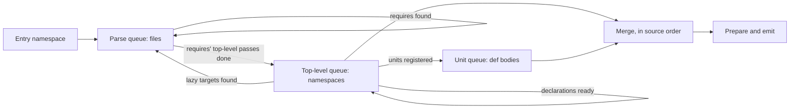

# Multi-threaded compilation: research and design

Status, October 19, 2026: stage A is built behind `--jobs N` and stays
experimental with a default of 1, because the stage A gate was missed on
Penpot (0.79x of `--jobs 1` at eight jobs, 1.8x peak RSS, and source maps
that depended on the schedule until light-cljs-379; light-cljs-343 under
"Gates and first steps").
Stages C and D are not built. The "As built" notes record what was
implemented; the rest of the document is the design as proposed.

October 31 experiment: a test-only shared-runtime namespace probe executes
independent namespace analysis concurrently (`src/analyzer_parallel_probe.rs`).
The corrected probe uses ordinary deferred units, canonical effect-lane pass
reservations and the build's worker budget, with each writer executing its own
units. It joins the resulting IR fragments in canonical order. For 64 copies
of the 200k project's worker namespace with fixed providers, three release runs
measured 1186 ms at one worker, 537 ms at four and 538 ms at eight (medians),
or 2.21x analysis speedup. Publication takes about 19 ms at eight workers.
These figures exclude setup and application preparation/emission; they are not
whole-compiler speedups. Production top-level namespace execution remains serial.

Combined JavaScript and source-map tables match a sequential NamespaceAnalysis
reference exactly at both Prepare and Advanced optimization. Node results
match the Babashka worker oracle. A shared macro-counter stress delays the first
namespace and verifies that later effects wait: eight stamps remain 1 through 8.
The reference drains each source immediately, as this probe does; it is not the
CLI's DRAIN_LAG/unit-pool pipeline. General registration visibility, changing
macro inventories, cross-namespace generations/extensions, failures and aggregate
analysis-budget publication still need production integration and validation.

Correction: the initial experiment-12 through experiment-14 probes used bound
bootstrap-mode hosts. They analyzed ordinary bodies inline, bypassing normal
deferred-unit registration. Their 2.1–2.2x results describe that narrower path
and are superseded by experiment-15. The ordinary serial reference exposed
the mismatch; the corrected probe now asserts actual deferred-unit registration.
The earlier per-node bridge-lock experiment also remains rejected: it increased
contention. Shared form-import contention persists in the corrected probe.

Reproducible commands, exact results and remaining limits are in
`research/pants-speedup-2026-10-31/experiment-15/README.txt`. Older evidence is
preserved with correction notices in experiments 12 through 14.

Experiment 16 adds native catalog branches as a publication prerequisite.
Each branch shares its existing immutable prefix and has a separate weak
snapshot cache for subsequent registrations. Producers inherit that branch.
This permits different registration orders at equal-length frontiers without
selecting another view's snapshot. Concurrent branch and collection tests
cover isolation, prefix sharing and reclamation. Production still uses the
single append-only journal; it does not yet fork these branches. Canonical
journal construction and namespace visibility remain to be implemented.

Experiment 17 separates the compiler's registration journal from shared unit
allocation. The manual namespace probe now gives each writer a fresh task and
a fixed provider prefix, records its own suffix, and publishes the suffixes in
namespace order. Native catalog checks reject foreign writer declarations and
demand ordinary and macro-generated functions from the combined journal.
Branch-local extension counts, multimethod names and generations have a
concurrent regression test. Synthetic declaration and metadata-test names now
take their unit ID under the allocation lock. These changes do not enable a
production namespace scheduler: the probe still uses fixed providers and
disjoint namespaces, and ordinary pool workers still use the serial journal.
General macro inventories, dependency-dependent prefixes, cache capture,
cross-namespace redefinitions and budget/failure publication remain open.
Three release repeats of this fresh-task path measured 1332 ms at one worker
and 562 ms at eight (2.37x), with 19 ms publication. Absolute eight-worker time
is slightly slower than experiment 15, so this is a correctness improvement,
not a throughput win. Full builds remain about 7.44 s Pants versus 6.75 s V8
in a three-round regression check. Commands and limits are recorded in
`research/pants-speedup-2026-10-31/experiment-17/README.txt`.

Experiment 18 adds an actual dependent namespace after the concurrent wave.
It consumes ordinary helpers, records, protocols, reify, multimethods and newly
declared macros through a fresh bound host. Namespace metadata publication
transfers the macro inventory and declarations while retaining the receiver's
other tables and counters. Independently emitted compile-time unit factories
now hold distinct Symbol tokens for their reify sites; local expression IDs
collided across namespace fragments. Tokens are stable across calls of the
same factory and can cross native task publication. Whole-application emission
continues using numeric expression IDs. Regression tests cover distinct types,
stable factory identity, raw-JS hygiene, lazy demand and macro rebinding after
the declaring host is dropped. This remains a test-only scheduling path;
dependency-driven production scheduling and aggregate budgets/failures are
still outstanding. Evidence is in
`research/pants-speedup-2026-10-31/experiment-18/README.txt`.

Experiment 19 connects the workers to the real compiler loop behind the
experimental `LIGHT_CLJS_NAMESPACE_WORKERS=1` switch. Contiguous dependency-ready
batches run at most `--jobs` namespaces, with no nested unit pool. Top-level IR
publishes in source order while deferred bodies retain the production drain
lag. Relocation maps preserve references into each writer's fixed prefix.
Native catalog seeds share the actual immutable prefix with fresh tasks;
rebuilding it for every namespace had overwhelmed the parallel work. A full
199,936-line build now completes with the established exact output hash,
oracle 855170 and zero retained waste markers. One clean exploratory run took
8.82 seconds, still slower than experiment 18's 7.46-second ordinary-path
median. This is integration evidence, not a performance win. The switch remains
off by default: general build/data-reader services, sibling reflection,
partial-failure ordering and aggregate-budget regressions are still open.
The new profile shows shared form import/export locks remain a major cost.
Three whole-build scaling repeats give 10.96/10.82/9.12/8.70 seconds at
1/2/4/8 jobs, only 1.26x at eight. The experimental path also removes the
ordinary unit pool from serial provider analysis. Experiment 20 below tests
whether that explains the slowdown. Narrowing the native catalog
registry lock produced no measured benefit (8.87 versus 8.85 seconds) and
was reverted. These results do not meet either speed gate.
An unrelated lazy-loading example exposed lost declarations for globals that
were reserved before their namespace ran. Publication now transfers changes
to the writer's frozen global prefix, detected by shared arena subtrees,
without replaying unchanged sibling bindings. The regression checks exact
serial output and fails when that transfer is disabled. Both unrelated
examples pass after the fix; a single corrected full build takes 9.15 seconds
and preserves the target hash/oracle/waste checks. Earlier repeated timings
precede this correctness fix. The default path remains unchanged.
Evidence and ongoing catalog-lock measurements are in
`research/pants-speedup-2026-10-31/experiment-19/README.txt`.

Experiment 20 rejects two attempts to improve the concurrent path. Reusing
the existing worker pool increased its median from 8.72 to 9.13 seconds.
The first dependency-ready batch already contains `workload.common` and
`workload.m0`, before any serial provider work; singleton namespaces contain
only 0.37% of source bytes. The earlier lost-provider-pool explanation is
therefore unsupported. Keeping an incremental environment cache per task
reduced rebuilt entries but left the concurrent median at 8.70 versus 8.69
seconds. Both prototypes were reverted. Form imports still held the shared
bridge lock for about 1.5 cumulative seconds and incurred about 5.4 cumulative
seconds of worker waits in a separate profile. These are sums across threads,
not additive wall-time stages. Full evidence and rejected source snapshots:
`research/pants-speedup-2026-10-31/experiment-20/README.txt`.

Experiment 21 retests per-scope native local storage now that namespace
analysis actually runs concurrently. Local access takes the scope's own lock;
the shared scope table remains responsible for lifecycle and GC tracing.
The seven-round concurrent comparison improves from 8.75 seconds median
(8.64–8.85) to 8.56 (8.44–8.66), with exact application bytes, oracle and waste
checks. A separate profile reduces cumulative bridge import hold time from
about 1.51 to 1.33 seconds and waits from 5.43 to 4.76. The change is retained,
with 886 runtime tests, 397 compiler library tests and both unrelated example
workloads passing. An earlier three-round comparison shows ordinary-path
7.42 versus 7.45 seconds; this is not an ordinary-path speedup claim. The
concurrent path remains slower than the ordinary path, experimental and off
by default. Neither goal gate is met; the seven-round A/B is not the final
fresh-V8 acceptance comparison. Evidence:
`research/pants-speedup-2026-10-31/experiment-21/README.txt`.

Experiments 22–24 investigated repeated native task setup and service calls.
Reducing shared atomics in object byte accounting did not establish a wall-time
gain and was reverted. A source-frequency diagnostic then identified 28,036
small evaluations per build that only enter or leave a compiler frontier.
Native task commands now invoke those same mutable JavaScript services
directly, preserving runtime-global lookup, receiver, nesting, errors,
cancellation and result lifetimes. Gensym scope updates use the same command
mechanism. No compiler work or budget limit is removed.
The paired three-round frontier experiment improves the concurrent median
from 8.94 to 8.14 seconds (ranges 8.93–8.99 and 8.08–8.23). Ordinary compilation
changes from 7.58 to 7.52 seconds. All outputs retain the established exact
bytes, oracle and waste checks; 401 compiler library tests and five frontier
integration tests pass, as do the unrelated examples. The profile confirms
only 1,060 small evaluations remain, all service installation. These commands
are retained; neither goal gate is met, and concurrency remains experimental.
The same profile counts 12,213 macro-free units among 14,018 analyzed units.
Ordinary native pool jobs give these units an engine-free view; namespace
workers inherit an engine. That distinction motivated experiment 25 below.
Evidence:
`research/pants-speedup-2026-10-31/experiment-22/README.txt`,
`research/pants-speedup-2026-10-31/experiment-23/README.txt`, and
`research/pants-speedup-2026-10-31/experiment-24/README.txt`.

Experiment 25 omits VM frontier and gensym scope transitions around native
bodies already proven macro-free. The existing eligibility guard forbids VM
entry from those bodies. The analyzer still receives its engine: dispatch-held
units must keep spending their immediate control polls. Focused tests compare
emitted code and recorded charges with an engine-free view, check that other
bodies retain scope transitions, and verify cancellation in held analysis.
403 library tests pass, as do five frontier and five gensym integration tests.
Nine of ten macro-free integration tests pass; the poll-budget case also fails
on both unchanged experiment 24 and the original 134d04ca binary, with the test
source unchanged. No test or budget was weakened.
Three alternating rounds give ordinary medians 7.60/7.55 seconds and concurrent
medians 8.15/7.95 seconds before/after. A seven-round concurrent repeat gives
8.31/8.00 seconds (ranges 8.11–8.47 and 7.88–8.23); all seven pairs improve.
All benchmark outputs, oracle and waste checks pass, as do unrelated examples
with the previously documented collections byte difference. The change is
retained. A separate profile still spends 5.82 seconds in analysis and 1.85
seconds in preparation and emission; cumulative bridge import hold time is
1.31 seconds, with 4.69 seconds of aggregate thread waiting. Concurrency alone
cannot remove that serial tail. Neither goal gate is met, and the namespace
path remains experimental and off by default. Evidence:
`research/pants-speedup-2026-10-31/experiment-25/README.txt`.

Experiment 26 profiles the full build and improves shared arena access. Task
boot still accounts for about 24% of non-blocked samples across threads;
preparation also repeatedly calls out-of-line arena accessors. Ordinary inline
hints leave that access code unchanged. The retained variant force-inlines the
short indexing and cached-leaf iterator paths, with tree traversal and frozen
copy-on-write mutation kept out of line. Bounds, entry order and compiler
passes are unchanged. All 403 library tests and the unrelated workload checks
pass. Three alternating rounds per variant give ordinary Pants 7.68/7.44
seconds before/after, concurrent Pants 7.97/7.82, and V8 6.81/6.73. The candidate
V8 is freshly built; every same-mode pair improves and all output checks pass.
Separate profiles place the gain in preparation (ordinary 1.09/0.89 seconds,
concurrent 1.04/0.92). Analysis is slightly slower in those profile runs, and
concurrent median CPU time and RSS rise, so this is a shared-stage improvement,
not evidence of better parallel scaling. The optimization is retained; neither
goal gate passes and these three-round comparisons are not final acceptance.
Evidence: `research/pants-speedup-2026-10-31/experiment-26/README.txt`.

Experiment 27 avoids full heap-statistics snapshots for narrower queries.
Import cache pruning now reads the existing collection counter under the GC
metadata lock without taking root or object-table locks. Native-backend
capability checks use a boolean query; actual per-macro statistics remain
unchanged. The runtime regression verifies the count against full statistics
and queries it while root and object locks are held. It and all 403 compiler
library tests pass. A seven-round paired repeat gives ordinary Pants medians
7.30/7.22 seconds and concurrent Pants 7.60/7.32 before/after; six of seven
concurrent pairs favor the change, with one 0.02-second loss. Ranges overlap,
so the improvement is modest. The earlier three-round comparison has unchanged
V8 medians of 6.52 seconds, including a fresh candidate build. All output,
oracle, waste and unrelated-workload checks pass. Separate profiles without
`--stats` reduce samples inside full heap-statistics calls from 408 to 154,
including blocked samples; these are thread sample counts, not wall time.
The change is retained. Serialized import construction and repeated runtime
startup remain significant, and neither goal gate is met. Evidence:
`research/pants-speedup-2026-10-31/experiment-27/README.txt`.

Experiment 28 remeasures scaling with the retained experiment-27 binary:
three-round medians are 9.03, 9.31, 7.94 and 7.37 seconds at 1/2/4/8 jobs.
One job uses the serial fallback; the other points use namespace workers.
Eight jobs reduce wall time by about 18% from one job but use 2.21 times
the user CPU time. Every output matches, including the oracle and waste check.
More specific attribution of the existing profile identifies bridge import
and export waits as the largest worker mutex waits. A candidate releases heap
access while waiting for that lock, preserving scoped roots and dropping the
temporary lock guard before reentering heap access. Its collection-progress
regression and all 404 library tests pass, but three paired eight-job rounds
give 7.50/7.49 seconds before/after with overlapping ranges. Separate profiles
reduce GC rendezvous by about 7 ms while increasing aggregate bridge waits.
The candidate is rejected and both source files restored exactly; its patch,
binary, tests and measurements remain in
`research/pants-speedup-2026-10-31/experiment-28/README.txt`. Concurrency remains
promising, but this change does not resolve serialized bridge construction or
repeated task startup. Neither acceptance gate is met.

Experiment 29 consolidates the bridge's import and retention indices and uses
cached child indices to calculate conversion costs. Its child-lifetime
regression, all 404 library tests and unrelated workload checks pass. A separate
profile reduces import lock-holding time from 1,269 to 1,203 aggregate thread
milliseconds. However, concurrent build medians worsen slightly in both the
initial three-round comparison (7.39/7.44 seconds before/after) and a seven-round
repeat (7.38/7.41). Repeat CPU time and peak memory also increase. Ordinary
three-round medians improve from 7.16 to 7.09, but the concurrent result does
not justify retaining this change. Both source files are restored exactly;
all 32 timed/warmup outputs match the oracle, bytes and waste requirements.
Evidence and the rejected patch are in
`research/pants-speedup-2026-10-31/experiment-29/README.txt`. The next candidate
is batching reclamation registration outside the bridge lock while the
existing heap scope still excludes collection. Neither acceptance gate is met.

Experiment 30 implements that batching. Imports collect already-computed object
identities while holding the bridge, then validate and register the batch under
one runtime registry lock after releasing the bridge. The original heap scope
remains active throughout; partial imports are registered even on conversion
failure. Tests cover foreign/stale batch rejection, deduplication, non-retention
and failed-import cleanup. All 727 selected runtime tests and 404 compiler
library tests pass, as do unrelated workload checks.

Seven paired rounds give ordinary Pants medians 7.20/7.13 seconds and namespace
workers 7.41/7.26 before/after. The concurrent candidate improves five of seven
pairs; ranges overlap, so the gain is modest. Ordinary peak RSS rises from
1.421 to 1.440 GB, while concurrent RSS falls from 1.590 to 1.566 GB. All 48
timed/warmup outputs across the initial comparison and repeat pass exact-byte,
oracle and strict waste checks. Separate profiling shows about 203 aggregate
thread milliseconds less import/environment lock-holding time and 157 ms of
registration work measured outside that lock. The latter is moved work, not
eliminated work; traced environment accounting also adds a statistics lock
absent from ordinary timing. This change is retained. Evidence:
`research/pants-speedup-2026-10-31/experiment-30/README.txt`. The V8 binary used
for unrelated checks is the saved experiment-27 build; no fresh V8 timing is
claimed here. Neither acceptance gate is met.

Experiment 31 instruments the actual namespace batches. Its diagnostic run has
529 jobs in 91 batches, averaging 6.18 occupied jobs during batch wall time;
occupancy includes waiting and is not useful CPU parallelism. Task boot costs
6.48 aggregate worker seconds, and bridge waits total 7.19 thread seconds
excluding traced-only accounting. Removing the eight-namespace batch cap would
grow ready groups only to nine under the current loader order. Moving source
form traversal outside the bridge reduces locked work but leaves the measured
concurrent median at 7.27 seconds, with higher CPU time, so it is reverted.
Evidence: `research/pants-speedup-2026-10-31/experiment-31/README.txt`.

Experiment 32 reduces serial lexer work: punctuation dispatch first selects by
the initial byte, preserving longest matches and the optional-chain decimal
exception. Both the runtime generator and emitted-output lexer use this path.
405 Pants and 360 default-backend library tests pass, including exhaustive
two-byte punctuation checks and truncated-section cases. Three paired rounds
give ordinary Pants medians 7.10/6.94 seconds, namespace workers 7.30/7.12 and
V8 6.49/6.39 (saved experiment 27 versus freshly built experiment 32). All nine
same-round comparisons improve. A seven-round worker repeat gives 7.33/7.11
seconds, with every pair faster; ranges are 7.12–7.40 and 7.04–7.20. Worker
median user CPU rises slightly, 19.74/19.88 seconds, while RSS falls from
1.581 to 1.571 GB. This is a measured latency gain, not a CPU-saving claim.
Separate diagnostic runs place final emission at 794.7/626.6 ms. All 40 timed
and warm-up outputs pass exact-byte, oracle and strict waste checks, and the
unrelated examples preserve their established outputs in both modes. The
lexer change is retained; it does not introduce parallel emission. Evidence:
`research/pants-speedup-2026-10-31/experiment-32/README.txt`. The fourfold and
absolute-time acceptance gates remain unmet.

Experiments 33–35 move fresh native form allocation outside the shared bridge.
The initial survey found 87.5% of remember/import work in entirely fresh Datum
trees. Workers now reserve bounded, disjoint trees under the bridge, allocate
through the existing converter outside it, then publish successful descendants
and register reclamation watches before leaving the original heap scope.
Overlapping imports wait and reuse the same native identities. Conversion
errors retain their successful prefix; polls, node/depth limits, provenance,
metadata and GC retention keep the existing behavior. Gensym reservations wait
for imported spellings. Environment imports inspect both their new input and
previous keys that incremental conversion might reimport, allowing disjoint
conversions to proceed without waiting for every active tree.

Experiment 34's broad environment wait had inconclusive timing evidence.
Experiment 35 removes those claim waits in its diagnostic run. Allocation
overlaps across up to six workers, while bridge import hold time falls from
about 1.20 to 0.75 aggregate thread seconds compared with the earlier baseline
profile. These thread sums include internal waits and do not predict wall gains.
Seven paired runs against retained experiment 32 give 7.19/7.10 seconds median,
with five pairs faster and ranges 7.16–7.28/6.98–7.24. Median user CPU increases
19.57/20.41 seconds; RSS decreases 1.586/1.561 GB. The combined change is retained
as a small latency improvement in the existing experimental worker path.
All 415 Pants library tests pass, including ten focused import regressions;
36 timed/warm-up outputs pass exact bytes, oracle and strict waste checks,
and unrelated examples retain their established behavior. Ordinary compilation
remains faster than namespace workers. No new V8 timing or final acceptance is
claimed; both speed gates remain unmet. Evidence and reproducible commands:
`research/pants-speedup-2026-10-31/experiment-35/README.txt`.

Experiment 36 reduces repeated task startup work. The native runtime's fixed
core-name inventory now uses indexed traversal of its private bootstrap array,
preserving every lookup, definition, descriptor and per-name getter closure.
This avoids native iterator-result objects before user code runs. It changes
no user iterator handling, task sharing, macro budgets or compiler work.
Seven paired namespace-worker runs improve from 7.04 to 6.75 seconds median,
with all seven pairs faster; ranges are 6.79–7.17 and 6.73–6.94 seconds. Median
user CPU falls from 20.38 to 18.35 seconds, and RSS from 1.586 to 1.576 GB.
The ordinary three-round comparison is roughly level at 6.93/6.91 seconds.
Separate samples show startup iterator-result counts falling from 412 to 83;
managed bytes admitted over those builds fall from about 3.85 to 3.35 GB, with
the same 589 task contexts. Sample counts are not wall-time measurements.
The change is retained. All 416 Pants library tests, 32 timed/warm-up output
checks and unrelated examples pass. The namespace path remains experimental,
and neither speed gate is met. Evidence and reproduction:
`research/pants-speedup-2026-10-31/experiment-36/README.txt`.

Experiment 37 tests indexed traversal of the other three small private startup
inventories. Functional regressions and 418 library tests pass, but the seven
paired worker runs do not confirm the initial timing result: medians are
6.73/6.69 seconds, only three pairs improve, and the average paired reduction
is about 0.02 seconds. Median user CPU rises slightly from 18.48 to 18.55
seconds. Both source files and the release binary are restored exactly to
retained experiment 36. All 32 timed/warm-up outputs pass bytes, oracle and
waste checks. The rejected candidate and evidence remain in
`research/pants-speedup-2026-10-31/experiment-37/README.txt`.

Experiment 38 shares compiled service-installation factories while executing
each installation in its requesting task with fresh runtime-global lookup.
It removes all 1,060 short evaluated units, replacing them with calls to two
shared compiled factories, with the same 589 task contexts. However, seven
paired worker runs give 6.75/6.82 seconds median, with only two pairs faster.
Median user CPU falls 18.84/18.51 seconds, but elapsed time does not improve.
The candidate is rejected and all three source files and the release binary
are restored exactly to retained experiment 36. All 419 library tests, 32
benchmark outputs and unrelated examples pass; candidate source and evidence
remain in `research/pants-speedup-2026-10-31/experiment-38/README.txt`.

Experiment 39 reuses GC-aware fixed-name bindings for descriptor-field presence
checks and reads. All focused and compiler tests pass, including concurrent
heaps collecting between instructions, but seven paired worker medians are
both 6.81 seconds. Only one pair improves; median user CPU rises 18.58/18.77
seconds. The candidate is rejected and production sources and binary restored
exactly to experiment 36. All 32 benchmark outputs and unrelated examples pass.
Evidence: `research/pants-speedup-2026-10-31/experiment-39/README.txt`.

Experiment 40 removes a second bridge-lock acquisition when detached imports
finish. Focused tests and all 418 library tests pass, but three paired worker
medians are 6.71/6.73 seconds, with only one pair faster and higher median CPU.
Separate profiles confirm cleanup waiting disappears while total namespace
blocking remains roughly unchanged. The candidate is rejected and source and
binary restored exactly to experiment 36. All 16 benchmark outputs and unrelated
examples pass. Evidence: `research/pants-speedup-2026-10-31/experiment-40/README.txt`.

Experiment 41 measures work inside the bridge lock without retaining a source
change. Mixed root imports account for only 11 ms of serial conversion and
contain fewer than 16 fresh nodes each. A deeper diagnostic attributes about
405 ms to environment slot imports, 225 ms to provenance recording, 232 ms to
pruning, and 153 ms to publication. Environment map assembly takes only 53 ms.
Classifying environment values finds just 344 large mixed values, accounting
for 84 ms of conversion; most values are small. These are instrumented thread
times, not additive wall stages or claimed speedups. They do not justify a
complex mixed-tree concurrency refactor by themselves. Four diagnostic outputs
and 11 focused tests pass; all three source files and binary are restored
exactly to experiment 36. Evidence:
`research/pants-speedup-2026-10-31/experiment-41/README.txt`.

Experiment 45 retains borrowed form traversal during analyzer import. It avoids
temporary child vectors and redundant ownership operations while preserving
occurrence identity, metadata and provenance. Seven paired ordinary-build medians
improve from 7.91 to 7.65 seconds, with 26% less user CPU; namespace workers improve
from 8.00 to 7.91 seconds. Fresh V8 timing is essentially unchanged. Library,
provenance and unrelated-example checks pass, as do all 72 timed output checks.
Evidence: `research/pants-speedup-2026-10-31/experiment-45/README.txt`.

Experiment 46 tests persistent OS workers while moving namespace inputs without
copying them and keeping each namespace's JavaScript context fresh. It passes
correctness checks but regresses all three worker pairs (8.20 to 8.56 seconds
median, with higher CPU). The candidate is rejected and experiment 45 restored.
Evidence: `research/pants-speedup-2026-10-31/experiment-46/README.txt`.

Experiment 47 retains a limit of two simultaneous fresh port-runtime bootstraps
within each namespace batch. Analysis still admits the requested number of jobs;
the permit ends before host setup, catalog installation or user macro work.
The separate 1/2/4/8-permit study uses eight compilation jobs throughout. Seven
paired confirmation rounds improve namespace-worker medians from 7.86 to 7.53
seconds, all seven pairs faster, with 13.8% less user CPU. Ordinary controls show
no regression. Library, effect-ordering, failure, task-state and unrelated-example
checks pass; all 52 timed outputs preserve exact bytes, oracle and strict waste.
`LIGHT_CLJS_NAMESPACE_BOOT_SLOTS` overrides this experimental admission limit;
zero or a value at least the batch width disables it. Real-core bootstrap is
excluded. Namespace workers themselves remain opt-in, their broader conformance
limits remain, and neither speed goal is met. These timings use different load
conditions from earlier experiments and should be compared within their paired
runs. Evidence: `research/pants-speedup-2026-10-31/experiment-47/README.txt`.

Experiment 48 retains borrowed provenance traversal under the bridge lock. It
removes temporary child vectors and ownership clones while preserving visit
order, last-occurrence provenance, exact poll/conversion charges and partial
failure effects. All 420 native library tests pass, plus the namespace fixtures
and unrelated examples. Seven paired runs show an ordinary-path saving from
7.52 to 7.44 s (six pairs faster). Namespace-worker time is effectively flat:
7.55 to 7.53 s, only three pairs faster, mean paired delta +0.016 s and slightly
higher user CPU. This is retained for the ordinary-path saving, not counted as
a concurrency win. Sampled provenance work falls but broader bridge waiting
does not. All 48 timed and four profiled outputs pass exact output/oracle/waste
checks. Evidence and the unchanged acceptance limits are in
`research/pants-speedup-2026-10-31/experiment-48/README.txt`.

Experiment 49 rejects per-thread ownership handles for byte reservations. The
candidate preserves exact global admission/accounting but moves frequent Arc
reference-count operations to an outer owning handle. All 879 selected runtime
and GC tests, 420 compiler tests, fixtures and examples pass. Seven paired runs
show identical namespace-worker medians of 7.49 s and effectively unchanged
ordinary compilation (7.44 versus 7.43 s); median CPU time does not improve.
The added lookup/indirection and changed inlining do not yield a measured win.
The budget source and binary are restored to retained48; all 48 timed and four
profiled outputs passed the checks. Evidence is in
`research/pants-speedup-2026-10-31/experiment-49/README.txt`.

Experiment 50 retains direct child visitation in compiler passes. All callers
of the temporary `Vec<ExprId>` helper now use the existing exhaustive visitor,
preserving edge order, stack order, duplicate-parent checks and scope flags.
Seven paired medians improve ordinary Pants from 7.47 to 7.38 s, namespace
workers from 7.55 to 7.44 s, and freshly built V8 from 7.05 to 7.01 s. This is
a modest shared-pipeline improvement, not a distinct concurrency advantage;
the worker mean is influenced by a large fifth-round swing. All 78 timed and
profiled outputs pass exact output/oracle/waste checks. Both library suites pass;
optimization and chunking suites match baseline, including two existing Pants
namespace-reporting failures. The 1.8625 s and fourfold gates remain unmet.
Evidence, complete ranges and load observations are in
`research/pants-speedup-2026-10-31/experiment-50/README.txt`.

Experiment 51 measures closure allocation separately from timing. Two worker
runs each allocate 898,941 functions through `new_function`, compared with
294,259 and 295,465 on the ordinary path. About 51% of worker environments
capture at most two values. Experiment 52 tests inline storage for those small
environments without growing heap slots or changing budget charges. All 969
runtime/GC tests, 420 compiler tests, fixtures and examples pass, but the initial
timing improvement does not repeat: seven-round worker medians are both 7.52 s,
and ordinary Pants changes from 7.37 to 7.38 s. Only two pairs improve in each
mode. The candidate is rejected and retained50 remains the implementation.
The allocation counts identify extra worker work; they do not establish that
removing those allocations improves the critical path. Evidence is in
`research/pants-speedup-2026-10-31/experiment-51/README.txt` and
`research/pants-speedup-2026-10-31/experiment-52/README.txt`.

Experiment 53 separates namespace batch phases from per-thread CPU consumption.
Each diagnostic run covers 529 namespaces in 91 batches. With two boot permits,
the workers consume 18.15–18.29 CPU seconds over 4.88–4.94 seconds inside batches,
averaging about 3.7 CPUs. Eight simultaneous boots increase consumption to
22.27–22.34 CPU seconds and batch elapsed time to 5.25–5.32 seconds. Boot CPU
alone grows from 2.23–2.40 to 5.55–5.63 seconds. These figures include runtime
overhead and spinning; active worker intervals are not equivalent to useful
parallel computation. Analysis remains the largest phase, and the 57 full-width
batches account for most batch elapsed time. All twelve diagnostic outputs pass
the exact-output/oracle/waste checks. No optimization or gate change is retained;
the temporary instrumentation is restored away. The phase decomposition and
its limits are recorded in
`research/pants-speedup-2026-10-31/experiment-53/README.txt`.

Experiment 54 retains separation of the byte budget's admission counters,
allocation volume and frequently polled collection state into distinct cache
lines. Every atomic operation, charge, limit and collection check is preserved.
Seven paired runs with eight simultaneous boots improve in all pairs: median
elapsed time falls from 7.81 to 7.51 s and user CPU from 22.77 to 20.18 s. The
existing two-boot setting remains faster overall and is unchanged: its median
falls from 7.44 to 7.38 s, with four pairs faster and a mean saving of 0.05 s.
Ordinary Pants changes modestly from 7.33 to 7.31 s, with five pairs faster.
The same interpreter polling instructions address the newly separated fields;
separate eight-boot samples at the pressure load fall from 190 to 6. Samples
are not durations, but support the CPU-contention explanation. All 968 selected
runtime/GC tests and 420 compiler tests pass, as do fixtures and examples. All
70 timed, warmup and profiled outputs pass exact output/oracle/waste checks.
The 1.8625 s and fourfold goals remain unmet; no fresh V8 acceptance comparison
is claimed. Full ranges, pair variation and evidence are in
`research/pants-speedup-2026-10-31/experiment-54/README.txt`.

Experiment 55 additionally isolates the heap's collection-threshold read from
allocation counters and metadata writes. The threshold calculations, atomic
operations and collection-check frequency remain unchanged. Heap alignment also
separates its Arc header; the experiment cannot isolate that secondary effect.
Seven paired runs against retained54 improve the two-boot worker median from
7.46 to 7.38 s, with six pairs faster and user CPU falling from 19.02 to 18.62 s.
Ordinary Pants changes from 7.39 to 7.37 s, with five pairs faster. Eight-boot
workers change from 7.44 to 7.40 s, with four pairs faster; they beat the updated
two-boot configuration in only two pairs, so the default remains two simultaneous
boots. Namespace workers remain opt-in. All 969 selected runtime/GC tests and
420 compiler tests pass, as do the native-state fixtures and unrelated examples.
All 78 timed, warm-up and profiled outputs pass exact-output/oracle/waste checks.
Separate boot-ancestry samples at the threshold load fall from 8 to 1 with two
boots and 23 to 3 with eight; total eight-boot samples rise, so this load-site
improvement is not evidence that all boot work got cheaper.
The modest timing gains include all outliers and were measured with recorded
Finder/WindowServer activity; they do not establish the fourfold goal or a fresh
V8 comparison. Full evidence and limitations are in
`research/pants-speedup-2026-10-31/experiment-55/README.txt`.

Experiment 56 retains borrowed provenance collection for pure compiler macro
expansion. Its temporary identity map stores occurrence IDs into the input arena,
avoiding owned Form/Datum clones and child vectors. Lookup during output
construction borrows occurrences; generated forms still own their data, source
spans, origins, expansion history and native span overrides. Parent/children/
metadata/payload order and the last-occurrence rule are unchanged. A regression
covers repeated identities, subtree boundaries, distinct spans/origins, malformed
UTF16 and ownership after dropping the input. Seven paired runs improve ordinary
Pants from 7.41 to 7.34 s (six pairs faster), namespace workers from 7.46 to 7.36 s
(all seven faster), and freshly built default V8 from 6.99 to 6.97 s (five faster,
one tie). All outliers remain. The 421 Pants and 362 V8 library tests pass; the
selected compiler tests pass 72/77 respectively, with two native reader failures
reproduced unchanged on retained55 (`core.taggedLiteral` is unsupported). All 78
timed, warm-up and profiled outputs pass exact-output/oracle/waste checks.
Separate samples in pure expansion decline 940 to 831 for ordinary
Pants, 621 to 557 for workers and 888 to 816 for V8; these are counts, not durations.
This shared-pipeline improvement does not establish the required native speed advantage:
fresh V8/Pants ratio is about 0.950 and Pants still exceeds 1.8625 s. Namespace
workers remain opt-in with two simultaneous bootstraps. Details and raw evidence:
`research/pants-speedup-2026-10-31/experiment-56/README.txt`.

Experiment 57 retains one source owner per single-source generated form arena,
with borrowed internal spans and independently owned public spans. Mixed-source
arenas retain individual spans; distinct sources with identical paths/text stay
distinct. Two regressions cover source ownership after dropping arenas, metadata,
literal payloads, native overrides and compacted leaves. The 423 Pants and 364
V8 library tests pass; selected compiler tests retain the same two native reader
failures and otherwise pass, as do native-state fixtures and unrelated examples.
Seven paired confirmation rounds improve ordinary Pants from 7.38 to 7.35 s
(five pairs faster), workers from 7.36 to 7.33 s (four faster), and V8 from 6.96
to 6.94 s (five faster, one tie). All outliers remain. Ordinary/V8 user CPU falls
12.40 to 11.71 s and 13.44 to 12.55 s, while worker CPU is nearly flat and worker
median peak RSS rises from 1.556 to 1.577 GB. The worker saving is small and
variable. All 78 timed, warm-up and profiled outputs pass exact-output/oracle/
waste checks. Separate pure-expansion samples fall 885 to 568 for ordinary Pants
and 776 to 505 for V8, but stay flat at 560/563 for workers. These are sample
counts, not durations; the V8 profiled analysis itself is slower. This change
does not establish reduced worker contention or the native speed advantage:
fresh V8/ordinary Pants is 0.944x, far from 4x, and Pants exceeds 1.8625 s.
Namespace workers remain opt-in with two simultaneous bootstraps. Evidence:
`research/pants-speedup-2026-10-31/experiment-57/README.txt`.

Experiment 58 shares immutable registration-history entries between namespace
writers using the compiler's existing persistent arena. Taking a prefix freezes
its tail; each writer appends privately while retaining the same registration
order and independent visibility indexes. A regression verifies shared prefix
entries, isolated additions, ordered range traversal and surviving snapshots.
All 424 Pants and 364 V8 library tests pass, along with the same selected compiler
outcomes, native-state fixtures and unrelated examples as experiment 57.
Seven paired rounds improve namespace workers from 7.27 to 7.12 s: six pairs
faster and one tie, mean paired saving 0.126 s. Median user CPU falls from 18.50
to 17.96 s and peak RSS from 1.585 to 1.482 GB. Ordinary Pants measures 7.32 to
7.25 s, with six pairs faster. V8 medians are nearly flat at 6.82/6.81 s, while
its mean paired delta is +0.013 s; large opposite-direction outliers prevent a
V8 improvement claim. Every outlier is retained. All 78 timed, warm-up and
profiled outputs pass exact-output/oracle/waste checks. Separate samples beneath
registration-journal cloning fall from 533 to 210 with the same 589 contexts and
1,060 evaluated units; these are sample counts, not durations. Workers remain opt-in
with two simultaneous bootstraps, and both performance targets remain unmet:
ordinary Pants is 7.25 s and fresh V8/Pants is 0.939x. An additional analysis of
archived batch phases quantifies finished-worker idle capacity, but does not
equate it with recoverable wall time or justify a scheduler rewrite by itself.
Evidence, full ranges and measurement limitations:
`research/pants-speedup-2026-10-31/experiment-58/README.txt`.

Experiment 59 tests moving each worker's already-owned registration snapshot
into its session, removing a second journal clone. All 425 native and 364 V8
library tests, the established compiler outcomes, native-state fixtures and
unrelated examples pass. Seven worker pairs give medians 7.11/7.10 s, with five
pairs faster and a mean saving of 0.096 s. Two larger gains account for 0.64 s
of the 0.67 s summed paired saving; all samples remain included. Median user CPU
falls 17.95 to 17.67 s, but the median elapsed gain is only 0.01 s. Ordinary and
V8 controls are mixed. Separate worker journal-clone samples fall 211 to 110
with the same 589 contexts and 1,060 evaluated units; the copy reduction does
not establish a convincing whole-build improvement. All 78 timed, warm-up and
profiled outputs pass exact-output/oracle/waste checks. The candidate is rejected;
all three source files and the target binary are restored exactly to experiment
58, whose source/target/workload evidence is rechecked after restoration.
Evidence and the remaining coordinator-side snapshot-copying lead:
`research/pants-speedup-2026-10-31/experiment-59/README.txt`.

Experiment 60 shares frozen visibility indexes and caches history-derived root
generation counts. Writers keep private replacement/deletion overlays; later
snapshots merge changes without changing older readers. Counts advance from
actual registrations, independently of a writer's local request counter. The
default V8 backend keeps its original HashMap representation. Three regressions
cover branch isolation, defonce/declaration behavior and cached counts; an arena
read counter verifies that eight writers no longer rescan the prefix. All 427
native and 364 V8 library tests pass, with the established compiler outcomes,
native-state fixtures and unrelated examples. Seven paired worker runs improve
7.19 to 7.08 s, all seven faster, with mean saving 0.134 s; median user CPU falls
17.98 to 17.27 s and peak RSS 1.483 to 1.450 GB. Ordinary Pants measures 7.30/7.31 s
and V8 6.94/6.95 s, with mean increases 0.031/0.040 s; no control improvement is
claimed, and all samples remain included. Separate worker journal-clone samples
fall 229 to zero and writer-journal-setup samples 243 to zero, with four samples
under the new prefix snapshot. Inlining and sampling resolution limit those
counts; they do not imply zero cost. Worker contexts/evaluations remain
589/1,060. All 78 timed, warm-up and profiled outputs pass the exact-output,
oracle and waste checks. The change is retained, workers remain opt-in with two
simultaneous bootstraps, and both targets remain unmet: workers take 7.08 s and
fresh V8/workers is 0.982x. Full ranges, controls, load and profile limitations:
`research/pants-speedup-2026-10-31/experiment-60/README.txt`.

Experiment 61 removes temporary qualified-name strings from source-binding and
JavaScript-macro probes. It keeps the existing layered maps and original key
spellings, with borrowed namespace/member keys that hash and compare the same
parts as stored keys. Two regressions cover separator and Unicode cases plus
mutation, deletion, compaction and snapshot isolation. All 429 native and 366
V8 library tests pass, along with established compiler outcomes, fixtures and
unrelated examples. Seven paired ordinary runs improve 7.31 to 7.26 s: five
pairs faster, all seven with lower user CPU, whose median falls 11.67 to 11.57 s.
Median peak RSS falls 1.443 to 1.412 GB. Workers measure 7.09/7.11 s, with two
faster, two ties and three slower; no concurrency gain is claimed. V8 measures
6.92/6.87 s. Every sample remains included, including the larger ordinary
fourth-pair gain. Separate combined name-resolution samples fall 407 to 336
ordinary, 389 to 371 workers and stay 386/386 for V8; inlining moves samples
between lookup functions, so the source-key function alone overstates the
reduction. All 78 timed, warm-up and profiled outputs pass exact-output, oracle
and waste checks. The change is retained for the ordinary-build gain. Namespace
workers remain opt-in; both goals remain unmet, with ordinary Pants at 7.26 s
and fresh V8/Pants at 0.946x. Full ranges, CPU, RSS and load:
`research/pants-speedup-2026-10-31/experiment-61/README.txt`.

Experiment 62 uses an address-mixing hasher for the temporary pure-expansion
provenance map. Only live internal Datum identities enter it; traversal order,
last-occurrence replacement, source ownership and all provenance rules stay the
same. A regression checks 1,024 equal-valued but distinct objects through map
growth and repeated occurrences. All 430 native and 367 V8 library tests pass,
with established compiler outcomes, native-state fixtures and unrelated examples.
Seven paired ordinary runs improve 7.22 to 7.14 s, six pairs faster, with median
user CPU 11.58 to 11.31 s and peak RSS 1.442 to 1.431 GB. The sixth pair's 0.53 s
saving accounts for much of the average improvement; no samples are excluded.
Workers measure 7.02/7.04 s despite five faster pairs, while user CPU falls
17.22 to 16.98 s in all seven pairs. No worker latency improvement is established.
Fresh V8 measures 6.83/6.79 s. Separate profiles show pure-expansion samples
552/410 ordinary, 516/360 workers and 522/354 V8; SipHash leaves in that ancestry
fall from 165/156/141 to zero. These are sample counts, not elapsed durations.
All 78 outputs pass byte identity, oracle and strict waste checks, with unchanged
project sources and budgets. The change is retained for the ordinary-build gain;
namespace workers remain opt-in. Shared preparation and emission remain material:
the new phase attribution identifies ProgramFacts construction and terse-name
processing as further leads, without claiming recoverable parallel speedup.
Both goal criteria remain unmet: ordinary Pants is 7.14 s versus fresh V8 at
6.79 s (0.951x). Ranges, paired results, memory and load are recorded in
`research/pants-speedup-2026-10-31/experiment-62/README.txt`.

Experiment 63 tested isolating inference's emitted-expression reachability walk
from the rest of fact construction. Matching assembly confirms fewer reloads
of traversal state, but complete ProgramFacts ancestry, including the new helper,
only falls 139/136 ordinary, 136/129 workers and 139/135 V8 in separate profiles.
The three-round screen is mixed: ordinary 7.17/7.14 s, workers 7.01/7.02 s and
V8 6.78/6.84 s. The candidate passes 431 native and 368 V8 library tests,
established compiler outcomes, fixtures and unrelated examples; all 30 screen
and profiled outputs pass exact-output, oracle and waste checks. It is rejected
without seven-round confirmation, and the exact retained62 source and native
binary are restored. No performance gain is claimed from code generation alone.
A read-only property-cache review also finds no compelling new redesign lead.
The next concurrency hypothesis is persistent OS workers with the current
two-permit bootstrap gate and retained budget layouts: experiment46 tested and
rejected persistence before those changes. Any retest must preserve fresh
private task state and ordered batch publication. Evidence and restoration:
`research/pants-speedup-2026-10-31/experiment-63/README.txt`.

Experiment 65 replaces repeated port-runtime interpretation with an initialized
task template. The first evaluator captures a clean command boundary; later
evaluators copy private globals, closure cells, object properties and mutable
collections with fresh task ownership. Aliases, cycles and private persistent
vector contents are relocated consistently. Canonical published data and realm
intrinsics remain shared. The snapshot does not retain later source-task
mutations. Template construction is synchronized once; copying reads immutable
snapshot data concurrently. The optional cache is bounded to 1/64 of the heap:
the 2 GiB workload uses it, while small heaps retain the replay path without
raising their limits. Real-core and unsupported checkpoints also retain replay.
Namespace workers remain opt-in, with the existing two-permit bootstrap gate,
batch barriers and ordered publication; experiment64's OS-thread proposal was
not implemented.

Seven fresh paired runs improve ordinary8 from 6.65 to 6.55 s and namespace
workers from 6.26 to 5.79 s, all seven native pairs faster. Worker user CPU falls
14.96 to 13.30 s (11.1%); median RSS is 1.506/1.526 GB. Fresh V8 is 6.26/6.24 s
with effectively zero mean paired difference. These are contemporary reference
runs on a less busy machine, not a comparison to historical 7-second timings.
All 78 timed/warmup/profile outputs match the exact JS hash, oracle and strict
waste gate; source files and benchmark budgets are unchanged. Engine tests,
compiler checks, low-memory tests and an additional 512 MiB fixture pass cover
both replay and template execution. Worker profiles still show 589 task
contexts and 1060 service evaluations, but admitted bytes fall 3.325/3.026 GB
and GC collections 47/37. Shared allocation, services, bridge/catalog contention
and serial final stages remain; the original 4×/1.8625 s goal is still unmet.
Evidence and limitations:
`research/pants-speedup-2026-10-31/experiment-65/README.md`.

Original status: proposed design, October 17, 2026. Nothing here is implemented. The
document merges the feasibility research (measurements, schedule models and
the scheduler, discovery and failure semantics) with the review of that
research, which tightened the measurement claims and separated the policies.
Measurements use the release build of `b51af6a` (the code under `87f5d0e`)
on the 24-core Mac, compiling the Penpot port's `app.main` entry with
`--optimize none`, which takes 23.2 s wall, 27.5 s user CPU and 0.96 GB peak
RSS. Method, scripts and raw data are listed at the end. Names of new types,
flags and configuration fields are design sketches, not available APIs.

## Summary

The proposed design is feasible. A work queue is seeded with the entry and
drained by a pool of workers that take batches and steal work. Each phase
hands its results to the next phase's queue, and work runs serially only
where macros and dependencies require it. Mapped onto light-cljs's phases,
it gives each phase a queue and a unit of work:

| Phase queue | Unit of work | Share of the build | Parallel? | What forces order |
| --- | --- | ---: | --- | --- |
| Lex and parse | one source file | ~1% (95 ms load, ~0.1 s re-parse in analysis) | fully | none; source order and cycle errors are computed from the discovered graph |
| Namespace top-level pass | one namespace | 26% | across namespaces | serial within a namespace (macros and definitions become visible in order); starts after the top-level passes of the namespaces it requires |
| Deferred units (`def` bodies) | one unit, batched per namespace | 70% | across workers, subject to declared blockers | compile-time effects made inside a body are visible only in the isolate that made them; consumers of a declared blocker keep today's order on the main isolate |
| Merge into the program | one result | ~3% (0.67 s) | no | canonical order, so output does not depend on timing |
| Prepare and emit | whole program, later per namespace | 3% | emit later | whole-program preparation |

Findings that decide how much the design buys:

- **The time is in the two analysis queues, and most of it is JavaScript.**
  96% of the build is analysis, and about 60% of the total runs inside V8:
  user macro code, plus the bridge that carries forms and environments to and
  from it. So **each worker needs its own V8 isolate**. A design that keeps
  one macro owner and feeds it requests from parallel Rust analysis is bounded
  by Amdahl's law at `1 / (0.60 + 0.40/P)`: about 1.5x at 8 slots and 1.67x
  with unlimited slots, before any overhead, however good its scheduler is.
  That bound rules out the single-owner architecture, even though its
  semantics would be easier to preserve.
- **The deferred-unit queue is almost free to create.** Each top-level `def`
  initializer is already a *deferred unit*: the compiler analyzes it from a
  frozen definition-time snapshot after the namespace's top-level pass, then
  appends the result. There are 13,361 of them, averaging 1.2 ms.
- **The dependency graph allows a large speedup.** The require graph has 922
  namespaces, is 63 levels deep and has a critical path of 2.8 s, against
  22.6 s of serial analysis. Simulated schedules on measured per-namespace
  and per-unit costs give the ideal times below. They are idealized list
  schedules, not predictions: they assume every task costs what it cost
  serially, and they omit transfer, publication, isolate start-up, JIT
  warm-up and memory admission. The measured slowdown from running compiles
  side by side (1.2x at 4, 1.4x at 8, 1.75x at 12 processes) is not included.

  | Which queues run in parallel | 4 workers | 8 workers | 12 workers |
  | --- | ---: | ---: | ---: |
  | None (today) | 22.6 s | 22.6 s | 22.6 s |
  | A. Units only; top-level passes on one thread | 6.1 s | 6.1 s | 6.1 s |
  | B. Top-level passes too, merged strictly in source order | 5.5 s | 4.2 s | 4.2 s |
  | C. Top-level passes too, each starting when its requires are done | 5.5 s | 2.7 s | 2.1 s |

  End-to-end targets, including contention and the serial load/emit tail,
  are about **9 s (2.5x) for A** and **5 s (4.5x) for C**. These are
  **hypotheses, not forecasts**, until the stage A prototype measures
  correctness and real scaling; they are not acceptance criteria. For
  comparison, Shadow-cljs dev took 32 s in the latest Penpot benchmark, for
  a build that also covers modules `app.main` does not reach.
- **The main semantic change is that compile-time state is no longer one
  heap.** A macro effect made in one isolate is invisible in every other.
  Stage A keeps top-level expansion serial on the main isolate, but it does
  *not* keep today's visibility: an effect made inside a `def` body on a
  worker is not seen by a later top-level macro on the main isolate. Macro
  providers with cross-namespace compile-time effects behave as they do under
  the proposed compiler cache: correct when declared, and the declaration
  gives their consumers affinity to the main isolate. The opt-out is the same
  blocker set, for the reason given under "Semantics and determinism".
  Upstream ClojureScript and shadow-cljs both run macros concurrently on a
  shared JVM and treat macro side effects as unsupported.
- **Cacheable and isolation-safe are separate properties.** One declaration
  (`--cache-blocker NS`) serves both opt-outs because the class of provider
  that breaks is the same, but neither feature proves the other correct.
  Each has its own contract tests, and each must stay correct with the other
  switched off.
- **The Rust refactor is moderate but not mechanical.** Parse results are
  already `Send`. `Program`'s element types hold no `Rc`; only its container
  types do. Swapping `Rc` for `Arc` in the arena, shared, layered, name-index
  and compiler-data modules measured no difference in a small sample (three
  alternating runs each; medians 23.07 s and 23.13 s, identical output).
  That is about 0.3%, not proof of zero overhead. `Arc` alone is not enough:
  `RefCell`, `Cell`, lazy state, callback captures and the engine handle
  remain. The larger work is splitting the engine handle out of `MacroHost`,
  a thread-safe unit catalog, deterministic name allocation and in-order
  merging.
- **The scheduler is written in this repository.** A compiler-specific pool
  on the standard library, with batched claims and work stealing, is a
  requirement. No scheduling or threading crate is added. The specifics
  under "The scheduler" are the recommended shape, not a contract.

Suggested build order:

1. The pool and queues, which can start with the parse queue, since that
   phase needs no thread-safety work. It is a scaffold rather than a speedup.
2. The deferred-unit queue (A). This is the first large gain, and it keeps
   today's top-level expansion order.
3. The top-level-pass queue (C), built on the relocatable namespace fragments
   that the [compiler cache](compiler-cache.md) needs anyway.
4. Per-namespace emission.

## Where the time goes

A 1 ms stack sample of the main thread (21,501 samples) attributes the time
as follows. Loading started before the sampler attached, so the load figure
comes from the timing probes instead. The sample is of the main thread only;
it is not a CPU profile of V8's background threads.

| Phase | Share | Notes |
| --- | ---: | --- |
| Deferred unit analysis (`drain_deferred`) | 69.8% | 63% of it is V8 time; includes the drain bookkeeping below |
| Namespace top-level passes (`NamespaceAnalysis::analyze`, excluding drain) | 26.3% | 62% of it is V8 time; includes helper work demanded synchronously during the pass |
| Emission | 2.9% | 0.67 s |
| Application preparation | 0.4% | 0.10 s |
| Loading and parsing 922 sources | 0.4% | 95 ms (probe); the re-parse of `#_` sources inside analysis adds ~0.1 s |

V8 accounts for 12.7 s of self time in the sample. The Rust frames that
enter it split as follows. These are self samples in milliseconds, and the
categories are exclusive.

| Entry | ms |
| --- | ---: |
| Macro calls (`MacroHost` → `MacroEvaluator::call`) | 6,680 |
| Form import (`import_macro_form`) | 1,451 |
| Environment import (`import_environment`) | 1,025 |
| Result export (`export_form`) | 972 |
| `compiler_frontier` | 746 |
| `macro_arguments` | 654 |
| Release, registration, unit evaluation | ~190 |
| Unattributed (truncated stacks) | 975 |

The timed V8-entry probes total 13.62 s. That is a different measurement
from the 12.7 s of sampled self time: the probe is taken at `invoke` depth 0
and so includes Rust callbacks reached from JavaScript. The two are not
interchangeable exclusive phase totals. Rust analysis called back from inside
a macro takes 3.7%; these are helpers that a macro demands, compiled on
demand. The substantial bridge cost (import, export, environment, frontier)
matters: parallel Rust analysis with one engine owner would retain most of
the current bottleneck.

The JIT matters a great deal: turning off V8's optimizing tiers (`--no-opt
--no-maglev`) raises the build from 23 s to 40 s, and also turning off
Sparkplug raises it to 60 s. That shows the importance of optimization, not
how much warm-up each worker will repeat; see "Risks".

Temporary per-namespace probes (reverted, see the end) produced these totals.
Output stayed byte-identical. An independent re-run of the saved model
reproduced the totals from the saved samples; that reproduction does not
rerun the compiler.

| Quantity | Value |
| --- | ---: |
| Top-level passes | 6.00 s (3.59 s in V8) |
| Deferred-unit drains | 16.53 s (10.03 s in V8) |
| Units analyzed in drains | 13,361; 15.86 s total (a subset of the 16.53 s) |
| Drain bookkeeping (append, index, release) | 0.67 s (the rest of the 16.53 s) |
| JS service calls | 1,288,464 (calls have different costs; the count is not a scheduling granularity) |

Do not add the drain total to its two components. Measured analysis comes to
22.56 s allowing for rounding, and the model's one-worker schedule takes
21.90 s because the unit models omit the bookkeeping, so printed speedup
ratios from the model do not compare identical total work.

Units are small and uneven.

- The mean is 1.2 ms. 2,535 units take over 1 ms, 227 over 10 ms and 4 over
  100 ms. Batches must remain stealable.
- The largest is 2.03 s: instaparse's `precompile-cljs-grammar` macro runs the
  GLL parser on the ABNF grammar at compile time (`instaparse.abnf`). It is a
  candidate for investigation, not an assertion that it is isolation-safe.
- Namespace cost barely correlates with source size (r = 0.11).
- 34 namespaces take over 100 ms. The costliest after `instaparse.abnf`
  (2.05 s) are `app.plugins.shape` (0.50 s), `app.main.ui.icons` (0.27 s, 272
  units) and `app.main.ui.dashboard.team` (0.27 s).

The engine side of a worker looks cheap to replicate, with the caveat that
these are whole-session observations, not the measured incremental cost of a
worker.

- A compile that boots V8, the runtime and the core macros takes about 45 ms
  in total.
- The whole build loads 993 JS units (1.7 MB of source) into the isolate. Its
  heap peaks near 39 MB used / 67 MB committed and ends at 27 MB after GC.

Parsing alone scales cleanly but is too small to matter. A harness that
parsed all 972 port files (11.8 MB, 1.07 M nodes) with the release parser
took 39.7 ms on one thread, 20.7 ms on two, 12.0 ms on four and 8.0 ms on
eight. Claiming four files at a time instead of one made no consistent
difference. The harness pre-enumerates files, holds sources in memory and
skips discovery, so it says nothing about the pipeline's batching policy or
about whole-build scaling.

The earlier whole-build numbers in
[benchmarks/results/compiler-2026-10-16/penpot-phase112](../benchmarks/results/compiler-2026-10-16/penpot-phase112/README.md)
(render 3.73 s, main none 21.97 s, main advanced 28.24 s) are the production
baseline. Advanced mode costs about 6 s more than none there, so the
preparation passes are worth a later look, but the two commands also differ
in assertions and output, so that subtraction is not an optimizer timer. Do
not average those runs with the probe run.

## How the compiler is structured today

The pipeline in [compiler.md](compiler.md) runs on one thread with one
`MacroHost`, one `CompilationSession` and one engine. It is more interleaved
than parse → expand → analyze → emit.

1. **Load** (`Loader::visit`, `src/compiler.rs:1175`). A depth-first walk
   asks the source provider for each namespace, parses the whole file inline
   with discarded forms retained, selects `.cljc` branches and reads the
   namespace directives, including raw directives beyond the `ns` form. It
   recurses into requires. The post-order defines each namespace's *source
   index*, which is also its initialization order. `Loading` marks membership
   in this DFS's active path; it is a cycle detector only for a serial walk.
   Namespaces reachable only through `light.lazy/loadable` are discovered
   *during analysis* and appended (`visit_lazy`, `:1343`, from
   `analyze_entry`, `:1541`). A lazy target may require its requester without
   being a static cycle.
2. **Analyze each namespace in source order**
   (`NamespaceAnalysis::analyze`, `src/analyzer.rs:3503`). Before each one,
   `prepare_source` installs macro imports and reads semantic namespace
   metadata, so it is not header scanning.
   - The analyzer takes ownership of the one combined `Program` (`:3535`).
     All `ExprId`, `GlobalId`, `LocalId` and similar values are dense indices
     into its arenas.
   - The top-level pass (`:3610`) expands top-level macros, declares globals
     and registers Vars and macros with the host. Reading, expansion,
     declaration and analysis interleave; `&env`, syntax quote, generated
     declarations and name resolution all depend on the current semantic
     position. There is no "expand everything, then analyze" phase to exploit.
   - For each top-level `def` with an initializer, it reads the initializer
     to a `Form`, takes a `definition_snapshot` and registers a unit with the
     session (`:6443`). The snapshot (`:6170`) is a frozen prefix of the
     program, the name index, the resolution and a macro-host frame. It does
     **not** freeze the JavaScript heap: roots can be late-bound, shared
     mutable values can change, and extension state has its own frontier. A
     snapshot is a transfer boundary, not a purity proof.
   - After the last form, `drain_deferred` (`:6202`) analyzes each unit
     through `CompilationSession::analyze` (`src/compilation_session.rs:386`).
     It then appends what the unit added with `program_fragment::append`,
     remapping its IDs. Parsed trees are released after each namespace;
     source text stays for diagnostics.
   - A macro may demand a helper's compile-time value. The evaluator's
     `__lightCompileUnit` callback enters the session, analyzes the unit,
     emits it and returns to the still-running macro. So analysis calls
     emission and evaluation before the application is analyzed, and an
     `Analyzing` unit met again on the single active stack is a cycle.
3. **Finish, prepare and emit.** These are whole-program passes on the
   assembled `Program`. Advanced mode alternates folding, inlining and
   retention, then computes inference, rapid type analysis and call shapes.

That gives two graphs: the static require graph and the dynamically
discovered graph of compile-time unit demands. Neither is the order in which
application initializers run; that is the source index.

Facts that bound a parallel design:

- **Definition-time snapshots already exist.** A unit never resolves names in
  a later environment, and its result is a fragment over a shared prefix.
  This is the isolation a parallel task needs on the Rust side.
- **One growing ID space.** A namespace's top-level pass allocates IDs after
  everything appended before it, including the previous namespace's units.
  The `Program` assumes a sequential build.
- **A namespace's analysis reads only its dependencies' top-level results.**
  - Declarations, metadata and macro registrations are all produced by the
    top-level pass (`GlobalBinding` and its `metadata` expressions are set
    before the initializer is deferred).
  - Cross-namespace arity warnings use arities from earlier namespaces'
    finished bodies (`collect_expression_warnings`, `src/analyzer.rs:3987`).
    That is a diagnostic post-pass, which can run at merge time.
  - In Penpot, deferred bodies add only 14 globals in total. All 14 are
    undeclared reservations (`exists?`-style probes and lazy targets); none
    is a definition.
- **Visibility follows load order, not requires.** A namespace may qualify
  globals of any namespace loaded before it. A probe over the final Penpot
  program found no runtime reference outside the referencing namespace's
  transitive requires. The only hits were the six lazy-target reservations.
  Compile-time observations were not probed: `&env`, `resolve`, `all-ns`, and
  the protocol-extension frontier, which is a global sequence number.
- **The engine is single-threaded state.**
  - Compile-time roots, compiled macro functions, the namespace reader-context
    registry, the protocol-extension journal and the JS `gensym` counter
    (`src/js_runtime.js:424`) live in one heap.
  - Every clean compilation starts fresh. Within a compilation, every macro
    sees the effects of every earlier macro, in source order, including
    effects made inside `def` bodies. The
    [macro regression tests](../tests/compiler/macros.rs) pin this down:
    definition-time visibility and macro generations; generated `defmacro`
    and top-level `do` declarations interleaving with later forms; shared
    mutable compile-time roots, with standalone application effects not
    replayed by helper demand; exactly-once nested expansion, cached failures
    and `defonce`; separate analysis-cycle and initializer-cycle diagnostics;
    and expansion limits that reject a macro *before* running it.
  - The `counter`/`next-value` test
    (`macro_namespace_effects_are_shared_once_per_compilation_with_fresh_reused_hosts`)
    is the canonical example:

    ```clojure
    ;; macros.cljs
    (ns macros)
    (def counter (atom 0))
    (defmacro next-value [] (swap! counter inc))

    ;; dep.cljs
    (ns dep (:require [macros :refer [next-value]]))
    (def value (next-value))

    ;; main.cljs
    (ns main (:require [dep :as d] [macros :refer [next-value]]))
    (js/console.log d/value (next-value))
    ```

    Namespace `dep` increments the counter inside `(def value (next-value))`,
    a deferred unit. Namespace `main` then calls `(next-value)` in a
    top-level form and prints `1 2`. Keeping every top-level call serial is
    not enough to preserve this: moving `dep`'s deferred expansion to a
    worker heap while `main` runs on the main heap prints `1 1`.
- **Process-wide name counters.** Syntax-quote `x#` (`src/compiler_reader.rs:1000`),
  `#()` parameters (`:1284`), binding gensyms (`src/compiler_binding_macros.rs:75`)
  and destructuring gensyms (`src/compiler_destructuring.rs:227`) are global
  atomics. Locals emit as `l{LocalId}`, but these names reach output through
  global, field and symbol-literal names and source-map `names`. Interleaved
  threads would make output depend on timing.

### Thread safety today

A read-only audit of the types on the analysis path found:

| Type | Send/Sync today | Blocking fields |
| --- | --- | --- |
| `SyntaxTree`, `Node`, `NamespaceSource`, `NamespaceResolution` | Send + Sync | none |
| `Program` (and `PreparedApplication`) | no | only the containers: `Arena` (`Rc` chunks, `Cell` hint), `Shared` (`Rc`), `Layered` (`Rc` maps) |
| `NameIndex` | no | `Rc` nodes |
| `Name`, `Source`, `Datum`, `Form`, `Origin` | no | `Rc`; `Source` also has a `OnceCell` line index; `Datum` identity is `Rc::as_ptr` (works the same with `Arc`) |
| `DefinitionSnapshot` | no | its `Program`, `NameIndex`, `Arena` and `Form` |
| `CompilationSession` | no | `RefCell<Catalog>` and `Rc<RefCell<Unit>>` units; each unit holds a boxed `MacroHost` frame |
| `MacroHost` | no | `Layered` maps, `Rc<RefCell>` environment caches, `Rc<Cell>` budget counters, `Rc<CompilationSession>`, and the engine via `Bootstrap` (`Rc<dyn CompilerEvaluator>`) |
| `SourceProvider` | no bound on the trait | caller-supplied closures may be thread-affine; `LoadRequest` carries a `Name` |
| `V8Evaluator`, QuickJS `Evaluator` | no, and must not move | isolate/runtime handles, `Rc<State>`, a stack limit bound to the creating thread |

About 190 `Rc` uses, 74 `RefCell` and 23 `Cell` across 21 files.
`analyzer.rs`, `compiler.rs` and `emitter.rs` contain none.

As built (light-cljs-333): `Arena`, `Shared`, `Layered`, `NameIndex` and
`Name`, `Source`, `Datum`, `Form`, `Origin` hold `Arc` instead of `Rc`;
`Source`'s line index is a `OnceLock`, and the `Arena` lookup hint is a
relaxed `AtomicUsize`: it measured +0.5% wall against the parent, a
per-thread hint +1.2%. `Datum` identity is `Arc::as_ptr`. So `Program`,
`PreparedApplication`, `NameIndex`,
`DefinitionSnapshot` (every field), `SyntaxTree` and the compiler data types
are now `Send + Sync`, and a `const` assertion at the end of
`src/compiler_data.rs` fails every build, not only test builds, if one of
them stops being so. Output is byte-identical; the Penpot numbers are in
[benchmarks/compiler-concurrency.md](../benchmarks/compiler-concurrency.md).

What still blocks `Send` on the analysis path, for the host-split and
session pellets (light-cljs-334, 335). Function-local `RefCell`s (in
`program_fragment.rs`, for example) and test-only counters are left out.

| Where | Thread-affine state | Kind | Blocks |
| --- | --- | --- | --- |
| `macro_host.rs` `MacroHost` | `compiler_data_readers: Rc<RefCell<CompilerDataReaders>>`, which also holds an `Rc<Evaluator>` for data readers | `RefCell`, engine handle | the host |
| `macro_host.rs` `MacroHost` | `macro_environment`, `namespace_environment`, `local_environment`, `reader_environment`: `Rc<RefCell<Option<…>>>` caches shared by frames | lazy state | the host |
| `macro_host.rs` `MacroHost` | `expansions`, `generated_nodes`: `Rc<Cell<usize>>` budgets shared by frames | `Cell` | the host; the aggregate budget of "Semantics and determinism" replaces them |
| `macro_host.rs` `MacroHost` | `reader_declared: Rc<RefCell<HashMap>>`, per-session registration positions | `RefCell` | the host |
| `macro_host.rs` `MacroHost` | `session: Option<Rc<CompilationSession>>`, `session_ref: rc::Weak` | session handle | the host |
| `macro_host.rs` `MacroHost` | `bootstrap: Option<Bootstrap>`, whose `evaluator` is `Rc<dyn CompilerEvaluator>` | engine handle | the host, `Catalog` |
| `compilation_session.rs` | `catalog: RefCell<Catalog>`; `units: Vec<Rc<RefCell<Unit>>>`; `Unit::host: Option<Box<MacroHost>>`; `AnalysisState` holds `Rc<Program>`, `rc::Weak<Program>` and `Rc<DeferredUnit>` (each `Send + Sync` inside) | `RefCell`, `Rc` | `CompilationSession`, `FrontierGuard` |
| `compilation_session.rs` `attach`, `compiler_evaluator.rs` `UnitService` | the `__lightCompileUnit` callback: `Rc<dyn Fn>` capturing an `rc::Weak<CompilationSession>` | callback capture | the bootstrap evaluator's services |
| `compiler_bootstrap.rs` `UNITS` | `thread_local!` `RefCell<Option<Vec<BootstrapUnit>>>`, the bootstrap macro JS cache | per-thread lazy state | nothing (it is per thread), but each thread compiles it again with its own gensyms; it becomes a process-wide `OnceLock` |
| `compiler_reader.rs` `NamespaceView` | `core_bindings: Rc<HashMap<Name, ResolvedBinding>>` from a `thread_local!` `CORE` | per-thread lazy state, `Rc` | `NamespaceView` and the analyzer's `ReaderView` (stage C); as an `Arc` in a `OnceLock` it would be shared |
| `evaluator.rs`, `v8_evaluator.rs`, `v8_bridge.rs` | isolate and runtime handles, `Rc<State>`, `RefCell`/`Cell` engine state | engine | must not move; one per thread |

As built (light-cljs-334): the `macro_host.rs` rows, the `__lightCompileUnit`
callback row and the `compiler_reader.rs` row above are resolved; the
`compilation_session.rs` rows are the session pellet's (light-cljs-335).

- **Two parts.** A `MacroHost` is its sendable data and an `EngineBinding`
  (`src/macro_host.rs`). The data is the limits, the evaluator options and the
  opaque-packages setting, which stay fields of the host so that callers can
  borrow them apart, and `MacroTables`: the layered imports, renames, namespace
  symbols and docs, runtime Vars, macro declarations and their names, source
  bindings, the name policy, the reader generation, the build configuration
  (now an `Arc`) and the data readers' emitted sources. `MacroHost::environment`
  takes all of it as a `MacroEnvironment`, as an analysis frame sees it. The
  binding holds the bootstrap engine, the data-reader engine and the reader
  functions evaluated in it, the session handle, the four environment caches,
  the budget counters and work marks, the reader declarations, the dependency
  log, the `light.build` context and the script host.
- **Checked in every build.** A `const` assertion fails the build if
  `MacroEnvironment` stops being `Send + Sync`, and another if
  `EngineBinding` becomes either; a marker field keeps it neither whatever its
  other fields become.
- **The serial path** builds every analysis frame from the two parts: the
  environment and a frame of the coordinator's binding, which shares its
  engines, caches, counters and session as before. Output is byte-identical.
- **A worker's host** is `MacroHost::bind(environment, evaluator)`, with an
  engine made on the worker's thread. The engine gets the host's preludes and
  the process-wide bootstrap units through `compiler_bootstrap::bind`, so no
  thread compiles them again. Without an engine, the host analyzes what runs
  no macro in one, which is light-cljs-338's case. The bound binding starts
  with no session, empty caches and zero counters; one aggregate budget is
  light-cljs-341's.
- **Source macros stay with their engine.** A declaration's function is a
  value ID of the engine that evaluated it, which any other engine refuses
  ("Value ID belongs to another JavaScript session"). An installed macro's
  cached function is behind an `Arc<Mutex>` now, so the tables are sendable,
  but it is still one engine's. Installing macro code in each isolate is
  light-cljs-339's.
- **The services' seam.** `install_catalog_services`
  (`src/compilation_session.rs`) installs `__lightCompileUnit` and
  `light.build`'s `__lightBuildService` in an engine from a weak
  `CatalogView`. `CompilationSession` is the coordinator's view; a worker
  installs them with a view of its own. The catalog behind it is
  thread-safe since light-cljs-335 (below).
- **V8 starts first.** `--compile` initializes the V8 platform at the start
  of `analyze_entry`, before the load pool's threads start
  (`v8_evaluator::initialize_platform`). An evaluator made elsewhere still
  initializes it on first use.
- **One table of core bindings.** `NamespaceView`'s core bindings are one
  `OnceLock<Arc>` for the process instead of an `Rc` per thread, and
  `NamespaceView` is in the `compiler_data.rs` assertion.
- **Tests.** `compilation_session::worker_tests` keeps the inputs of each
  unit a compilation registers, sends them to another thread, binds a fresh
  engine there (V8, or QuickJS in a QuickJS-only build) and analyzes a
  macro-free unit, with an engine and without, and a unit that expands `when`
  and `->`, to the main thread's prepared JavaScript. Others run the data
  readers an environment was taken with on another thread, and give a bound
  engine a catalog view of its own, through which `__lightCompileUnit` and
  `light.build` requests reach it.

As built (light-cljs-335): the `compilation_session.rs` rows are resolved.

- **One shared catalog.** `SharedCatalog` (`src/compilation_session.rs`) is
  the units, the Var bindings, the active and `defmulti` targets and the
  ordered registrations behind one `Mutex`, with one `Condvar`, and a `const`
  assertion keeps it `Send + Sync`. A unit is `Unstarted`, `Analyzing(owner)`,
  `Analyzed(Arc<Program>, warnings)`, `Prepared(sync::Weak<Program>,
  warnings, Arc<DeferredUnit>)` (the prepared compile-time JavaScript is the
  `DeferredUnit`'s source) or `Failed(message, diagnostic)`. Its inputs are
  its form, its snapshot and the `MacroEnvironment` of the host it was
  registered with (`MacroHost::into_parts`); the registering thread keeps the
  host's `EngineBinding`, by unit ID.
- **One producer, many waiters.** A demand claims an `Unstarted` unit, waits
  on the condvar with a predicate loop while another thread's analysis owns
  it, and otherwise reuses the result or the failure, which every waiter
  shares and nothing retries. The lock covers that bookkeeping only: the
  analysis, the preparation of a unit's JavaScript and the drop of a
  program run outside it, and the condvar is notified only when a thread
  waits. A unit counts its waiters: when the application takes the analyzed
  program (`release_application_ir`) while one waits, the unit keeps a strong
  reference until the last waiter has its own, and `__lightCompileUnit`
  falls back to the prepared JavaScript if the program went first. The claim
  is guarded from the moment it is taken, so an analysis that unwinds still
  fails its unit as interrupted and wakes its waiters.
- **Cycles.** Each view joins the catalog with a thread slot that holds its
  stack of units being analyzed and the unit it waits for. A unit met again
  on the demanding thread's own stack is the serial diagnostic, unchanged. A
  wait that would close a cycle across threads walks owner, waited unit,
  owner, and reports "compile dependency cycle" with the cycle's units in
  demand order from the lowest (source index, unit ID), and that unit again.
  The thread that would close it gets the error; its failure reaches the
  others as their waits end. The root-initializer cycle stays separate, in
  JavaScript.
- **Per isolate.** The coordinator's bootstrap engine and how many of the
  catalog's registrations it holds are fields of its view,
  `CompilationSession`, and no longer of the catalog. `WorkerView` is a
  worker's view: its host (`MacroHost::bind`), whose binding each analysis
  frame is taken from, its own slot, and its own count. It installs
  `__lightCompileUnit`, `light.build`, the root registry and the runtime in
  its engine, and before each analysis or `__lightCompileUnit` it installs
  the registrations made since it last looked. Analysis is shared; a unit's
  registration and roots are evaluated in each engine that asks for it.
- **Left for later.** Only the coordinator registers units. A worker frame
  has no `CompilationSession`, so analysis that needs one there, such as a
  definition's `:test` unit, is for light-cljs-338's eligibility; source
  macros in worker engines are light-cljs-339's.
- **Tests.** `compilation_session::worker_tests` registers units in a fresh
  catalog and analyzes them on worker threads without an engine: two threads
  demanding one unit share one analysis and the same `Arc<Program>`; three
  demanding a failing unit all get its one failure, and a later demand does
  not retry it; a two-thread wait cycle reports `cljs.user/a -> cljs.user/c
  -> cljs.user/a` whichever thread asks; a waiter that wakes only after the
  coordinator's application took the program still gets it; a producer that
  panics wakes its two waiters with "analysis interrupted", which a later
  demand gets too. A worker engine evaluates a unit the coordinator prepared
  through its own `__lightCompileUnit`, without a second analysis. Roots
  initialized once per isolate with a stateful initializer are
  light-cljs-367's test.

The engines are ready for concurrent use.

- The V8 platform is initialized once per process (`OnceLock` in `platform()`,
  `src/v8_evaluator.rs:190`). The vendored V8 headers permit one thread per
  isolate at a time; a second context in the same isolate gives no
  concurrency.
- Each evaluator owns one isolate. The interrupt scheduler is one process-wide
  thread built to serve many isolates.
- A unit test already runs four isolates on four threads, and
  `tests/compiler/dev_build.rs` runs whole independent compilations in
  parallel threads.
- On Linux x86-64 hosts with memory protection keys, threads created before
  the first V8 initialization cannot enter isolates. So `platform()` must run
  before the pool spawns.
- The bootstrap macro JS cache is `thread_local!` (`src/compiler_bootstrap.rs:158`).
  Each worker would recompile it once, and its gensym suffixes would differ
  per thread. It should become a process-wide `OnceLock`, so every thread
  shares the exact artifacts the canonical compiler produced.
- Evaluators are created and destroyed on their owning thread. Engine
  handles, closures, roots and an active `MacroHost` never travel through a
  queue; a worker constructs a local host bound to its own evaluator from
  transferable data.

QuickJS remains for interactive sessions, and WebAssembly (whose embedder runs
the macros since light-cljs-357) has no engine of its own; both stay serial.
Parsing and IR work must not come to require V8. (Since light-cljs-436 a
QuickJS-only build has the pool too, with one QuickJS runtime per worker;
see "As built (light-cljs-436)" under "Stage A".)

The built-in file provider can be parallelized directly. A caller-supplied
provider keeps today's invocation context and order unless the embedding
opts into a `Send + Sync` contract. Jobs carry namespace strings and build
the `LoadRequest` on their own thread.

## How upstream ClojureScript and shadow-cljs do it

Both parallelize per namespace.

- **Upstream** `:parallel-build` is off by default (`cljs/closure.clj:1074-1100`).
  - A pool of `2 + 0.6 × cores` threads takes namespaces from a dependency-ordered
    deque. A thread busy-waits, polling every 10 ms, until all of a
    namespace's requires are compiled.
  - All threads `swap!` into one shared compiler env, with no per-task copy.
  - Macro *loading* (`require`) is under a global `load-mutex`. Expansion is
    not locked.
  - Results are re-sorted into dependency order. Warnings print as they
    happen, and gensym is a global JVM counter, so output is not deterministic.
- **Shadow-cljs** is parallel by default (`shadow/build/compiler.clj:1215-1398`),
  with `availableProcessors` threads.
  - One task per namespace, ready when every require is ready. Waiting tasks
    poll every 5 ms with a progress timeout.
  - A namespace signals ready **after analysis, before emit**, and right after
    a cache restore, so dependents start earlier.
  - Macro loading takes a global `require-lock`.
  - Warnings are collected per namespace and printed in source order.
    Namespace roots are precomputed, because the munger raced on a partially
    populated namespace set ("the ns may not exist when munge decides to
    munge").
- **Macro side effects** are unsupported in both; neither serializes
  expansion. Upstream fixed several races caused by them:
  - CLJS-1570: `set! *unchecked-if*` leaked between files.
  - CLJS-2171: spec-registry reads.

  Shadow handles side-effecting macros by excluding them from its cache
  (`:cache-blockers`, default `clara.rules`/`clara.macros`).

The transferable lessons are explicit readiness and reusable per-source
results. The polling loops are not worth copying; readiness here is
completion-driven. The 2023 parallel-rustc report is the other relevant
precedent: task graph and data ownership mattered more than thread count,
and utilization was uneven.

light-cljs can't share one macro runtime across threads the way the JVM does.
Its isolates are separate heaps, so compile-time state diverges *more* than on
the JVM, not less. In return, nothing races: each isolate is single-threaded,
and the divergence is deterministic once tasks are assigned deterministically.

## The design, phase by phase



**Queue seeded with the entry.** This works as described.

- Parsing a file reveals its requires, which go on the same queue. This
  discovery is parallel. A one-file frontier stays serial until its
  dependencies are known; stealing cannot create parallelism that the graph
  does not have.
- Today's depth-first source order, which is also initialization order, and
  the dependency-cycle error path are then computed from the discovered graph
  rather than from the order files happened to finish.
- Namespaces reachable only through `light.lazy/loadable` are found during
  analysis, so the top-level queue feeds them back into the parse queue.

**Workers that take several items at once, plus work stealing.** Both fit.
The cache to protect is mostly per-worker state rather than the CPU cache:
the macro and helper code installed in that worker's isolate, its JIT
feedback, namespace registrations, and the analyzer's reader-view cache.

- *Parse queue:* batch whole files. Any order works. Scanning and parsing
  stay fused in one file job; a token queue or splitting a file at byte
  offsets would be finer than the work justifies.
- *Unit queue:* a worker takes one namespace's units as a batch, in source
  order. Idle workers steal from the far end of another worker's batch.
- *Top-level queue:* one namespace per task. Locality comes from preferring
  the worker that already holds the namespace's dependencies' macros.
- *Queue type:* tasks average about 1 ms (13,361 units plus 922 passes, over
  a few seconds of wall time). Standard-library primitives are enough, with
  no new crates; see "The scheduler".
- *Priority:* this matters more than the queue type. Taking the longest
  remaining dependency chain first beats source order by 1.4x at 8 workers.
  The chain length counted in namespaces is within 3% of perfect knowledge,
  so no timing profile is needed.

**Hand-off between queues.** Items move on one at a time as soon as they are
ready, so the phases overlap.

- A namespace leaves the parse queue for the top-level queue once the
  namespaces it requires have finished *their top-level passes*. It does not
  wait for their units. This follows shadow-cljs's "ready after analysis".
- A namespace's units enter the unit queue as its top-level pass registers
  them.
- Every result goes to the merge, which consumes them in source order.
- A worker may continue straight into a ready next stage for the item it just
  finished. The queue boundary is a scheduling opportunity, not a forced
  thread migration.

**What must be serial**, precisely:

- *Within a namespace*, the top-level pass. Definitions become visible in
  source order, a `defmacro` may be used by later forms, and top-level forms
  have effects on the host and session. Declaration admission follows actual
  source and macro-generated declarations; nothing predeclares names found
  in parsed files.
- *Across namespaces*, only along require edges, as above.
- *Consumers of a declared blocker*, on the main isolate in source order.
- *Merging* into the final program, in canonical order. It is cheap: 0.67 s
  of bookkeeping today, and it can run as results arrive.
- *Whole-program preparation.* Emission could later run per namespace.

"Independent" here means independent *compiler execution*. Lowering a
function that prints or mutates an atom is independent Rust work; the
compiler creates instructions and does not run them. Only when a macro
demands that function's value or invokes it at compile time does its effect
belong to an isolate's ordered state.

Macro execution itself does not need to be serial if macros don't share
compile-time state across workers; that is the contract under "Semantics and
determinism". The 9 s and 5 s targets come from the two analysis queues, so
that is where the hard engineering goes:

- an isolate per worker;
- `Arc` instead of `Rc` in shared data;
- deterministic generated names;
- the in-order merge.

## The scheduler

A compiler-specific scheduler on the standard library is a requirement of
this design: `std::thread::scope` for a build's fixed worker set, one
`Mutex`, two `Condvar`s and `VecDeque`s, with batched claims and work
stealing. No scheduling, channel or thread-pool crate is added. A scheduling
runtime of this shape is on the order of 800 lines, which is small next to
the compiler changes it drives. Stage transitions live in the compiler, not
in the queues, so the same work graph runs inline for `--jobs 1` and
WebAssembly and through the pool natively. Deterministic order comes from the
compiler's canonical numbering, never from which worker won a lock. Worker
assignment and stealing are never part of the language contract.

**Ownership.** The coordinator runs on the calling thread and owns the
canonical `Program`, the dependency state, the merge and the main isolate.
Each worker owns one isolate and its scratch buffers. Only owned,
transferable job and result handles enter the scheduler state. Queues carry
handles, not copies of syntax trees.

**One mutex, for the first version.** Behind it: a ready `VecDeque<Job>` per
phase, per-worker deques grouped by phase, a completion deque, running-job
accounting and the shutdown flag. The lock covers short bookkeeping only.
Compiler code, provider callbacks, macro evaluation, large destructors and
merging all run after it is released. Measure contention before splitting
the lock.

**Claiming and stealing.** At each job boundary, under the mutex:

1. Check cancellation, then urgent work (anything the coordinator or a
   waiting demand needs). Otherwise pop from the local deque of the current
   phase.
2. If empty, claim a bounded batch from that phase's shared queue. Start one
   job and leave the rest in the local deque, where peers can still see it.
3. If the shared queue is empty, steal from a peer: rotate the victim index
   and take about half of its unstarted jobs, capped by the batch limits. The
   owner pops from the back; thieves take from the front.
4. If the phase has nothing, move to another ready phase with the same
   policy. Reconsider phase preference after a bounded number of jobs, with
   aging, so a busy phase cannot starve the others.
5. Sleep only when no runnable job exists anywhere.

Batch limits count jobs and estimated cost. A batch is never a private
closure: every unstarted member stays stealable. A running job stays on its
worker until it finishes. Start with small fixed batch counts; use measured
costs later to keep several large items off one worker.

**Outcomes.** A worker reports `Done` or a failure through the completion
deque. The coordinator consumes it, updates readiness, and releases newly
ready jobs. Work whose readiness is already known may be placed on the
finishing worker's own deque, under the same accounting. Discovery results
and anything that touches ordered state go through the coordinator.

**Parking and wakeups.** One condition variable for workers waiting for
runnable work, one for the coordinator waiting for outcomes, so an outcome
never wakes only a worker. Every wait inspects its predicate under the mutex
and loops around `Condvar::wait`; producers update the predicate under the
same mutex before notifying. Claiming or stealing must preserve the
"runnable work exists" predicate, including jobs in local deques. One new
job wakes one worker; a batch wakes all. There is no polling sleep.

**Completion.** Track queued, running and completed-but-unconsumed jobs
separately, plus suspended demands and pending publications. The coordinator
registers an outcome's successors before testing for completion, and only it
declares the build done: no admitted running work, no runnable work and no
outstanding discovery or demand that can create more. An empty queue while a
parse job is still discovering requires does not end the build. A dependency
with no producer is a cycle, a missing source or a scheduler bug, and is
diagnosed as such.

**Failure and shutdown.** A compiler error is an outcome whose precedence and
cancellation scope the coordinator decides. A worker panic, under unwinding,
is caught at the job boundary, retires the running slot, is reported and
stops the build; its scratch state is discarded. Every exit path, including
coordinator failure, sets shutdown and wakes both wait sets before the scope
joins; scoped joining alone cannot wake a parked worker. Abort-mode panics
still abort the process.

**Bounded admission.** Bound queued artifacts by estimated bytes as well as
count; parsed trees are many times their source size and macro output is
larger still. Reserve completion-deque room for every admitted job so a
worker can always publish without blocking, and prefer work that unblocks
the next merge over speculative breadth. Byte estimates guide admission;
they are not a hard memory bound.

**Worker count.** `--jobs N` means CPU work slots, and the
coordinator's own isolate counts as one, so there are up to `N-1` background
workers. It does not promise a thread count: V8's platform threads, I/O and
other builds are outside it. `--jobs 1` runs the ready jobs and ordered
operations inline without spawning. An empty eligible workload starts no
pool and no worker isolate. A persistent watch-build pool is a later step
and uses owned scheduler state with explicit shutdown.

*As built (light-cljs-336):* the pool is `src/scheduler.rs`, about 1,100
lines with no `unsafe` (`#![forbid(unsafe_code)]`), and its tests on
synthetic jobs are `src/scheduler/tests.rs`. It is generic and knows nothing
about the compiler:

- *Interface.* A `Job` reports its phase, an estimated cost, estimated bytes
  and a priority. `scheduler::run(config, make, execute, coordinate)`
  takes a function that creates a slot's state on the thread that owns it,
  on that slot's first job (so a worker that never runs a job never starts
  an isolate), one that runs a job against that state, and the
  coordinator's closure, which drives the build on the calling thread
  through a `Coordinator`. The coordinator submits jobs singly or as a
  batch (`submit`, `submit_batch`), submits urgent work (`submit_urgent`)
  and consumes outcomes with `next_outcome()`. A running job sees a `Worker`
  handle: its slot, whether the build is cancelled, and `push_local` for
  a successor whose readiness it already knows. Anything ordered goes back
  in its outcome.
- *Slots.* Slot 0 is the coordinator's. With `Slots::ONE`, nothing is
  spawned: `next_outcome()` claims and runs each job inline, through the same
  queues, claim order and accounting, and creates the slot state on the
  calling thread. With N slots, N-1 named, scoped worker threads are
  spawned at `run` (`Config::stack_size` sets their stacks). The
  coordinator does not run pool jobs; its slot is for its ordered work
  and its own isolate. A caller with no eligible work does not call `run`.
- *Claims.* Claims follow the order above. Urgent jobs come first, in any
  phase, and are admitted whatever the bounds, since what waits for them
  may be holding the room. Then come the local deque of the current phase,
  a batch from the phase's shared queue, and a steal of about half a
  victim's deque from its far end. A batch is at most `batch_jobs` jobs
  and `batch_cost` total estimated cost, but its first job is always
  taken. Shared queues and the backlog are ordered by priority, highest
  first, with ties in submission order. A worker stays in its phase for
  `phase_quantum` consecutive jobs while that phase has runnable work.
  Then, or when the phase runs dry, it moves to the runnable phase whose
  last start is oldest (the aging).
- *Admission.* The backlog is kept per phase. It admits the
  highest-priority front, ties in submission order, but a phase whose
  backlog has waited `phase_quantum` admissions goes next. Without that
  rule, a high-priority stream could keep another phase out of the
  runnable set when admission is tight.
- *What the bounds cover.* The bounds apply to admitted work, which is
  queued, running, or completed and not yet consumed. A job's byte
  estimate is what it holds until its outcome is consumed. The backlog
  holds job handles the caller has already built, and it does not refuse
  them. A caller that produces work faster than it runs can read
  `backlogged()` and hold back; `PoolCounts::peak_backlog` records the
  most that waited.
- *Defaults.* `batch_jobs` is 4, `batch_cost` is unbounded until costs
  are measured, admission allows 4096 jobs and 1 GiB of estimates, and
  the quantum is 32.
- *Wakeups.* A submission that makes one job runnable notifies one worker,
  and a batch notifies all. A claim that leaves unstarted jobs in the
  claimer's deque notifies up to that many parked workers, so they can
  steal. Workers notify the coordinator when they publish an outcome or a
  panic.
- *Completion.* `next_outcome()` returns `Outcome`, in completion order. With
  nothing admitted or in the backlog it returns `Quiescent`, or `Stalled`
  when demands or publications are held: the coordinator registers those
  with `hold` and `release`, and "stalled" is the "dependency with no
  producer" case for it to diagnose. An outcome's admission is freed when
  the coordinator consumes it. Admitted jobs that are neither runnable,
  running nor completed are a scheduler bug, and `next_outcome()` panics on them
  rather than waiting forever.
- *Cancellation.* `cancel()` drops every unstarted job with the mutex
  released and refuses later submissions. Running jobs finish, and long
  ones can poll `Worker::cancelled`. It is also set when the build stops,
  after a panic or when the coordinator's closure ends, so the scope can
  join a running job that polls it.
- *Panics.* A panic in a job or a slot constructor is caught at the job
  boundary. The slot's state is dropped and its unstarted jobs go back to
  the shared queues. Shutdown is set, and `next_outcome()` returns the
  `WorkerPanic` from then on. `run` returns `PoolError::Panic` whatever
  the coordinator returned. A guard sets shutdown and wakes both condition
  variables however the coordinator's closure ends, so a panicking
  coordinator still joins every worker before its panic resumes.
- *Counters.* `PoolCounts` records the jobs started by each path, claims,
  steals, phase switches, parks, the peak numbers admitted and
  backlogged and the jobs cancelled, for `--stats` once a phase runs on the pool.
- *CLI.* `--jobs N` is parsed in `CompileFlags::accept` and is threaded to
  the compile entry as `EntryRecorders::slots` (and to
  `analyze_namespace_entry_cached`). It is accepted with every
  `--compile` and defaults to 1. The parse queue is the first phase to use
  more than one slot (light-cljs-337, under "Source discovery and
  readiness").

The tests cover the scheduler, liveness and completion rows of the
validation table that do not need the compiler:

- the claim order, batch limits and steals, checked on the state directly;
- no job lost or duplicated in a 3,000-job graph with injected delays, at
  2, 3, 4, 8 and 16 slots, four rounds each, with local pushes and
  coordinator successors;
- members of one claimed batch stolen by idle workers;
- 2,000 submissions racing the last worker as it parks, half of them made
  only once every worker is parked;
- a starved phase served against endless local streams, also with one or
  two jobs admitted at a time, where only admission aging lets it in;
- a panicking job, and a panicking slot constructor, which stop the build
  and drop every slot's state;
- shutdown with every worker parked, and with a panicking coordinator;
- a running job that polls for cancellation, joined after a peer's panic,
  after the coordinator returns, and after it panics;
- admission bounds of one job and one byte with saturated workers;
- the one-slot path, which runs the same graph on the calling thread;
- a chain whose queues are empty while its only job runs;
- held demands without a producer;
- cancellation.

Each liveness test runs under a deadline, so a deadlock fails instead of
hanging the suite. Disabling the single-job wakeup, the quantum or
admission aging makes them fail. Duplicate unit demands, cross-worker
cycles and cancellation during discovery need the compiler's jobs and
remain for the stage A pellets.

## Source discovery and readiness

- One record per resolved namespace per build, with states unrequested,
  queued or running, parsed, top-level done, committed and failed. Reverse
  edges and unresolved-prerequisite counts drive readiness. Parsed
  dependencies and top-level-done dependencies are different conditions, and
  stage A's merge order follows today's total order, not any topological
  order.
- Two branches reaching the same dependency at once form a diamond, not a
  cycle. Coalesce the requests and diagnose cycles from graph paths, never
  from a `Loading` flag.
- Reconstruct the DFS post-order deterministically from ordered require
  edges, independent of completion order. That order defines source indices,
  the entry's value, diagnostic order and initialization order.
- Preserve the resolution rules: `.cljs` before `.cljc`, canonical duplicate
  handling and ambiguity errors, virtual core namespaces, first-party
  fallback, `clojure.*` rewriting, explicit sources over `goog.*` host
  namespaces, and `:as-alias` not loading a file. Keep whole-file parsing
  before discovery; an early-header scanner would miss raw directives later
  in the file.
- Lazy targets enter only at the existing semantic discovery point and append
  their closures by the current rules.
- Keep the initial source-error barrier. Today the whole static graph is
  loaded and validated before any application macro runs. Overlapping
  analysis with discovery would let macro effects run before an error that
  currently prevents them, and needs its own compatibility decision.
- Tag work with a build generation and the source bytes it saw, so a stale
  completion cannot publish into a newer watch build.

*As built (light-cljs-337):* the parse queue is the first phase on the
pool, in `src/compiler.rs` (`Loader::load`, `discover`, `parse_source`):

- *The job.* `parse_source` is one file's whole job: the provider lookup
  (with the bundled first-party fallback), the whole-file parse with
  discarded forms retained, `.cljc` selection, the `ns` form and the raw
  directives after it, the `goog.*` host checks and the `clojure.*` rewrite
  lookups, and the implicit `light.lazy` require. Its result carries the
  ordered requires, which are the edges, and the job's own lookups numbered
  from 0. The same function runs wherever the job runs.
- *Discovery.* `discover` seeds the queue with the root and, as each
  outcome arrives, requests every require that is not the core, not loaded
  and not requested yet, as one batch. `ParseRecords` holds one record per
  namespace by dense id: absent (unrequested), `Queued` (queued or
  running), `Done` (parsed or failed). A namespace that two requires reach
  is requested once, whichever outcome names it first, so a diamond is
  never mistaken for a cycle. A failed job reports no requires. The phase
  ends when the pool is quiescent.
- *Replay.* The depth-first walk (`visit`) then runs exactly as before,
  but takes each namespace's result from the records instead of reading
  it. Its post-order is the source order; the cycle check still uses the
  walk's stack, so a cycle's path and the first error reported (a missing
  source, a parse error, an ambiguity, a cycle) are the ones the serial
  walk meets first, located at the same require. Each job's lookups are
  appended to the manifest record when the walk reaches its namespace,
  with the walk's requester, and its lookup numbers are offset by the
  lookups recorded before it, so the record is identical too. Work the
  queue did beyond a first error (files the walk never reaches) is
  discarded with the records.
- *Lazy targets.* `visit_lazy` asks the provider for the target on the
  calling thread, as before, then loads it with `load`: a new phase whose
  discovery skips every loaded namespace, so the target's unvisited
  closure is appended by the walk's rules and a require of the requester
  is no cycle. The static graph is still loaded and validated whole before
  analysis starts.
- *Providers.* `SourceProvider::concurrent` (default `None`) is the
  `Send + Sync` opt-in; `FileSourceProvider` returns itself. Any other
  provider is called by the walk on the calling thread, in today's order,
  with no pool started. A concurrent provider is asked once per namespace,
  with the requester that reached it first in the discovery, which need not
  be the depth-first one, so its answers must not depend on the requester;
  the manifest records the depth-first requester.
- *Slots.* At `--jobs 1` (the default) the pool runs every parse job inline
  on the calling thread, so every build with source roots goes through the
  same discovery and replay. With N slots, N-1 workers parse and the
  coordinator only consumes outcomes. QuickJS-only and WebAssembly builds kept one slot
  whatever `--jobs` said (`parse_slots`), as the first delivery's scope
  required: their parse jobs all ran inline. Since light-cljs-436 only
  WebAssembly does. Each lazy target's phase is its own
  `scheduler::run`.
- *Generation.* Each phase takes a fresh generation from a process-wide
  counter, its jobs and outcomes carry it, and an outcome of another
  generation is dropped unpublished. With the pool scoped to one phase
  this cannot happen yet; it is the guard for a persistent watch-build
  pool.
- *Trace.* With `--stats`, each job times itself and the walk records the
  times as the namespaces' `load`, in source order; `trace.load-ms` is the
  coordinator's wall time in load phases (discovery and replay), which at
  `--jobs 1` is the sum of the jobs and at N slots the phase's wall time.
- *Errors.* A panic in a parse job is reported as a compile error naming
  the worker, after the pool joins.

The tests are `tests/compiler/source_loading.rs`. Each scenario compiles at
one and four slots, four rounds each, and compares JavaScript, source order,
warnings, the dependency manifest or the error (message, file, span, line
and column) with the serial walk of a provider that does not opt in: a
diamond; a static cycle and a missing source, each reported first when the
walk meets it first; a parse error deep in the graph against a later one; a
mismatched `ns` name; `.cljs` over `.cljc` and an ambiguity across roots;
`goog.*` host, explicit `goog.*` source, bundled `clojure.string` and the
`clojure.*` rewrite; raw `require` forms after the `ns` form; and a lazy
target that requires its requester, with a missing dependency in its
closure; and a missing source later in the graph than a namespace whose
macro would throw, which reports the missing source. A non-`Send` closure
provider at four slots is asked on the
calling thread, in walk order; an opted-in provider is asked once per
namespace, on worker threads at four slots. The whole suite was also run
once with the loader forced to four slots (not committed).

On Penpot main the serial build measured +2.7% median wall in a noisy set
(+1.7% on paired differences) and -0.4% peak RSS; the load phase itself is
103 ms before and 105 ms after, of a 26 s build, and at `--jobs 8` the
load phase takes 35 ms; see
[benchmarks/compiler-concurrency.md](../benchmarks/compiler-concurrency.md).

## Building it in stages

A coordinator thread owns the canonical `Program` and the merge, and N
worker threads each own one V8 isolate. Immutable compiler data is shared
through `Arc`. The parse queue can go first as scaffolding for the pool. It
needs no thread-safety work beyond what parse output already has, and it
gives no measurable speedup on its own.

### Stage A: parallel deferred units

This stage keeps today's top-level *expansion order*: every top-level form is
still expanded on the main isolate, in source order. It does not keep
today's *visibility* of compile-time effects made inside `def` bodies; see
"Semantics and determinism" for what changes and how blockers restore it.

- **Coordinator.** It runs the loader and every top-level pass in source
  order, in the *main isolate*, as today. Where `drain_deferred` analyzes
  units inline today, the coordinator instead enqueues the namespace's units
  as one batch and moves on to the next namespace. Units of a blocker's
  consumers are not enqueued; they drain inline on the main isolate at
  today's point, before the next namespace.
- **Workers.** A worker takes a unit and analyzes it from its existing
  snapshot and macro frame, in its own isolate. It registers macro and helper
  code from the shared catalog on first use, then stores the fragment and
  warnings in the catalog. Nested demands made during the unit keep running
  inline on the worker, as today.
- **Compile-time demand.** When a macro demands a helper unit (on any thread),
  the caller claims the unit if it is still queued, waits if another worker
  is analyzing it, and reuses the analysis if it is finished. One producer
  per unit, many waiters, shared success or failure. Analysis is shared
  across threads; evaluation of roots is per isolate. Nested demands keep
  running inline on the demanding thread, as today, so a macro that
  synchronously needs a helper never waits on a coordinator that is waiting
  on it.
- **Cross-worker cycles.** Each wait walks the wait-for graph. A cycle back
  to the waiter is the existing "compile dependency cycle" error, reported
  with the canonical path (lowest source index first). Thread-local recursion
  stacks alone cannot see these cycles.
- **Merge.** Unit fragments are appended *after* the coordinator's top-level
  passes, in unit order. Every snapshot is a prefix of the monotonically
  growing program, so the existing shared-prefix `append` stays valid. The
  merge remaps expression, local, global, string, literal, recur and lazy
  IDs, source indices, generation references, diagnostics and reader
  metadata; `append` does the first group today and must grow to the rest.
  - This changes ID order relative to today: the next namespace's
    declarations now precede the previous namespace's bodies. That is one
    deterministic output change, and afterwards output is identical for any
    worker count.
  - Reservations made inside bodies must be merged with an existing
    same-named global rather than duplicated.
  - Later flags and metadata set on an earlier global by a later namespace
    are kept when a definition-time fragment is appended.

Expected result: the 6.0 s of serial top-level passes is the floor. That gives
6.1 s ideal at 4 workers, with no gain beyond 4, and about 8–9 s end to end,
2.5–2.8x. It needs every piece of infrastructure that stage C needs.

A narrower first cut dispatches only units whose analysis is conservatively
known not to enter the macro host, and keeps the rest on the coordinator.
Eligibility must come from the frozen resolver: imported macros, core
macros, semantic readers and nested demands all count, and "no `defmacro` in
this file" is not enough. Unknown work discovered before execution takes the
serial path; a macro-host entry after a task begins is a bug in the
eligibility check, not a recoverable condition. This is a milestone on the
way to stage A, useful for shaking out the merge, the pool and the transfer
boundary without a second isolate. It is not a design of its own, and its
eligible share of Penpot is expected to be small.

*As built (light-cljs-338), the narrower first cut:*

- *Eligibility.* With `--jobs N` above one, `Analyzer::definition` judges
  each unit as it registers it, from the resolver its snapshot freezes
  (`macro_free_form`): every list whose operator could name a macro other
  than the native `let`, `loop`, `fn` and `letfn` (source, imported and
  bootstrap macros alike, through `has_javascript_macro` and `macro_name`),
  every intrinsic the analyzer lowers itself, a nested `def`, `ns`, `var` or
  lazy reference, a `js*` template with a named placeholder, a symbol
  naming a macro in a value position, and a qualified or dotted symbol whose namespace is neither the unit's own, an
  alias, a require, `js` nor the core makes it ineligible; so does `:test`
  metadata, whose unit is analyzed through the session. Whether the file
  defines macros does not enter: a call to a function the file later turns
  into a macro is eligible, as its snapshot sees it. At `--jobs 1` nothing
  is judged, so the serial build does no new work (since light-cljs-391
  it is judged at every value, to start the coordinator's engine at the
  same point, but only `--jobs N` above one dispatches by it).
- *The guard.* A macro-free unit is analyzed under
  `macro_host::MacroFreeUnit` on whichever thread takes it. Entering a core
  or source macro's JavaScript, declaring a macro, calling a data reader,
  registering a nested definition's Var or recording a dependency
  observation panics there with the unit named (`forbid_engine_entry`); a
  worker's panic is raised again on the coordinator when the drain ends. The
  whole suite was run once with every build forced to four unit slots (not
  committed): no unit tripped it.
- *Dispatch.* A namespace's drain with at least one macro-free unit runs in
  `compilation_session::with_unit_pool`: `scheduler::run` with the build's
  slots, whose workers each own a `WorkerView` of the shared catalog bound
  to an engine-free `MacroHost`, and whose jobs are the macro-free units'
  IDs. The coordinator drains every unit in unit order exactly as before:
  for a pooled unit the catalog's claim makes it reuse a finished analysis,
  wait for a running one, or analyze one no worker has started yet itself.
  A worker's analysis is the catalog's `Analyzed` state, with its warnings,
  which the drain appends in unit order. Ineligible units drain inline at
  today's point, so the counter fixture still prints `1 2` at `--jobs 8`.
  The pool is started per drain; 339 keeps one for the build.
- *Accounting.* A macro-free unit's analysis counts with counters and work
  marks of its own, polls no execution control, and records in order each
  form's poll (its span) and each native expansion attempt, before its
  limit checks (`UnitEvent`: its nodes, operator and span). The
  coordinator charges them to the compilation when it first takes the
  analysis, in its order (`UnitCharges::charge`): it polls the control the
  unit's analysis there would have polled, and checks the expansion and
  generated-node limits per expansion as `expand_compiler_seed` does, so a
  limit crossed inside a pooled unit fails with the error, message and
  position of the serial build, and `--stats` and the cache's work marks
  do not depend on `--jobs`. No analysis is run again for it. A worker
  does not notice a cancellation or deadline itself; the charge does. The
  poll budget is not exact even with one slot, since V8's interrupts poll
  on a timer, so a build whose budget runs out may report it at another
  form; it runs out at every `--jobs` value.
- *Trace.* The exclusive-stage trace is per thread, so units analyzed on
  workers are not in it (until light-cljs-369, below); `--stats` adds `deferred-units.macro-free` and
  `time.macro-free-units-ms`, the summed analysis time of those units on
  whichever thread.
- *Append.* `program_fragment::append` checks in every build that each
  shared table is a prefix of both programs and that the last shared global
  names the same binding (`SharedPrefix::check`); a unit test appends a
  fragment after its target grew past the snapshot, as the merge after the
  next namespace's top-level pass will: the body's global merges with the
  same-named one the target reserved meanwhile, the target's later change
  to a shared global stays, and the program runs.

*The merge after the top-level passes (light-cljs-338, second part).*
The one deterministic ID-order change of this stage is made, at every
`--jobs` value and in QuickJS-only builds alike:

- *Order.* `NamespaceAnalysis::analyze` still analyzes, claims or waits for
  each unit in unit order at its drain, where errors, warnings and
  compile-time effects happen as before, but keeps each unit's fragment
  instead of appending it (`DrainedUnit`). The loader merges a namespace's
  fragments (`NamespaceAnalysis::merge_front`) once the next namespace has
  been analyzed or installed, and every remaining one before `finish` or
  when a namespace fails. The program of `a`, then `main` is now `a`'s
  top-level pass, `main`'s, `a`'s bodies, `main`'s bodies; nothing else
  appends between the next namespace's top-level pass and its own drain,
  so merging after its drain gives the same IDs as merging before it.
  The globals a unit's analysis added (a nested `def`'s Var, a
  reservation) are given to the program at the drain, without their
  metadata, as appending there did (`publish_globals`), so the next
  namespace resolves them and they keep their IDs; the merge finds them by
  name.
  `macro_free_units::a_namespaces_bodies_follow_the_next_namespaces_top_level_pass`
  checks the order and that `--jobs 1`, `2` and `8` emit the same program.
- *Append.* A unit's fragment may reach only its own namespace's reader
  context: merged after later namespaces, its snapshot's view of the
  others may predate their refreshes (`program_fragment::append`'s
  `own_namespace`). Its reservations merge with a same-named global by
  name, as before.
- *Lazy targets.* The loader reads a namespace's lazy targets when its
  analysis returns, from its top-level pass and from its units' fragments
  before they merge (`NamespaceAnalysis::lazy_namespaces`), in the order
  the program had them, so lazily reached sources load in the same order.
  `finish` reports the first missing target in ID order, which can now be
  a later namespace's top-level one.
- *Warnings.* Units' warnings are reported at the drain as before. The
  expression warnings, which read the bodies, and the cross-namespace
  `DiagnosticArities` move to the merge (`expression_warnings` over the
  namespace's two ranges); since warnings are sorted by source and offset
  after each namespace, their order is unchanged.
- *Errors.* The analysis that fails is still the first in unit order at
  its drain; the namespaces before it merge first, so their warnings are
  still reported. With asynchronous units (light-cljs-339 on) a later
  namespace's error waits for the earlier units (light-cljs-341).
- *Artifacts.* A namespace's artifact is two parts: what its analysis
  appended, captured and keyed when it returns, and its bodies, captured
  when they merge and installed at the same point (docs/compiler-cache.md,
  "As built (light-cljs-338), two-part artifacts"), so cached builds keep
  matching uncached ones (`tests/compiler/cache_modes.rs`,
  `cache_contract.rs`).

*As built (light-cljs-339), per-worker isolates:*

- *One pool for the build.* With `--jobs N` above one, `analyze_entry`
  starts a `compilation_session::UnitPool` once the compilation's session
  exists and finishes it after the last namespace: `scheduler::run` with N
  slots, so N-1 workers, each of which makes one `V8Evaluator` on its own
  thread at its first job (after `initialize_platform`), binds it with
  `MacroHost::bind` to the compilation host's settings and joins the
  catalog with a `WorkerView`; the engines are destroyed on their threads
  when the pool finishes. The scheduler is driven from a thread of its own
  (`light-cljs-units`), which only submits the batches the drains hand it
  and consumes outcomes, so the coordinator's analysis does not have to run
  inside the scheduler's closure; a job is a unit ID. A worker whose engine
  failed for good (`ExecutionControl::check`) is retired and the next job
  on that slot makes a new one. `LIGHT_CLJS_FRESH_UNIT_ISOLATES=1` makes
  one isolate per job instead, the correctness reference.
- *Which units.* Every unit is the pool's (`CompilationSession::pools`)
  except a definition's with `:test` metadata, analyzed with its
  definition through the session (a worker that demands one analyzes its
  test unit through its own catalog view), and those of a cache blocker
  and its consumers, which stay on the main isolate (light-cljs-340, which
  replaced the temporary `LIGHT_CLJS_INLINE_UNITS` hook; "Semantics and
  determinism"). While
  artifacts are captured or a dependency manifest is recorded
  (`--cache-dir`), the workers had no engine and took only macro-free
  units, as light-cljs-338's did; light-cljs-374 lifted that (below).
  QuickJS-only builds and WebAssembly had one slot, so no pool (until
  light-cljs-436 for QuickJS-only builds; WebAssembly still has one).
- *The drain.* A namespace's drain gives the pool its units still
  unstarted, as one batch in unit order, and then takes every unit in
  order as before; for a pooled one it waits in the catalog even while it
  is queued (`SharedCatalog::claim` with `queued`): the coordinator never
  analyzes a pooled unit in the main isolate, whose compile-time state
  would then depend on which thread got there first. A compile-time demand
  from the coordinator (a top-level macro calling a helper) still claims,
  waits for or reuses its unit as before, and a demand from a worker runs
  inline on that worker.
- *Per isolate.* A source macro's declaration keeps the JavaScript that
  declared it (`compiler_bootstrap::MacroCode`), and a worker's engine
  evaluates it once into its binding's own table (`EngineBinding::foreign`,
  `foreign_macros`), as it does an installed artifact's macro. The table
  is keyed by an identity the declaration's clones share, never by an
  address, which a later declaration can reuse once a released
  generation is freed (light-cljs-385); the
  bootstrap macros are its own already. A worker installs the catalog's
  registrations before each analysis and evaluates the roots it demands
  through its own `__lightCompileUnit`, so a helper demanded from k
  isolates initializes k times (`--stats`: `pool.worker-initializations`).
  The bootstrap macros' extension frontier comes from the catalog
  (`EngineBinding::extension_frontier`), and the macro inventory `&env`
  shows is cached per inventory (`MacroTables::macro_version`), since one
  worker's binding serves units of many snapshots. A worker's `light.build` request
  is answered by the coordinator, which alone has the build's resources
  and log, while it waits for units (`SharedCatalog::forward_build`).
- *Accounting.* A unit a worker analyzes records its form polls, native
  expansions and JavaScript macro expansions (`UnitEvent::Script`) with
  counters of its own, as a macro-free unit's do, and a unit it demands
  is recorded with it, in its place (since light-cljs-442, unless a
  dispatch took that unit, which is recorded on its own and charged at its
  drain point; see "Stage A"); the coordinator charges them in unit
  order when it takes the analysis, so `--stats`' macro calls and nodes do
  not depend on N. A unit that expanded a JavaScript macro starts the
  coordinator's engine where a serial build's first expansion would have,
  so the polls charged after it are spent. A limit crossed in a worker's
  JavaScript expansion fails with the serial limit's message but not
  always its position; one aggregate budget and the earliest canonical
  error are light-cljs-341's.
- *Memory.* The isolates, the main one included, share
  `--macro-memory-limit` evenly: as many as the limit gives a share of at
  least 32 MiB, up to N, each capped at its share, so their caps never sum
  to more than the limit (`isolate_shares`, now `isolate_count`); with fewer than two shares the
  workers have no engine and take only macro-free units. The default
  64 MiB gives the main isolate and one worker 32 MiB each; Penpot's 4 GB
  gives eight isolates 500 MB. The limits pellet makes it one budget
  (light-cljs-341, below: the isolate count stays, the even caps go).
- *Semantics.* The counter fixture prints `1 1` with several slots, the
  documented undeclared behavior (`macro_free_units::the_counter_fixture_prints_one_one_at_several_slots_without_a_blocker`,
  `tests/cli.rs` `worker_isolates_match_a_fresh_isolate_per_unit`, which
  also checks that persistent and fresh isolates emit the same program and
  that the inline hook restores `1 2`).
- *The coordinator going on.* Not built here: it needed a second ID-order
  change, since the globals a unit adds were published at the drain,
  before the next namespace allocated any. light-cljs-391 built it with
  the user's 2026-10-19 decision (below). The jobs keep phase 0 and
  priority 0, one batch per namespace, so workers take earlier
  namespaces' units first (ties go in submission order), claim four at a
  time and steal.
- *Trace.* The exclusive-stage trace stays per thread; `--stats` adds
  `deferred-units.pooled`, `pool.worker-isolates`,
  `time.worker-isolate-startup-ms`, `time.worker-units-ms` and
  `pool.worker-initializations` when the pool ran. JIT share per worker is
  not measured. *As built (light-cljs-369):* worker units are in it. While
  the coordinator records, each pool slot's thread records its unit
  analyses (`compile_trace::record_worker`), and a unit's rows, with those
  of the units it demanded and its `execute` and `read` rows, travel with
  its `UnitCharges`. The coordinator records them where it charges the
  unit, so `unit` rows come in the order a serial build gives: what the
  job itself demanded becomes the coordinator's innermost frame (the drain
  for a pooled unit), depths count from the coordinator's stack, and the
  `thread` column is the slot (1 to N-1). Their times are the workers'
  work: they enter no stage total, as the parse jobs' do not, though a
  top-level pass that demanded one counts it as its wait, as in a serial
  build. The time any thread is blocked in the catalog, for another
  thread's analysis or a forwarded request's answer, is a new exclusive
  stage, `wait` (`compile_trace::wait`), so a drain's time and a blocked
  worker unit's time and engine share are no longer the waited-for unit's
  work counted twice. Once the coordinator records worker rows, a unit
  that another worker analyzed on its own before a unit reused it, which
  the drain reaches later, is moved before every row that demanded,
  executed or read it (`dependencies_first`), so that dependencies precede
  demanders as `dag.bb` assumes; a trace with no worker rows keeps its
  order. A
  unit counted on counters of its own (a worker's, or a macro-free one's
  on the coordinator) now has its trace frame bound to them, so native
  expansions and nodes are its own; frames count the work of frames inside
  them only on the same counters, and what a charge adds is subtracted
  from the frame it is charged in (`compile_trace::charged`). A worker's
  isolate first evaluating a ready root adds an `execute` row with
  `prepared` 1 the serial build does not have. A unit demanded by another
  pooled unit is the demander's nested row or a drained one depending on
  which job claimed it first. The CLI fixture
  `stats_file_traces_exclusive_stages_and_demand_edges` checks the rows at
  `--jobs 1`, 2 and 8.

*As built (light-cljs-374), recording on workers:* capturing artifacts
(`--cache-dir`, `EntryRecorders::capture`) and recording a dependency
manifest no longer take the workers' engines away, so macro-expanding units
go to the pool on a cold cache too, and the counter fixture prints `1 1`
with several jobs whether or not the cache is on (the separate policies of
"Semantics and determinism"). A unit recorded off the coordinator
(`MacroFreeUnit` with a `UnitRecording`) keeps what the compilation records
of an analysis with its charges, and the coordinator adds it where it
charges the unit, in unit order, which is where a serial build records it:

- *Observations.* `MacroHost::observe` logs into the unit's own
  `ObservationLog`; a `light.build` request the coordinator answers for a
  worker is served into a log of its own, which goes back with the answer
  into the unit's (`SharedCatalog::forward_build`), not into the
  compilation's in the order requests arrive. The charge adds it with
  `ObservationLog::absorb`, through the same deduplicating appends, with
  observations by the source being analyzed taken as the coordinator's
  window.
- *Capture.* A source macro call the unit expands (`UnitEvent::Captured`),
  the room its expansions needed in the node budget (`Room`, relative to
  the nodes generated so far), its conversion peak and an unmeasured
  conversion are events, charged in order with its expansions. The names
  `gensym` gave in the worker's engine during the analysis are taken from
  that engine's log and added after what the coordinator's runtime gave
  before them (`CompilationSession::absorb_gensyms`); a name the build took
  already, such as one a helper's initializer gives again in another
  isolate, is not added twice.
- *Encode peaks.* An outermost JavaScript expansion first discards the
  engine's encode peak, so that an expansion's accounting is of its own
  conversions, not of the engine's history (its startup, a gensym export),
  which differs by isolate and also differed between `--jobs 1` and
  `--jobs N` before this pellet (`light.build`'s artifact recorded a node
  peak of 2068 nodes at one job and 1105 at two). Serial capturing builds
  record the smaller, history-free peak from now on. For the same reason
  an environment's measure counts the declared names its reader context
  leaves out because the engine holds them already (`:declared` `:from`,
  `WorkMarks::declared_elsewhere`): a worker that had not seen a
  namespace's earlier units sent all five of `light.build`'s names where
  the coordinator sent one, and measured 8 nodes more.
- *Tests.* `worker_isolates::units_on_workers_keep_the_one_slot_manifest_and_artifacts`
  compares the manifest, every captured artifact, the program and the
  macro calls at one, two, four and eight slots, with room for eight
  isolates and at least two workers at four and eight, on a fixture whose units
  read resources from macros and from a helper's initializer, name a loaded
  unrequired namespace, reflect on one, miss a dotted namespace and
  generate names; `tests/compiler_cache.rs`
  `a_cold_parallel_build_expands_units_on_workers_and_publishes_the_one_job_artifacts`
  checks that a cold `--jobs 4 --cache-dir` build pools macro-expanding
  units in two or more worker isolates and publishes the one-job build's
  artifact files byte for byte.
- *Heap limits.* An isolate's heap limit, a share of the build's memory
  budget since light-cljs-341, is rounded down to a MiB: V8 reserves its
  code range from it, and an unaligned one (Penpot's 4 GB over eight
  isolates) aborted the process. On Penpot a cold `--jobs 8 --cache-dir`
  build gives the pool 12,817 units instead of 5,303, -10% wall
  (benchmarks/compiler-concurrency.md).

*As built (light-cljs-391), the coordinator goes on past a drain.* The
user allowed a second ID-order change on 2026-10-19 (the one exception to
the group's "One deterministic output change"), so the coordinator no
longer waits for a namespace's units before the next namespace's
top-level pass:

- *Dispatch and drain point.* Where a namespace's drain was, its
  *dispatch* (`Analyzer::dispatch_deferred`) gives the pool the units it
  takes, as one batch in unit order, and analyzes the rest on the main
  isolate at once, in unit order, recording each one's charges as a
  worker's unit is recorded (`CompilationSession::analyze_held`); the
  first of them that fails ends the dispatch. Every unit then waits for
  the namespace's *drain point* (`NamespaceAnalysis::merge_front`), right
  after the top-level pass, or artifact install, of the namespace
  `DRAIN_LAG` after it, and for every namespace still waiting, before
  `finish`. The drain point takes the units' outcomes in unit order,
  waiting for the pool's, charges them (`UnitCharges::charge`, for a kept
  unit too), publishes the globals their bodies added (`publish_globals`,
  every unit's before any body), reports their warnings where their forms
  ended, releases their catalog copies, merges their fragments and
  reports the expression warnings, and returns the namespaces their
  bodies' lazy references name, which the loader reads then; lazy
  references from a top-level pass are read when it returns. An
  installed namespace's bodies install there too. So with L =
  `DRAIN_LAG`, the program is the top-level passes of namespaces 0..L,
  namespace 0's drain point (globals, then bodies), namespace L+1's
  top-level pass, namespace 1's drain point, and so on: a function of the
  load order and L only, and the same at every `--jobs` value, in
  QuickJS-only builds and whoever ran which unit.
- *L = 6.* `benchmarks/concurrency/dag.bb` gained "Option U with a fixed
  lag" (namespace k's units on W workers, earliest namespace first, from
  the end of its top-level pass; the pass of k+L+1 waits for them). On the
  serial trace of Penpot `app.main` at the parent commit (922 namespaces,
  5.86 s of top-level passes, 16.0 s of units; about 2.0 s outside them),
  with units at their serial cost and at the 1.38x that light-cljs-343
  measured on workers, W = 7:

  | L | 0 | 1 | 2 | 3 | 4 | 6 | 8 | 16 | all |
  | --- | ---: | ---: | ---: | ---: | ---: | ---: | ---: | ---: | ---: |
  | units at 1.00x | 14.57 s | 11.10 s | 9.91 s | 9.23 s | 8.88 s | 8.49 s | 8.33 s | 7.93 s | 5.93 s |
  | units at 1.38x | 17.86 s | 13.49 s | 11.86 s | 10.87 s | 10.34 s | 9.76 s | 9.51 s | 8.93 s | 5.95 s |
  | most units waiting | 304 | 317 | 324 | 333 | 375 | 597 | 648 | 767 | 13,361 |

  The gate, 0.525x of `--jobs 1`'s 23.3 s, leaves about 10.2 s for this
  part; at the measured inflation L = 6 is the smallest lag that meets it
  with room, and holds about 600 units' outcomes (the queued IR peaked at
  16 MB for 317 units before). The long tail after L = 16 is a few long
  units (instaparse.abnf's 1.6 s one) that only an unbounded lag hides.
- *What changes in meaning.* A Var or reservation a namespace's bodies
  add is visible to later namespaces from its drain point on: one of the
  next L namespaces resolves `app.a/answer` as a name no definition
  declared yet (with `--warnings` it is reported as an undeclared Var and
  still runs, since the bodies define it before the namespace that names
  it runs; without, it is an error as any undeclared Var is), and a
  `:refer` of it is an error, at every `--jobs` value and, since
  light-cljs-393, in warning mode too
  (`macro_free_units::body_discovered_vars_resolve_past_the_drain_lag`,
  which also checks a namespace past the lag). On Penpot main, counted
  with a temporary probe in `publish_globals`, four globals that bodies
  add were already named by a later namespace within the lag, all
  reservations (`cljs-bean.core/pr-writer` three times and
  `caching-hash` once), and no Var a body defines is named before its
  drain point; the JavaScript is the parent's but for numbered local
  names. With `--warnings` the parent and the candidate at one job report
  the same 18 warnings, byte for byte, so the lag adds none.
- *`--jobs 1`, QuickJS-only and affinity.* With one slot (as QuickJS-only
  builds had until light-cljs-436), and for a cache
  blocker's consumers, every unit is kept: analyzed on the main isolate at
  the dispatch, today's point, so compile-time effects keep their serial
  order (the counter fixture still prints `1 2` with a blocker), but
  charged, published and merged at the drain point like a worker's.
  Recording a kept unit counts its expansions and nodes on cells of its
  own and logs its observations, `light.build` requests and `gensym`
  names in its record, for its charge; it polls its own control as it
  runs, since a control that a later failure invalidated would fail its
  replayed polls. A unit demanded while one is recorded is recorded with
  it, as on a worker, on cells of its own. A charge is taken at the drain
  point, at every N (since light-cljs-394; before, also where the
  coordinator demanded the unit first outside a recording).
- *The coordinator's engine.* A kept unit that expands a JavaScript macro
  would start the main isolate's engine inside its analysis, at the
  dispatch, and a worker's unit where it is charged, after later
  top-level passes, so the engine, whose start installs the catalog's
  registrations and can analyze units, would start at different points
  per N. The dispatch therefore starts it, if nothing has, when one of its
  units may enter an engine (`DeferredUnit::may_enter_engine`: all but
  those found macro-free, which is now judged at every slot count); a
  start that fails leaves no engine, and the expansion that needs one
  starts it again and fails as before (light-cljs-386).
- *Observing builds settle first; every build charges at the drain point
  (light-cljs-394).* A build that records what analysis observes
  (`--cache-dir`, a manifest) takes a namespace's unit outcomes right after
  its dispatch (`NamespaceAnalysis::settle_last`), waiting for the pool's,
  and logs what they observed (`CompilationSession::observe_pooled`),
  since the namespace is keyed with it before the next namespace is looked
  up. Such a build overlaps only one namespace's units, as before; plain
  builds, and since light-cljs-394 builds that only install artifacts,
  overlap L namespaces. Light-cljs-391 also charged the units there, so
  limits counted in source order in a settling build and in drain-point
  order in a plain one, and a limit crossed in the overlap failed at
  different units with and without the cache. Now every build charges a
  namespace's units at its drain point and only there:
  - The dispatch marks its units held (`CompilationSession::hold_units`).
    A later top-level pass that demands one before its drain point takes
    its analysis and leaves its charges (`Take::Defer`); one that no thread
    has started is recorded for the drain point, as the dispatch records a
    kept unit, but for its `gensym` names, which the running macro's engine
    cannot be asked for. The demand used to charge it, which put an earlier
    namespace's charges in a later namespace's top-level count, which no
    artifact of either could reproduce when only one of them is installed.
  - Artifacts split their accounting. `Accounting` is still the whole
    namespace's, which admission checks; `Bodies::charges` lists, unit by
    unit in the order the drain point charged them, each expansion's nodes,
    the operator its limit error names and its call. Installing the first
    part charges the rest (`NamespaceArtifact::top_charges`), and the
    installed namespace's drain point charges the bodies' list
    (`artifact_install::charge_bodies`) before it installs them, failing at
    the expansion and with the diagnostic the analyzed namespace's drain
    point reports. `SCHEMA_VERSION` is 8. Its warnings were all reported
    then, as installed at the first part; since light-cljs-395 they wait for
    its drain point, which stops them at the failing unit as an analyzed
    drain point does (below).
  - A unit that failed at a settle point no longer stops the build there:
    no later namespace settles, since the pool starts none of their units,
    and the build goes on to the failed namespace's drain point as a plain
    one does, so the error is the plain build's at every N.
  So `--no-cache`, cold, warm and manifest-recording builds, and every mix
  of installed and analyzed namespaces, report the same limit error, at one
  slot and at four
  (`cache_contract::limits_crossed_between_bodies_and_a_later_top_level_pass_fail_alike_in_every_cache_mode`,
  which sweeps every expansion and node limit of a fixture whose later
  namespace's top-level macro demands an earlier namespace's helper). What
  still differs between N is the documented case below: where a unit's own
  analysis crosses a limit, one slot stops at its dispatch and several
  reach its drain point after later top-level passes, which charge first.
- *A dispatched unit demanded inside a recording (light-cljs-442).* That
  test once failed under load at four slots in a QuickJS-only build: at a
  node limit of 133 the plain build reported `lib.a`'s error at the span of
  `lib.macros/wrap` (bytes 16..45) where every other build reported
  `lib.a/f`'s (55..85). `wrap` is macro-free and pooled; `f`, kept at
  `lib.a`'s dispatch, expands `twice`, whose engine compiles `wrap`. When
  no worker had started `wrap` yet, the coordinator claimed it inside
  `f`'s recording, and a demand while a unit is recorded was recorded in
  that recording, in its place, so `wrap`'s expansions were charged at
  `lib.a`'s drain point, inside `f`'s, rather than at `lib.macros`'s,
  where a worker's analysis of it (or the kept analysis with one slot) is
  charged. A settling build waits for `lib.macros`' pooled units before
  `lib.a`'s top-level pass, so it never raced. Now a unit its namespace's
  dispatch took (`CompilationSession::hold_units`) is recorded on its own
  wherever it is demanded first: the coordinator records it as it records
  a held unit outside a recording (`Take::Defer`), and a worker inside its
  unit's recording records it on cells and events of its own; on either
  thread it logs its `gensym` names in a log of its own
  (`generated_names::nest_log`) and the demanding unit's log goes on after
  it (a worker's `--stats-file` rows stay in its unit's). Its drain point
  charges it, names included, so which thread started it never moves its
  charges or the captured artifact's names
  (`worker_isolates::a_dispatched_helper_demanded_inside_a_recording_keeps_its_own_generated_names`).
  One mark still differs: the unit nesting a worker's nested demand
  needed (`Accounting::unit_depth`) is not carried in its unit's charges,
  so a worker's artifact records the drain point's depth, as before
  (light-cljs-443).
  `MacroFreeUnit` restores the recording it
  interrupted (its drop used to clear it, which no nesting reached
  before). A unit no dispatch took yet, such as one of the namespace in
  its top-level pass, is still recorded in the demanding unit's
  recording. `schedule_stress::a_limit_crossed_after_a_demand_of_an_unstarted_pooled_unit_fails_at_the_same_unit`
  delays every pooled job's start (`Perturbation::start_delay`) and
  compares each node limit where the one-slot outcome changes, at two and
  four slots, with workers without and with engines; before the change it
  failed at once.
- *Warning mode (light-cljs-393).* With `--warnings`, `Analyzer::body`
  drains a namespace's units after each top-level form until the namespace
  defines a macro, so that its later forms see what earlier units define
  (a record's fields for constructor arity warnings), and those drains
  publish the units' globals at once. They stay the namespace's own: each
  publication records the flags a global had before (a new one's are a
  reservation's, all false), a definition, `declare` or type factory of
  the global by the rest of the top-level pass takes it off that list, and
  at the end of the pass the rest get those flags back
  (`Analyzer::withhold_published`). A new global so keeps its ID, as an
  undeclared reservation, which a later namespace resolves as it would
  have reserved it. The drain point then publishes the globals of every
  unit of the namespace in unit order, those drained form by form first,
  as without warnings, so a body's flags win over a top-level definition's
  there in both modes. So a later namespace within the lag reports
  `app.a/answer` as an undeclared Var and fails a `:refer` of it in
  warning mode too, and one past the lag resolves it
  (`body_discovered_vars_resolve_past_the_drain_lag` runs both modes at 1,
  2, 4 and 8 slots, with a top-level redefinition and a type factory after
  the body's that are visible at once, and compares cached builds in both
  modes with mixes of installed namespaces). Output in warning mode
  keeps its global IDs. On Penpot main with `--warnings` the parent and
  the candidate emit the same JavaScript and the same 18 warnings, byte
  for byte, and without warnings the same JavaScript; the serial build is
  unchanged in time and memory (benchmarks/compiler-concurrency.md).
- *Artifacts.* The first part is captured when the namespace's analysis
  returns. Its units are recorded at the drain point, when they are
  prepared, from the first part's marks (`captured_units` and
  `captured_registrations` take ranges); the drain point's accounting,
  its units' charges, `gensym` names and captured expansions join the
  artifact there too, in every build since light-cljs-394 (in a plain
  build only before).
- *Warnings and errors.* A namespace's warnings are taken out of the
  compilation's list once its first part is captured and put back at its
  drain point (`HeldWarnings`), so later namespaces and earlier merges do
  not move them; positions are relative to them. On any failure the loader
  first reaches the drain point of every namespace still waiting, in
  order, waiting for their units; the first of those that fails is the
  error, and the namespaces after it are left with their warnings. A
  drain point that fails is the error at once: later namespaces are not
  drained, since the pool starts none of their units after a failed one
  (`parallel_diagnostics::a_failed_drain_point_reports_its_error_and_drains_no_later_namespace`).
  A kept unit that fails stops the build right after its dispatch, as
  with one slot always
  (`a_kept_units_failure_stops_the_build_before_the_next_top_level_pass`);
  with several slots a worker's failure is found at the drain point,
  after the next L top-level passes, so their warnings, those of the
  sources their lazy references loaded, and their per-namespace `--stats`
  rows are dropped then, and the error and warnings are the one-slot
  build's. What stays different is what those passes did at compile time
  (their macros ran) and, where an expansion or node limit is crossed
  near the failure, which unit it names. A replayed poll on a session
  that an engine failure invalidated, such as a later top-level pass's,
  is skipped: that failure is that expansion's. A cancelled build still
  reports its cancellation.
- *Warnings of an installed namespace (light-cljs-395).* Installing an
  artifact's first part no longer reports its warnings: they wait with the
  namespace for its drain point, as an analyzed namespace's do, so a
  failure at an earlier namespace's drain point leaves them too. There the
  bodies' charges either pass, and every warning is reported, or fail at a
  unit, and only the warnings the analyzed drain point had reported before
  that unit are (`UnitCharge::warnings`, recorded from
  `NamespaceAnalysis::drain_dispatched`; docs/compiler-cache.md, "As built
  (light-cljs-395)"). With `--warnings` a failed build prints them, so a
  warm build failing at a limit printed warnings an uncached one does not.
  `cache_contract::warnings_stop_at_the_same_unit_when_cached_body_charges_fail`
  sweeps the limits of a warning-mode fixture whose macro-defining
  namespace's units are dispatched, comparing errors and warnings of
  `--no-cache`, cold, warm and manifest builds at one and four slots, and
  of every mix. It found a hang at four slots: a later namespace's
  top-level pass in warning mode drains its own units form by form, and
  waited for a pooled one the pool never starts because an earlier unit
  in unit order had failed (`SharedCatalog::admits`). That wait now ends
  with an error (`SharedCatalog::claim`; a skipped job wakes waiters),
  which the earlier failure's drain point, reached first, replaces.
- *Trace.* The drain point is the `drain` stage; `trace.wait-ms` is now
  the coordinator's time blocked at drain points and on demands.

*As built (light-cljs-432), natively expanded units need no engine.* The
core macros light-cljs-426 expands in Rust (`src/native_core_macros.rs`)
used to take the names they allocate from the compile-time runtime's
`gensym`, in one engine call per expansion, so a unit using `or`, `case`,
`when-let`, `for`, `doseq`, `cond->` and the like entered V8 and was never
macro-free. Now each scope of generated names keeps its `gensym` count in
Rust (`generated_names::Scope::gensym`): a native expansion takes its
numbers there (`generated_names::gensym`), and a runtime put in the scope
(`gensymScope` with `native`) takes each of its numbers there too, through
the string service `__lightGensym` every compile-time engine installs at
construction (`generated_names::serve_gensym`). The two interleave on one
counter, so names are byte-identical to before whichever side allocates
them; what the installed scope is, and when, is unchanged, and a scope
the thread no longer knows, which only a stale installed one could be,
falls back to the runtime's own count. While a capturing compilation logs
`gensym`'s results, both sides log on the analyzing thread, in order
(`generated_names::start_log`, `take_log`): the coordinator's log, a
worker unit's log (taken without an engine call, with or without an
engine) and a held unit's names are what they were, minus the engine
calls that read them. The bootstrap's own expansions log nothing
(`generated_names::unlogged`), as its engine, which did not log, logged
nothing before.

`Analyzer::macro_free_form` now admits calls of those macros: at a call
it expands the call as analysis will (`native_core_macros::native_expansion`,
with stand-ins for the names, `generated_names::stand_in`, each equal to
nothing but itself as an allocated name is, so an expansion comparing
symbols, as `js-obj` compares keys, decides alike) and walks the expansion
instead of the call; an argument the expansion leaves out, by identity, is
checked as a value (`Analyzer::dropped_arguments_free`), since a call
whose operator analysis finds a local analyzes it, and a name the
namespace shadows (a source value, a declared global, an exclusion or a
referral, as `expand_macro` judges) makes the unit ineligible; with what a
native expansion generates
(`compiler-case*`, `cljs.core/lazy-seq`, without `compiler-case*`'s
`:light-cljs/case-source` metadata, which is read as data) lowered as the
analyzer lowers it. `native_expansion` declines exactly where
`expand_core_native` leaves a call to the engine (outside every scope, a
call or expansion the conversion would refuse, a call the definition
rejects, a `js-obj` of more than eight entries), and the unit is then not
macro-free, so a macro-free unit's analysis never reaches the engine and
needs no fallback; the differential tests of `native_core_macros` assert
that parity on every edge case they cover, and
`macro_free_units::units_whose_only_macros_expand_natively_need_no_engine`
builds such units at two, four and eight slots on workers without an
engine (one isolate's memory), where `MacroFreeUnit` panics at any engine
entry, against the one-slot build;
`macro_free_units::trial_expansions_admit_no_call_the_engine_expands`
covers a threaded stand-in next to a same-spelled source key, a shadowed
`if-let` and a local `js-obj` with a repeated key, and
`generated_names::tests::native_and_runtime_gensyms_share_count_and_log`
the shared count and log. Accounting is unchanged in kind: such an
expansion is always a `UnitEvent::Expansion`, never a `Script` event, so
its charge no longer starts the coordinator's engine, and neither does a
one-slot build's expansion, which no longer allocates in an engine; the
engine starts at a drain only when a unit may enter one (`judged` false),
at every `--jobs`. `MacroHost::core_gensyms` is gone.

*As built (light-cljs-428), declaration bundles on the pool.* A top-level
type, record, protocol, extension, `defmulti` or `defmethod` is one unit
of several products (`CompilationSession::register_bundle`, from
`Analyzer::catalog_bundle`), and until now none went to the pool: the
coordinator analyzed every one at its namespace's dispatch, 5,255 of the
200k generated project's 13,477 units, as much of its analysis as the
top-level passes. Bundles now follow the definitions' rule:

- *Which bundles.* With several slots and more than one worker every
  bundle the top-level pass registers to be analyzed later is the pool's
  (`CompilationSession::pools_bundle`: `pools(macro_free, false)`, as a
  bundle has no `:test` unit), but a cache blocker's and its consumers',
  whose namespaces have one slot. With a single worker, as the default
  64 MiB gives at every `--jobs` above one, the coordinator keeps its
  bundles at the dispatch, as before: it never analyzes a queued unit
  (light-cljs-339), so a pool of one worker that took the bundles as well
  as the definitions would leave it waiting at the drain points (the 200k
  project at `--jobs 8` and 64 MiB, 8.79 s against 6.62 s). A
  value-position group
  (`catalog_definition_group`) is registered already analyzed, so no thread
  analyzes it again. A bundle a top-level macro or another unit demands is
  claimed, waited for or reused through the catalog as a definition's unit
  is.
- *Why a worker's isolate sees what the main one would.* A bundle's
  analysis depends on the engine only through the macros it expands and
  the extension frontier those see. A worker installs the catalog's
  registrations, bundles included, before each analysis, and
  `analyze_unit` sets the unit's frontier (`compiler_frontier` with the
  snapshot's `extension_frontier`, the bundles registered before this one)
  on whichever engine analyzes it, as it does for a definition. Staging
  products and journaling dispatch patches happen when a bundle's root is
  initialized, which is per isolate for every unit already. A source
  macro's effect in a bundle's method body is the documented per-isolate
  behavior, and a blocker restores the serial order as for definitions.
  No kind was found that has to stay on the coordinator.
  `schedule_stress::pooled_declaration_methods_restore_extension_frontiers`
  builds a type, an extension and a record whose methods expand a macro
  that dispatches on a string between two string extensions, under every
  schedule, with persistent and fresh isolates: they see the first, the
  top-level pass and the runtime the second.
- *Macro-free bundles.* With several slots a bundle is also judged
  (`Analyzer::macro_free_bundle`), so that workers without an engine take
  the ones that need none: a type, record, protocol, `extend-type` or
  `extend-protocol` is walked as code but for its methods' names (its
  name, fields, protocols, targets, signatures, options, parameters and
  bodies), so a method body is judged as a function's; a `defmethod` by
  its native expansion, a `-add-method` call of a `fn`, when its operator
  is the core macro `expand_macro` expands natively (`Analyzer::macro_use`,
  the part of `symbol_use` after the intrinsics); a `defmulti` defines a
  Var in its expansion and is never macro-free. The analysis of a type or
  protocol registers its own products again in the unit's frame, which the
  bundle's registration filled already; that changes only the frame, so
  `MacroFreeUnit` allows it inside `macro_host::OwnDeclaration` (around
  `type_form`'s `declare_global` and `defprotocol_form`, which analyzes no
  code) and still panics at any other definition. One slot judges no
  bundle, and the dispatch still starts the coordinator's engine for a
  bundle at every slot count, so `--jobs 1` does no new work and its
  engine starts where it did.
  `macro_free_units::declaration_bundles_are_pooled_and_macro_free_ones_need_no_engine`
  builds every kind at one, two, four and eight slots, with an isolate per
  slot (every unit pooled) and with one isolate's memory (eight
  macro-free units, analyzed with no engine from four slots on), with a macro that demands a
  record at compile time from the record's namespace and from a later
  top-level pass. With every build forced to four slots and no worker
  engine (not committed), no unit of the compiler, CLI and execution
  suites tripped `MacroFreeUnit`.
- *Measured* (benchmarks/compiler-concurrency.md, against `ade9a21`): at
  `--jobs 8` with an isolate per slot the 200k project's pool takes all
  13,477 units (8,222 before) and its wall falls from 6.84 s to 5.58 s,
  0.70x of `--jobs 1`; Penpot's takes 13,360 of 13,367 (12,817), 8.82 s to
  8.30 s. Output is unchanged at every N.
- *Open question.* At the default 64 MiB, `--jobs 2` and above already
  failed on both projects with the session memory limit where `--jobs 1`
  succeeds, and the pool's slots stop at the isolate count, so one worker
  runs; light-cljs-437. *Settled (light-cljs-437)*, below.

*As built (light-cljs-437), the default memory at every `--jobs` and
workers without an engine beyond the isolates.* At the default 64 MiB,
`--jobs 2` and above split the budget into the coordinator's isolate and
one worker's, 32 MiB each, so a build that fits 64 MiB at one job could
fail at two (Penpot always, the 200k project under load), and the pool had
one worker however many slots it was given.

- *The main isolate's reservation.* `compilation_session::isolate_count`
  reserves for the main isolate what a serial build with the default limit
  has, `evaluator::DEFAULT_MEMORY_LIMIT` (64 MiB) or the whole limit when it
  is lower, and gives a worker an isolate for each 32 MiB of the rest, up
  to N-1: 64 MiB gives none at any N, 96 MiB one, 128 MiB two, 256 MiB
  four at four slots and seven at eight, 4 GB eight. `MemoryPool` gives the
  main isolate a base of its own (`main_base`: the workers' base, but at
  least the reservation, as far as the workers' bases leave it), and the
  rest of the limit is headroom as before; `V8Evaluator::new_for_build`
  takes which base an isolate has, `v8_buffers::Budget` gives back what it
  took beyond its own. The limit stays one budget for all the isolates
  ("Decisions"), and a build the default limit fits at `--jobs 1` fits it
  at every `--jobs`: with no worker isolate the coordinator's engine is the
  serial one, with the whole limit, and it analyzes no more than a serial
  build does. Above the default, a coordinator that needs more than its
  reservation still competes with the workers for the headroom, as since
  light-cljs-341. The policy for the default limit and `--jobs` is
  light-cljs-434's.
- *Workers without an engine beyond the isolates.* The pool now always has
  N-1 workers. The first `isolates - 1` own an isolate, the others none
  (`UnitPool::engine_workers`, `WorkerSlot::engines`), which take only
  macro-free units, as `PoolEngines::None` workers did. In a pool with both
  kinds, a unit not judged macro-free is a job of its own phase
  (`ENGINE_PHASE`) that only the workers with an engine serve: the
  scheduler's `Config::servers` gives each phase how many of the first
  workers may run its jobs, so the others never claim, steal or, under a
  fixed perturbation, get assigned them; a worker serves the runnable phase
  with the fewest servers first, so the workers with an engine take the
  units only they can before macro-free ones, and every wakeup wakes all
  parked workers, since the one woken might not serve the job's phase.
  With all workers of one kind the pool has one phase, as before, and its
  schedule is unchanged. A declaration bundle is pooled when more than one
  worker may analyze it (any worker for a macro-free one, one with an
  engine for another). `--stats` adds `pool.engine-workers` and
  `pool.engine-less-units` (units the workers without an engine analyzed).
- *Tests.* `scheduler::tests::a_phase_with_fewer_servers_runs_only_on_them`
  (a job graph whose jobs are pushed locally and stolen, plain, randomly
  perturbed and under a fixed assignment),
  `a_job_only_some_workers_serve_is_never_left_to_a_parked_one` and
  `a_worker_serves_its_scarcest_phase_first`;
  `worker_isolates::workers_beyond_the_isolates_take_only_macro_free_units`
  (eight slots at 128 MiB, two worker isolates and five workers without an
  engine, and at 64 MiB, against the one-slot build, with perturbed
  schedules); `parallel_diagnostics::a_build_the_default_memory_limit_fits_at_one_slot_fits_at_every_slot_count`
  (a unit that needs 40 MiB, which the even split refused at two slots).
  Tests that need a worker isolate now ask for one with 96 MiB
  (`macro_free_units::one_worker_isolate`), what the default used to give.
- *Measured* (benchmarks/compiler-concurrency.md, against `3ab55c7`): at
  64 MiB both projects succeed at `--jobs` 1, 2, 4 and 8 in 5 of 5 rounds
  with one output per project; Penpot `--jobs 8` is 0.94x of `--jobs 1`
  and 1.07x its peak RSS, the 200k project 0.89x and 1.09x, with seven
  workers and no worker isolate. The parent's Penpot builds failed at
  every N above one.
- *Open question.* With an engine-less pool, a wall-clock deadline can be
  reported at an earlier unit than with worker isolates:
  `a_worker_isolate_that_runs_out_of_time_fails_its_unit_and_the_build_ends`
  at two slots and 64 MiB reported `app/m.cljc:2:1` (the helper unit the
  macro calls) instead of the spinning unit `app/s.cljs:4:8`. Timeouts are
  not promised byte-identical across job counts ("Semantics and determinism", Limits),
  and the test now runs with a worker isolate, which it is about.

*As built (light-cljs-436), a pool of QuickJS runtimes in QuickJS-only
builds.* A build without V8 (`--no-default-features`) used to keep one
slot whatever `--jobs` said. It now has the parse queue and the unit pool
of a V8 build, with a QuickJS runtime where a V8 build has an isolate:

- *Slots.* `parse_slots` gives the parse queue and the unit pool the
  build's slots in every native build; WebAssembly, which has no threads,
  keeps one. A QuickJS-only build at `--jobs 1` does what it did.
- *Worker runtimes.* `PoolEngines::Persistent` (and `Fresh`, with
  `LIGHT_CLJS_FRESH_UNIT_ISOLATES=1`) is chosen in QuickJS-only builds as
  in V8 builds, and a worker with an engine makes its own QuickJS
  `Evaluator` on its thread at its first job (`worker_view`), binds it with
  `MacroHost::bind` and joins the catalog with a `WorkerView`, exactly as a
  V8 worker does with its isolate; everything after that (the drain lag,
  the charge order, recording on workers, cache capture, `--cache-blocker`
  affinity, retiring an engine that failed for good, the panic path, the
  engine-less workers beyond the runtimes and the scheduler's engine phase)
  is the engine-independent code V8 builds run. The runtime is freed on its
  thread when the pool finishes. `Evaluator` is neither `Send` nor `Sync`
  (an assertion in `evaluator.rs`, as for `EngineBinding`), so no runtime
  can cross threads; quickjs-ng keeps its state (class IDs, atoms) per
  runtime, and rquickjs refreshes the stack top at each entry, on the
  8 MiB pool threads.
- *Limits per runtime.* `Evaluator::new_for_build` is the QuickJS
  counterpart of `V8Evaluator::new_for_build`: the main runtime's control
  is linked to the build's control and a worker's to the workers' control
  (`BuildResources`), so each runtime counts its own polls in its
  interrupt handler and all follow one deadline and the coordinator's
  cancellation. Its allocator (`LimitedAllocator`) holds the runtime to its
  base in the build's `MemoryPool` (`main_base` or `base`) and, past it,
  takes what it needs from the shared headroom, at least 1 MiB at a time
  (`HEADROOM_STEP`), which it gives back when the runtime is freed; a
  worker whose runtime took headroom is retired after its unit
  (`holds_headroom`), as an isolate is (since light-cljs-459, only one
  that took more than a worker keeps; see "As built (light-cljs-459)"
  below). A build with no worker runtime
  (fewer than two isolates by `isolate_count`) gives the main runtime the
  whole limit, as before.
- *The budget.* QuickJS runtimes share V8's budget: one aggregate
  `--macro-memory-limit`, the main runtime's reservation of 64 MiB (or the
  whole limit when lower), the rest as worker bases and shared headroom,
  so the default 64 MiB starts no worker runtime (its workers have no
  engine, as in a V8 build) and a build that fits the default at one job
  fits it at every `--jobs`. One thing differs: a worker's share
  (`evaluator::WORKER_SHARE`), what the limit must leave beyond the
  reservation per worker engine and the least base one is allowed, is
  64 MiB for a QuickJS runtime against 32 MiB for a V8 isolate. A worker's
  runtime holds 33 to 48 MiB once it has the build's macros (a probe of the
  allocator's peak on Penpot and the 200k project; the main runtime 42 to
  46 MiB, and Penpot's largest unit 135 to 155 MiB), so at 32 MiB every
  runtime would take headroom at its first units, and a budget with no
  headroom left failed the 200k project with the memory limit at `--jobs 8` and 192 MiB and at `--jobs 16` and 512 MiB,
  which both build at 64 MiB per runtime. The cost is half as many worker
  runtimes as V8 isolates for a limit above the default; the projects'
  own limits (2 GiB, 4 GB) give one per worker up to 24 jobs either way.
  Making the limit per runtime instead would let the default start
  runtimes, but would break "a build the default fits at one job fits at
  every N" and multiply the bound by N; that policy, with the `--jobs`
  default, is the user's (light-cljs-434).
- *Tests.* `schedule_stress`, `macro_free_units`, `worker_isolates`,
  `blocker_affinity`, `parallel_diagnostics`, `cache_contract` and the
  pool tests of `tests/cli.rs`, `tests/compiler_cache.rs` and
  `tests/config_file` run in QuickJS-only builds with the V8 builds'
  expectations (the counter fixture prints `1 1` with several slots there
  too); the memory tests' hog keeps about 1 MiB per step in either engine,
  and tests that ask for worker engines size the limit by the share
  (`macro_free_units::WORKER_SHARE`).
  `evaluator::active_tests::a_build_runtime_grows_into_the_shared_headroom_and_gives_it_back`
  checks the base, the headroom and the shared cancellation of a
  runtime of a build, and
  `build_runtimes_enforce_independent_poll_budgets` that each runtime
  counts its own polls.
- *Measured* (benchmarks/compiler-concurrency.md, "QuickJS runtimes on the
  pool"): output is byte-identical to QuickJS `--jobs 1` and to V8 at
  1, 2, 4, 8, 12, 16 and 24 jobs on Penpot `none` and `advanced` (with
  source maps), the 200k project and the 100k project's release and dev
  builds. The 200k project takes 6.64 s at eight jobs against 10.73 s at
  one, 0.62x, which is 1.27x V8 at eight jobs and 0.91x V8 at one; Penpot
  38.4 s against 58.4 s, 0.66x, 4.5x V8 at eight and 2.8x V8 at one, and
  no faster beyond four jobs: the top-level passes' 21 s of QuickJS time
  on the coordinator is the floor, which light-cljs-439 and -440 address.
  Peak RSS stays below V8's at every N.

*As built (light-cljs-441), an isolate at its heap limit when it is torn
down, and a V8 worker's share of 64 MiB.* The V8 build of the 200k project
at `--jobs 16 --macro-memory-limit 536870912` once aborted the process with
V8's "Fatal JavaScript out of memory: Reached heap limit" from a worker
isolate, in `CppHeap::StartDetachingIsolate`:

- *Why.* `V8Evaluator::drop` removed the near-heap-limit callback before
  the isolate was disposed. A disposal that finds incremental marking
  running finishes it with a full collection, which promotes the young
  generation into the old one; when that leaves the old generation past its
  limit, V8 asks the callbacks for room and, with none installed, aborts.
  A worker isolate with no headroom left runs close to its limit (the 200k
  project's hold 27 to 29 MiB of heap at a 32 MiB base), so whether its
  last collection fell in its teardown was a matter of timing.
- *The fix.* The callback stays installed through the disposal (the guard
  it reads, `MemoryGuard`, is dropped after the isolate), and once the
  evaluator is being dropped (`MemoryGuard::disposing`) it doubles the
  limit without reporting anything: the isolate runs no more JavaScript and
  its whole heap is freed right after, so this is no unit's failure, and a
  unit that ran out of memory has already failed with "JavaScript session
  memory limit exhausted". The collections a running isolate makes were
  never at risk: their heap-limit checks find the callback, which grows the
  heap or fails the unit with the memory limit.
- *The worker's share.* `evaluator::WORKER_SHARE` is now 64 MiB for a V8
  isolate as for a QuickJS runtime, so a limit gives as many worker
  isolates as worker runtimes. At 32 MiB a worker isolate with no headroom
  ran its collections at its limit, and one that took headroom was retired
  after its unit and replaced: on the 200k project, 16 jobs at 512 MiB took
  1.6x as long with fourteen worker isolates as with seven, and at 1 GiB
  1.2x, with 15 to 20 isolates made against 15; at 8 jobs and 192 MiB (four
  against two) and at 16 jobs and 2 GiB (fifteen each) the two are even
  (benchmarks/compiler-concurrency.md). The default 64 MiB still starts no
  worker isolate, and the projects' own limits give one per worker up to 24
  jobs either way.
- *Tests.*
  `v8_evaluator::tests::an_isolate_torn_down_at_its_heap_limit_does_not_abort_the_process`
  runs a child process with `LIGHT_V8_FLAGS=--stress-compaction`, which
  makes every teardown collect, and drops build worker isolates with no
  headroom filled from three quarters of their share to past it: some
  build, the others fail with the memory limit, and with the callback
  removed the child aborted at 57 MiB. `isolate_count`'s test and the
  suites' `WORKER_SHARE` and `ONE_WORKER_ENGINE` now have one value for
  both engines.

*As built (light-cljs-459), a worker keeps its steady need.* A worker
whose engine took any headroom was retired after its unit
(light-cljs-341), so a worker whose need with the build's macros was
above its base was retired after every unit, and its replacement
installed the macros and took the headroom again at once: the 800k
generated project at its own 2 GiB took 30 s at 8 jobs (a 128 MiB base),
165 s with 1,322 isolates at 12 (85 MiB) and 922 s with 14,132 at 16
(64 MiB), its workers holding about 90 to 100 MiB (light-cljs-434).

- *What a worker keeps.* `MemoryPool::keep` is the headroom over the
  isolates. A worker whose engine holds at most that much headroom after
  its job keeps the engine (`WorkerView::holds_excess_headroom`, from the
  engines' `headroom_held`); one that holds more is retired as before, so
  one unit's spike still does not stay taken. The workers together keep
  at most (isolates - 1) x `keep`, which leaves at least one `keep` of the
  headroom for the main isolate and for a running unit's spike, and the
  main isolate keeps what it took, as before. Nothing is reserved or
  moved: the budget stays one aggregate, the bases and the headroom still
  sum to the limit, and the default 64 MiB still starts no worker isolate,
  so a build the default fits at `--jobs 1` fits it at every N.
  `--jobs 1` has no pool and runs nothing new.
- *Growing to it.* A V8 isolate grows its heap by half again at its
  limit (`near_heap_limit`), which from a 64 MiB base passes 128 MiB at
  the second step. A worker isolate now grows to what it keeps
  (`v8_buffers::Budget::kept`, its base and `keep`) before it grows past
  it, so a steady need within it is not taken for a spike; the main
  isolate and engines outside a build grow as before. A QuickJS runtime
  takes headroom 1 MiB at a time already.
- *What fit depends on.* Before, workers held no headroom between jobs,
  so the main isolate could take all of it while no worker unit ran. Now
  what the workers keep between jobs depends on which units each ran, so
  a main-isolate spike above one `keep` can find less headroom than at
  light-cljs-341. Which build fits already depended on which units ran at
  the same time; a timeout or memory failure is not promised identical
  across job counts ("Semantics and determinism", Limits), and
  `headroom_a_worker_took_returns_for_the_main_isolate`, whose worker
  unit takes more than a worker keeps, passes unchanged.
- *Tests.*
  `parallel_diagnostics::a_worker_whose_steady_need_exceeds_its_base_keeps_its_isolate`:
  a macro namespace that holds 70 MiB in every isolate installing it, at
  256 MiB and two slots (a 64 MiB base and 64 MiB kept), makes one worker
  isolate for its twelve pooled units (twelve before), in both engines.
  `headroom_a_worker_took_returns_for_the_main_isolate` now sets the
  256 MiB its comment describes (it had `limited`'s 352 MiB, whose 88 MiB
  kept would hold the 150 MiB spike) and asserts that the worker's later
  units run in a replacement isolate; with retirement disabled it fails
  with the memory limit.
  `share_tests::isolates_share_the_memory_limit_without_exceeding_it`
  checks that what the workers keep leaves a `keep` of the headroom at
  every limit and slot count, and the 800k project's bases and `keep`.
- *Measured* (benchmarks/compiler-concurrency.md, "Worker isolates that
  keep their steady need"): the 800k project at 2 GiB takes 28.9 s at 8
  jobs, 29.6 s at 12 and 30.4 s at 16 (1.05x of 8) with one isolate per
  worker, and the QuickJS-only build 32.5 s at 8 and 33.4 s at 16 (the
  baseline 1,383 s at 16); output is identical at every N. At 24 jobs
  2 GiB gives 23 worker isolates a 64 MiB base and 21 MiB to keep, which
  the project's workers cannot fit: it fails with the memory limit.
- *Open question.* A V8 isolate torn down at its heap limit while a
  concurrent Sparkplug or Maglev job of it allocates aborts the process
  (`CALL_AND_RETRY_LAST`); master did so at 12 and 24 jobs on the 800k
  project. Fewer retirements make it rare; light-cljs-460 fixes it.

### Stage C: parallel namespaces

This stage removes the serial top-level chain.

- **Readiness.** A namespace's top-level pass becomes a worker task. It is
  ready when all of its requires have finished *their top-level passes*,
  following shadow's "ready after analysis".
- **Visibility.** It analyzes against exactly its transitive requires (plus
  `cljs.core` and first-party libraries). Visibility by dependency closure
  replaces visibility by load order. The probe above shows Penpot already
  conforms for runtime references. Compile-time views must follow the same
  rule: reader contexts, `all-ns`/`ns-publics`, and the extension frontier,
  which becomes closure-relative. This is a language-policy decision, taken
  here deliberately; the runtime-reference probe is evidence that Penpot
  tolerates it, not the justification for it.
- **Relocatable fragments.** A namespace's fragment refers to three kinds of
  entries:
  - the committed prefix, by stable ID;
  - dependencies' not-yet-committed fragments, by fragment and local ID;
  - its own entries, by local ID.

  The analyzer reads `Program` tables through a view that combines the prefix
  with dependency overlays. The merge commits fragments in source order and
  relocates the second and third kinds. Interned tables (strings, named
  literals) must be canonicalized at commit, so results don't depend on which
  prefix a task happened to see.

  This is the in-memory form of the cache's "relocatable namespace artifacts"
  (Phase 2 of [compiler-cache.md](compiler-cache.md), pellets 315–318). Its
  external-reference and generated-name rules are the same. Build it once
  for both.

A cheaper variant, **stage B**, commits fragments in order *without* overlays.
A namespace starts only when every namespace up to its latest dependency in
source order has committed. It still uses the plain prefix `append`. It reaches
only 4.2 s ideal, because depth-first source order usually places a
namespace's last require right before it. Keep it as a fallback if overlays
prove hard.

Expected result for C: 2.7 s ideal at 8 workers and 2.1 s at 12. The 2 s
instaparse unit becomes the floor; without it, 0.8 s at 24. End to end that
is about 5 s, 4.5x. Splitting namespaces without unit fan-out is almost as
good at 8 workers (2.8 s), but units keep balancing the load at 12 and above.
Stage A's measured speedup cannot be extrapolated to this changed schedule;
plan C from stage A's trace, not from the model.

*As built (light-cljs-429), re-measured and cut into pellets.* A planning
note: no compiler code changed (a probe of the engine services each
top-level pass calls was built and reverted). The user settled on
2026-10-22 that top-level passes may run on separate isolates under the
contract deferred units already have (see "Semantics and determinism"), and
that parallelism should be the default path.

- *Measured* at `cc1ec07` (benchmarks/compiler-concurrency.md, "Stage C
  re-measured"): `--jobs 8` takes 0.58x of `--jobs 1`'s wall on Penpot
  `app.main --optimize none` (7.34 s), 0.66x with `advanced` (9.69 s) and
  0.70x on the seed-42 200k project (5.25 s), at 1.84x, 1.64x and 1.46x
  peak RSS. At eight jobs the coordinator's analysis on Penpot main-none is
  6.74 s of the 7.54 s: 4.44 s of top-level passes (2.7 s of the serial
  build's 4.3 s is V8), 1.47 s waiting at drain points and 0.8 s of its
  own bookkeeping; the 200k project's is 2.87 s (2.09 s of passes, no wait)
  before a 2.3 s serial tail. Units on workers take 1.56x (Penpot) and
  2.28x (200k) their one-job time, matched unit by unit.
- *Modeled* (`benchmarks/concurrency/dag.bb`, its new "Stage C against
  stage A" section, on the `--jobs 1` traces, with worker tasks, passes
  included, at those inflations). Stage A as built is Option U with the lag
  of 6 on P-1 workers plus the coordinator's bookkeeping S (0.77 s Penpot,
  0.68 s 200k), which matches the measured analysis at eight jobs (6.94 s
  modeled against 6.74 s, 2.59 s against 2.87 s). Stage C's floor is the
  larger of its schedule and S. Analysis seconds:

  | Penpot main-none | P = 4 | 8 | 24 |
  | --- | ---: | ---: | ---: |
  | Stage A (lag 6) + S | 7.50 | 6.94 | 6.84 |
  | C, units dispatched at commit | 4.33 | 3.20 | 3.08 |
  | C, units dispatched at the pass's end | 4.33 | 2.17 | 1.23 |
  | B (in-order commit, no overlays) | 4.33 | 3.87 | 3.85 |

  | 200k project | P = 4 | 8 | 24 |
  | --- | ---: | ---: | ---: |
  | Stage A (lag 6) + S | 2.64 | 2.59 | 2.59 |
  | C, units dispatched at commit | 2.47 | 1.24 | 0.81 |
  | C, units dispatched at the pass's end | 2.47 | 1.24 | 0.68 |
  | B (in-order commit, no overlays) | 2.47 | 1.24 | 0.71 |

  The gain at eight jobs is 4.77 s on Penpot main-none (65% of the
  `--jobs 8` wall), 4.88 s with `advanced` (50%) and 1.35 s on the 200k
  project (26%); at four jobs 3.17 s and 0.17 s (where the 2.28x inflation
  eats it); at 24, 5.62 s and 1.90 s. Well above the 5% bar, so
  light-cljs-344 is split rather than dropped.
- *Settled by the evidence.*
  - *C, not B.* Committing in order without overlays (stage B) is as good
    on the 200k project but leaves 1.7 s at eight jobs on Penpot (3.87 s
    against 2.17 s). A pass reads the committed prefix plus its requires'
    uncommitted fragments.
  - *No ID-order change.* Fragments commit in source order where today's
    passes return, and a namespace's drain point stays after the commit of
    the namespace `DRAIN_LAG` after it. Letting a pass also wait for the
    drain points of its requires at least `DRAIN_LAG` + 1 places earlier,
    which keeps the light-cljs-391 rule for globals bodies add exactly,
    costs nothing in the model ("bodies at the lag"), nor do the trace's
    73,774 root edges (a pass or unit waiting for the drained units whose
    compile-time roots it reads).
  - *Units at commit first.* Dispatching a namespace's units at its commit,
    as stage A does, keeps unit IDs as they are and gets most of the gain
    (3.20 s on Penpot at eight jobs, all of it on the 200k project);
    dispatching at the pass's end is a later pellet.
  - *Engine-less passes.* A probe of the engine services each top-level
    pass called (reverted) found 507 of Penpot's 922 passes (0.63 s of
    3.88 s of top-level time) and 134 of the 200k project's 569 (0.29 s of
    1.96 s) expanding no JavaScript macro. Their only engine calls register
    the namespace's compile-time roots (`registerRoot`,
    `canCacheRegistration`, `evaluate` of registration code,
    `registerNamespaces`, `gensymScope` and `release`), which a worker's
    isolate already installs lazily from the catalog. With the default
    64 MiB, which starts no worker isolate, these are the only passes
    workers can take. By engine time alone (zero V8 time in the trace)
    only 8 and 1 would qualify, since registration enters the engine.
  - *The fragment.* The cache's first artifact part (capture and install,
    light-cljs-316 to 318) already refers to earlier namespaces by identity
    and installs at the next IDs, with the macro host's part and the units
    renumbered; reuse it in memory. `program_fragment::append` assumes the
    fragment's prefix is the target's, which a pass that read uncommitted
    fragments does not have.
- *What bounds the build after stage C:* the coordinator's bookkeeping S
  (0.68 to 0.78 s: release 0.28 s, the loop's own 0.22 s, drains 0.16 s,
  appends 0.07 s on Penpot), the workers' inflation, the serial tail after
  analysis (0.8 s on Penpot main-none, 3.0 s with `advanced`, 2.3 s on the
  200k project; stage D, light-cljs-430) and peak RSS, already above the
  1.5x gate at eight jobs.
- *The cut*, in queue order, each with its own acceptance text:
  light-cljs-446 resolves every namespace against its require closure at
  every `--jobs` (the visibility rule above, measured on its own in the
  serial build); 447 analyzes a top-level pass into a detached fragment
  that its namespace commits in source order, still on one thread; 448
  runs passes on workers once their requires' passes are done, units
  dispatched at commit, blockers on the main isolate, the first failing
  namespace in source order reported; 449 charges the macro limits of
  parallel passes in source order; 450 runs passes that expand no
  JavaScript macro on workers without an engine; 451 dispatches units
  when their pass ends; 452 extends the determinism stress to passes; 453
  benchmarks stage C and updates light-cljs-434's `--jobs` default
  proposal for the user.

### Stage D: the serial tail

After stage C, the 0.87 s that stays serial (load 95 ms, prepare 98 ms, emit
672 ms) is about a sixth of the build. Candidates, each needing a frozen
plan before dispatch:

| Existing boundary | Candidate jobs | What must be fixed first |
| --- | --- | --- |
| `emit_dev_build` | each namespace's JavaScript and source map in its own emitter | manifest order, stable source indices, the first-unit registration choice |
| Advanced chunk emission | each planned chunk into a private buffer | runtime slice, constants, reflection, imports; today one `Emitter` discovers requirements while writing |
| `prepare_application` | `ProgramFacts::new` and `closed_functions` side by side | both precede `Inference::new`; two coarse jobs, little to gain |
| Folding and inlining rounds | local summaries or rewrites over one program version | deterministic growth-budget allocation and overlap resolution; `fold` and `inline` mutate the whole `Program` today |

Per-namespace dev emission is the direct one. Output concatenation preserves
initializer order whatever order bodies were generated in, and source-map
offsets are fixed at assembly. Profile advanced mode before touching the
folding and inlining rounds.

## Semantics and determinism

The invariant: **output, warnings and errors are byte-identical for every
worker count.** `--jobs 1` runs the same algorithm with one worker. Today's
output changes once, when stage A lands.

- **Compile-time state across isolates.** Each isolate has its own roots,
  atoms and extension state. Pure macros, and helpers whose values don't
  depend on other units' effects, behave as today. A macro whose effect is
  observed from another namespace does not: the `counter`/`next-value` test
  prints `1 1` under stage A without further measures, because dep's
  increment happened on a worker and main's top-level call ran on the main
  isolate. Stage C widens the exposure to top-level effects as well.
  - *Settled by the user on 2026-10-22 (light-cljs-429):* top-level passes
    may run in parallel on different isolates, under the contract that
    already applies to deferred units under `--jobs N`. A compile-time side
    effect a macro makes, in a top-level form or in a unit, is visible only
    in the isolate that made it, unless its namespace is declared with
    `--cache-blocker NS`, which keeps NS and its consumers, their top-level
    passes and their units, on the main isolate in source order. Exact
    single-heap visibility of cross-namespace compile-time effects is not a
    requirement; upstream ClojureScript and shadow-cljs do not offer it
    either. Stage C is designed on this contract (see "As built
    (light-cljs-429)" under "Stage C"), and the counter fixture keeps
    printing `1 1` without a blocker and `1 2` with one.
  - *On the native backend (light-cljs-480)* one heap holds every task, and
    compile-time atoms keep their `--jobs 1` order at every `--jobs`
    without a declaration: the counter fixture prints `1 2` at every N.
    See "Effect lanes (light-cljs-480)" at the end of this document.
  - **Why the cache blocker set is the right opt-out.** A cache hit skips a
    consumer namespace's macro expansion, so its effects never happen and a
    later fresh consumer sees state without them. A worker isolate produces
    the same observation: the effect happened, but not where the later
    consumer looks. The class of provider that breaks is identical, which is
    why one declaration (`--cache-blocker NS`, the spelling decided in the
    cache pellets) serves both.
  - **The two policies stay separate.** The cache contract permits skipped
    effects on hits; it says nothing about reordering fresh-build effects or
    replicating roots across heaps. Cacheable does not *prove*
    concurrency-safe, and no annotation for one feature grants the other.
    Each feature has its own contract tests, and each must stay correct with
    the other off: `--jobs 1` with the cache on, and `--jobs N` with no cache.
  - The parallel scheduler gives a blocker's compilation consumers *affinity*:
    their units and passes run on the coordinator's main isolate, in source
    order, and their drains complete before the next namespace's top-level
    pass. That restores today's `1 2` exactly. A namespace's own
    `^:light-cljs/no-cache` is a different thing and does not imply affinity.
  - Effects are never discovered after the fact and replayed serially. A
    provider is either declared or it is treated as pure.
  - *As built (light-cljs-340), affinity:* `--cache-blocker NS` reaches
    analysis with the cache on or off (`EntryRecorders::blockers`; the
    cache's own bypass still comes from `CacheOptions::blockers`). Before
    each namespace's analysis, or its install from an artifact, the loop
    asks `cache_policy::BlockerReach::admit` whether it is a blocker,
    requires through its `ns` form a namespace already reached, or names
    one in its source: a symbol qualified with a reached namespace or with
    an alias of one (a fully qualified macro of a provider it does not
    require), or the reached namespace's own name (a reflected
    `'provider`). That symbol scan stands, before any unit is dispatched
    and conservatively, for the observed edges the cache finds by
    analysis; a name built at compile time escapes it. A
    reached namespace's analysis has one unit slot whatever `--jobs` is:
    no unit is found macro-free or marked for the pool, and its drain
    analyzes every unit on the coordinator's isolate at today's point,
    before the next namespace's top-level pass, so compile-time demand
    from those units, helpers included, resolves on the main isolate. Its
    `--stats` macro counts, warnings and output are the one-slot build's.
    Every other namespace's units still go to the pool, so a sibling of a
    consumer keeps its workers. Over runtime, macro-provider and helper
    edges the require closure is the reverse closure
    `cache_policy::evaluate` computes, since a helper is a direct
    dependency of a provider
    (`the_reach_before_analysis_is_the_blocked_set_without_observed_or_coarse_edges`);
    the coarse edges it also follows give no affinity (see "Open
    questions"). `^:light-cljs/no-cache` gives none, and an
    undeclared provider still prints `1 1`. Tests:
    `tests/compiler/blocker_affinity.rs` (the counter fixture with and
    without a blocker at 1/2/4/8 slots, a consumer through a fully
    qualified macro, a consumer's sibling on the pool,
    `^:light-cljs/no-cache` on a provider), `tests/cli.rs`
    `worker_isolates_match_a_fresh_isolate_per_unit` (`--cache-blocker
    macros` emits the `--jobs 1` program at 2/4/8), and, for the cache
    with the other policy off or on, `tests/compiler_cache.rs`
    `counter_example_across_processes` and `tests/cache_matrix.rs` at
    `--jobs 1`, and `a_warm_hit_and_a_parallel_miss_match_one_job` at
    `--jobs 4`.
- **Definition-time rules stay.** A unit resolves against its frozen
  snapshot: declaration identities, aliases, macro generations and the
  frozen resolution tables. Forward macro references still fail; an earlier
  function keeps the earlier macro definition; generated `defmacro` and
  top-level `do` declarations still interleave with later source forms,
  because the top-level pass is serial within a namespace.
- **Worker heaps and history.** A persistent worker isolate carries the
  macro and helper code it installed for earlier tasks and their JIT state.
  Results, diagnostics and logical work counts must not depend on which
  worker ran a task, which tasks it ran before, or the task order. The
  validation compares persistent workers against a fresh isolate per task
  under different task histories; matching one fixed assignment is not
  enough. A worker whose isolate failed is discarded, not returned to the
  pool.
  - *As built (light-cljs-371):* the form bridge kept one provenance per
    scalar value, the latest imported, so a scalar a macro returned took the
    span of an equal scalar from whatever call this isolate had seen last,
    and source maps differed between slot counts on master. Each macro call
    now has a scalar table of its own (`compilerFormBridge` in
    `src/js_runtime.js`, so both engines), pushed when its input is
    imported, reset to its arguments by `macroArguments` and popped when the
    input is released, so a call made while another runs (a helper analyzed
    on demand) leaves the outer call's table intact. A returned scalar has
    the span of an equal argument scalar, or of a scalar the call imports
    while it runs, else that of the call. The environment's scalars do not
    count, since which of its components are re-imported or reused from the
    environment cache also depends on history; nor does a scalar a macro
    saved in an earlier call, which has no identity to tell it from an equal
    new one. `tests/compiler/macro_scalar_spans.rs` and
    `macros::javascript_form_bridge` cover these cases.
  - *As built (light-cljs-379):* keywords take their provenance from the
    same per-call table. The runtime interns keywords, so the bridge's
    object provenance put a keyword's on the one interned value, where it
    stayed for the isolate's life: a keyword a macro's helper built (`{:k i}`
    in `table`) took the span of the last form this isolate imported that
    keyword from, the helper's own source after the main isolate expanded
    its `for`, nothing in a worker isolate that never did. Penpot main's
    source map so differed between `--jobs` values and between two runs at
    one value above one, while the JavaScript did not; bisected to
    light-cljs-339 (`d2c6858` gave one map at 1 and 8 jobs, `19b789e` three
    maps in three runs). A keyword the macro returns now has the span of an
    equal keyword among its arguments, or one it imports while it runs,
    else that of the call, in every isolate and at every slot count; at one
    job such elements lose the helper spans they had, which named whatever
    form the isolate happened to have seen. Other values the bridge makes
    are fresh objects, so this was the only interned one.
    `macro_free_units::same_at_every_slot_count` now compares spans and the
    `none` and `prepare` source maps at 1, 2, 4 and 8 slots with an isolate
    per slot (the default memory budget ran one worker isolate, which hid
    this), and `worker_isolates` uses it for every fixture, the
    reproduction (`helper_built_macro_results_map_alike_in_every_isolate`)
    included.
  - *As built (light-cljs-342), the determinism stress.* The hook is
    `scheduler::Perturbation`, compiled under `cfg(debug_assertions)`, so
    every test build has it and release binaries have none of it (a
    `cfg(test)` hook does not reach integration tests, and a cargo feature
    that test builds turn on needs a self dev-dependency, which rewrites
    `Cargo.lock`). A build takes one through
    `EntryRecorders::perturbation`, and its parse queue and unit pool use
    it. One seed drives randomized delays (sleeps up to 1 ms, yields) at
    each job's start and finish and at submission; claims from a random
    place in the shared queue with a random batch size; a random steal
    victim and amount; or, with `fixed`, an assignment of each job to the
    worker the seed's hash of its key picks, which no other worker
    claims or steals, in a random order. `limits` replaces the pool's
    bounds (the stress uses one-job batches with one admitted job, and
    with seven, every worker busy and the rest in the backlog). It logs
    where each unit job ran, which a failure prints (the parse queue keeps
    a log of its own). Two compiler hooks ride on it: `fresh_isolates`, a fresh
    isolate per unit as `LIGHT_CLJS_FRESH_UNIT_ISOLATES` gives, and
    `panic_in`, a Rust panic inside `__lightCompileUnit` for one Var's
    unit, the callback a running macro's nested demand enters; with
    `isolates`, which counts the engines the workers made even when the
    build fails. `tests/compiler/schedule_stress.rs` builds the fixtures
    of `macros.rs` (source order and generations, generated declarations,
    nested demand, snapshots, mutual recursion, a cached failure,
    `defonce`, saved functions, the extension frontier, transitive helpers
    with their initialization order), of `compile_time_units.rs` and of
    `deferred.rs`, and a mixed fixture (pure units, the counter's provider
    as `--cache-blocker`, pure units, printing `1 2`), and warning-mode
    and failing fixtures (24 warnings from units on several workers; an
    earlier unit's error against a later one that fails first), at 1, 2,
    4 and 8 slots, in four modes (free, fixed, tight, saturated) per seed,
    with a 256 MiB macro memory limit so that eight slots get eight
    isolates (the default 64 MiB gives two, one worker at any slot
    count), against the one-slot build: JavaScript, spans, source maps,
    warnings, errors,
    macro calls, peak nodes, per-namespace calls and units registered,
    analyzed and prepared, with the entry value and initialization order
    from running it in Node. *Worker history:* six fixtures with a fresh
    isolate per unit, with persistent isolates under two fixed
    assignments at four slots and with one worker running every unit in
    the seed's order; all match. *Retirement:* an isolate that runs out
    of memory, or whose `__lightCompileUnit` callback panicked, fails the
    unit as with one slot, and with one worker in a random order a unit
    before it then runs in a new isolate (`Perturbation::isolates` ≥ 2);
    a deadline is the build's, so after it every isolate fails.
    *Liveness:* duplicate demands of one helper from 24 units, a
    cross-worker cycle while the coordinator waits, a provider panic
    during discovery, the callback panic during nested demand, tight
    bounds, and `--jobs 1` with the same seeds (its inline parse queue is
    perturbed too); none hangs, and the tests whose cases need it check
    that some build ran units on two workers or more. The run is bounded:
    seeds 1 to 3 (or
    `LIGHT_CLJS_STRESS_SEEDS`) and a cap per test of 30 s
    (`LIGHT_CLJS_STRESS_SECONDS`) checked after each seed, each fixture's
    first seed always running. With three seeds the twelve tests take 0.1
    to 20 s each, 20 s of wall time together under nextest at load 4 to
    9; twelve seeds took 76 s for the longest
    ([benchmarks](../benchmarks/compiler-concurrency.md)). QuickJS-only
    builds skipped each test with a note until light-cljs-436, and run
    them on their QuickJS runtimes since. Synthetic tests next to the
    scheduler check that a perturbed pool runs every job once in each
    mode, that a fixed assignment holds, and that one-job batches with as
    many admitted jobs as workers finish while every worker waits on a
    barrier that opens only when all are busy. Findings: a pool panic's
    message named the slot that ran the job (`compiler worker 3
    panicked`), so a provider that panicked during discovery failed the
    build with a different error per schedule; the message no longer
    names it (`WorkerPanic::slot` stays). A deadline crossed in one unit
    can be reported at an earlier unit that a random order started after
    it, as the Limits bullet allows. A cycle's message depends on the unit
    it was entered from (see "Open questions").
- **Generated names.** Replace the four process-wide Rust counters and the
  per-heap JS `gensym` counter with allocation that is deterministic per
  unit: a unit-local counter plus a canonical unit discriminator, remapped or
  reserved at merge. Macro-visible `gensym` results that escape into literal
  data keep their existing contract; rewriting symbol strings after the fact
  is not hygiene. The cache needs the same thing ("Generated names" in
  compiler-cache.md). Make the bootstrap JS cache process-wide, so every
  thread gets the same text.
  - *As built (light-cljs-332):* `src/generated_names.rs` keeps a stack of
    scopes per thread. A namespace's analysis enters the scope of its
    discriminator, and each unit registered in a scope gets that scope's
    prefix and count (`D_K`) in its definition snapshot, which its analysis
    enters whenever and wherever it runs. The four Rust allocators number in
    the innermost scope: the reader's syntax-quote and `#()` names as `D_N`,
    expansion's `binding` and destructuring locals as `D_0_N`, each with a
    count of the scope's own, so a namespace's read names depend on its
    source alone. Before a macro expands, `sync_gensym_scope` tells the
    compile-time runtime's `gensym` the innermost scope (a `gensymScope`
    hook that output never embeds, set only when the heap's scope changes);
    `gensym` then appends the prefix and that scope's count in the runtime
    (`G__D_K_N`), and skips no decoded names, so the names do not depend on
    the heap's history. The bootstrap macros are compiled once per process
    into a `OnceLock`, in a scope of their own (discriminator 0). Analysis
    outside every scope (a single source, REPL and evaluation forms) keeps
    the process-wide counters. Nothing is rewritten at merge.
  - *Decision (light-cljs-332):* the discriminator is not the namespace's
    source index but a 64-bit FNV-1a digest of its name and source text.
    With the source index, a cache hit's names, captured at another index,
    could meet a fresh namespace's at that index, which needed either a
    reservation floor that every fresh name moved above (growing with each
    recapture) or rewriting. With the digest a namespace's names depend
    only on its own source and expansions: a hit retains what a fresh
    analysis of the same source gives, a fresh namespace next to hits gives
    what an uncached build gives, and a namespace whose source changed gives
    other names than the ones hits captured from it. Stage C needs no
    canonical position to name a namespace either. Two namespaces of a
    build collide only if their digests do (about 2^-64 per pair).
  - The heap is also put in the innermost scope before a compile-time
    initializer bundle runs, so its `gensym`s number in the scope that
    registered it, and back in the expanding unit's scope after a unit
    analyzed on demand returns (`RestoreGensymScope`), so a running macro
    that demanded it goes on in its own. A scope that ends is retired: the
    next `gensymScope` call drops its count from the runtime, so retained
    sessions do not accumulate them. A dev session's file load is a scope
    of its namespace and text, so a watch step names alike in a session
    that loaded the program and in one installed from the cache.
  - *Open:* a `gensym` that runs outside a macro expansion and outside an
    initializer, such as in a deferred unit's function called later at
    compile time, numbers in the scope the heap was last put in: unique and
    deterministic serially, but not tied to the unit that runs it.
    Per-worker isolates (light-cljs-339) should keep it in mind.
    `READER_GENERATION` stays process-wide: it only tells compilations
    apart for a macro environment's reader, is compared for equality and
    never reaches output or artifacts.
  - *As built (light-cljs-350):* a custom data reader's evaluator is put in
    the scope of the namespace being read before each reader call, as
    `D_0_` and a count of its own (`sync_reader_gensym_scope`), and retires
    ended scopes from a list of its own, so it never takes the retirements
    the compile-time runtime is owed. Its function is evaluated in a scope
    of the reader's own, a digest of its tag and emitted unit
    (`enter_reader_definition`).
- **Warnings.** Buffer them per task and emit them at merge in canonical
  order. Cross-namespace arity warnings move to the merge post-pass.
- **Errors.** Report the failure with the earliest canonical position, which
  is the serial traversal's precedence, not whichever worker failed first.
  Stop scheduling work that comes after it in canonical order, let earlier
  work finish so the correct error is chosen, and cancel the rest. Messages
  must be deterministic from the task's own data: a cycle message carries
  the canonical path, a limit message the canonical unit. Nothing is re-run
  serially to recover a message, since a re-run would repeat macro effects on
  the main heap and could observe different state. Failures are shared with
  every waiter on the unit and are not retried. Internal panics,
  cancellation and physical resource failures are terminal; a partial result
  is never reinterpreted as success, and a failed build publishes no output.
- **Limits.** `--macro-expansions` and `--macro-nodes` are shared `Rc<Cell>`
  counters today. They become per-unit counts, checked as running sums in
  canonical order at merge. A shared atomic soft cap stops runaway work
  early. A limit still rejects an expansion before running its producer, as
  the depth-limit test requires; new workers never replenish a build's
  budget, renew its deadline or clear a cancellation.
  - **Memory is one budget.** `--macro-memory-limit` covers the main isolate
    and every worker isolate in aggregate, including backing stores; it does
    not become a per-worker multiplier. Add cooperative aggregate accounting
    and admission before enabling workers, and keep the per-isolate guards
    as secondary limits. Account for queued IR and source data separately
    in total RSS. A cooperative engine cap is not a process RSS limit.
  - Wall-clock timeouts and physical memory failures are
    scheduling-sensitive already; byte-identical resource-failure diagnostics
    are not promised across worker counts.
  - Engine stack limits are bound to the creating thread, so pool threads
    need the stack-boundary behavior re-checked, not just a stack size.
- **Publication is transactional.** Nothing is published as final while a
  later declaration could still change its meaning, and a failed build
  publishes no output.
- *As built (light-cljs-341), diagnostics and limits.* The coordinator
  still waits at each drain (the open question under "Open questions"),
  so canonical order is the order it takes units in, and most of the
  above follows from taking them in that order:
  (Since light-cljs-391 it takes them at each namespace's drain point,
  after the next six top-level passes, in a fixed order at every `--jobs`
  value: the top-level passes of a failing build's next six namespaces
  run before a worker's unit error is reported at its drain point, and
  their warnings are dropped (a unit kept on the coordinator stops the
  build at once); expansion and node limits count in drain-point order, or
  in source order in builds that record observations or install
  artifacts. See "As built (light-cljs-391)" under "Stage A".)
  - *Warnings.* A unit's warnings are kept with its analysis in the catalog
    (`AnalysisState::Analyzed`) on whichever thread made them and appended
    at the drain in unit order; the expression and cross-namespace arity
    warnings already run at the merge over the namespace's two ranges
    (light-cljs-338). `parallel_diagnostics::warnings_are_in_the_same_order_at_every_slot_count`
    compares source-macro units' warnings at 1, 2, 4 and 8 slots.
  - *Errors.* The drain takes units in order and stops at the first that
    failed, reporting its stored diagnostic, so a later unit whose worker
    failed first is never reported
    (`an_earlier_units_error_wins_over_a_later_workers_that_failed_first`).
    The next namespace's top-level pass never starts before the drain ends,
    so nothing of a later namespace runs after an earlier failure. Once a
    pool job's unit has failed, the pool starts no job after it in unit
    order (`SharedCatalog::admits`): the drain stops at that unit, and work
    before it still runs, so the right error is chosen. When the
    loader's loop fails, the error is chosen: `CompilationSession::cancel_pool`
    drops the batches and jobs the pool has not started and cancels the
    workers' control, so the units still running stop at their next poll
    (`a_later_namespace_does_not_run_after_an_earlier_failure` checks that
    seven spinning units after the failure do not delay it). Nothing is run
    again serially. A cycle's message already carries the lowest (source,
    unit) path (light-cljs-335).
  - *Expansion and node limits.* Each unit off the coordinator counts its
    own expansions and nodes as events (light-cljs-338/339), charged in
    unit order at the drain as running sums. Two changes make the charge
    exact for JavaScript macros: a recorded expansion keeps the operator as
    spelled and the call's span (`macro_host::ExpansionSite`), so its limit
    error is the analyzer's `while expanding NAME: ...` at the call, as the
    serial build gives it; and a macro's conversions (its call, `&env`, its
    arguments and its result) are bounded by the node limit itself rather
    than by what the compilation has left of it, as data readers' already
    were, so whether they fit depends on the expansion alone, not on the
    units charged before it, and what an expansion generates is checked
    after it, in the charge. That is a change at every job count, `--jobs 1`
    included: a result too large for what is left now fails with
    `generated-node limit exceeded` instead of a conversion's
    `node limit at PATH`, and an expansion whose input is larger than what
    is left but whose result fits succeeds. The cache's accounting keeps
    the stricter measure (the nodes before an expansion plus its largest
    conversion), so admission stays conservative.
    `exact_boundary_expansion_and_node_limits_name_the_same_unit_at_one_and_four_slots`
    builds source-macro units at every expansion limit from 1 to the
    build's count and at forty node limits, and
    `exact_boundary_depth_failures_name_the_same_unit_at_one_and_four_slots`
    at every expansion depth, at one and four slots. Which unit's charges
    an expansion counts in does not depend on which thread started a
    unit first: a unit its namespace's dispatch took is recorded on its
    own even when another unit's analysis demands it first, on any thread,
    and charged at its own drain point (light-cljs-442, "As built
    (light-cljs-394)" under "Stage A"). One case stays
    inexact: a limit crossed inside a helper unit that no dispatch took
    yet, which a worker's macro
    demanded and analyzed inline, is charged as the outer unit's event, so
    the error names the same outer unit and the inner call, but its text
    may lack the nested failure's wrapping that the serial build's message
    has (not tested; light-cljs-377).
  - *Soft cap.* The coordinator publishes what it has charged
    (`SharedCatalog::raise_charged`, at each submission and charge), a
    lower bound of what precedes any unit it has not charged yet; a unit
    analyzed off the coordinator starts its counters there, so its own
    checks fail only where the serial build fails at or before the same
    expansion, and runaway work in a unit stops early. The charge still
    decides the diagnostic. Workers never reset these counts, renew the
    deadline or clear a cancellation; a limit still rejects an expansion
    before running its producer once the unit's count reaches it.
  - *Memory.* `--macro-memory-limit` is one budget
    (`evaluator::MemoryPool`). As many isolates run as the limit gives at
    least 32 MiB each (`isolate_count`, unchanged); each is allowed a base
    of half its even share, at least 32 MiB and at most 256 MiB, and the
    rest of the limit is headroom. An isolate whose heap reaches its
    allowance (`near_heap_limit`) or whose backing stores would exceed it
    (`v8_buffers::Budget`) takes what it needs from the headroom, and gives
    back what it took when its budget is dropped: a worker whose engine
    took headroom is retired after its job (`WorkerView::holds_headroom`),
    so what one unit needed does not stay taken and decide which later
    units fit (`headroom_a_worker_took_returns_for_the_main_isolate`); the
    main isolate keeps what it took for the build. (Changed by
    light-cljs-459: a worker keeps up to the headroom over the isolates,
    its steady need, and is retired only after a job that left it holding
    more; see "As built (light-cljs-459)" under "Stage A".) One that cannot get it
    fails the build with the memory error, never takes more. The bases and
    the headroom sum to the limit, so the isolates never hold more
    together; the per-isolate limit stays each one's secondary cap. The
    default 64 MiB still gives two isolates of 32 MiB and no headroom;
    256 MiB at four slots gives four isolates of 32 MiB and 128 MiB to grow
    into, and Penpot's 4 GB at eight gives eight of 250 MB and 2 GB. Builds
    with one slot have no pool and keep today's single cap. (Changed by
    light-cljs-437: the main isolate now reserves 64 MiB, so the default
    gives no worker an isolate and 256 MiB at four slots leaves 96 MiB of
    headroom; see "As built (light-cljs-437)" under "Stage A".)
    `the_memory_limit_is_one_budget_across_the_isolates`: a unit that needs
    96 MiB of a 256 MiB limit builds at four slots, which the even split's
    64 MiB caps refused, and one that needs 320 MiB fails in the same unit
    at one and four slots.
  - *Deadline and poll budget.* A pooled build's resources
    (`evaluator::BuildResources`) are made when its pool starts: the
    build's control, whose deadline starts then, and a workers' control
    linked to it. Every isolate's control is linked to one of them
    (`ExecutionControl::linked`): it counts its own poll budget, and is
    cancelled, or reaches its deadline, when its build's is. So
    `--macro-timeout-ms` is one deadline for the build and
    `--macro-poll-budget` is per isolate, as `USAGE` says; which form a
    timeout or memory failure is reported at depends on scheduling and is
    not promised byte-identical across job counts. `tests/cli.rs`
    `a_build_stopped_at_its_deadline_writes_no_output_at_any_job_count`.
  - *As built (light-cljs-378), the bootstrap is not charged.* The
    process-wide bootstrap units are compiled on the process's first use,
    and that compilation is exempt from the engine's deadline and poll
    budget (`ExecutionControl::exempt`), which stand still while it runs;
    a pooled build compiles them before its resources are made, in a
    short-lived engine with the default limits
    (`compiler_bootstrap::prepare`), since the build's deadline has no
    exemption. A build is charged only for installing the units, the same
    whether or not the process compiled them before: a first build used
    to spend about 125 ms of a debug binary's deadline, and the polls of
    every core macro the sequence unit expands, on compiling them.
    `compiler_bootstrap::tests::compiling_the_units_charges_nothing_to_the_build_engine`;
    `worker_isolates.rs`
    `a_first_pooled_build_compiles_the_bootstrap_before_its_deadline_starts`
    fails, through a debug assertion in `exempt`, if a pooled build
    compiles them in one of its isolates. The deadline tests in
    `tests/compiler/schedule_stress.rs` and `worker_isolates.rs`, which
    failed in the bootstrap under load, now spend 16-38 ms of their
    300 ms before the spinning macro, and take a deadline of four times
    what the same build without the spin takes at that moment when that
    is longer (`macro_free_units::deadline_after`).
  - *Stacks.* Pool threads have 8 MiB stacks (light-cljs-339), and V8's
    limit is set from the thread each engine entry starts on.
    `deep_recursion_in_a_macro_on_a_pool_thread_meets_the_engine_stack_limit`
    runs a macro that recurses until V8's `RangeError` on workers: caught,
    the build goes on; uncaught, it fails with the same message at one
    and four slots.
  - *As built (light-cljs-376), the memory report.* `--stats` ends its
    counters with `memory.*` lines (`compile_stats::MemoryCounts`), which
    account the process, the loader's sources and the queued unit IR
    separately:
    - `memory.peak-rss-bytes` is `getrusage(RUSAGE_SELF)`'s `ru_maxrss`
      (bytes on macOS, kilobytes times 1024 on Linux, through a local
      `extern "C"` declaration, no crate), read when the CLI reports; it
      is omitted where the platform has none.
    - `memory.parsed-trees.peak-bytes` and `-files`: `analyze_entry`
      counts each source the loader appended (after the first load and
      after each namespace's lazy loads) as its text plus nodes, roots,
      child lists and decoded strings, and uncounts it where its tree is
      released after its analysis; the peak is the largest sum. The text
      stays for diagnostics after the release, but is counted only while
      its tree is held. Every eagerly reached source is parsed before the
      first analysis, so the peak is normally right after loading.
    - `memory.queued-ir.peak-bytes` and `-units`: a unit's analysis, on
      whichever thread, settles with its estimate
      (`SharedPrefix::added_bytes`: each IR table's entries after the
      snapshot's times the entry size, plus the added strings), which the
      catalog adds under its lock; `merge_unit` removes it when the
      fragment is appended, and `release_definition_test` when a
      definition appends its `:test` unit's. So a unit counts while a pooled analysis waits
      in the catalog for the drain to take it, while the drain's namespace
      holds it until `merge_front` after the next namespace's top-level
      pass, and also while a serially analyzed unit a macro demanded waits
      for its drain. Without `--stats` each analysis and merge reads one
      relaxed atomic and nothing else.
    `tests/cli.rs`
    `stats_reports_peak_rss_parsed_trees_and_queued_unit_ir_at_any_job_count`
    checks the lines at one and four slots, with
    `stats_parsed_tree_peaks_exclude_trees_released_before_a_lazy_load`
    and `stats_queued_ir_peaks_drop_test_units_their_definitions_appended`
    for the releases. On Penpot main the trees peak
    at 48 MB (601 sources at once) and the queued IR at 16 MB (317 units)
    at both one and eight slots, against 0.93 and 1.69 GB of RSS
    (benchmarks/compiler-concurrency.md, "Memory report").

## Engineering inventory

| Area | Change |
| --- | --- |
| `arena`, `shared`, `layered`, `name_index` | `Rc` → `Arc`; the `Arena` lookup hint `Cell` becomes per-thread or a relaxed atomic. Measured cost of the `Rc` swap (with `compiler_data`): none observed in a three-run sample. Done in light-cljs-333 (relaxed atomic). |
| `compiler_data` | `Rc` → `Arc` for `Name`, `Source`, `Datum`, `Form`, `Origin`; `OnceCell` → `OnceLock`. Done in light-cljs-333. |
| `macro_host` | Split into sendable environment data (layered maps, limits, options) and a per-thread engine binding (bootstrap evaluator, data-reader evaluator, session). The `Rc<RefCell>` environment caches become per worker. Done in light-cljs-334 (`MacroEnvironment` and `EngineBinding`). |
| `compilation_session` | Catalog behind a `Mutex`, unit state with an owner and a `Condvar`, analyzed IR as `Arc<Program>`, prepared JS as `Arc<str>`; per-isolate registration state moves to the worker; wait-for graph for cross-worker cycles; shared failure per unit |
| Engines | One `V8Evaluator` per worker; platform init before spawning; process-wide bootstrap JS cache (done in light-cljs-332); `__lightCompileUnit` callbacks bound to the worker's catalog handle (the platform init and the callback seam, `CatalogView`, done in light-cljs-334) |
| Loader | Task per file; namespace records with readiness counts; deterministic DFS reconstruction; diamond coalescing; parallel built-in provider, serial custom providers |
| Names, warnings, limits | Deterministic per-unit allocation (done in light-cljs-332: per-thread scopes, digest discriminators, scoped `gensym`, process-wide bootstrap); per-task buffers; merge-time accounting; aggregate memory budget |
| Driver | `std::thread::scope` pool, one mutex, two condvars, phase and per-worker deques, batch claims and stealing, critical-path priority, in-order merge, completion accounting, panic and shutdown handling; `--jobs N`, default 1 until the gates below pass |
| Stage C | Program view over prefix and overlays, fragment relocation and interned-table canonicalization at commit, closure-based visibility (shared with cache Phase 2) |

Interactive sessions, `--eval`/`--repl` and the WebAssembly playground stay
single-threaded; QuickJS-only builds have the pool since light-cljs-436. `DevSession` reloads are a later consumer.

## Risks and unknowns

A prototype of stage A must measure the following before stage C is planned
in detail.

- **JIT warm-up.** Each isolate warms up separately, and the optimizing tiers
  are worth 17 s of this build. Most of that is steady-state speed, not
  warm-up, but the warm-up share per isolate is unmeasured. The 45 ms boot
  figure is a whole-session number; the incremental cost of a worker isolate
  is measured by the prototype, first with a fresh isolate per task as the
  correctness reference, then with persistent isolates.
- **Repeated compile-time initialization.** A helper root demanded in k
  isolates initializes k times. The 2 s grammar unit is a single expansion,
  but a large helper value used by many workers costs k times.
- **Contention.** The 1.2x / 1.4x / 1.75x slowdowns were measured with
  separate processes, each with its own V8 platform and GC threads. A shared
  platform may do better or worse; these are not correction factors. Past 12
  workers, efficiency cores and GC threads compete.
- **Memory.** Expect 40–70 MB per isolate plus per-task analyzer state:
  about +0.3–0.6 GB at 8 workers, against today's 0.96 GB peak and Shadow
  dev's 2.55 GB. Retaining the whole parsed closure behind the source-error
  barrier is a baseline that bounded queues do not remove.
- **Ecosystem macros.** No Penpot macro has been checked for compile-time
  effects beyond the build's own output. A stage A build compared
  byte-for-byte against `--jobs 1` and run in the browser is the check. If
  Penpot needs blockers, the affinity path is on the critical path from day
  one.
- **Ready width.** The DAG model assumes each task costs what it cost
  serially and that units are independent. The real question is how much
  work is ready at once at each boundary, which only the multi-stage
  prototype's trace can answer. A useful lower bound for any schedule is the
  serial work outside the parallel runs plus, per run, `max(W_run/P,
  longest_task)`, plus the ordered merge.

  *Measured with one worker (light-cljs-331):* the median Penpot drain has 6
  ready units (p90 34, max 304), 2 of them macro-free (p90 16). Macro-free
  units are 45% of the units but 2% of unit time (0.39 of 17.1 s); units
  that enter the macro host are the rest. Demand edges are nearly absent:
  13,359 of 13,361 units start in their own namespace's drain, so top-level
  passes wait 0.1 ms in all. The bound above with a barrier at each drain is
  17.0 s at P=4 and 16.5 s at P=12, because one long unit per drain
  dominates: stage A must not wait for a drain before the next top-level
  pass, which its design already avoids (`Option U` on the trace: 6.6 s).

## Gates and first steps

1. The worker pool and queues, with the parse queue as the first one running
   in parallel. Validate the pool's lifecycle on synthetic jobs first: no
   job duplicated or lost under claim/steal races, no missed wakeup at the
   sleep boundary, no starvation across phases, clean shutdown on panic.
   Gate: identical output and source order, and no regression in cold-build
   time.
2. Phase timing (the cache plan already reserves `--stats`) and the
   deterministic generated-name scheme. The cache needs both too. Record
   exclusive work per stage, waits, artifact sizes and demand edges with one
   worker, as the trace baseline. Exclusive times, so nested work is not
   counted twice.

   *As built (light-cljs-331):* `--stats` records the trace
   (`src/compile_trace.rs`) as a stack of frames on the compiling thread:
   load per file, preparing each source, each namespace's top-level pass,
   its drain and the drain's append, index and release steps, warnings, each
   deferred unit's analysis, and finishing the program. A frame's time
   excludes the frames opened inside it, and V8 time, taken at the
   outermost `v8_evaluator::invoke`, is charged to the innermost frame; a
   unit demanded from inside JavaScript pauses its demander's V8 time. Each
   unit records its namespace, Var, line and column, exclusive and V8 time,
   the time it waited for units it demanded, its macro calls and form
   nodes, whether it entered the macro host (a V8 service call other than
   the frontier transition and bridge check every unit makes), its demander
   (drain, top-level pass or unit) with the demand depth, and its thread (0,
   the coordinator, until stage A). Each first evaluation of a unit's
   compile-time root records an execution edge from the innermost frame,
   and every distinct read of a root or bundle a read edge (below). Native
   macros are counted as macro calls, not as host
   entries. Each namespace records its source index,
   requires and stage times. The report gains `trace.*` counters ahead of
   its table; `--stats-file PATH` writes the whole trace as TSV, which
   `benchmarks/concurrency/dag.bb` reads in place of probe output. With
   `--stats` off each hook is one relaxed atomic load. Generated names and
   artifact sizes are light-cljs-332's and the cache's. On Penpot main the
   trace reproduces the probe totals at the same commit (drains exactly,
   top-level passes within 0.8%, 13,361 units), and the serial build is
   within the gate; see
   [benchmarks/compiler-concurrency.md](../benchmarks/compiler-concurrency.md).

   *As built (light-cljs-359):* reads of roots that are already ready, which
   never leave JavaScript, are read edges in the trace too, so a stage A
   schedule sees that a unit expanding a macro needs the helper root the
   macro calls even after its first evaluation. While a trace records, the
   registry (`src/compiler_roots.js`) notes the unit of every root and bundle
   `forceSlot` and `forceBundle` touch, once per engine entry, with no call
   into Rust; without a recording the cost is one null check per force. The
   bridge check that ends every engine entry, V8 and QuickJS alike, then
   receives the innermost trace frame's serial (`compile_trace::frame`) and
   hands Rust, in one string call, only the pairs new since each unit's last
   read; Rust keeps one row per distinct (demander, unit). The frame is
   right for the whole entry because frames opened inside it close before it
   returns, and the caller's notes are set aside across
   `__lightCompileUnit`, whose entries may run in a demanded unit's frame.
   The rows are `read UNIT KIND DEMANDER` (trace version 2); the first
   evaluation of a root is a read as well as an execution. Notes left by an
   entry that fails before its check are charged to the next entry's frame,
   and an engine prepared before the recording started notes nothing.
   `dag.bb` counts the reads and runs Option U again with the execution and
   read edges as dependencies between its tasks.
3. `Arc` and the `MacroHost` engine split. Gate: serial build within +2%
   wall and +3% RSS of today, suite green for both backends.
4. Stage A, the unit queue, behind `--jobs N`. Gates: output identical across
   `--jobs 1/4/8` with randomized scheduling delays; the blocker-affinity
   test reproduces `1 2`, and a test pins the documented undeclared behavior
   so that any change to it is noticed; Penpot main ≤ 50% of `--jobs 1` wall
   at 8 jobs, run in the browser; RSS ≤ 1.5x. Report two numbers: the
   speedup against the unchanged serial compiler at the parent commit, and
   the scaling against `--jobs 1` of the new code. A slower new baseline
   must not pass as good scaling.

   *As built (light-cljs-343): the gate is missed, and `--jobs` stays 1 by
   default.* `benchmarks/jobs.bb` alternates the parent commit's binary with
   the candidate at each `--jobs` value, on Penpot through `penpot.bb` and
   on generated fixtures; `--stats` gains the scheduler's counters
   (`pool.workers`, `time.pool-ms`, `pool.utilization`, `pool.jobs`,
   `pool.jobs.local`, `pool.claims`, `pool.claimed`, `pool.steals`,
   `pool.stolen`, `pool.parks`, `pool.peak-admitted`, `pool.peak-backlog`,
   `pool.lock-contended`, `catalog.lock-contended`, the queue waits
   `time.pool.queue-wait-ms` and `time.pool.queue-wait.max-ms`, and the
   parse queue's `parse-pool.*` lines). Medians of three
   alternating rounds, Penpot `app.main` (`none`: the rebased set at load
   2 to 3, and the first set at load 3 to 5 where marked; `advanced`: load
   4 to 14; full tables in
   [benchmarks/compiler-concurrency.md](../benchmarks/compiler-concurrency.md#stage-a-gate-light-cljs-343-october-19-2026)):

   | Build | `none` wall | vs `--jobs 1` | Peak RSS vs `--jobs 1` | `advanced` wall | vs `--jobs 1` |
   | --- | ---: | ---: | ---: | ---: | ---: |
   | Before the scheduler (`8ad35f6`), serial | 26.40 s (load 10) | | | | |
   | Parent, no `--jobs` | 23.37 s | 1.00x | 0.98x | 32.49 s | 1.02x |
   | `--jobs 1` | 23.32 s | 1 | 1 (0.907 GB) | 31.80 s | 1 |
   | `--jobs 2` (first set) | 26.13 s | 1.05x | 1.11x | 33.94 s | 1.07x |
   | `--jobs 4` | 18.92 s | 0.81x | 1.39x | 26.88 s | 0.85x |
   | `--jobs 8` | 18.39 s | 0.79x | 1.80x | 28.59 s | 0.90x |
   | `--jobs 12` (first set) | 21.15 s | 0.85x | 2.22x | 28.89 s | 0.91x |

   | Gate | Result |
   | --- | --- |
   | Output identical across `--jobs 1/4/8` | JavaScript yes: one SHA-256 in every Penpot build at every N, and the 12-seed stress passes. Source maps no: they differ between N and between runs at one N (fixed by light-cljs-379) |
   | `--jobs 8` at most 50% of `--jobs 1` | no: 0.79x (0.83x and 0.84x in two noisier sets); against the compiler before the scheduler, 1.23x faster at the same load |
   | Peak RSS at most 1.5x | no: 1.80x (1.82x, 1.78x) |
   | Browser run (light-cljs-309) | not available: 309 was closed without a procedure |

   Generated fixtures whose namespaces hold hundreds of units (`macros`,
   `wide`, `chain`) reach 0.44x at eight jobs; a one-namespace program pays
   about 50 ms and 80 MB for the isolates, and `instaparse.abnf`, one 1.6 s
   unit, gains nothing. Two slots are always slower than one. The default
   macro memory limit (64 MiB) stays: it gives two isolates, so a flipped
   default would have run as `--jobs 2` unless that limit rose too. (Since
   light-cljs-437 the default gives the main isolate the whole 64 MiB and
   the other slots workers without an engine.)

   *What the trace says about the next investment.* At eight slots the
   coordinator spends 9.5 s of a 19.6 s build waiting at drains
   (`trace.wait-ms`) and 6.7 s in top-level passes, while the workers are
   busy 17% of their time (`pool.utilization`). With the serial trace's
   costs, a namespace's top-level pass plus `max(longest unit, unit total /
   W)`, summed over the 914 drains, is 14.4 s at 7 workers and 14.3 s at 11,
   about 0.66x of `--jobs 1` with loading and emission: no amount of cheaper
   bridge work, transfer or isolate reuse reaches 50% while the
   coordinator waits at each drain. The first investment is therefore
   overlap: letting the coordinator go on past a drain (the open question
   of light-cljs-339, which needs a second ID-order change and so a user
   decision) or stage C's parallel top-level passes; `dag.bb`'s Option U,
   serial top-level passes with units on 8 workers, is 5.9 s. Second, the
   per-unit inflation: worker units cost 21.8 s at eight slots against
   15.8 s on one worker (+38%), with 1,090 helper initializations against
   the serial 277 and 0.40 s of isolate start-up, so warm or shared helper
   state per isolate is the next lever after overlap. Lock contention
   (about 2,200 contended acquisitions of the pool's lock, 3,900 of the
   catalog's), steals (3,400) and queue waits (3.6 ms a unit on average,
   a parse job well under one) are not costs worth attacking. Stage C
   should be cut with the overlap as its first pellet.

   *Measured again (light-cljs-391): the coordinator goes on, the gates are
   still missed, and `--jobs` stays 1 by default.* With the drain lag of
   six namespaces ("As built (light-cljs-391)" under "Stage A"), three
   alternating rounds of `benchmarks/jobs.bb` against the parent `8ee35b7`
   (load 4 to 6; source maps written; full tables in
   [benchmarks/compiler-concurrency.md](../benchmarks/compiler-concurrency.md#the-coordinator-past-a-drain-light-cljs-391-october-19-2026)):

   | Build | `none` wall | vs `--jobs 1` | Peak RSS vs `--jobs 1` | `advanced` wall | vs `--jobs 1` |
   | --- | ---: | ---: | ---: | ---: | ---: |
   | Parent, no `--jobs` | 23.61 s | 1.03x | 1.01x | 29.91 s | 1.04x |
   | `--jobs 1` | 23.00 s | 1 | 1 (1.121 GB) | 28.67 s | 1 |
   | `--jobs 2` | 18.29 s | 0.80x | 1.13x | 29.00 s | 1.01x |
   | `--jobs 4` | 12.86 s | 0.56x | 1.32x | 19.39 s | 0.68x |
   | `--jobs 8` | 12.40 s | 0.539x | 1.64x | 18.51 s | 0.65x |
   | `--jobs 12` | 12.41 s | 0.54x | 2.00x | 18.91 s | 0.66x |

   | Gate | Result |
   | --- | --- |
   | Output identical across `--jobs 1/2/4/8` | yes: one SHA-256 for the JavaScript and one for the source map on Penpot `none` and one for `advanced` at every N; the 12-seed stress passes |
   | `--jobs 8` at most 0.525x of `--jobs 1` | no: 0.539x (0.535x in a `--stats` round without maps); 1.90x faster than the parent's serial build |
   | Peak RSS at most 1.575x | no: 1.64x with maps, 1.79x without |
   | Serial gate (+2% wall, +3% RSS) | holds: `--jobs 1` is 2.6% faster and 1% smaller than the parent |
   | Browser run (light-cljs-309) | not available: 309 was closed without a procedure, and none has landed since |

   Since both Penpot gates are missed the default stays 1, and the flipped
   default's macro memory limit was not measured. The coordinator now waits
   2.7 s of a 12.3 s build at eight slots (9.5 s of 19.6 s before), and
   four slots already give 0.56x: what remains is the coordinator's 6.3 s
   of top-level passes, the few long units the lag cannot hide, and the
   per-unit inflation (21.1 s of worker units against 16.0 s serially,
   1,088 helper initializations). Stage C's parallel top-level passes, or
   warm helper state per isolate, are the next levers; the memory gate
   needs the isolates' share made smaller, which overlap does not change.
5. Stage C, the top-level queue, on top of cache Phase 2's relocatable
   fragments. Then per-namespace emission.

If a gate fails, the trace decides the next investment: reduce bridge work,
improve artifact transfer, relax one restriction, or prioritize the
persistent cache. Do not respond by building a general effect system or a
continuation-based analyzer; neither is needed by this design.

Validation that the prototype must cover:

| Area | Evidence |
| --- | --- |
| Graph handling | diamond loads once; static cycle path; missing source; extension precedence and ambiguity; host and first-party fallbacks; raw directives; lazy targets, including one that requires its requester |
| Semantic parity | the existing macro tests: source order and generations, generated declarations, nested demand, `defonce`, cached failure, readers, extension frontier; the shared counter across siblings, declared and undeclared |
| Policy separation | a blocker gives affinity with the cache off; a cache hit with `--jobs 1` behaves per the cache contract; neither annotation is inherited from the other |
| Determinism | repeated 1/2/4/8-worker builds with randomized delays; stable JS, maps, diagnostics, entry result and initializer order |
| Worker history | persistent worker isolates match a fresh isolate per task after different preceding tasks; no escaped roots or handles; a failed isolate is retired |
| Scheduler | claim/steal races; stealable batch members; phase aging; wakeup at the sleep boundary |
| Liveness | duplicate unit demands, cross-worker cycles, panic and cancellation during discovery and nested demand; small queue capacities with saturated workers |
| Completion | empty queues mid-discovery do not end the build; successors register before completion checks; one-thread inline execution progresses |
| Limits | shared expansion and node limits, no replay, no replenished budgets; aggregate memory budget; bounded backlog; stack behavior on pool threads |
| Backends | native V8; QuickJS-only; wasm without threads; thread-affine custom providers |
| Performance | cold Penpot builds and small fixtures; wall, user, system, peak RSS; per-stage queue depth and wait, lock contention, steal counts, worker utilization, critical path and main-isolate time; isolate start-up and helper initialization; measured by light-cljs-343 with `benchmarks/jobs.bb` ("Gates and first steps", item 4) |

Benchmark with the existing Babashka workflow: sequential, non-overlapping
baseline and candidate runs, several alternating repetitions, a pinned
compiler and source fingerprint, medians and spread. Include a macro-free
parse-heavy program, a macro-heavy one, a wide DAG, a chain, one huge
file or macro, and a small program where pool start-up dominates. Measure
none and advanced separately, and cold builds separately from retained
sessions. A Penpot output comparison is not a browser run; the browser run
is part of the stage A gate.

## Open questions

- *A cycle's diagnostic depends on where it was entered (light-cljs-342).*
  `schedule_stress::a_cross_worker_cycle_fails_the_build_at_the_same_unit_under_any_schedule`,
  seed 1 at two slots, free mode, assignment `[(0, [0, 1, 2])]`: units
  `a` and `b` each expand a macro that calls the other. With one slot the
  drain analyzes `a` first and `b` inside it, so `b`'s analysis meets
  `a` on its stack and fails, and `a` reports `while expanding mb:
  ... app.main/b: macro expansion: while expanding ma: ... compile
  dependency cycle: app.main/a -> app.main/b -> app.main/a`. When a
  worker starts with `b` (or with `y`, which demands `b`), `a` is
  analyzed inside `b` and fails first, and `a` reports `while expanding
  mb: ... compile dependency cycle: app.main/b -> app.main/a ->
  app.main/b` (or `app.main/y -> app.main/b -> app.main/a ->
  app.main/b`). The build fails at the same unit and expansion every
  time, but the text differs. Two decisions make it so: a cycle met on
  one thread's stack keeps the serial message, its demand path from the
  bottom of the stack, unchanged ("Cycles" under the thread-safety
  audit), while a cross-thread one is rotated to the lowest unit; and a
  unit's stored failure is whatever its own analysis met, so an inner
  member of a cycle carries the cycle and the outer one carries it
  wrapped. A byte-identical diagnostic needs a canonical cycle error,
  such as failing every member with the lowest-rotated path at its own
  definition, not wrapped, at every job count (`--jobs 1` included),
  which changes today's serial message. The stress compares the failing
  unit, its expansion and the cycle's members until that is decided.

- *Affinity over coarse edges and computed names (light-cljs-340).* The
  group context gives affinity to a blocker's transitive compilation
  consumers. As built, affinity follows the require edges (runtime, macro
  provider and, through providers, helper edges) and, for the observed
  edges, every symbol of the source that names a reached namespace; the
  cache's observed edges themselves are logged while the namespace and
  its units are analyzed, so following them would decide affinity after
  the units were dispatched, which is discovery after the fact. Two edges
  stay out. A coarse edge (a source macro that sees the whole declaration
  view) reaches every earlier namespace, so a blocker early in load order
  would put every later source-macro user on the main isolate; the
  compile-time state a blocker owns (its atoms, its helper values) is
  reached through its Vars, which a consumer names, while the declaration
  view is the compilation's declarations, which a unit reads from its
  frozen snapshot rather than from a heap. And a namespace whose macro
  builds a reached namespace's name at compile time (`(symbol "m" "f")`)
  names it in no symbol. Such a namespace is treated as pure, like an
  undeclared provider; the cache's bypass keeps the full closure.

- *The coordinator going on past a drain (light-cljs-339).* Stage A has the
  coordinator enqueue a namespace's units and go on to the next
  namespace's top-level pass. The globals the units add are published at
  the drain today, before the next namespace allocates its own, which the
  next namespace's resolution and every global's ID depend on
  (`macro_free_units::body_discovered_vars_resolve_in_the_next_namespace`).
  Going on needs them published after the next namespace's top-level
  pass at every `--jobs` value: a second ID-order change, which the group
  context does not allow, and a Var defined in a previous namespace's
  body would no longer resolve in the next one. Until it is decided, the
  pool overlaps only one namespace's units: on Penpot main the drains
  still wait about 10 s at eight slots.
  *Settled (light-cljs-391):* the user allowed the second ID-order change
  on 2026-10-19. A namespace's drain point follows the top-level pass of
  the namespace `DRAIN_LAG` = 6 after it, at every `--jobs` value, and a
  Var its bodies define resolves from there on (see "As built
  (light-cljs-391)" under "Stage A";
  `macro_free_units::body_discovered_vars_resolve_past_the_drain_lag`).
- *Merging after the top-level passes (settled by light-cljs-338).* Made as
  described under "Stage A": fragments merge after the next namespace's
  analysis, artifacts are two parts, lazy targets are read from the
  fragments, and expression warnings and arities move to the merge. Still
  open: whether stage A's workers need the merge after every top-level
  pass, which the 6.0 s floor above assumes; that would be a second
  ID-order change, which the group context does not allow.
  *Settled (light-cljs-391):* no; the merge, with the units' globals,
  moved to the drain point after a fixed lag of six top-level passes, the
  one allowed second ID-order change, so workers overlap the next six
  namespaces' passes, not every later one.
- *Scalar provenance (light-cljs-371).* The runtime keeps the latest
  provenance of each scalar value it exported, so the span of a scalar a
  JavaScript macro returns depends on what the main isolate exported
  before; macro-free units analyzed on workers export nothing there, so in
  the fixtures such spans, and with them source maps, can differ between
  `--jobs` values (JavaScript and warnings do not; Penpot's maps do not).
- *Source maps depend on the schedule (light-cljs-343).* The group's
  decision is byte-identical output for every `--jobs` value and every
  scheduling order. Penpot main's JavaScript is, but its source map at
  `--jobs 4` and `8` differs from `--jobs 1`'s and from run to run, and
  so do the maps of small fixtures whose units expand a macro that returns
  collections a compile-time helper built: at one job those elements map
  into the helper's source, on a worker isolate they do not. Filed as
  light-cljs-379, which the stage A gate needs besides the overlap below.
  *Settled (light-cljs-379):* the cause was interned keywords keeping the
  provenance of the isolate's first import (the light-cljs-371 entry
  above); the worker's spans, the call's own, are the right ones, and every
  isolate now gives them.
- *The 50% gate and the waiting coordinator (light-cljs-343).* While the
  coordinator waits at each drain (the light-cljs-339 entry above), Penpot
  main's ideal is about 0.66x of `--jobs 1` at any N, from the serial
  trace's own costs, so stage A as built cannot pass its gate. Passing it
  needs the coordinator to go on past a drain, which needs the second
  ID-order change, or stage C.
  *Settled (light-cljs-391):* the coordinator goes on with a lag of six
  namespaces; eight jobs reach 0.539x and 1.64x peak RSS, so both gates
  are still missed (narrowly for speed), and `--jobs` stays 1 by default
  (see "Gates and first steps", item 4).
- *What the first cut buys.* On Penpot main 5,319 of 13,367 units (40%)
  are macro-free, but their analysis takes about 0.3 to 0.5 s of the 19 s of
  deferred units (2 to 3%): they are constants, data and small functions.
  The narrow cut gains nothing measurable; stage A's gain needs the
  per-worker isolates of light-cljs-339.
- *Stage C (light-cljs-429).* Whether top-level passes may run on separate
  isolates was settled by the user on 2026-10-22 (yes, under the
  deferred-unit contract; "Semantics and determinism"). The re-measure
  settled four more design questions ("As built (light-cljs-429)" under
  "Stage C"): overlays rather than stage B's in-order commit, no ID-order
  change (commit in source order with the drain lag kept), units
  dispatched at commit first, and the cache's capture and install as the
  fragment. Two remain for the user. *Visibility by require closure at
  every `--jobs`*, `--jobs 1` included: the design took it as a language
  policy, and light-cljs-446 measures it alone and stops if Penpot's or the
  200k project's output changes. *The `--jobs` default and the default
  macro memory*: light-cljs-434 proposes them from stage A, light-cljs-453
  updates the proposal with stage C; at the default 64 MiB no worker
  isolate starts, so only engine-less passes (light-cljs-450) could leave
  the coordinator. *As measured (light-cljs-434),* at `0f0e6c0` the
  default 64 MiB gives no `--jobs` value a gain and fails the 800k
  generated project at every N, and QuickJS's Penpot build, `--jobs 1`
  included. The proposal, awaiting the user, is `--jobs` defaulting to the
  available parallelism capped at 4, where scaling stops while the
  top-level passes are serial (0.65x to 0.73x of one job on Penpot and
  the generated projects, 1.13x to 1.28x the peak RSS), and a default
  macro memory of 256 MiB per job, still one budget, which gives every
  isolate a 128 MiB base; a worker isolate below its need was retired and
  made again after every unit, which light-cljs-459 settled ("As built
  (light-cljs-459)" under "Stage A"). Numbers and the exact
  change are in benchmarks/compiler-concurrency.md, "The `--jobs` and
  macro memory defaults".

## Method and reproduction

As built (light-cljs-330): the probe patch and module, the `Arc`
experiment patch, the bb models, the probe data and the parse harness are
retained in [benchmarks/concurrency/](../benchmarks/concurrency/README.md),
with their hashes and a portable driver, `run.bb`. The 3.2 MB main-thread
sample stays in the gitignored `research/concurrency-opus/` of the main
checkout; its hash is recorded there.

- **Sampling.** `sample PID 30 1` during a cold build. `phases.bb` attributes
  self samples to the outermost phase marker and the innermost
  light-cljs-or-V8 frame. `jscallers2.bb` attributes V8 samples to the
  compiler operation that entered JS.
- **Probes** (`instrumentation.patch`, `conc_probe.rs`).
  - `LIGHT_NS_PROBE=1` prints per namespace: top-level and drain time, the V8
    share of each, the unit count, each unit's duration and its requires.
  - It also prints load, prepare and emit times; out-of-closure global
    references; and globals added by unit bodies.
  - V8 time is measured at `v8_evaluator::invoke`, at depth 0, so it includes
    Rust callbacks made from JS.
- **Trace** (light-cljs-331). `--stats-file PATH` writes the same costs
  without a patch, with exclusive stage times and demand edges besides;
  `dag.bb` reads it as it reads probe output.
- **Models** (`dag.bb`). They take the measured costs and the require edges,
  and compute critical paths and list schedules (critical-path-first) for
  the designs above. The models assume each task costs what it cost serially
  and do not record an effect or demand graph. Contention was measured
  separately by running 1, 4, 8 and 12 concurrent `app.render` compiles.

  ```sh
  bb benchmarks/concurrency/dag.bb benchmarks/concurrency/main-probe.tsv
  ```
- **`Arc` A/B.** Three alternating runs of each binary on Penpot main. Same
  output; medians 23.07 s (`Rc`) and 23.13 s (`Arc`).
- **Parse harness** (`parse_probe.rs`). Links the release `liblight_cljs`
  rlib and mimalloc, preloads every `.cljs`/`.cljc` under the five port
  roots used by `benchmarks/penpot.bb`, and times parsing on 1, 2, 4 and 8
  threads claiming one or four files at a time; one warm-up, seven samples,
  rotated order. Timing covers thread creation, parsing and joining, not
  loading or destruction.
- **Run script.** `run.sh` embedded a temporary binary path and was not a
  portable reproduction command. It is replaced by
  `benchmarks/concurrency/run.bb`, which takes the binary, the source roots
  and the output directory as arguments, applies no patch, and can attach
  the sampler (`--sample`). The model run above reproduces the summary's
  schedule table unchanged.

Recorded SHA-256 identities of the artifacts at the time of writing:

| Artifact | SHA-256 |
| --- | --- |
| `main-probe.tsv` | `be8dd1084a1dda6f1b50c1920876e9680c993ee401c97b1e0ef229646f933d7f` |
| `dag.bb` | `0468372d10e42761fc37eedd7ee7ea910e9572663380ef167cfe8f827dbfcf52` |
| `instrumentation.patch` | `6b9bbf3debed7b810510acf8f64dcda95ae74bca47a6bf9d8d569f47915b90b8` |
| `arc-experiment.patch` | `1494961534a815b2db1547704166773a2703812e590448a7eb4c41c0c2c00399` |

### Native helper task boundaries

The native backend has a compilation-owned `BbpRuntime`: one heap, immutable
boot executable and aggregate execution control. Its tasks share imported native
forms by Datum identity. An unavailable helper parks the VM before the compiler
runs its producer using independent task state; completing a dependency only
makes saved frames runnable. Helper factories retain shared executable code.
Binding availability, factories and initializer outcomes are separate cells, and
ready reads remain recorded dependencies. A successful initializer publishes its
immutable value, or retains its mutable value locally and advertises per-task
initialization to later consumers. Publication never speculatively reruns an
initializer. The helper statistics count actual publication and initialization.

The scheduler now exposes bounded helping with fresh nested slot state, urgent
producer admission and depth counters. It cannot recursively borrow the active
analyzer or evaluator. Its tests saturate all slots before demanding producers,
including the one-slot inline path. Native evaluator tests separately run two
real ClojureScript consumers on two OS threads, force collection while both wait
for one compiler producer, and verify retained input identity and one execution
of the code before the wait and in `finally`.

The compiler's deferred-unit pool connects these mechanisms: native waits help
analysis jobs proven safe by the existing snapshot-based macro-free classifier
with fresh worker views, and owned bounded VM steps go to
the urgent queue after the first helper wait. No thread-local analyzer callback
crosses a worker boundary. Jobs that may demand another analysis remain for
ordinary worker claims: nesting C below suspended A when C needs A would create
an artificial Rust-stack wait. The classifier excludes nested definitions and
deferred drains, lazy references, readers and engine services; ordinary Var reads
resolve snapshot data without demanding initializers. Its existing runtime guard
rejects engine entry. A deterministic pool test holds two consumers on one
unprepared helper, requires unrelated analysis during their wait, and forces a
saved continuation onto the other OS worker. A queued C that actually demands A
runs only after an ordinary worker becomes available; the independent analysis
still runs during the wait. Real namespace output agrees at
one, two and four slots. Aggregate helper and task counters include all workers.
The old per-isolate implementation above continues to describe legacy backends.

### Effect lanes (light-cljs-480)

On the native backend (`bbp-macros`), compile-time atom effects happen in
the order `--jobs 1` gives them, at every `--jobs`, with no
`--cache-blocker` declaration. The strategy is
[shared-heap-compilation.md](shared-heap-compilation.md), "Compile-time
state and determinism"; this is what was delivered.

- **Atoms.** `atom`, `deref` (`@`), `swap!`, `reset!`,
  `compare-and-set!` (by `=`, as cljs.core), `swap-vals!` and `reset-vals!`
  in macro code are engine atoms (`__rt.atomNew`, `atomLoad`, `atomCas`,
  `cljIsAtom`; big-boy-pants-js `docs/grammar.md`). An atom is shareable
  without being immutable, so a Var whose initializer makes one publishes
  it: one atom per Var, shared by every task. As in cljs.core, a swap's
  function runs once and its result is stored whatever the atom then
  holds (an identity compare-and-set that repeats only when another task
  wrote in between, never running user code again; `src/bbp_runtime.js`). An atom holds shareable
  values only: making one with, or setting one to, a mutable JavaScript
  object fails the macro with the engine's `NotShareable` error, which no
  handler catches (engine atom errors are not JavaScript exceptions). Atom
  options (`:meta`, `:validator`) and watches are unsupported operations.
- **Positions.** The coordinator reserves pass groups (`src/effect_lanes.rs`)
  in `--jobs 1` order. A position has a group number and a local counter,
  stored in the two halves of a `u128`. A namespace's top-level pass is a
  segment, the units its dispatch schedules follow it in unit order, and
  a drain moves only that thread's pass segment after its drained units.
  An unstarted reservation is already a barrier, so later work cannot
  overtake units that an earlier pass has yet to discover. Dropping a
  reservation or finishing its pass removes the barrier; unfinished units
  retain their positions. An ordered pending map supports insertion from
  earlier groups, and insertion lowers cached home frontiers as needed.
  A pass reserved with a known source may schedule only units of that
  source, so its require closure bounds undiscovered work too. Mixed-source
  batches must use an unknown source. Positions do not depend on slots or
  scheduling, or on an estimate of how many forms a macro will introduce.
  Production namespace passes still reserve and start inline; reservations
  alone do not provide concurrent catalog admission or host publication.
- **Declaration order.** Until pass reservations overlap, allocation IDs are
  also declaration order; the serial compiler needs no per-unit key storage
  or extra lock to advance a drain. Once reservations overlap, new units get
  immutable keys: their pass group and a separate declaration counter. Keys
  for the preceding serial units remain implicit ID order in an earlier group.
  The catalog stores explicit keys separately, preserving Unit's layout.
  Drains can move
  the pass's effect segment without changing declaration order. Catalog IDs
  remain storage addresses. Failure admission, drained-unit statistics and
  coordinator help compare declaration order, so a later pass registering
  first cannot exclude earlier work when it fails. The catalog creates an
  ordered ID index only if registration is out of order; ordinary serial
  registration keeps contiguous traversal.
  Registration visibility, capture prefixes and worker host publication still
  require a separate protocol before concurrent namespace execution is safe.
- **Activities and inheritance.** What runs at a position is an activity:
  a pass, a unit a pool slot, a dispatch or a rescue thread analyzes, a unit
  demanded inside another activity (at the lower of the two positions), a
  Var initializer and a helper's production (at the position of the
  activity they run in). Each thread keeps a stack of them; a pool job,
  including one a waiting worker helps with, starts a new root. An activity
  also inherits the lowest position of any activity waiting for something
  it owns: a unit it analyzes (catalog waits) or a dependency cell it
  produces (initializer and helper waits). Waiters refresh their position
  while they wait, so chains of waits converge.
- **The lane rule.** Before a task reads or writes an atom that another
  activity made, it asks the lanes (host effect 65532 with the atom's owner
  token). The lane is open when every scheduled unit and pass segment
  before the task's effective position has finished. Otherwise the task
  needs a fresh lane cell (result kind 5) and parks before the access; the
  lanes complete the cell when the lane opens, and the task's step is
  queued like any woken step. Nothing is replayed. An activity's own atoms
  need no lane; an atom made inside an initializer belongs to the
  initializer, so the unit that ran the initializer waits for its lane
  like any other (in the counter fixture, `main`'s top-level call creates
  `counter` when it runs first and still waits for `dep`'s unit). With one
  slot every lane is open when asked.
- **What takes a lane.** Atom accesses (including a multimethod's tables,
  which the port keeps in atoms), shared mutable fields, namespace registry
  reads, `*ns*` reads, a `gensym` inside an initializer, a shared
  initializer's caller selection and the first realization of a shared lazy
  sequence or delay (the engine's realization gate: its thunk reads the
  realizing task's bindings, gensym scope and other task state). A macro's
  `binding` does not: its overlay is task-local, and other tasks see it only
  through those last two (light-cljs-676; docs/native-macros.md).
- **Per-namespace lanes (light-cljs-672).** On the Pants build a
  namespace's compile-time code may touch only the state of its require
  closure (the user's rule of 2026-10-23, light-cljs-446): itself and its
  transitive requires, runtime and macro, as the loader resolved them;
  `cljs.core` and host or package requires add nothing. Each namespace's
  closure is a dense bitset of source indices, made once when the
  namespace's turn comes in load order (`Lanes::register_namespace`). An
  atom a Var initializer makes is *homed* in the initializer's namespace,
  and so are the atoms that keep its bookkeeping (a multimethod's table
  history); a shared Var initializer's caller selection is homed in the
  initializer's namespace too, including an extension bundle's. Extension
  bundles are admitted by their defining namespace before forcing them;
  installed entries and activation obey the same closure filter, and cached
  dispatch views are scoped to the consumer's own and inherited closures.
  Source macro providers are admitted before execution using the actual
  activity, so rebinding `*ns*` cannot widen admission. Unknown initializers
  shadow an outer home and retain the conservative global lane, as does the
  global hierarchy; bookkeeping atoms inherit their parent's ownership.
  The source-order frontier remains an additional restriction. A
  task touching homed state waits only for
  earlier unfinished units and pass segments whose namespace's closure
  contains the home, or whose closure is unknown; it skips the others
  (`native.lanes.skipped` counts the accesses that went on, or parked
  lanes that opened, only because of that). Everything else above still
  waits for every earlier unit: atoms a unit or pass made directly, the
  global hierarchy, shared mutable fields, registry and `*ns*` reads and
  the realization gate.
  The skip is sound because the rule is enforced where it matters: a task
  that touches homed state, or selects the caller of a homed initializer,
  fails with "N reached compile-time state of K, which it does not
  require" when the namespace whose work the access counts as (the task's
  own unit or pass, and the one at its effective position) does not
  require K. So a namespace outside the closure never touches the state, at
  any thread count, and its units cannot be ordered against it. The check
  is the same at `--jobs 1`, so the error does not depend on N (fixture
  `outside`, tests/fixtures/native-lanes). `find-ns`, `all-ns` and
  `the-ns` see a namespace of the build's sources only from a unit or pass
  whose namespace requires it (fixture `views`); other names (`cljs.user`,
  `cljs.core`, `create-ns`) stay as they were, and the registry's lane
  still waits for every earlier unit. Member views check the namespace being
  enumerated before constructing members, including refers to an otherwise
  visible Var and imports of JavaScript values. The per-consumer check stays
  in cached helper IR and quoted macro expansions; application emission is
  transparent. Namespace member views, resolution,
  and global root reads and enumeration use the same closure; reader
  aliases come from the consumer's own namespace snapshot. Protocol and
  multimethod extension views intersect the source frontier with the
  defining namespace's admission. The analyzer's resolution of qualified names
  is unchanged; a temporary probe found no resolution leaving the closure
  on Penpot `app.main` (V8 build, 922 namespaces), `app.render` and the
  seed-42 200k project (Pants build), so no output changed.
- **No deadlock by order.** An earlier activity never waits for a later
  one parked on its lane: a demand lends the later one its position. The
  test `an_earlier_unit_demanding_a_parked_initializer_lends_it_its_lane`
  holds `inherit.app/x` and `s` until `t`, later, has parked inside the
  shared `snapshot` initializer; `s` then demands it and the initializer
  runs at `s`'s position (`native.lanes.inherited`).
- **Rescue.** The pool's claim order can leave the earliest unfinished unit
  queued behind workers that all wait for lanes (a fixed assignment, a
  worker's own batch). After 30 ms a waiting lane has a thread of its own
  analyze that unit, as a demand claims a unit; the pool's job then reuses
  the analysis (`native.lanes.rescued`).
- **Failures.** Once every unit before a failed unit has finished, lanes
  after it stop ordering: the build reports that error or an earlier one.
  Units before it still run in order, since one of them may fail first.
  A cancelled build opens every lane.
- **`--cache-blocker`.** It keeps its cache meaning and its affinity. On
  this backend a blocker's consumer's top-level pass and kept units also
  wait for their lane before they start, so all their effects, not only
  atom accesses, come after every earlier unit.
- **Registries.** `gensym` names come from the compiler's per-unit scopes
  (`src/generated_names.rs`); the native runtime has no generated-symbol
  service. The namespace reader context is compiler-owned Rust state that
  reaches macros through `&env`; the native runtime's reader-namespace
  services keep no state. The protocol-extension journal is the catalog's
  bundle registration order with the frontier the compiler selects per
  expansion, so it does not depend on tasks. The namespace registry that
  `all-ns` and `find-ns` read is the compilation's: creations are recorded
  at their activity's place without waiting, count at an earlier waiter's
  place once it waits for the work that made them, and a read waits for its
  lane and sees the creations before it in `--jobs 1` order (light-cljs-589,
  docs/native-macros.md). Extensions that macro code runs outside a bundle,
  mutable JavaScript objects held in Vars and a Namespace object's `obj`
  and name metadata are per task, outside the guarantee, as host effects
  such as `println` are outside lanes.
- **Stats.** `--stats` prints `native.lanes.entered` (activities that
  touched an atom another activity made or read the namespace registry),
  `waits` (accesses that parked),
  `inherited`, `wait-ms` (total), `longest-wait-ms` and `rescued`.
- **Tests.** `tests/bbp_macros.rs`
  `effect_lanes_keep_one_slot_atom_effects_under_seeded_scheduling_stress`
  builds `tests/fixtures/native-lanes` at one, two, four and eight slots in
  free, fixed and one-job modes per seed (`LIGHT_CLJS_STRESS_SEEDS`) and
  compares JavaScript or error, source maps, warnings and helper counts
  with the one-slot build: the counter with and without
  `--cache-blocker counter.macros`, sibling namespaces taking values,
  source-order macro generations appending to one log, `defonce` of an
  atom, a definition and a declaration, a cached failed initializer, a
  failure at the fourth unit in source order, a failure that later units
  must not overtake, every atom operation with the legacy runtimes'
  values (a swap whose function resets the same atom included), and a helper initializer
  touching the shared atom that an earlier unit demands, across
  namespaces and within one. The `macros.rs` fixtures themselves still
  need native support outside this work (`zero?`, `false?`, `exists?`,
  `resolve`, and macros expanded in a helper analyzed on demand,
  light-cljs-500).
